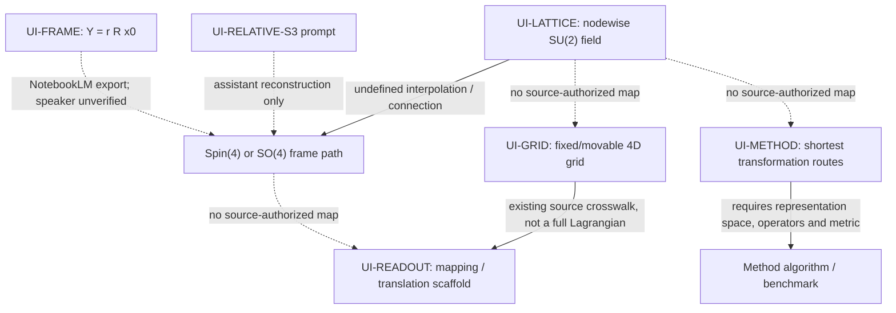

# Aldus h898:s0 | Universal Indicatrix version genealogy and geometry fidelity

**Run key:** `REVROT3-19-20261011:898:s0`  
**Classification:** assistant-level source-fidelity investigation; deterministic Aldus label, not authenticated historical Aldus participation.  
**Scope:** source genealogy, object typing, geometric relationships, assistant-translation discrepancies. No CODATA scoring.

## 1. Authority and source boundary

The historical Aldus check-in describes a broad cross-reading role: combine perspectives and source families that are not normally read together, while preserving their provenance. No standalone signed Aldus specialist charter was found. The check-in is a secondary reconstruction; its referenced raw conversation export is indexed but the GitHub file-content endpoint returned an empty body during this run.

This report follows the explicit Lane 00 geometry-fidelity instruction. It does not assign new work to Aldus as an authenticated agent, alter another specialist's remit, or claim a historical thread was revived.

## 2. Recovered source chronology

### A. March 5, 2026: user-supplied draft and LaTeX preparation

Raw conversation:
- Path: `DEVELOPMENT_FULL_CONVOS/SAT_CONVOS_16/26.03.04•26.09.12•LaTeX Formatting for Paper — raw.json`
- Conversation ID: `69a8fea1-0fa0-8328-a51e-daf69b7a14b9`
- Raw export blob SHA-1: `ede0286669b4b27bd0cd4f6d1a0f5cde9e6f2b3e`
- Initial user-supplied draft message: `8cc0cc59-ccc8-4043-ba00-070796a6cb33`, 2026-03-05T03:55:15Z.
- Procedure-formatting request: `1ac7681f-00c5-4298-b773-9e679b0eaa7a`, 2026-03-05T03:59:40Z.

The document title is "Procedure for Constructing and Using the Universal Indicatrix". Its author and date fields are blank. The raw message establishes that the document was supplied by the user for review/formatting; it does not authenticate the document's deeper authorship.

### B. March 6, 2026: evaluation and assistant demonstration

Raw conversation:
- Path: `DEVELOPMENT_FULL_CONVOS/SAT_CONVOS_16/26.03.05•26.09.12•Universal Indicatrix Framework — raw.json`
- Conversation ID: `69aa403c-5238-8331-b108-3362747fc4d7`
- Raw export blob SHA-1: `c7e6faeb3885da51dcc7fc172dd0346628ecd654`
- First user message: `87b60454-b6f1-438d-9b37-f5628f80be38`, 2026-03-06T02:47:34Z.
- User follow-ups: "Publishable?" and a request to do the necessary review work, followed by "Go ahead" at 2026-03-06T02:51:11Z.
- Assistant demonstration: `4f3b3f87-67e1-4e12-9944-2b79d41f2cd7`, 2026-03-06T02:51:19Z.

The user supplied the procedure for evaluation. The "Go ahead" authorizes review of that material; it does not validate the procedure or endorse later assistant-generated numerical claims.

A second repository copy exists at:
`DEVELOPMENT_FULL_CONVOS/7OCT26_A_GRADE_MINEABLES/26.03.05•26.09.12•[A] Universal Indicatrix Framework — raw.json`, blob `54d55785a657e72afcba01e2c3311408ce914115`.

Both copies have the same conversation ID and the same five user-message IDs and contents. They are two snapshots of one conversation, not independent source witnesses. The raw metadata records the conversation's creation at 2026-03-06T02:47:34Z even though the filename begins with 26.03.05.

### C. March 7, 2026: distinct fixed/movable 4D grid construction

The March 7 direct-source crosswalk is already documented in [issue #1244](https://github.com/Satobloc/HsH/issues/1244). It identifies user messages describing a fixed and movable four-dimensional hypersphere/grid, a marked point and a mapping/translator role. The source distinguishes the 4D hypersphere and 4DHH Lagrangians and does not establish a complete UI Lagrangian.

This is not the same object as a discrete SU(2) field assigned to lattice nodes in the March 6 procedure.

### D. Later method-paper branch

The September 12 raw export of "LaTeX Formatting for Paper" records a user attachment named `Pasted text(20260912-204655).txt`, 20,767 bytes, on message `a32efc50-5884-4fed-a9f1-25614c9761ab`. The raw JSON stores attachment metadata but not the attachment body.

A merged Library transcript preserves a later request to frame the Universal Indicatrix as a consensus-science method for finding short transformation/derivation routes, with elementary and complex examples. The accompanying check-in describes this as a methodology paper, not a new physical theory. The exact attachment bytes were not materialized here, so the method-paper wording is classified as **Library-transcript corroborated / raw attachment body unrecovered**, not as a verbatim raw-message quotation.

This methodological use of "Universal Indicatrix" must remain separate from the physical SU(2) lattice proposal.

### E. Later assistant and NotebookLM reconstructions

- `UNIVERSAL_INDICATRIX.txt`, blob `0b31a1664579f7bcec0e6201f7a98374f6905051`, is a prompt/analysis artifact describing coincident S3 hyperspheres, relative SO(4) rotation and scale. It is not a raw user message.
- The October 11 `EQUATIONATOR__NotebookLM_export.json`, blob `282704a31472176889d0e0043ae0170f48662a51`, is a 305,355-character NotebookLM export, version 0.2.2, with 51 visible sources and 284 scans. Its response-shaped content appears under `role=user`; that role field is not reliable speaker attribution.
- The later `Y = r R x0`, `R(lambda) in SO(4)`, `Omega = Rdot R^{-1}` and `L_UI` equations are therefore not promoted to Nathan Direct by their appearance in that export.
- The unbylined UI configuration and its sphere-geodesic sign issue are already covered by [issue #1244](https://github.com/Satobloc/HsH/issues/1244) and [issue #1231](https://github.com/Satobloc/HsH/issues/1231). They are not re-audited here.
- The September 30 "Minkowski Literalism" file is a podcast-style generated transcript, blob `38a3ec50c31127550e02c7b35ec5487fa04116a6`, not a raw chat. Its editorial note attributed to Nathan says not to disparage Minkowski, but the note has no raw message ID. The direct-source treatment in [issue #1407](https://github.com/Satobloc/HsH/issues/1407) keeps Minkowski as the comparison/reference layer.

## 3. Independently extracted geometry of the March 6 procedure

The user-supplied procedure proposes:

1. A base `S^3`, described there as a "4D unit hypersphere", with optional extension `S^3 x R`.
2. A cubic `3 x 3 x 3` lattice whose nodes receive coordinates said to lie within a hypersphere embedding.
3. A nodewise field `g(s_k) = exp(i theta^a(s_k) sigma^a)` with `theta^a in R^3` and Pauli matrices `sigma^a`.
4. Loops along lattice faces, edges or diagonals.
5. A proposed winding sum, derivative-squared mass proxy, scalar gravity projection, gauge projection, time update and resolution pivot.
6. A proposed unified interpretation in which the same loops and theta variations serve as particle excitations at fine resolution and spacetime geometry at coarse resolution.

These are proposals in a user-supplied document, not established H(s)H geometry or independent measurements.

## 4. Geometry and topology discrepancies

### D1. Intrinsic versus ambient dimension

`S^3` is a three-dimensional manifold embedded in `R^4`; it is not a four-dimensional manifold. If the intended substrate is `S^3 x R`, that product is four-dimensional. If the phrase "4D unit hypersphere" is taken literally as a four-dimensional sphere, its product with `R` would be five-dimensional. The source alternates these readings without a typed embedding or dimension declaration.

The later March 7 direct source distinguishes an `S^3` boundary from a `B^4` volume. That distinction should not be retroactively inserted into the March 6 document without an explicit correction record.

### D2. Lattice embedding is absent

The `3 x 3 x 3` node coordinates are not accompanied by:
- an embedding `iota: Lambda -> S^3`;
- a metric or edge-length rule;
- boundary conditions;
- an interpolation from lattice values to a continuous field;
- a continuum-limit definition.

A cubic node array is not automatically a discretization of `S^3`.

### D3. The proposed winding number is not a signed topological invariant

The source writes:

```text
w_lambda = (1 / 2pi) * sum_k ||theta(s_(k+1)) - theta(s_k)|| in Z
```

Every summand is nonnegative. The expression therefore cannot produce the stated negative values for antiparticles. It also does not force an integer: a norm sum divided by `2pi` is a nonnegative real unless a separate quantization theorem and admissible path space are supplied.

The assistant's March 6 demonstration reported `w = 2` for a three-point first-row path. That path was not shown to be closed, the output did not establish a group-valued holonomy, and the reported integer was not derived from the stated norm-sum. The associated mass and gravity numbers were arbitrary-unit proxies, not physical results. The assistant's statement that this was the kind of numerical illustration reviewers would want is unsupported.

### D4. A possible topology route is not the source's construction

Standard topology gives `SU(2) ~= S^3`, `pi_1(SU(2)) = 0`, and `pi_3(SU(2)) ~= Z`. A degree could be associated with a suitably defined continuous map `S^3 -> SU(2)`. The source instead describes a discrete node field and loopwise norm accumulation. It supplies neither the continuous map nor the degree integral. A degree-based repair is only a candidate direction, not a correction already present in the source.

### D5. Gauge curvature and dynamics are under-typed

The source gives `F_ij = [A_i, A_j]` but does not define `A_i`. For a general connection, the standard curvature also contains derivative terms; a commutator-only expression needs a special reduced or lattice construction that is not supplied.

The evolution equation writes commutators of `theta^a` components. Those are declared as real components, not as Lie-algebra matrices. A matrix lift or a defined vector-product operation is missing.

### D6. Proxies are not physical observables

The mass proxy and gravity projection are sums of derivative magnitudes. The source supplies no parameter units, metric, calibration, coupling, stress-energy map or observable operator connecting them to measured mass or spacetime curvature. They cannot be treated as physical quantities or predictions.

## 5. Relationship to later SO(4) kinematics

The later assistant/NotebookLM reconstruction uses a different object:

```text
Y(lambda) = r(lambda) R(lambda) x0
R(lambda) in SO(4)
Omega(lambda) = Rdot(lambda) R(lambda)^(-1)
```

This is a one-parameter point/frame trajectory. The March 6 object is a spatially indexed SU(2) field on a discrete lattice. No source-defined map connects them.

A possible representation-theory bridge is `Spin(4) ~= SU(2)_L x SU(2)_R -> SO(4)`. But the old procedure specifies one SU(2) field at lattice nodes, not a pair of Spin(4) factors, and it does not define an interpolation, connection, path-ordered transport or global frame path. A single SU(2) factor does not specify an arbitrary SO(4) rotation.

Required before any equivalence claim:
1. a typed lattice domain and embedding;
2. a continuous or discrete connection with transport law;
3. a source-authorized lift/representation into Spin(4) or SO(4);
4. boundary and gauge conditions;
5. a projection/readout map;
6. explicit composition conditions.

None is established. The arrows between these versions remain **UNDEFINED**, not equivalent.

## 6. Glossary

| Audit label | Object | Status |
|---|---|---|
| UI-LATTICE | March 6 nodewise SU(2) field and loop procedure | User-supplied document; deeper authorship unresolved |
| UI-METHOD | Shortest transformation/derivation route methodology | Later user-requested framing reported in Library transcript; formal metric/operator set missing |
| UI-GRID | March 7 fixed/movable 4D hypersphere/grid and marked-point mapping | Direct source; existing issue #1244 |
| UI-RELATIVE-S3 | September 30 coincident-S3 relative-rotation prompt | Assistant/prompt artifact |
| UI-FRAME | October 11 SO(4) scale-rotation reconstruction | NotebookLM/assistant source; not Nathan Direct |
| UI-READOUT | Current H(s)H readout/translation scaffold | Direct-source role recorded in issue #1407 |

These are local audit labels only. They are not canonical renames or claims that all objects belong to one mathematical construction.

## 7. Mapping diagram



## 8. Formalization and empirical disposition

- Existing PR #1064 and #1066 cover adjacent C3 and braid-permutation/holonomy statements, not the March 6 SU(2) lattice or a lattice-to-SO(4) map.
- Existing issue #1231 records the later sphere-geodesic sign correction; no new proof is claimed from it.
- No exact Lean module for the source's lattice embedding, winding formula or proposed degree map was found.
- Local `lean`, `lake` and `elan` executables are absent. No Lean build or proof run occurred.
- The candidate `S^3 -> SU(2)` degree construction is not formalized because the source does not define that map. Formalizing an invented map would not test source fidelity.
- No physical system, measured dataset, units, uncertainty budget or prediction/fit separation was supplied for this proposal. No physical calculation, fit, prediction, CODATA score or independent measurement was performed.

## 9. Existing work and non-duplication

This report is additive to, and does not repeat, the following existing records:
- [#1244](https://github.com/Satobloc/HsH/issues/1244): March 7 direct UI source and later assistant translation.
- [#1407](https://github.com/Satobloc/HsH/issues/1407): current UI readout/translation hierarchy and Minkowski reference status.
- [#1460](https://github.com/Satobloc/HsH/issues/1460): D4 indicatrix and H baseline.
- [#1583](https://github.com/Satobloc/HsH/issues/1583): UI/Hagalaz source-fidelity addendum.
- [#1231](https://github.com/Satobloc/HsH/issues/1231): sphere-geodesic sign/source distinction.

A search for a published March 6 SU(2)-lattice source-genealogy report found no matching issue. This report adds the earlier user-supplied lattice procedure and the separate method-paper branch to the existing version history.

## 10. Next source and formalization cursor

1. Recover the exact bytes of `Pasted text(20260912-204655).txt` from the September 12 attachment and reconcile them with the merged Library transcript.
2. Locate any primary-source statement that explicitly maps UI-LATTICE to UI-GRID or UI-FRAME; absent that, keep the versions separate.
3. If the source intends a degree invariant, recover a continuous domain/map, orientation, regularity and boundary conditions before writing a theorem.
4. If it intends SO(4) motion, identify both Spin(4) factors or a source-defined subgroup and the connection/transport law.
5. Only after the maps are explicit should a Lean target be written and actually compiled.
6. Keep the method-paper branch methodological and separate from the physical theory.

**Final disposition:** `H898_S0 / UI_VERSION_GENEALOGY / MARCH6_SOURCE_RECOVERED / SU2_LATTICE_NOT_EQUIVALENT_TO_SO4_FRAME / METHOD_PAPER_SEPARATE / SOURCE_MAPS_UNDEFINED / NO_LEAN_RUN / NO_PHYSICAL_CALCULATION / NO_CODATA / NO_THEORY_PROMOTION`.
