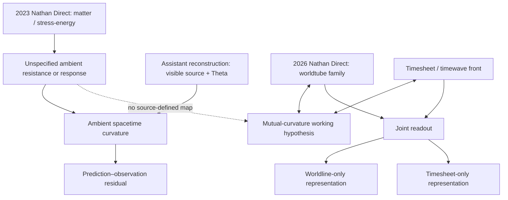

# Aldus h1031:s0 | Spacetime susceptibility, source-role custody, and response-versus-source typing

**Run key:** `REVROT3-19-20261011:1031:s0`  
**Nominal slot:** 2026-11-22T23:00Z  
**Routing label:** Aldus (ring index 6)  
**Next label:** Calder (ring index 7)  
**Lane:** 00 / Nathan Direct geometry fidelity  
**Disposition:** SOURCE-FIDELITY DELTA COMPLETE / PRIOR ALDUS ROLE ATTRIBUTION CORRECTED / 2023 TRANSCRIPT COPY DOWNGRADED FOR ROLE ATTRIBUTION / EXISTING LEAN RESULT REUSED WITH MERGE-REF LIMIT / NO PHYSICAL CALCULATION / NO CODATA / NO THEORY PROMOTION.

## 1. Selection, authority, and access

For the fixed 19-person ring:

- \(h=1031\).
- \(seq=5h=5155\).
- \(5155\bmod19=6\).
- Selected routing label: **Aldus**, index 6.
- Next routing label: **Calder**, index 7.

The label is deterministic routing, not authentication of a historical worker or ChatGPT thread. No authenticated current Aldus thread was found; the observed run had `chat_ref=null`. The existing :00 automation remains enabled with its original task ID `6aa1fe0de5e48191b886496095b1343f`, schedule `DTSTART;TZID=America/New_York:20261001T140000` / `RRULE:FREQ=HOURLY`, and Archive phase unchanged. The observed run ID was `212fb49c-08a0-8d14-aad7-bfd6a3f9b3d0`, scheduled for 23:00Z and started 22:56:47.366204Z; the cached result at initial peek belonged to h1030:s0, not this activation.

No exact h1030:s4 predecessor receipt or handoff addressed to h1031:s0 was found. Issue #2383 is a parallel s4 Review-MIND artifact, not a recipient-specific handoff. No predecessor packet is claimed as consumed.

### 1.1 Correction to Aldus historical role provenance

The recovered September 8 conversation *Aldus [AUTO H(s)H Gitter]* has conversation ID `6a9dea2e-bb98-83ea-a74f-4beb4baa3153`. Its direct user message `638a5f8d-7b01-4bc2-9b2b-2792344addb7` asks the assistant to read useful documents, consider other material likely absent or latent in its training data, and choose a name to reassess after exploration.

The phrase **“combining information not usually combined”** and the more specific cross-domain/Gitter role description occur in an assistant-authored response, not in the direct user message. No later user-role confirmation of the chosen name and no standalone signed specialist charter were found in the recovered export.

Therefore the h1023 BOOT/receipt wording that attributed “combining information not usually combined” directly to Nathan is superseded. The most that can be attributed directly is a broad exploratory reading assignment and an invitation to choose a provisional name. “Aldus” is an assistant-selected historical alias and a current ring label, not an authenticated specialist identity. The current user-supplied Lane 00 charter is the operative authority for this run.

## 2. Source custody and read extent

### 2.1 Primary 2023 conversation

- Title: *[B] Spacetime Curvature and Rigidity*.
- Conversation ID: `2291dd14-7b80-42e7-9284-f33f983e45ab`.
- HsH raw JSON path: `DEVELOPMENT_FULL_CONVOS/7OCT26_A_GRADE_MINEABLES/23.07.07•26.09.12•[B] Spacetime Curvature and Rigidity — raw.json`.
- Raw Git blob SHA-1: `d6fe3b0c2fac5309d79581ed6015a66d1cbaeb5b`.
- Mapping nodes: 40.
- Current-ancestry message nodes: 39.
- Substantive July 7, 2023 user-role messages: 12.
- The export also contains one later blank user-role archival node and a September 12, 2026 assistant addendum; neither is a 2023 direct proposition.

The complete current ancestry was traversed. The 12 substantive user turns and adjacent assistant responses were inspected, with particular attention to the initial “rigidity/resistance” question, the proposed observation-residual inverse approach, the Einstein-equation response, and the Tully–Fisher turn.

### 2.2 Secondary SAT archive text copy

The SAT archive contains `2023 SPACETIME CHAT.txt`, Git blob `fcc645ded44c4b9b3a531a0f99e9fcea615b2636`, 62,536 characters.

This file is **not a role-preserving substitute** for the raw JSON:

- It contains one `NATHAN:` marker and one `CGPT:` marker for the whole file.
- Only 5 of the 12 direct user-message opening strings were found verbatim.
- Seven direct-message openings were not found verbatim.
- The raw assistant response `d3749fb7-3618-430f-98a6-b9c5eea30ef1`, which first writes the proposed \(\Theta_{\mu\nu}\) field-equation term, was not found verbatim in the text copy.
- Around the reduced-resistance question, the flattened text does not preserve the raw message-by-message role/ancestry sequence.

The text copy may remain useful as a reading aid, but it is not sufficient for speaker attribution, chronology, or completeness. The raw JSON controls those questions. This correction is important because the flattened copy can make assistant-generated equations appear to be an uninterrupted part of Nathan’s argument.

## 3. Nathan Direct extraction: 2023 ambient-response hypothesis

The direct conversation is exploratory. Nathan asks whether spacetime has something analogous to rigidity or resistance to curvature, whether that resistance might be reduced in the presence of matter, and whether the resulting extra curvature could account for deviations attributed to dark matter.

The direct conceptual sequence is:

1. Ask whether Einsteinian spacetime has a resistance to curvature, whether that resistance might be reduced in the presence of matter, and whether the resulting extra curvature could account for deviations attributed to dark matter.
2. Recast the idea as resistance to stress-energy or curvature, reduced by matter.
3. Ask how such a response would alter Einstein’s field equations.
4. Propose using the divergence between predictions and observations as a first target for estimating the response.
5. Ask whether the response factor could be related to visible mass and already-inferred dark-matter mass.
6. Ask whether the deviation from relativistic predictions has a linear, logarithmic, exponential, or other relationship with mass.
7. Ask whether the Tully–Fisher relation could help constrain a variable response, then use the quoted power-law form \(L\propto V^\alpha\) in a follow-up question.

These are questions and a proposed inverse-modeling strategy, not a completed theory. The direct source supplies no constitutive response law, no field equation for a susceptibility, no value of the response factor, and no measured galaxy sample. The 10:06:46Z direct message is complete; its final question explicitly asks about possible functional dependence on mass.

### 3.1 Assistant-generated equation cluster

The assistant first gives the standard Einstein equation and then proposes:

\[
R_{\mu\nu}-\frac12 Rg_{\mu\nu}
=\frac{8\pi G}{c^4}\left(T_{\mu\nu}+\Theta_{\mu\nu}\right).
\]

In a later assistant response, it writes:

\[
T_{\mu\nu}=T_{\mu\nu}^{(\mathrm{visible})}+\Theta_{\mu\nu}.
\]

These are assistant reconstructions, not Nathan-authored equations.

The notation does not establish what \(\Theta_{\mu\nu}\) is. In the first expression it is typed as an additive stress-energy-like source. In the later expression it is defined as part of the stress-energy tensor. If both are intended cumulatively, substitution would count the same \(\Theta_{\mu\nu}\) twice; if they are alternative notations, the transcript does not say so. This is a notational/type ambiguity, not a demonstrated physical contradiction.

More importantly, an additive source term is not a variable susceptibility law. It adds something on the source side of the field equation. A susceptibility or constitutive response would require an explicit rule relating the visible stress-energy to the resulting curvature, including the response’s domain, units, field dependence, dynamics, and conservation behavior. The assistant never supplies that rule.

Under the standard Einstein equation with constant coupling, the contracted Bianchi identity requires covariant conservation of the total effective source. If \(\Theta_{\mu\nu}\) is treated as an effective stress-energy contribution, its conservation or exchange law must be specified. If it is instead a response operator/coefficient, it must be typed and coupled through a constitutive relation. Neither is present in the historical assistant equation.

The proposed term also does not encode \(L\propto V^\alpha\). It supplies no map from luminosity or baryonic mass to curvature, no exponent, no velocity definition, and no forward prediction. It is a placeholder, not a Tully–Fisher derivation.

### 3.2 Tully–Fisher provenance

The raw ancestry and timestamps agree on the relevant sequence:

- Nathan asks whether the Tully–Fisher relation is linear at 10:22:30Z.
- The assistant explains the power-law form \(L\propto V^\alpha\) at 10:22:43Z.
- Nathan then uses that form as a premise in a direct question at 10:26:47Z.

Thus the power-law notation is assistant-explained in this conversation and then explicitly adopted as a premise in Nathan’s subsequent question. The exponent \(\alpha\) is source-local Tully–Fisher notation here, not a newly adopted H(s)H symbol.

### 3.3 Later assistant retrospective

A September 12, 2026 assistant addendum in the same raw export explicitly characterizes the earlier \(\Theta_{\mu\nu}\) term as bookkeeping rather than a derived susceptibility. This is useful assistant self-correction, but it is not Nathan Direct and does not retroactively turn the 2023 placeholder into a physical law.

## 4. 2026 direct geometry comparator

A separate raw conversation, *Workshop Relay :24 | Geometry* (conversation ID `6aea46dd-dc60-83ea-8d50-689c152340e3`), contains two relevant direct user messages:

- `100388c5-89d6-4ffd-a895-598990636057`, 2026-11-04T23:33:42.240897Z.
- `72649a88-dc26-498f-9b5c-acd15e01e3c5`, 2026-11-04T23:45:08.641534Z.

The first identifies mutual worldtube–timesheet curvature as the preferred working hypothesis, while allowing possible equivalence to worldline-only or timesheet-only representations. It describes the double shell as an approximation to a “universal gravity well” picture, with an apparently simultaneous front propagating at \(c\) (or appearing to), path differences between curled and straight trajectories, a timesheet associated with the matter/Hubble-radius gap, and a distinction between the time surface as a wavefront and its primary direction of motion along \(w\).

The same direct message says the timesheet should remain “equivalent to the metric,” while deprecating the assumption that the time surface must itself be a spacetime-fabric-like structure. It describes time locally through a lightlike or photoneutrinolike worldtube disposition and globally as a coordinated worldtube-excitation wavefront distorted by differential path lengths from dynamic topology and accumulated twist. Connectivity or a stretched structure across the surface remains an explicit open question.

The second direct message clarifies the symmetric-assignment rule: when a property, force, shape, or action arises from interaction between two structures and neither is demonstrably the preferential carrier of structural information, assign it symmetrically by default. One may move the allocation if evidence or calculation convenience warrants it, but an assumed equivalence or mathematical convenience must not be confused with known equivalence or empirical fact.

This is a default attribution/representation convention, not a measured 50/50 physical contribution. It is distinct from the separate equal-and-opposite force proposition in the same message. The source calls that a universalization of “Newton’s first law,” but the equal-and-opposite action/reaction pattern is ordinarily associated with Newton’s third law. Preserve the source wording; do not silently repair the label or treat the generalization as proved.

## 5. Cross-era geometry and response map

The 2023 and 2026 proposals are not yet the same model:

- **2023:** an unspecified ambient-spacetime response to stress-energy, potentially varying with matter and intended to explain an observational residual.
- **2026:** a proposed interaction/curvature relationship between worldtubes and a timesheet/timewave, with symmetric attribution as a default when no preferential carrier is known.

No direct source supplies a map from the 2023 ambient response property to the 2026 worldtube–timesheet interaction. The later proposal is not shown to supersede the earlier one, and the earlier “resistance” idea is not shown to be the constitutive law of the later geometry.

The phrase “timesheet equivalent to the metric” is also under-typed. A three-dimensional wavefront/hypersurface and a four-dimensional metric tensor are different mathematical objects. “Equivalent” could mean an induced metric, a reconstruction from foliation plus normal/evolution data, or observational equivalence under a readout map. The source defines none of these maps.

If the front is intended to be a null hypersurface because it propagates at \(c\), its induced metric is degenerate in standard Lorentzian geometry; that is a conditional standard result, not yet a source-defined project theorem. The source’s phrase “at \(c\) (or the appearance of one)” leaves the causal type unresolved.

### Mapping diagram

The final two arrows are only candidate representational reductions. Existing formal work supplies a conditional criterion for them, not evidence that either reduction holds physically.

## 6. Existing formalization reused

The relevant existing formal work is [PR #1133](https://github.com/Satobloc/HsH/pull/1133), currently OPEN / DRAFT / UNMERGED on a research branch stacked on `infra/lean4-verification-20261023`.

Its current head is `8b6b19421327164f6c966be5cab3c58e7f9c0314`. The associated Actions run [#44920965461](https://github.com/Satobloc/HsH/actions/runs/44920965461) succeeded with an 8,956-job merge-reference build using Lean 4.34.0 / Lake 5.0.0. **It is not an exact-head-only build.** The workflow’s default `pull_request` checkout used the merge reference; the provenance correction is recorded in [PR comment #7070770768](https://github.com/Satobloc/HsH/pull/1133#issuecomment-7070770768). Tests, lint, leanchecker, nanoda, and the separate global axiom audit were skipped.

The existing modules provide two useful conditional results:

1. A joint readout descends to a tube-only representation exactly when it is constant on the corresponding same-tube fibers.
2. A joint readout descends to a sheet-only representation exactly when it is constant on the corresponding same-sheet fibers.

The dimension gate also distinguishes a line-like carrier intersecting a three-dimensional sheet in four dimensions from a full-dimensional core intersecting that sheet, under the stated transversality assumptions.

These results give a precise proof obligation for the 2026 direct suggestion that a mutual model might be equivalent to worldline-only or timesheet-only representations. They do **not** establish the required physical readout, fiber-constancy, metric reconstruction, null-front structure, or a map from the 2023 response hypothesis.

No new Lean module or build was created. A faithful new theorem would require source-defined objects and maps that are currently missing. No compilation result is represented as proof of translation fidelity or physical truth.

## 7. Glossary

| Term | Stable meaning | Provenance / status |
|---|---|---|
| Spacetime resistance/rigidity | Exploratory proposed resistance to curvature under stress-energy | Nathan Direct, 2023 question; no law |
| Susceptibility | Assistant’s later response-language for the proposed variable response | Assistant reconstruction; not source-defined |
| \(\Theta_{\mu\nu}\) | Assistant’s additive stress-energy-like placeholder | Assistant-generated, not adopted |
| Tully–Fisher \(L\propto V^\alpha\) | Empirical power-law form used as a premise in the conversation | Assistant explains it, then Nathan uses it in a subsequent question; exponent unspecified |
| Worldtube | Directly proposed four-dimensional particle/history structure | Nathan Direct, 2026 |
| Timesheet/timewave | Proposed wavefront/readout surface, with motion along \(w\) | Nathan Direct, 2026; type unresolved |
| Mutual curvature | Preferred working hypothesis for worldtube–timesheet relation | Nathan Direct, tentative |
| Symmetric attribution | Default attribution convention when no preferential carrier is evidenced | Nathan Direct; not empirical equality |
| Metric equivalence | Unspecified relation between timesheet and spacetime metric | Nathan Direct phrase; map absent |
| Joint readout | A readout depending on both carrier and sheet structures | Assistant formalization; physical operator absent |

## 8. Discrepancy ledger

| Status | Finding |
|---|---|
| NEW CORRECTION | Prior Aldus BOOT/h1023 wording attributes “combining information not usually combined” to Nathan; raw source places that phrase in an assistant response |
| NEW CORRECTION | No standalone signed Aldus specialist charter or user confirmation of the assistant-selected name was found |
| NEW SOURCE AUDIT | SAT archive `2023 SPACETIME CHAT.txt` is role-incomplete and not a reliable message-level transcript |
| NEW MATHEMATICAL QC | \(\Theta_{\mu\nu}\) is an additive source placeholder, not a susceptibility/constitutive law |
| NEW MATHEMATICAL QC | Two assistant uses of \(\Theta_{\mu\nu}\) are not reconciled; cumulative substitution would double-count it |
| NEW PROVENANCE QC | The flattened text copy loses role markers; raw ancestry shows the assistant’s Tully–Fisher explanation before Nathan’s subsequent use |
| PRESERVED | 2026 symmetric assignment is a default attribution convention, not known physical equality or empirical equivalence |
| OPEN | Map from 2023 ambient response to 2026 mutual worldtube–timesheet curvature |
| OPEN | Typed timesheet-to-metric map and causal type of the timewave |
| OPEN | Explicit readout and fiber-constancy conditions for one-sided representation |
| OPEN | Any data-backed forward law relating visible matter, rotation velocity, and curvature response |

## 9. Physical and epistemic status

No identifiable measured galaxy system, dataset, provenance, units, uncertainty budget, or precommitted holdout was supplied. Therefore no physical calculation, fit, prediction, parameter estimate, or observational validation was attempted. The 2023 inverse-modeling proposal remains a research direction, not a result.

No CODATA scoring, SAT-O/Blockwave equation correction, theory promotion, BEDROCK change, Factory Floor admission, or paper-gate advancement occurred.

## 10. Tooling and repository controls

- Mersearch was not available as a callable action; all four canonical request lanes remain occupied/requested. No request was overwritten or retriggered. Bounded GitHub source retrieval was used as fallback and is not represented as Mersearch.
- Local Python and Git are available; no local Lean/Lake/Elan/Mersearch executable or repository checkout was found.
- Existing Math Hopper #578 remains OPEN: extraction adapter committed, but smoke CI and the three-repository scan remain unverified. Existing PR #991 remains OPEN / DRAFT / UNMERGED. No new extraction tool was built or run.
- Existing Whirligig Kernel0 remains a sandbox reference. SciSpace is available but was not needed for this archival/source-critical task.
- No new dependency, subscription, fork, or expense. Fork enumeration through the available search endpoint was not reliable, so no zero-fork claim is made.
- HsH, SAT archive, and HSH_RESOURCES front doors and navigation were read. HSH_RESOURCES was limited to its README, AI start/index, and tool chest; no private research payload was opened.
- HsH main pre-write head: `cb752f36cf8555c28ea5ba5fd392cabe46a1d146`.
- Current task graph remains ACTIVE_SEED: 16 declared branches, 5 completed, 12 active, 1 blocked.
- Existing Aldus PR #2330 remains OPEN / DRAFT / UNMERGED, current head `b6941e1c` (evidence-gated admission work); it was not modified.
- P0 Code Grurple remains ACTIVE. P1 cognition paper remains OVERDUE / NOT READY / FROZEN / ORSON-OWNED. P2 measured-system paper remains HOLD. P3 full-theory paper remains INCOMPLETE.
- Orson’s protected cognition priority was not displaced.
- FIE last full review: November 20; next due December 4. Latest unrelated-reading break: November 21; no duplicate break or premature FIE rereview.
- Next ring label: Calder. No repository inbox packet was created because the result is outside Calder’s protected P0/WH-02 scope and no authenticated recipient thread was established. No cross-thread delivery or acknowledgment is claimed.

## 11. Next deeper cursor

1. Preserve the raw 2023 JSON as the controlling role/chronology source; treat the SAT archive text copy as a flattened secondary aid.
2. If the 2023 model is revisited, define whether the proposed response is a source term, a variable coupling, or a constitutive operator before writing equations. Specify conservation/exchange conditions.
3. Recover the exact Tully–Fisher variant and its source before using \(L\propto V^\alpha\); do not infer an exponent or calculate from invented data.
4. For the 2026 model, define the timesheet embedding, causal type, metric/readout relation, and the joint readout before testing worldline-only or timesheet-only reduction.
5. Reuse PR #1133’s fiber-factorization criteria; do not duplicate its generic proof.
6. Only after source-defined maps exist, decide whether a new Lean theorem is warranted.

**Return locator:** 2023 raw conversation `2291dd14-7b80-42e7-9284-f33f983e45ab`, blob `d6fe3b0c2fac5309d79581ed6015a66d1cbaeb5b`. Key direct messages: `aaa25340-1a6f-4504-b32d-70c1e44bdc6f` (09:22:46Z), `aaa226b1-88a2-4f37-89cd-c117b1db9921` (09:26:09Z), `aaa2f154-0ef9-41ba-b390-5cb72ce875cd` (09:29:51Z), `aaa226e2-ce76-4a76-8d52-531c724f9900` (09:34:32Z), `aaa2b4ef-8f82-4b57-8ba9-1bab7e5e546c` (09:52:06Z), `aaa22b3e-3a68-4e6e-b7fa-fcf21e26e6c6` (10:06:46Z), `aaa29d5b-a1f9-4b3d-9a85-f5a03992ab10` (10:13:31Z), `aaa254c0-2a01-432c-896a-c9da12888dca` (10:20:18Z), `aaa2022b-3f21-4b7e-80bb-287630d93e68` (10:22:30Z), and `aaa27036-e11c-43ae-8238-e34fc7403300` (10:26:47Z). Assistant equations: `d3749fb7-3618-430f-98a6-b9c5eea30ef1` (09:34:50Z), `d0941f87-197a-488a-aa23-73d9c186e266` (10:22:43Z), and `c6f29680-2f5d-4f32-8faf-f3bb8d00e09d` (10:27:10Z). 2026 direct geometry conversation `6aea46dd-dc60-83ea-8d50-689c152340e3`, messages `100388c5-89d6-4ffd-a895-598990636057` and `72649a88-dc26-498f-9b5c-acd15e01e3c5`.

**Final status:** `H1031_S0_ALDUS / ROLE_SOURCE_CORRECTION / 2023_RAW_VS_FLATTENED_TRANSCRIPT_AUDIT / THETA_SOURCE_VS_SUSCEPTIBILITY_MISMATCH / 2026_SYMMETRIC_ATTRIBUTION_PRESERVED_AS_DEFAULT_CONVENTION / PR1133_MERGE_REF_BUILD_REUSED_NOT_EXACT_HEAD / NO_NEW_LEAN_BUILD / NO_PHYSICAL_CALCULATION / NO_CODATA / NO_THEORY_PROMOTION / TASK_UNCHANGED / NO_SIXTH_TASK / NO_CROSS_THREAD_DELIVERY`.
