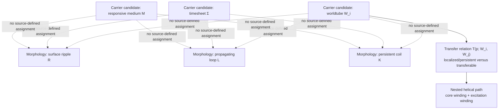

# Ariadne h810:s0 Lane 00 Addendum 02: unbound transferability, nested-helix typing, and the incidence dimension gate

**Parent:** [Ariadne h810:s0 source-snapshot and symmetry-proof report](https://github.com/Satobloc/HsH/issues/1696)  
**Geometry base:** [#1420, observation / geometry / mathematics fidelity gate](https://github.com/Satobloc/HsH/issues/1420)  
**Related source locator:** [#1449, November 4 worldtube/timesheet source locator](https://github.com/Satobloc/HsH/issues/1449)  
**Status:** additive source-fidelity correction; no theory or paper-gate promotion.

This addendum records a source distinction and a mathematical constraint not stated explicitly in the parent report. It does not replace the glossary, mapping diagram, or full discrepancy ledger in #1420 and #1696.

## 1. Source boundary and branch-sensitive correction

The later raw Library snapshot of `Workshop Relay :24 | Geometry` contains 1,341 mapping nodes, 1,338 nodes on the current ancestry, and 21 active user-role messages. The relevant raw role field is `user`; `author.name` is null. This is primary user-side conversation evidence, but not independent author-name authentication. The private raw export and its digest are not redistributed here.

A 01:54 sibling-branch message gives a compressed boson/fermion shorthand: an “unbound” ripple that can jump tubes versus a persistent coil. That sibling is not on the selected current ancestry. The active 02:07 user-role message then makes a material clarification: no excitation is independent of filamentary structure. An excitation is a distortion of a filament, with the worldtube/filament acting as carrier; the open question is whether the perturbation is transferable or “unbound” from an individual worldtube.

**Source-faithful correction:** “unbound” is relational to a particular worldtube. It does not mean independent of filamentary structure. The active source narrows the distinction to transferability across worldtubes versus persistence/localization, while leaving the precise transfer operation undefined.

The assistant response that follows translates this into “boson = transferable perturbation” and “fermion = persistent deformation bound to one worldtube.” That is a useful candidate operationalization, not a source-supplied equation or complete classification. The direct discussion still asks which of the three candidate morphologies belongs to which bosonic or fermionic case.

## 2. Stable glossary for this local cluster

| Term | Working meaning | Source status / unresolved point |
|---|---|---|
| Filament | The structural object whose geometry is perturbed | Direct descriptive term; exact ambient type varies across historical formulations |
| Worldtube `W_i` | The history/support associated with an individual filament | Direct descriptive term; embedding and finite-core thickening map are not supplied here |
| Timesheet `Σ` | Proposed 3D time surface or wavefront | Direct descriptive term; relation to metric and to the responsive medium remains open |
| Responsive medium `M` | A candidate carrier/response structure | Direct proposal; may be distinct from or equivalent to the timesheet |
| Perturbation `p` | A distortion of filament/worldtube structure | Direct clarification; not an independent object |
| Transferability `T(p; W_i, W_j)` | Candidate relation saying a perturbation can be carried from one worldtube to another | Reconstruction of “unbound”; no transport map or preserved quantity is defined |
| Surface ripple `R` | Perturbation expressed on a tube/shell surface | Candidate morphology, not a settled boson definition |
| Propagating structural loop `L` | A loop/twist that travels along the tube | Candidate morphology; propagation law and support are unspecified |
| Persistent coil `K` | A persistent helical deformation extended along a tube | Candidate morphology; persistence criterion and particle mapping are unspecified |
| Nested helix | A helical core/centerline together with a helical excitation around a selected cross-section | Direct geometric description; composition map is absent |

The three carrier candidates `(W, Σ, M)` and three morphology candidates `(R, L, K)` are different classification axes. Their 3×3 product is a search space for possible constructions, not nine established modes. Transferability/persistence is a further relation, not a fourth carrier and not proof of a one-to-one boson/fermion assignment.

## 3. Mapping diagram

The arrows are a reading aid, not established physical maps. In particular, the source does not decide whether the responsive medium is a substitute for, an addition to, or an equivalent representation of the timesheet.

## 4. Nested-helix construction: source versus assistant formula

The active user-side description distinguishes at least two windings:

1. the core/worldtube itself may follow a helical path;
2. an excitation may travel around an extended circumference of the worldtube, tracing another helical path;
3. combining the two may produce a second-order or nested helix.

The historical assistant formula

\[
X(s)=C(s)+r(s,\phi(s))
\]

is schematic. Addition is meaningful only after the ambient affine/vector structure and the type of `r` are specified. In a curved manifold, a point and a displacement vector cannot simply be added. The formula also omits the normal frame, selected cross-section, parameter domains, and composition map.

A more explicit **candidate reconstruction**, not a Nathan equation, is:

\[
\gamma:I\to M^4,\qquad N\gamma\to I,
\]

where `γ` is the base/core curve and `Nγ` is its normal quotient bundle. For a regular embedded 1D curve in a 4D manifold, the normal quotient has rank 3. To define a circular helical excitation, one must select an oriented rank-2 subbundle `E ⊂ Nγ` and a local frame `(e_1,e_2)`. Given a radius `ρ(s)` and phase `φ(s)`, define

\[
V(s)=\rho(s)\big(\cos\phi(s)e_1(s)+\sin\phi(s)e_2(s)\big),
\qquad
X(s)=\exp_{\gamma(s)}V(s).
\]

This makes the excitation a lifted curve in a selected normal 2-plane. It requires an ambient metric/connection, a nondegenerate normal construction, a chosen 2-plane and frame, a radius field, and a phase field. The source supplies none of those maps or fields. In a Lorentzian setting, a null tangent requires separate treatment: the metric-orthogonal complement is degenerate, even though the normal quotient still has rank 3. A canonical single `U(1)` phase does not follow from a rank-3 normal bundle.

The existing Ravel formalization already records the conditional positive-normal-rank result and the need for a selected lower-dimensional normal structure. This addendum reuses that work rather than creating a duplicate theorem.

## 5. Incidence and coupling: a dimension constraint

The direct description allows coupling through coincidence at a point **or through a separately defined relationship**. The assistant's generic template `Φ(A,B)=0` is not a source equation and does not define the relationship.

For transverse embedded submanifolds in a 4D ambient manifold, the expected intersection dimension is

\[
\dim(A\cap B)=\dim A+\dim B-4.
\]

| Supports | Expected dimension | Generic transverse result |
|---|---:|---|
| 1D filament × 3D timesheet | 0 | Isolated point(s) |
| 1D filament × 2D worldsheet | -1 | Empty generically |
| 1D filament × 1D filament | -2 | Empty generically |
| 3D boundary × 3D timesheet | 2 | 2D intersection |
| 4D worldtube support × 3D timesheet | 3 | 3D slice/support intersection |

This sharpens the source-fidelity ledger: a point-like coupling between two bare 1D filaments in 4D is not the generic transverse intersection. It would require a special non-transverse incidence, a larger support, or a separately defined interaction relation. Do not silently substitute “intersection” for “coupling.”

The generic dimension helper in existing PR #1133 returns `Nat`; natural subtraction truncates the negative values `1 + 1 - 4` and `1 + 2 - 4` to zero. That can conflate generic emptiness with a genuine zero-dimensional intersection. The fixed carrier profile theorem with its explicit range guard remains usable, but the generic helper needs a signed result or an explicit `Empty / Dimension d` result before being used outside that guarded profile.

## 6. Original versus translated propositions

| User-side source proposition | Historical assistant translation | Fidelity assessment |
|---|---|---|
| No excitation is independent of filamentary structure; “unbound” concerns transferability from an individual worldtube | Bosonic excitation can move across worldtubes; fermionic excitation is persistently bound to one | Plausible reconstruction, but the transfer map and exact boson/fermion assignment are not defined |
| Three carriers and three excitation morphologies are considered | Assistant labels f-/t-/m-bosons and builds a mode table | Labels are assistant organization; no 1:1 carrier/morphology map is source-defined |
| Core winding plus excitation winding can make a second-order helix | `X(s)=C(s)+r(s,φ(s))` | Schematic only; not a typed embedding on an unspecified curved 4D manifold |
| Coupling may be coincidence or another defined relation | `Φ(A,B)=0` | Generic template, not a source equation; dimension count shows bare 1D/1D coincidence is non-generic in 4D |
| 3D Kerr ring/shell and 4D straight vacuum worldtube are described as corresponding | Assistant calls the Kerr structure a candidate geometric realization | Cross-dimensional correspondence still needs explicit embedding/projection maps; not an established identity |
| Observation → geometric representation → mathematical abstraction | Assistant's named “Reality-Approximation Principle” | The three-stage distinction is direct; the label and convergence claims are assistant reconstruction, not ontology |

## 7. Formal verification reused, not duplicated

Existing [PR #1133](https://github.com/Satobloc/HsH/pull/1133) contains the conditional carrier/slice dimension and positive-normal-rank formalization. Its successful Actions run was #41292451762, job #124806308038. The run checked a merge reference combining PR head `10099fa9b9a8175269405bd77e71e0803143f645` with base `61cc8b65ffed70296e0121dbae067892a79c81d4`.

- Lean 4.34.0 / Lake 5.0.0.
- 8,946 build targets completed.
- `#eval` returned `[(3, 0), (2, 1), (1, 2), (0, 3)]`.
- Theorem-specific axioms: `[propext, Quot.sound]` for the generic carrier/slice dimension theorem; `[propext]` for positive normal rank; no axioms for the concrete dimension results and induced-map witness.
- The retrieved build log reports zero `sorryAx` and zero `admit`.
- Tests, lint, nanoda, and the separate automated axiom-audit action were skipped.
- Classification: `MERGE_REF_BUILD_SUCCESS / EXACT_HEAD_NOT_STANDALONE_VERIFIED / PR_OPEN_DRAFT_UNMERGED`.

This is actual compilation of the formalized conditional mathematics. It does not establish that a physical worldtube exists, that a chosen timesheet is transverse, that a transfer relation exists, or that any carrier/morphology is a boson or fermion. No new Lean module is justified until the source defines the transfer map, its state space, preserved quantity, ambient metric/connection, and normal-plane selection.

## 8. SAT-O1 and Blockwave originals preserved

No original equation file was changed and no corrected equation is issued here.

- **SAT-O1:** `SATOBLOC/SAT O1 4D.txt`, Git blob `7577aa1ee5a6c3850ce3b226c75377de6367aedc`. Archive file-index metadata dates the source June 7–9, 2025; first extant SAT-archive path commit is October 27, 2025. This is an unbylined historical document, not a raw user-role message.
- **Blockwave:** user-supplied attachment dated 2025-09-16T16:31:34.670Z; Git blob `ffdb8aadb6ac93e3c9d5f48aad8153dcedaf997d`; attachment SHA-256 `3d393efcedf9dc715cd49a319605fc5adc2011c5b5984abd9a2d280765953664`; first extant HsH path commit 2026-10-08T02:42:49Z. Embedded content authorship remains unresolved. The October 19 unified action is a separate assistant-authored reconstruction.

The 1D SAT-O1 curve, its proposed 4D swept support, the Blockwave rank-2 current, and the finite-core worldtube remain separate objects. Keep the existing verbatim ledgers #1073 and #1281 authoritative for equation custody.

## 9. Next deeper cursor and controls

1. Recover the raw role-tagged original behind the earliest Bosonic Time / temporon wording. Existing Hale and Sable crosswalks already cover the accessible flattened text; do not repeat that search as though it were a new witness. The 2026-11-05 user-side recollection of an early-summer-2025 conception is retrospective, not an independently dated 2025 source.
2. Define the typed support and transport maps for `W_i`, `Σ`, `M`, perturbation `p`, and `T(p;W_i,W_j)` before assigning boson/fermion labels.
3. Specify the ambient metric/signature and normal-plane selection before formalizing the nested helix. Reuse PR #1133 and #873; do not create a duplicate dimension theorem.
4. Keep the `3D Kerr ring/shell ↔ 4D straight vacuum worldtube` statement as a proposed correspondence until its embedding and projection maps are supplied.
5. No physical calculation until an identifiable measured system or dataset, provenance, units, uncertainties, and prediction-versus-fit separation are specified.

No CODATA scoring, physical calculation, fit, prediction, independent measurement, BEDROCK promotion, or paper-gate advancement is made. P0 remains active; P1 remains overdue/not ready and Orson-owned; P2 remains HOLD; P3 remains incomplete. FIE's next review remains November 24; the last full review was November 10.

Unrelated reading completed: Charles Babbage, *Reflections on the Decline of Science in England*, Project Gutenberg lines 1121–1243; next cursor 1244. The reading is a separate source and does not inform the geometry claims.

**Disposition:** source-fidelity addendum only. No new task, branch, schedule, signet, chat rename, or ownership transfer.
