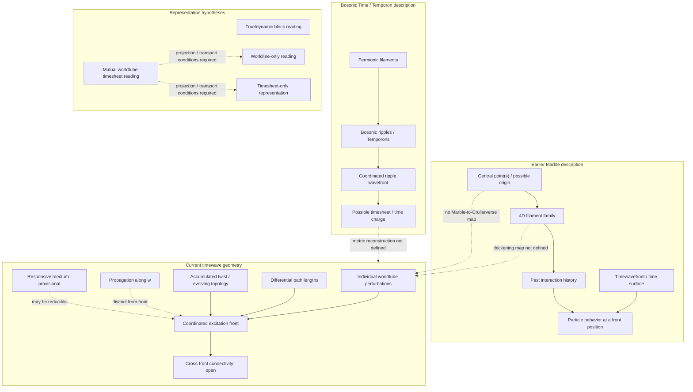

# H1054:s0 Calder | Marble, Bosonic Time, and the timewave

**Disposition:** ADJACENT SOURCE CLUSTER RECOVERED / GEOMETRY FIDELITY AUDITED / CONDITIONAL REPRESENTATION THEOREM REUSED / NO PHYSICAL CALCULATION / NO THEORY PROMOTION.

**Run key:** `REVROT3-19-20261011:1054:s0`  
**Routing:** h=1054; seq=5270; 5270 mod 19 = 7; selected label Calder; next ring label Hale.  
**Scope:** Lane 00 geometry-fidelity overlay. Calder's empirical/statistical/null-design specialty remains intact.

## 1. Authority and source gates

The live BEDROCK, Steering Charter 2026-10-26, Three Paper Campaign, three-repository onboarding, Revival Rotation V3/V4, thread-first rule, duplicate-run-key guard, current branch, task graph, recent receipts, Calder BOOT/CURRENT_WORK/INBOX, and the available Calder historical role record were consulted.

No standalone signed Calder specialist charter was found. The strongest historical role witness is the September 12 self-report in `WORKSPACES/COMMON/CHECKINS.md`, supported by Calder BOOT and CURRENT_WORK. It identifies an empirical/statistical/null-design specialty. Calder's separate Foundational Covariance / Global Architecture lineage remains distinct. This is a one-run Lane 00 overlay, not a role reassignment.

The current HsH branch was `main`; preflight head was `4d7652f9d1a090964d6946f0f1e8751eb331e5b2`. The live task graph has 18 records against declared `branch_count=16` (12 active, 1 blocked, 5 completed). No graph repair or branch mutation was attempted.

The previous Lane 00 Calder report was h1035:s0, covering the Pauli-Kerr surface/core/boundary source delta. This run deliberately changed lens and expanded to the adjacent Marble / Bosonic Time / Temporon / timewave cluster rather than repeating that work. The h1035 report and receipt remain the prior checkpoint; publisher issue #2401 was rejected for SHA mismatch and was not retried.

### Mersearch and access boundary

Mersearch was not run. No callable Mersearch connector or local pinned checkout was available, and all four canonical request lanes were still marked `requested`. No lane was overwritten, retriggered, or released. GitHub search and direct file reads were used only as a bounded fallback, not represented as Mersearch and not claimed exhaustive.

The SAT archive root README, ARCHIVE_ACCESS guide, dashboard and index were used for navigation. HSH_RESOURCES root README and AI_START_HERE were read, but no private reference payload was opened. The HsH, SAT archive, and HSH_RESOURCES onboarding boundaries were preserved.

## 2. Primary-source geometry recovered

### A. Earlier Marble Universe description

The mixed transcript [More SAT Speculation.txt](https://github.com/Satobloc/SAT_THEORY_ARCHIVE_2023-25/blob/main/More%20SAT%20Speculation.txt#L620-L638), blob `67ff75cb9a462c47d3dbd11bb3a12569be9bed3e`, contains explicit `You said:` / `ChatGPT said:` markers. The user-authored passage at lines 627-629 describes a Marble Universe in which filaments extend from one or more central points, possibly corresponding approximately to the Big Bang or another origin in four-dimensional spacetime. It also says past filament interactions contribute to particle behavior at a position on a time wavefront.

This is direct user-authored material in a mixed transcript. The surrounding text frames the discussion as a June 2025 state-of-the-theory discussion, but the specific message has no raw UUID or message timestamp in the surviving file. "Marble" does not define a manifold topology, boundary, metric, or dynamical law.

The direct proposition is history-sensitive behavior at a wavefront. It does not by itself establish that every filament shares one origin, that all filaments are mutually entangled, or that every past interaction is retained in a universal information store.

### B. Bosonic Time / Temporon description

The mixed text [BOSONIC TIME AND TWO GRAVITIES.txt](https://github.com/Satobloc/SAT_THEORY_ARCHIVE_2023-25/blob/main/SATOBLOCK_lumped/BOSONIC%20TIME%20AND%20TWO%20GRAVITIES.txt), blob `bbc868efd38c38ba4710f82da1246f60d053aaa2`, contains a user-attributed passage around line 1145 describing time as a boson and Temporons as forward/outward ripples along fermionic filaments, collectively forming a coherent wavefront across a four-dimensional matter matrix. Later user-attributed passages around lines 1191-1200 distinguish ripple-like activity from gravitational "tugs" and correct the assistant's earlier conflation.

Provenance limit: this is a mixed conversation text without a surviving raw role graph or message UUIDs. The current source index attributes these passages to Nathan Direct, but that attribution is weaker than the explicit role markers in More SAT Speculation.txt. The file's index date is 2025-10-26; it does not establish the first conception date.

### C. Current timewave and mutual-curvature description

The 4 November transcript [UNIVERSAL FIRST LAW.txt](https://github.com/Satobloc/HsH/blob/main/DEVELOPMENT_FULL_CONVOS/SAT_CONVOS_13/UNIVERSAL%20FIRST%20LAW.txt), blob `cc72f512ca0f7f4b978f9403c5de3825cfd3969a`, contains the current user-attributed timewave discussion around lines 463-465. The surrounding source index is [NATHAN_DIRECT_2026-11-04](https://github.com/Satobloc/HsH/blob/main/WORKSPACES/COMMON/NATHAN_DIRECT_2026-11-04_SYMMETRIC_ATTRIBUTION_TIMEWAVE_CRULLERVERSE.md), blob `d7f0a32258d568c153c17872e4c5c7c0d474bec6`. The raw conversation contains separately identified user messages about mutual worldtube-timesheet curvature and symmetric attribution, but the specific timewave paragraph in the text transcript has no recovered raw message UUID.

The current geometry describes:
- Individual worldtube perturbations relative to a straight/vacuum reference.
- A coordinated excitation front or timewavefront formed across those histories.
- Distortion of the front by differential path lengths and accumulated twist associated with evolving client-fabric topology.
- A propagation direction along the dimensional w axis that is distinct from the time surface/front itself.
- A timesheet that should remain equivalent to the metric, without a specified reconstruction map.
- A "double shell" as an approximation to a universal gravity-well picture, not a fundamental two-shell ontology.
- Cross-front connectivity as unresolved.
- A responsive medium as provisional, with the possibility that it can be eliminated or absorbed into the timesheet.

The source preserves several interpretive modes: true/dynamic block, worldline-only, and mutual worldtube-timesheet. These are not shown to be equivalent. The dynamic/mutual reading is a working preference, not a theorem or promotion to BEDROCK fact.

The later methodology [NATHAN_DIRECT_2026-11-08](https://github.com/Satobloc/HsH/blob/main/WORKSPACES/COMMON/NATHAN_DIRECT_2026-11-08_METHODOLOGY_AND_MODEL_OVERVIEW.md), blob `a8e333b1d5b5aa1d9772366945dd88769d24153c`, keeps worldtube/worldline and timesheet as interacting structures while treating the responsive medium as provisional. It does not authorize universal information conservation, universal retention, or guaranteed predictive continuity.

### D. Distinct global geometries

The earlier Marble Universe and the current Crullerverse/twisted-torus proposal are distinct candidate global geometries. No embedding, deformation, quotient, homotopy, or other map between them was recovered. The archive does not justify treating one as a continuous phase or nested substructure of the other.

The term "Shin-kick Universe" is re-attested in the 4 November transcript, but the specific off-center wavefront geometry appears in assistant synthesis rather than a recovered primary geometry description. "Crystallization," "Spring-water," and "index of diffraction"/refractive-index ideas are named as adjacent lines of thought, but their original source geometries and maps remain incomplete.

## 3. Historical LLM mathematics and fidelity comparison

### A. Temporon / time-flow translation

The assistant response in the mixed Bosonic Time transcript (around lines 1147-1169) translates the ripple idea into a unit time-flow vector `u_mu`, perturbations `delta u_mu`, hydrodynamic/phonon-like modes, drag, and an induced-inertia mechanism. The later assistant text and [10-20-25 definitions.txt](https://github.com/Satobloc/SAT_THEORY_ARCHIVE_2023-25/blob/main/MISC/10-20-25%20definitions.txt), blob `afda1c11ae1693267d9f030445bfb24070c86541`, sharpen this into a "quantized ripple" definition and mass decomposition.

Those are assistant formalizations, not direct equations in the recovered user passages. The direct material names ripples, filaments, a coordinated front, and a distinction between ripples and tugs. It does not define a vector field, quantization, a phonon spectrum, a drag law, a mass law, or an action.

### B. Later Bosonic Time formalization

The extracted text [_AUTO_EXTRACTED_TEXT/BOSONIC_TIME.txt](https://github.com/Satobloc/SAT_THEORY_ARCHIVE_2023-25/blob/main/_AUTO_EXTRACTED_TEXT/BOSONIC_TIME.txt), blob `0679fa07b49dff60724da12b7e9096136fb9a806`, describes a PDF credited to Nathan J. Bellomy and dated 30 March 2026. The archive does not establish that this author credit identifies the present user, nor does it establish the document's generation history. The PDF pages were not visually inspected; only the extracted text was read. It is treated as a historical formalization with unresolved authorship/provenance, not Nathan Direct.

That formalization adds, among other things:
- `u_mu = partial_mu T` and `u_mu u^mu = -1`.
- A Lorentzian spatial projector `P_munu = g_munu + u_mu u_nu`.
- An action `S = integral d^4x L_SAT`.
- `Phi_SAT = sin^2(theta4)`, a phase field, and `tau in Z3`.
- A mass decomposition `m_eff = m_topo + m_ind`, with `m_topo = m0/Q`.
- Hydrodynamic variables, constraint analysis, and cosmological/particle claims.

This is a large formal enrichment. None of these equations is supplied by the recovered direct timewave passages. The Lorentzian unit-timelike condition also does not map directly to the current native all-positive metric convention recorded elsewhere in BEDROCK. It could be an effective/control representation, but no signature-conversion or induced-metric map is specified. The PDF cannot be used as evidence that the current timesheet is a level set of a scalar time field or that Temporons are quantized field modes.

### C. Spring-water and Shin-kick translations

[SPRING-WATER MODEL.txt](https://github.com/Satobloc/HsH/blob/main/DEVELOPMENT_FULL_CONVOS/SAT_CONVOS_22/SPRING-WATER%20MODEL.txt), blob `25f92956bca3ce5b70ea1ec6a8d7ba602b4f81d4`, imports fluid-structure-interaction machinery: Navier-Stokes fluid dynamics, Helfrich-style membrane energy, and Kirchhoff-rod mechanics. This is a candidate analogy/model family, not a source-defined physical medium. The current direct methodology keeps the responsive medium provisional and asks whether it can be eliminated or absorbed into the timesheet.

[PARADIGM RUBRIC.txt](https://github.com/Satobloc/HsH/blob/main/DEVELOPMENT_FULL_CONVOS/PARADIGM%20RUBRIC.txt), blob `0d9511bc8a38d7d7431c702dc02159ef0a470bdf`, contains an assistant-generated Marble/Shin-kick comparison. Its off-center wavefront construction is not promoted to Nathan Direct geometry. The current direct re-attestation of "Shin-kick" does not supply the missing construction.

### D. Symmetric attribution

The direct symmetric-attribution position in the 4 November source is a methodological default: when an interaction-dependent feature has no evidenced preferential carrier, assign it symmetrically unless evidence or a useful computational convention justifies another split. The assistant's scalar `Q_A = Q_B = Q/2` is one special additive two-participant realization, not a universal force law and not proof of equal physical contributions.

The source's reference to Newton's first law should not be used to derive an equal-and-opposite interaction law. Equal-and-opposite interaction forces are associated with Newton's third law. Neither law supplies the missing worldtube-timesheet coupling map.

## 4. Glossary

| Term | Stable working meaning | Boundary |
|---|---|---|
| Filament | One-dimensional carrier/path in the earlier Marble and Bosonic Time descriptions | Not automatically a string-theory fundamental string |
| Worldline | One-dimensional history curve in spacetime | Not interchangeable with a finite-core worldtube without a thickening map |
| Worldtube | Finite-core or finite-extent history structure | Exact support dimension, framing, and normal bundle remain to be specified |
| Timesheet | Complementary time-surface/front structure | Dimension, causal type, and relation to the metric are unresolved |
| Timewavefront | Coordinated excitation front across histories | Distinct from the direction in which the front propagates |
| w-axis | Stated propagation direction | Not automatically the front normal or a proper-time coordinate |
| Temporon | Historical name for a bosonic ripple along filaments | Quantization, spectrum, and inertia coupling are not direct-source definitions |
| Marble Universe | Earlier central-origin filament cosmology | "Marble" does not specify a topology or metric |
| Crullerverse | Current twisted-torus/worldtube cosmology proposal | No map to the Marble construction is established |
| Responsive medium | Provisional third structural participant | May be eliminable or absorbable into the timesheet |
| Double shell | Approximation to a gravity-well picture | Not a declared fundamental pair of material shells |
| Symmetric attribution | Default bookkeeping for interaction-dependent features without a preferred carrier | Not a physical 50/50 force law |
| Cross-front connectivity | Possible relation across the timewavefront | Open, not yet a defined field or graph |
| "All structure is wavelength" | Conceptual shorthand | Not a universal axiom or constitutive equation |

## 5. Mapping diagram

Solid edges are source-supported descriptions. Dashed edges are proposed or missing maps, not established equivalences.

## 6. Original versus translated propositions

| Source proposition | Historical translation | Fidelity assessment |
|---|---|---|
| Filaments extend from one or more central points; past interactions affect behavior at a timewavefront | All filaments share one Big Bang history and universal entanglement follows | Assistant strengthens a possible common-origin picture into a universal claim |
| Time is described as a boson; Temporons are ripples along fermionic filaments | `u_mu` field, quantized `delta u_mu` phonons, drag, induced mass | Adds field, quantization, dynamics, and mass mechanism not defined in direct source |
| A coordinated wavefront is distorted by differential path lengths and accumulated twist | Scalar time field and unit timelike vector | One possible representation, but no map from worldtube histories or w-propagation is supplied |
| Timesheet should be equivalent to metric | Timesheet treated as if it were the metric/fabric | Type mismatch unless an explicit induced-metric or reconstruction map is defined |
| Propagation direction along w is distinct from the front | Time-flow vector used as the organizing direction | May collapse propagation vector and front normal; relation is not specified |
| Responsive medium is provisional | Fluid, membrane, and rod FSI model | Candidate analogy, not a source-defined ontology |
| "Shin-kick" is named again | Assistant supplies an off-center wavefront geometry | Term is direct; detailed construction is not |
| Symmetric attribution is a default | `Q_A=Q_B=Q/2` | Valid only under declared additivity and swap symmetry; not a physical law |

## 7. Discrepancy ledger

| ID | Severity | Discrepancy | Status |
|---|---|---|---|
| M-01 | HIGH | No thickening map from a 1D filament/worldline to a finite-core worldtube | OPEN |
| M-02 | HIGH | No map between the timewavefront/timesheet and the ambient metric | OPEN |
| M-03 | HIGH | Propagation direction along w is not typed relative to the front normal | OPEN |
| M-04 | HIGH | No map from the Marble central-origin geometry to the Crullerverse twisted-torus geometry | OPEN |
| M-05 | HIGH | `u_mu`, `delta u_mu`, phonon quantization, drag, and induced mass are not direct-source equations | UNPROMOTED |
| M-06 | MEDIUM | Past-interaction dependence is expanded into universal entanglement/information retention | OVERSTATEMENT |
| M-07 | MEDIUM | Double-shell approximation risks being read as a fundamental two-shell ontology | CLARIFIED |
| M-08 | MEDIUM | Spring-water FSI imports fluid/membrane/rod objects without a source map | ANALOGY ONLY |
| M-09 | MEDIUM | Shin-kick term is re-attested, but its exact geometry is not recovered | SOURCE INCOMPLETE |
| M-10 | MEDIUM | Crystallization and diffraction/refractive-index lines lack source-defined geometry or constitutive maps | SOURCE INCOMPLETE |
| M-11 | MEDIUM | Symmetric attribution is over-translated into a universal physical half-force law | BOOKKEEPING ONLY |
| M-12 | PROVENANCE | Summer 2025 Bosonic Time origin has no recovered raw source UUID/timestamp in this pass | OPEN |
| M-13 | PROVENANCE | March 2026 PDF author/production chain is not authenticated as Nathan Direct | UNRESOLVED |

## 8. Formalization and proof status

The source says worldline-only and timesheet-only descriptions may be equivalent representations, but it does not define the maps that would make this a mathematical proposition.

Existing [PR #1133](https://github.com/Satobloc/HsH/pull/1133) contains the relevant conditional formalization:
- Readout descent to a tube-only representation requires constancy on the fibers of the tube projection.
- Readout descent to a sheet-only representation requires constancy on the fibers of the sheet projection.
- Representation transport, dynamics commutation, and observable invariance together yield representation-independent readout.

The existing module `RavelRepresentationConversionCoherence.lean` was compiled in successful CI run [#42933770097](https://github.com/Satobloc/HsH/actions/runs/42933770097). The recorded run built 8,952 targets and reported the relevant theorem's axiom output as `[Quot.sound]`. This was a merge-reference build, not an exact-head verification of the current PR head. PR #1133 remains draft/open/unmerged, and the current head has no verified exact-head success in this run.

This is the appropriate proof-first result. The conditional criterion is formalized; the physical worldtube/timesheet maps are not. No new Lean module was added because defining those maps now would invent the missing source geometry. Lean checks the formalized criterion only. It does not establish source-to-model fidelity, physical truth, or observational validation.

No local Lean/Lake/Elan installation was found. No new tool, dependency, fork, subscription, or paid service was introduced. Existing Math Hopper #578 and PR #991 remain open with their prior verification limitations; Whirligig Kernel0 remains an existing sandbox resource; SciSpace is available but was not needed for this internal source-fidelity task.

## 9. Control state

- Mersearch: NOT RUN; all four request lanes remain `requested`; no overwrite or retrigger.
- HSH_RESOURCES: root and AI-start navigation only; no private payload.
- SAT-O1 / Blockwave: untouched; no corrected equations issued. Verbatim custody remains in the prior h1035 Calder receipt.
- P0 Code Grurple: ACTIVE.
- P1 cognition: OVERDUE / NOT READY / FROZEN / ORSON-OWNED.
- P2 November 30 major paper: HOLD.
- P3 December 14 full-theory paper: INCOMPLETE.
- FIE last full review: November 20; next review: December 4. Not due.
- Unrelated source-reading break last completed: November 21; next cursor remains `fun break - lx.txt` line 2401. Not repeated early.
- Task graph mismatch remains unchanged.
- No physical calculation, measured-system fit, prediction, independent measurement, CODATA scoring, or paper-gate advancement.
- No BEDROCK theory promotion, task/schedule change, signet, or chat rename.

## 10. Next deeper cursor

1. Recover the raw summer 2025 Bosonic Time / Temporon user messages with message UUIDs and timestamps. The current 4 November statement asserts that earlier origin but does not supply the raw source.
2. Recover the exact source geometry for Shin-kick and crystallization; determine whether Spring-water and refractive-index ideas have any direct user-authored construction.
3. Define the object types and maps before further formalization: filament/worldline to finite-core worldtube; worldtube to front interaction; timesheet to metric; propagation vector w to front normal; cross-front connectivity; and any responsive-medium map.
4. Decide whether Marble and Crullerverse are alternative cosmologies or related by an explicit embedding/deformation/quotient. Do not infer nesting from analogy.
5. Instantiate the existing PR #1133 conditions only after source-defined state spaces, projections, dynamics, and observables exist. Then run exact-head Lean CI and independent review.

**No theory or paper status is promoted by this report.**
