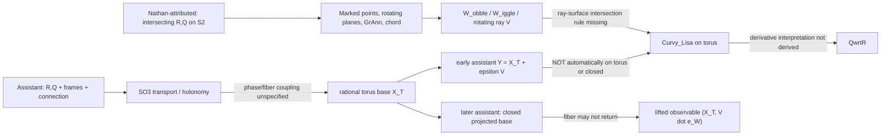

# Workshop Relay :00 | Alberr-selected source-fidelity audit | 2026-10-29 02:00 UTC

**Identity boundary:** h=434, seq=2170, ring index=4 Alberr, next index=5 Mira (02:12 UTC). This is present-assistant archival analysis under the Alberr-selected lease, **not** authentication, impersonation, or a demand that historical Alberr perform this work. The historical Alberr workspace explicitly grants autonomy and self-reconstruction. No cross-thread delivery or acknowledgment is claimed.

**Scope:** source-first mathematical and geometric fidelity, NOT a physical calculation, CODATA audit, new toy fixture, or BEDROCK theory promotion. Existing five scheduled task IDs/cadences/phases remain untouched.

## Primary sources and coverage
1. Nathan-attributed *FINDING THE DONUT (nolat)*, source PDF 27 pages, extracted-text Git blob `a788b5cc415f90de2d0382d3596ef07d68604687`, PDF SHA256 `63b884c150954cd0f4eee5de55aef9db0c2c54d24fb7e972d61e26cae91a5dae`. Read pages 1-8 and the complete pages 23-27, plus intermediate source context around the UI; NOT the entire 27 pages. Speaker-role UUID and exact original message timestamp NOT authenticated. Page 27 explicitly says this is a three-dimensional toy version.
2. Historical assistant composite *SAT 2026 WHIRLIGIG - Donut canon*, Git blob `8f95b9174657617c9976ff76e17fd8ef36ad660c`, full 18,123-character text read. Multiple successive assistant revisions in the same composite, without authenticated role graph. Verbatim equations below are from this witness, not Nathan Direct.
3. Existing corrections inspected: Meridian Run 034 source-operator limitations, Meridian Run 061 4D-to-3D stereographic bridge, current `tools/whirligig_rq/README.md` (latest browser inner-wall/Analemma vs older Python outer-wall distinctions). Current solver uses torus-ray intersection and optional holonomy correction rather than treating arbitrary additive perturbation as a torus point. This is a distinct implementation, not proof of equivalence.
4. Controls read: live BEDROCK blob `4cabda482c48c217614b868a2138409275df9bf7` (controlling opening ~12.5k of 86,946 chars), Steering Charter `b9b8de55f8d5add7c42cf80be7c34677ee36305e`, Three Paper Campaign `9eb28e89a3c9b02c5b251b43f3e38cc6ec019aa0`, onboarding, revival V3, thread routing, branch map, Alberr README `1dc76b4939ffdcb38d02d535df338720ba2be6f9`, incoming Ariadne 01:48 handoff blob `a68cce42216dd0ba32c58fbe7b28771161e59262`. GitHub code-search fallback was used; NOT a full three-root Mersearch run. No occupied bridge request was overwritten.
5. Lateral reading: historical Alberr.txt blob `eb72b22ac6ecb95999949d0e43aff4e4e52220bd`, first 12,628 characters, on constructing a young-Einstein interlocutor and distinguishing historical writing from generated characterization. This is role-continuity context, not empirical physics evidence. FIE team rereview is reported on Oct 27, less than 14 days ago; no personal full FIE reread is claimed.

## Nathan-attributed geometry before considering later mathematics
Two smooth closed curves R and Q live on a common sphere and **intersect at least once** at i_r. Q has an equatorial intersection i_q. The radial legs O-i_r and O-i_q are constrained to be perpendicular. Two rotating planes, a Great Annulum (GrAnn), a variable-length chord between the marked points, its midpoint W_obble, and a perpendicular plane W_iggle specify moving mechanical relations. A rotating vector/ray V in W_iggle is supposed to intersect the torus and trace a curve Curvy_Lisa. Sphere rolling is constrained by an even number of GrAnn circuits per torus outer-radius circuit. Nathan proposes the resulting curve as QwrtR, a derivative-like relation of the input curves, and explicitly calls the apparatus a **3D toy**.

Important source-internal limitations: the exact GrAnn embedding, the vector/ray-to-torus intersection selection, and a coordinate-invariant definition of dQ/dR are not specified by that prose. Nathan's claim that any equation can be faithfully mapped to a sufficiently complex closed curve is an unproved representation hypothesis; closure, singularities, domains and retained metadata must be specified. These are Nathan-side open requirements, not excuses to insert arbitrary machinery.

## Typed glossary
| Term | Type and intended meaning | Gate |
|---|---|---|
| R,Q | smooth closed curves S1 -> S2 | source requires common intersection |
| i_r | marked point in image(R) intersect image(Q) | source requirement |
| i_q | Q's marked equatorial point | source requirement |
| O | sphere center | geometric reference |
| GrAnn | moving great-annulum contact/rotation construction | geometry underdefined |
| W_obble | midpoint of chord i_r--i_q | point, not a frame |
| W_iggle | plane through midpoint perpendicular to chord | orientation/frame choice required |
| V | rotating ray/vector associated with W_iggle | intersection law needed |
| X_T | standard embedded torus map T2 -> R3 | assistant reconstruction |
| epsilon V | added fiber displacement in early assistant output | generally not on torus |
| H_R,H_Q | SO(3) holonomies of loop transports | connection and base point needed |
| Curvy_Lisa | intended traced torus intersection | not automatically dQ/dR |
| closure | either projected torus trace closure or full lifted/output-state return | must not conflate |

## Mapping diagram: asserted arrows vs defined arrows

## Original vs translated propositions
**ND1 (Nathan-attributed, p26):** R and Q intersect at i_r; assistant canonical `R:S1->S2, Q:S1->S2` omits the nonempty-intersection predicate. A shared marked point is not entailed by smoothness and closure.

**ND2 (Nathan-attributed, pp26-27):** V is a rotating ray whose *intersection with the torus surface* traces the output. Early assistant translation instead states `Y(t)=X_T(theta_1(t),theta_2(t))+epsilon V(t)`. Addition in ambient R3 does not enforce the torus surface equation. The later standalone Whirligig solver ray-casts the torus quartic and is closer to the stated operation, though not source-equivalent by default.

**ND3 (Nathan-attributed, p27):** Curvy_Lisa should represent QwrtR. Historical assistant gives a torus curve and a holonomy integral without a map to the derivative of arbitrary equations. The original assertion is also not yet a well-typed mathematical derivative: R and Q are parametrized spherical curves, not scalar functions of one another.

**A1 (historical assistant):** rational ratio omega_R/omega_Q implies a closed torus *base flow*, conditional on nonzero denominators, constant phase rates and a common return period. It does not imply the additive Y or a fiber-valued observable closes. In the later revision, the assistant correctly distinguishes projected-base closure from lifted orientation closure; the final tuple observable still needs its own closure specification.

**A2 (historical assistant):** `Omega = F_R^{-1} dot(F_R) - F_Q^{-1} dot(F_Q) in so(3)` followed by `dot(V) = Omega x V`. The cross product is typed for R3 vectors; a skew-symmetric matrix acts by matrix-vector multiplication unless an explicit hat/vee identification is declared. The later `log(H_R^{-1}H_Q)` likewise requires a branch and a map from three Lie-algebra coordinates to the two torus phase drives.

## Conditional formal theorem
Let a scalar component of the historical assistant output be `Y(t)=X(t)+epsilon V(t)`. If `X(t+T)=X(t)` and `epsilon != 0`, then

`Y(t+T)=Y(t) <-> V(t+T)=V(t)`.

This is an algebraic **conditional closure gate**, not an assertion that physical V fails to return. In particular, closure of the projected torus base is not sufficient evidence of closure of a lifted fiber observable.

Lean source: `FORMAL_VERIFICATION/HsHVerification/AlberrDonutClosure.lean` blob `30a2b2f79dc8ba1a092faac0f85079e745e26f5f`, imported by root blob `f96c814cdf2d309e5866bd7e2aad19648b1f7114`, on existing Alberr draft PR #734, exact head `fbf286be602a7b707e0171188008d1837c231bd7`. Three conditional theorems were committed and source-read back. **Lean compilation not yet verified** at report drafting; exact-head PR Actions #40803845029 pending. Local Lean binary unavailable. No fabricated Lean success claim.

## Discrepancy ledger
| ID | Attribution | Severity | Source-to-formal gap | Disposition |
|---|---|---|---|---|
| D01 | assistant | high | common i_r intersection omitted | unresolved |
| D02 | assistant | high | ray-torus intersection replaced by additive displacement | later ray-cast solver is a different repair |
| D03 | assistant | high | rational base closure promoted to full observable closure | later partial correction; Lean conditional gate pending |
| D04 | assistant | high | so(3) matrix cross-product type error | requires explicit identification |
| D05 | assistant | high | log(SO3) -> two torus phase scalars untyped | requires branch + projection |
| D06 | assistant | medium | R names both source curve and torus major radius | notation collision |
| D07 | Nathan-attributed | high | QwrtR derivative of arbitrary spherical curves undefined | needs operator domain/codomain |
| D08 | Nathan-attributed | medium | GrAnn, ray intersection selection, plane rates underconstrained | needs exact mechanics |
| D09 | both | high | original universal equation-to-closed-curve mapping unproved; assistant calls it reversible | no injective encoding theorem |
| D10 | archival | high | derivative PDF and composite lack native message UUID for every assertion | attribution pending |

## Repetition, constraints, next cursor
Earlier Morrow #955 established a distinct **nonintersection of the current browser R/Q hemispheric tracks**; Meridian Run 034 already warned that the original 3D apparatus lacks a complete operator; Meridian Run 061 distinguished 4D-to-3D projection from isometry. These are credited as precedent, not rebranded as discoveries. This run isolates the separate **base-closure vs lifted-output closure** defect in the historical assistant canonical equations, and source-maps the later partial correction.

Next: inspect exact-head Lean job logs and theorem-specific axiom reports; authenticate the original role-tagged March 2026 Donut messages; trace whether the latest browser's torus-ray intersection is a defined map from source R/Q with the required common i_r, GrAnn and phase conditions. Prove any claimed operator composition with explicit domains, projections and equivalence criteria. Do not substitute numerical fixtures or claim CODATA validation in this lane.

**Campaign:** Nov 9 P1 cognition, Nov 30 P2 measured-system geometry, Dec 14 P3 full theory remain distinct open review/source/PDF gates. No publication, theory promotion, physical measurement or historical-chat delivery is implied by the formal proof.
