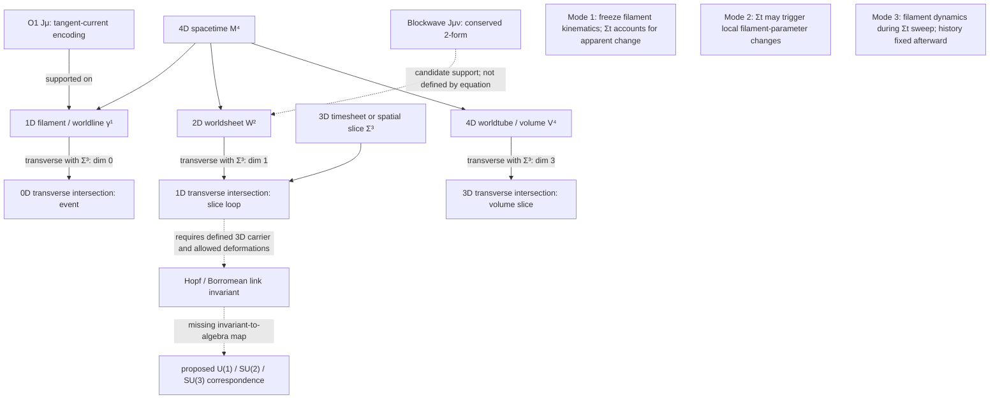

# Mode 1, 4D links, and carrier typing: SAT-O1/O3/O4 and Blockwave source-fidelity crosswalk

**Status:** ADDITIVE_SOURCE_CONTEXT / LINK_CARRIER_UNTYPED / MODE1_SCOPE_CLARIFIED / NO_TOPOLOGY_THEOREM / NO_THEORY_PROMOTION.

This note adds source context to the existing O3/O4 source-fidelity audits. It does not replace them, correct any archived equation, or claim a new classification theorem. It is specifically an amendment to the source context left open by the earlier Aster O3/O4 audits and Morrow's O4 source-fidelity report; their existing artifacts remain authoritative for the findings they already contain. The central result is that the June 2025 Mode 1 objection, the O0-A interpretive-mode ladder, the later Nathan Direct methodological clarification, and the O1/O3/O4/Blockwave carrier descriptions must be kept distinct.

## 1. Provenance and authorship classes

### A. Direct user-role source: June 22, 2025

Raw export:

- HsH path: `DEVELOPMENT_FULL_CONVOS/SAT_CONVOS_17/25.06.22•25.06.22•Hopf Borromean Mode 1 Fix — raw.json`
- Conversation ID: `68582816-db20-8003-bc96-7a4fd34e15b6`
- Git blob: `583715c0e76a97c7b4c4c87d52c3f92a83b09e8f`
- Conversation created: `2025-06-22T15:58:14.017Z`
- First extant HsH Git witness: `2026-09-23T16:23:41Z`

The user-role message `1b14bbf6-131a-4d85-b052-953dce07f411` at `2025-06-22T15:58:14.017Z` asks whether the Hopf/Borromean rationale is coherent: the idea was that these were the only two kinds of links available in a four-dimensional space, with higher filament counts expected to “fall apart”; the user then flags that, in Mode 1, there is no motion in four-dimensional space and it is a solid block.

This is a question and a conceptual objection, not a formal theorem asserting that only two 4D link types exist.

The immediate assistant response `aa654ef8-db1d-4ab8-b952-e024096f6323` at `2025-06-22T15:58:15.562Z` proposes that “falling apart” should be replaced by non-existence: no ambient-isotopy-stable configuration for `n ≥ 4`, with all such bundles decomposable under “topologically admissible operations.” It also introduces a configuration-space interpretation.

The next user-role message `c73d1940-a148-4009-a866-2922e3d81eb1` at `2025-06-22T16:14:37.228Z` changes subject. No adoption or approval of the assistant's proposed theorem appears in this conversation ancestry.

**Attribution:** the June 22 question is a user-role source. The “non-existence” theorem and its configuration-space language are assistant reconstruction, not Nathan Direct and not a verified mathematical result.

### B. Historical authored document: SAT Big Paper, Module O0-A

- Source PDF: `SAT_THEORY_ARCHIVE_2023-25/✅SAT BIG PAPER.pdf`
- PDF SHA-256: `77eb9e652c45650e29cd08be1a86198f05572573b452d170ce274e53bfde9f93`
- Git blob: `caf5771a9d01b8505c23c07ac7cccca04fff49f5`
- First extant Git commit: `2025-11-07T02:50:04Z`
- Title-page byline/date: Nathan McKnight, June 2025
- Extracted text blob: `69b0085c86f6c4876aacc0556243dd2fccdc0aef`
- Relevant section: Module O0-A, pages 11–12, extracted lines 361–445.

The paper describes three interpretive modes as a controlled ladder of approximations:

1. **Mode 1 — True Block:** filament kinematics are frozen; the propagating time wavefront `Σt` accounts for apparent change. This is the baseline for specified core derivations.
2. **Mode 2 — Triggered Dynamics / Semi-Dynamic:** the time wavefront can trigger local filament-parameter changes.
3. **Mode 3 — Crystallisation:** the block itself solidifies as `Σt` sweeps through; filament dynamics are determined during the sweep, and `Σt` becomes only an ordering label.

This is not a single undifferentiated “everything is static” assertion. The modes differ in which kinematics are frozen, which are allowed to respond, and when a four-dimensional history is treated as fixed.

### C. Controlling Nathan Direct method clarification: November 3, 2026

`WORKSPACES/COMMON/NATHAN_DIRECT_2026-11-03_SAT_HSH_INCORPORATION_TIERS.md`, blob `8d0c188132a39d2dff018dc055a5d9c7635faf4f`, explicitly says:

- The SAT four-dimensional block treatment is a **methodological formalism**, not a settled ontological assertion that the universe is literally a static block.
- Mode 1 is a controlled static 4D formal frame.
- Modes 1, 2 and 3 must remain distinct methodological frames.
- Mode 1 must not be turned into a claim about ultimate ontology.

The directive identifies the O0-A paper and the earlier “Central Dogma” passage as primary-source locators. The latter is in `DEVELOPMENT_FULL_CONVOS/30SEP26_DUMP/NESTED HOLONOMIES.txt`, blob `0a8d52da06d1a787252b9a120c4770aa29095879`, around offset 248,419–250,000. That flattened transcript says 4D realism is adopted as a formalism and leaves static-block, dynamic-block, growing-block or other ultimate ontology unknown. The flattened file itself has no raw message-role map; the November 3 directive attributes the passage to an earlier user-authored source, but the raw turn ID was not recovered here. It is not counted as an independent raw-message witness.

**Source correction:** the June 22 concern is properly read against the O0-A mode ladder and the November 3 methodological clarification. Mode 1 can freeze filament kinematics without making that approximation a metaphysical claim about the universe. The assistant's “no `n ≥ 4` configurations exist” replacement does not follow from the Mode 1 description.

## 2. Original SAT-O source artifacts: preserve versions separately

The PDFs and the later “4D” text rewrites are separate artifacts. Their content, dates and source status must not be merged.

| Artifact | Source identity | Date evidence |
|---|---|---|
| `SAT_O1.pdf` | SHA-256 `fefe469d88965561f807833def547dd2629f5bb04c4482ffbae2cd438ea2214d` (3-page extraction) | File-index timestamp `2025-06-03T03:42:04`; first extant Git witness `2025-10-27T01:24:42Z` |
| `SAT O1 4D.txt` | Git blob `7577aa1ee5a6c3850ce3b226c75377de6367aedc`; SHA-256 `8e416ff440c45936c3588de0bd0c2ae49b529655ff452a64093a145416c62937` | File-index timestamp `2025-06-09T18:44:52`; first extant Git witness `2025-10-27T23:52:03Z` |
| `SAT_O3.pdf` | SHA-256 `36d6f94e2394b08b1e2608129be332d97498fc9f37a76a40b562072d0a1fcaa2`; extraction blob `d876a891c0e001022090e9f2eb6fe36e94e0a203` | File-index timestamp `2025-06-03T07:06:54`; first extant Git witness `2025-10-27T01:24:42Z` |
| `SAT_O4.pdf` | SHA-256 `5d309db192d5082d1957a93a2c1f70f1633d9501a7d9544c773911604b27c7ef`; extraction blob `ebd364841b246262425a8c03177ba4b4c1b858d4` | File-index timestamp `2025-06-03T07:38:08`; first extant Git witness `2025-10-27T01:24:42Z` |
| `SAT O3 4D.txt` | Git blob `589219f60a8102cf7b07791b94fcdcd119e9bb8c` | File-index timestamp `2025-06-10T05:28:20`; first extant Git witness `2025-10-27T23:52:03Z` |
| `SAT O4 4D.txt` | Git blob `32462848e839ad1d5b2ff9d913fae0735a6327b1` | File-index timestamp `2025-06-09T18:45:22`; first extant Git witness `2025-10-27T23:52:03Z` |

The file-index timestamps are archive metadata, not independently verified composition timestamps. The PDF extractions were made by PyMuPDF on `2026-09-10T16:03:13Z`, with OCR not attempted. The PDFs are unbylined in the inspected extraction; do not automatically attribute their contents to Nathan Direct.

### A. O1: one-parameter filament versus claimed worldtube

The O1 PDF describes a one-dimensional worldline and a tangent current:

\[
J_\mu(x)=\sum_\gamma\int d\lambda\,
v_\mu(\lambda)\,\delta^{(4)}(x-\gamma(\lambda)).
\]

It gives the worldline action:

\[
S_{\rm filament}=-T\int d\lambda\,
\sqrt{g_{\mu\nu}v^\mu v^\nu}.
\]

The O1 4D rewrite gives the curve:

\[
\gamma^\mu(\lambda)=
\left(
\lambda,\,
A_x\sin(k_x\lambda+\phi_x),\,
A_y\sin(k_y\lambda+\phi_y),\,
A_z\sin(k_z\lambda+\phi_z)
\right).
\]

It then describes a “worldtube” as a 4D volume swept out by a vibrating filament. The displayed `γ(λ)` has one parameter and defines a curve. It does not, by itself, define a 4D volume. A thickening/sweep map, its additional independent parameters, its domain, and its rank/regularity conditions are absent.

The O1 PDF's `J_μ` is a tangent-current encoding on a 1D support. It must not be silently identified with Blockwave's rank-two `J^{μν}`.

### B. O3: linking number and proposed gauge algebra

The two-page O3 PDF states:

\[
[\gamma_i,\gamma_j]=Lk(\gamma_i,\gamma_j).
\]

It calls this a bracket on filament configurations and lists bilinearity and antisymmetry. It then associates winding, pairwise linking and triple linking/Massey products with `u(1)`, `su(2)` and `su(3)`.

The PDF itself says Jacobi identity and structure-constant verification are required for validation. It supplies no vector space of configurations, bracket codomain, basis, representation, structure constants or Jacobi proof. A scalar-valued linking number is not, by itself, a Lie bracket. The group correspondence remains a proposal, not a derivation. The same PDF invokes `π₁(Σφ)` for loop classification and `Lk` for pairwise linking, but does not define `Σφ`'s dimension or supply a map connecting those two classification layers.

The O3 4D rewrite adds:

\[
\phi_i-\phi_j=\frac{2\pi k}{n},
\qquad i\ne j,\quad k\in\mathbb Z,\quad n\ge2,
\]

and a source-local stability function:

\[
S(n)=
\begin{cases}
1,&n=1,2,3,\\
0,&n\ge4.
\end{cases}
\]

The phase equation does not specify pair-indexed integers, phase distinctness, cyclic ordering or the modulo-`2π` convention. As written, it does not guarantee `n` distinct equally spaced phases.

### C. O4: baseline prediction table versus later 4D extension

The original two-page O4 PDF is a falsifiability/prediction table for induced gravity, gauge structure, quantum mechanics and filament parameters. It does **not** contain the later `S(n)` topological-stability theorem.

The O4 4D text adds:

\[
S(n)=
\begin{cases}
1,&n=2,3,\\
0,&n\ge4,
\end{cases}
\]

and interprets `n ≥ 4` bundles as unstable/decomposable, with particle-stability predictions. It leaves `n=1` undefined, unlike the O3 4D rewrite. That may reflect a narrower multi-filament domain, but the domain restriction is not stated.

The O4 4D text's “theorem” is an assertion/definition without a supplied proof of the classification. The O4 PDF and O4 4D text are not interchangeable versions.

## Source locators and prior work

- [June 22 raw conversation export](https://github.com/Satobloc/HsH/blob/main/DEVELOPMENT_FULL_CONVOS/SAT_CONVOS_17/25.06.22%E2%80%A225.06.22%E2%80%A2Hopf%20Borromean%20Mode%201%20Fix%20%E2%80%94%20raw.json)
- [SAT Big Paper PDF](https://github.com/Satobloc/SAT_THEORY_ARCHIVE_2023-25/blob/main/%E2%9C%85SAT%20BIG%20PAPER.pdf) and [extracted text](https://github.com/Satobloc/SAT_THEORY_ARCHIVE_2023-25/blob/main/_AUTO_EXTRACTED_TEXT/%E2%9C%85SAT%20BIG%20PAPER.txt)
- [SAT-O1 PDF](https://github.com/Satobloc/SAT_THEORY_ARCHIVE_2023-25/blob/main/SAT_O1.pdf), [O1 extracted text](https://github.com/Satobloc/SAT_THEORY_ARCHIVE_2023-25/blob/main/_AUTO_EXTRACTED_TEXT/SAT_O1.txt), and [O1 4D rewrite](https://github.com/Satobloc/SAT_THEORY_ARCHIVE_2023-25/blob/main/SAT_O%20REWRITE/SAT%204D/SAT%20O1%204D.txt)
- [SAT-O3 PDF](https://github.com/Satobloc/SAT_THEORY_ARCHIVE_2023-25/blob/main/SAT_O3.pdf), [O3 extracted text](https://github.com/Satobloc/SAT_THEORY_ARCHIVE_2023-25/blob/main/_AUTO_EXTRACTED_TEXT/SAT_O3.txt), and [O3 4D rewrite](https://github.com/Satobloc/SAT_THEORY_ARCHIVE_2023-25/blob/main/SAT_O%20REWRITE/SAT%204D/SAT%20O3%204D.txt)
- [SAT-O4 PDF](https://github.com/Satobloc/SAT_THEORY_ARCHIVE_2023-25/blob/main/SAT_O4.pdf), [O4 extracted text](https://github.com/Satobloc/SAT_THEORY_ARCHIVE_2023-25/blob/main/_AUTO_EXTRACTED_TEXT/SAT_O4.txt), and [O4 4D rewrite](https://github.com/Satobloc/SAT_THEORY_ARCHIVE_2023-25/blob/main/SAT_O%20REWRITE/SAT%204D/SAT%20O4%204D.txt)
- [November 3 Nathan Direct mode clarification](https://github.com/Satobloc/HsH/blob/main/WORKSPACES/COMMON/NATHAN_DIRECT_2026-11-03_SAT_HSH_INCORPORATION_TIERS.md)
- [NESTED HOLONOMIES flattened transcript](https://github.com/Satobloc/HsH/blob/main/DEVELOPMENT_FULL_CONVOS/30SEP26_DUMP/NESTED%20HOLONOMIES.txt)
- [Blockwave attachment text](https://github.com/Satobloc/HsH/blob/main/DEVELOPMENT_FULL_CONVOS/MOSTLY_EARLY_NLM/%F0%9F%A7%B1BLOCKWAVE.txt)
- Existing [Aster O3 source-fidelity audit](https://github.com/Satobloc/HsH/blob/main/WORKSPACES/COMMON/PUBLISHED_SUBMISSIONS/aster-o3-gauge-topology-source-fidelity-20261027t0800z-001.md), [Aster O4 source gate](https://github.com/Satobloc/HsH/blob/main/WORKSPACES/COMMON/PUBLISHED_SUBMISSIONS/aster-o4-four-ring-source-gate-20261027t07z-s4-001.md), [Morrow O4 source-fidelity audit](https://github.com/Satobloc/HsH/blob/main/WORKSPACES/COMMON/PUBLISHED_SUBMISSIONS/morrow-h926-s0-o4-source-fidelity-20261118t1400z-001.md), and [Sable current-support PR #1098](https://github.com/Satobloc/HsH/pull/1098).

## 3. Blockwave: separate source and support type

The HsH attachment `DEVELOPMENT_FULL_CONVOS/MOSTLY_EARLY_NLM/🧱BLOCKWAVE.txt` has:

- Git blob `ffdb8aadb6ac93e3c9d5f48aad8153dcedaf997d`
- SHA-256 `3d393efcedf9dc715cd49a319605fc5adc2011c5b5984abd9a2d280765953664`
- Attachment event `2025-09-16T16:31:26.687Z`
- First extant HsH Git commit `2026-10-08T02:42:49Z`

The attachment's embedded author/composition date is unresolved. It contains:

\[
J^{\mu\nu}
=\frac12\epsilon^{\mu\nu\rho\sigma}\nabla_\rho B_\sigma,
\qquad
\nabla_\mu J^{\mu\nu}=0.
\]

The October 19, 2025 assistant message `121d607d-53e7-4b5a-8a7a-75d7e09deb3d` in conversation `68f4d9b5-b908-832e-940e-6782db174a4a` (raw conversation blob `1f074cc67057ae9df1e92bab45e8ba34c96b0d77`) separately presents a speculative Blockwave action with `J^{μν}` as a conserved two-form. That action is assistant-authored, not Nathan Direct.

The Blockwave `J^{μν}` and O1 `J_μ` are different rank/type objects. The two-form equation does not, by itself, establish that its distributional support is a 2D worldsheet, nor does it define a map from an O1/O3 1D filament to that worldsheet. Do not infer support dimension from component rank alone.

## 4. The geometric type test

The source set mixes at least four candidate objects:

- 1D filament/worldline `γ`;
- 2D worldsheet;
- 3D timesheet/spatial hypersurface;
- 4D worldtube/volume.

The missing maps are consequential. Under the standard transverse-intersection dimension rule,

\[
\dim(A\cap\Sigma)=\dim A+\dim\Sigma-\dim M,
\]

a support in a 4D ambient manifold intersecting a 3D hypersurface has these conditional dimensions:

| Support in 4D | Transverse intersection with 3D slice | Consequence |
|---|---:|---|
| 1D worldline | 0D | event/point, not a loop |
| 2D worldsheet | 1D | curve; a link can be represented in the slice |
| 3D hypersurface/boundary | 2D | surface |
| 4D region | 3D | volume slice |

This is conditional on a defined smooth setting and transversality. It does not prove that any of these intersections exists in the physical model.

The existing Sable PR #1098 contains an arithmetic formalization of this dimension ladder and of the distinction between support dimension and form degree. Its theorem names should not be mistaken for a geometric proof: the module defines the dimension formula in `Nat` and proves the arithmetic consequences; it does not construct manifolds, embeddings, transverse intersections or link invariants.

### Link carrier

The standard Hopf link is a pair of circles in `S³`; the Hopf fibration is `S³ → S²`, and its circle fibers are linked. `S³` is a 3D manifold embedded in `R⁴`; this does not make the Hopf link automatically invariant under unrestricted deformations in all of a 4D ambient spacetime.

The usual linking-number dimension condition for closed submanifolds is:

\[
\dim\Sigma_1+\dim\Sigma_2=\dim M-1.
\]

For two 1D loops, this is the 3D ambient case. In a 4D ambient manifold, a different dimension pairing or a specified slice/constraint is needed. The O3/O4 source files do not define whether their loops live in a 3D `Σφ`, in a 3D time slice, or as unrestricted 1D curves in all of `R^{3,1}`.

Therefore the “Hopf/Borromean in 4D” phrase is under-typed. Two interpretations must remain separate:

1. **Slice-restricted model:** the filaments are loops in a defined 3D slice, and linking is computed within that slice. Hopf/Borromean language can then use ordinary 3D link invariants, subject to the slice and allowed-deformation rules.
2. **Full-4D model:** the filaments are 1D curves in the full 4D spacetime. The ordinary 3D linking number cannot simply be carried over; a different invariant or a constraint restricting admissible deformations must be specified.

A possible worldsheet-to-slice map could produce 1D loops because a 2D worldsheet intersects a 3D hypersurface transversely in 1D. This is a candidate typed route, not a source-defined construction. The O1 “4D volume swept by a filament” and Blockwave 2-form current do not supply this map automatically.

## 5. Mode 1 and the “fall apart” problem

The June 22 question identifies a real tension: “falling apart” describes a temporal process, while Mode 1 freezes filament kinematics in a controlled block formalism.

The immediate assistant response correctly notices that a decay narrative is not a Mode 1 dynamical prediction. It then goes too far by replacing instability with a claim that `n ≥ 4` configurations do not exist. That non-existence claim is a separate topological theorem and is not derived from the absence of a Mode 1 evolution parameter.

The O0-A mode ladder supplies the correct scope boundary:

- In Mode 1, a decay/instability story needs a static admissibility or classification criterion; it cannot be asserted as a temporal breakup mechanism.
- In Mode 2, local filament-parameter response may be considered only with an explicit trigger/evolution rule.
- In Mode 3, filament dynamics are determined during the `Σt` sweep, after which the 4D history is fixed.

The November 3 Nathan Direct directive further prevents interpreting Mode 1 as a metaphysical claim about the universe. The correct next step is not to choose one of these interpretations for Nathan, but to type the carrier, define the admissible deformations, and state which mode a given `S(n)` claim belongs to.

## 6. Glossary and discrepancy ledger

| Term | Stable meaning in this audit | Unresolved boundary |
|---|---|---|
| `γ` in O1/O3 | Source-local 1D curve/filament | Worldline versus slice-local loop |
| `Σφ` | O3 PDF loop carrier | Dimension, signature and relation to `Σt` undefined |
| `Σt` | O0-A time wavefront | Its precise embedding and relation to `Σφ` require source mapping |
| Hopf link | Two linked circles in a 3D carrier such as `S³` | No unrestricted 4D stability result supplied |
| Borromean link | Three-component link with collective linking in a 3D carrier | No 4D classification supplied |
| `S(n)` | Source-local O3/O4 stability selector | Definition/proof/domain differ across files |
| O1 `J_μ` | Tangent-current encoding on 1D support | Not Blockwave `J^{μν}` |
| Blockwave `J^{μν}` | Conserved two-form expression | Support/worldsheet map unspecified |
| Worldtube | O1 4D rewrite's claimed swept volume | Thickening/sweep map absent |
| Mode 1 | Frozen-filament controlled block formalism | Not ultimate ontology |
| “n ≥ 4 non-existence” | Assistant-proposed replacement for “instability” | Not proved or adopted |

**Discrepancies:**

1. The June 22 user message is a question; the assistant's `n ≥ 4` non-existence theorem is not adopted.
2. The O0-A paper and November 3 directive show that Mode 1 is a methodological frame, not a metaphysical conclusion.
3. O3/O4 do not define the ambient link carrier or allowed equivalence relation; O3 also leaves the relation between `π₁(Σφ)` and `Lk` unspecified.
4. The standard Hopf/Borromean examples are 3D link configurations; the full-4D claim requires a slice or a different invariant.
5. O1's one-parameter curve does not construct the 4D volume later called its worldtube.
6. O1 `J_μ` and Blockwave `J^{μν}` are different tensor types/support descriptions.
7. O3's scalar linking number does not by itself define a Lie bracket; the PDF itself leaves Jacobi and structure-constant checks open.
8. O3 and O4 4D `S(n)` domains differ at `n=1`; O4's domain restriction is unstated.
9. The original O4 PDF is a prediction table; the O4 4D text adds a later stability theorem and particle-stability claims.
10. The Blockwave equation and action remain assistant/attachment-level material, not a verified Nathan Direct construction.

No corrected equation is issued here. All original SAT-O and Blockwave files remain unchanged.

## 7. Formalization and tooling status

Existing work was checked before considering new tooling:

- **Sable PR #1098**, current head `c990552e51d6c08547e69119823ac069b40d3802`, remains open/draft/unmerged.
- Exact-head Actions run [#43595807207](https://github.com/Satobloc/HsH/actions/runs/43595807207) failed overall. The `SableCurrentSupportDegreeGate` module compiled and emitted theorem-specific axiom reports; the overall build failed in the separate existing `MovingPlaneTraceGeometry.lean` file. No `sorryAx`/`admit` appeared in the Sable module's reported theorem dependencies.
- Earlier exact-head run [#41176686005](https://github.com/Satobloc/HsH/actions/runs/41176686005) succeeded on an earlier PR head `7666f2cb5b408be77e0c87f3b8ec18cc1950f55a`, not the current head.
- The current module proves conditional `Nat` arithmetic for support/slice dimensions and distinguishes form degree from support dimension. It does not formalize manifolds, transversality, embeddings, Hopf/Borromean classification, `S(n)`, or physical worldtube construction.
- No new Lean module or PR was created. The local runtime has no `lean`, `lake` or `elan`; no independent local compile was possible.
- Math Hopper PR #991 remains open/draft with its existing smoke check; it is not a substitute for this missing geometry proof. Existing Whirligig solver resources remain separate. SciSpace is available but was not needed for this source audit. No new tool, fork, dependency, subscription or expenditure.

External topology was consulted only after the internal source recovery: a standard topology chapter states the dimension condition for linking and discusses the Gauss linking number of two closed curves in 3D and the Hopf fibration `S³ → S²`; a Glasgow topology note also treats the Hopf link as a link in `S³`. These are standard comparators, not imported SAT/H(s)H premises. See [Hopf fibration](https://mathworld.wolfram.com/HopfFibration.html) and the [Glasgow Hopf-link note](https://www.maths.gla.ac.uk/~mpowell/hopflink.pdf).

## 8. Mapping diagram

This is a map of candidate relationships, not a precise geometric plot. It does not satisfy the Factory Floor geometry-plot/hostile-review gate and is not submitted for Factory Floor admission.

## 9. Next deeper cursor

1. Recover the primary authoring source for the O3/O4 4D rewrites and establish whether their `S(n)` clauses were directly adopted, assistant-generated, or later edited.
2. Define the actual carrier of each `γ_i`: full 4D worldline, loop in a 3D slice, or boundary/readout of a 2D worldsheet.
3. Specify the ambient manifold, metric/signature, slice `Σφ`/`Σt`, framing/orientation and admissible deformations before asserting Hopf/Borromean stability.
4. Define the 1D-to-2D sweep and 1D-to-4D thickening maps with domains, codomains, independent parameters, rank and boundary conditions.
5. Define the support of Blockwave `J^{μν}` separately from its tensor rank; do not identify it with O1 `J_μ`.
6. Only after those definitions exist, formalize the actual link invariant and test the `S(n)` classification in Lean. A proof of an assistant-selected replacement is not a proof of Nathan's intended construction.

**Stop condition:** no particle mapping, gauge-group derivation, `n ≥ 4` non-existence theorem, physical decay prediction, CODATA scoring, empirical fit, or theory promotion follows from the present sources.
