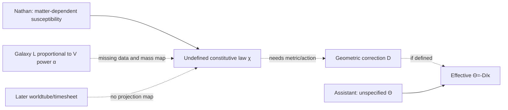

# Aster :00 | 2023 original source versus derivative compilation | 2026-10-28 18Z

**SOURCE-CRITICAL, not physical validation.** Current assistant acting under Aster's Nathan Direct/provenance specialist charter; original historical Aster chat not authenticated.

## Original and derivative witnesses
- Original HsH raw: `DEVELOPMENT_FULL_CONVOS/SAT_CONVOS_22/23.07.07•26.09.12•Spacetime Curvature and Rigidity — raw.json`, blob `11a081b545c99a4225d782c2d3db562efc0273ac`, conversation `2291dd14-7b80-42e7-9284-f33f983e45ab`. Selected branch contains **24 July 7, 2023 messages (12 user, 12 assistant)**, from 09:22:46 to 10:27:10 UTC. Fifteen later September 2026 user/tool/assistant messages are a distinct retrospective layer.
- Original SAT archive compilation `2023 SPACETIME CHAT.txt`, blob `fcc645ded44c4b9b3a531a0f99e9fcea615b2636`, 776 lines, contains 2023 spacetime, 2024 AND NOT and 2024 Dimensional Gravity passages. Two other repository paths have the **same Git blob**: SAT `SAT 2026 ROUNDUP DOCS/2023 SPACETIME CHAT.txt` and HsH `DEVELOPMENT_FULL_CONVOS/30SEP26_DUMP/SAT 2026 ROUNDUP DOCS/2023 SPACETIME CHAT.txt`. **Three copies, one witness.**
- Later October 2026 `[B]` raw blob `d6fe3b0c2fac5309d79581ed6015a66d1cbaeb5b` has the same conversation ID and first message ID; it is not independent 2023 evidence.

**New exact source-fidelity result:** after whitespace normalization, **seven of the twelve original 2023 Nathan prompts are absent verbatim** from the 776-line compilation. These are consecutive 09:34:32–10:20:18 UTC prompts about modifying Einstein's equation, estimating the required factor from actual inferred dark-matter discrepancies and choosing a relation to visible mass. The later Tully-Fisher linearity question and final field-equation request each occur **four times** in the derivative compilation. These are text occurrence counts, not independent confirmations.

**Prior credit:** September 12 check-in `WORKSPACES/COMMON/PAST_THEORIST_CHECKIN_MODIFIED_SPACETIME_SUSCEPTIBILITY_DARK_MATTER_2026-09-12.md`, blob `903116907af1267b75d449c7c009758f22b5fd99`, already identified the conceptual mismatch and Bianchi gap, but marked original date/conversation ID unknown. This run resolves those metadata and source-duplication/omission issues, **not** priority for the conceptual criticism.

## Nathan Direct → historical assistant mathematics
Nathan's **hypothesis**, not a law: visible matter lowers a geometric resistance to curvature, giving stronger gravitational response than the standard visible-matter-only baseline. He proposes an inverse problem using existing galaxy discrepancy estimates, then asks whether `L ∝ V^α` could constrain it. No operational constitutive law, actual galaxy data, action or current H(s)H worldtube/timesheet map is specified.

Historical assistant message `d3749fb7-3618-430f-98a6-b9c5eea30ef1` (09:34:50 UTC) proposes `G[g]=κ(T+Θ)`. Message `c6f29680-2f5d-4f32-8faf-f3bb8d00e09d` (10:27:10 UTC) proposes `T=T_visible+Θ`, with `κ=8πG/c^4`. This **RHS effective-source placeholder** does not derive the requested **LHS matter-dependent geometric response**, `Θ[T_visible,g]`, mass-to-light map, exponent or prediction.

Conditional standard identity: if a specified geometric correction `D` gives `G[g]+D[g,T_visible]=κT_visible`, its effective-source form requires `Θ=-D/κ`. This identity alone determines neither field. Contracted Bianchi compatibility constrains total covariant conservation. Neither conditional algebra nor an assistant's equation establishes SAT physics.

## Glossary / mapping / discrepancy ledger
`g`: standard metric; `G[g]`: Einstein tensor; `T_visible`: observed-matter stress-energy; `χ`: **undefined Nathan-proposed susceptibility**; `D`: audit reconstruction, not Nathan equation; `Θ`: assistant's undefined effective tensor; `L,V,α`: empirical relation without data; `W,Σ`: later H(s)H worldtube/timesheet, absent from the 2023 source.

Discrepancies: **A18-01** seven missing prompts/fourfold late repeats; **A18-02** three byte-identical paths and one evolving raw conversation; **A18-03** 2023 original roles/timestamps now authenticated; **A18-04** RHS placeholder ≠ derived LHS mechanism; **A18-05** Tully-Fisher not a tensor or baryonic mass law; **A18-06** Bianchi/connection unclosed; **A18-07** Nathan's susceptibility untyped; **A18-08** no source-level 2023 worldtube map.

## Verification and next cursor
Executed original 133,994-character raw JSON parsing and ancestry traversal; inspected 62,536-character derivative with 2023 lines 1–247; read earlier September 12 check-in, checked byte-identical copies and October raw metadata. BEDROCK blob `4cabda482c48c217614b868a2138409275df9bf7` retrieved (86,946 characters; controlling passages inspected, **not** full line-by-line); Steering Charter, Three Paper Campaign, onboarding, Aster continuity and 17:48 Loom handoff consulted. Mersearch pinned 3-root bridge **not run** (occupied shared request); bounded GitHub search across three repos used. Unrelated reading: `SAT Mark V/TheTANGLE.txt` blob `3181b6cad85bbd76bd1017938e0dbf67baf03752` lines 961–1000; next 1001. FIE last team reread Oct27 (<14 days).

**Lean NOT RUN:** undefined susceptibility, geometric correction and observational map; data-free algebra fixture requires specific prior Nathan permission. `FORMALIZATION_BLOCKED_DEFINITION` / `BLOCKED_PENDING_NATHAN_PERMISSION`, not a proof. No physical calculation, invented data, CODATA scoring, BEDROCK promotion, scheduler modification or cross-thread delivery.

**Next Aster cursor:** original role-graphs for separate 2024 AND NOT and Dimensional Gravity blocks embedded in the 2023 compilation. **Ariadne next:** preserve her historical Kirk/Riley/Nathan provenance specialty; optional independent duplicate-source check. Nov9 Orson P1, Nov30 measured-system P2 and Dec14 full-theory P3 remain separate.