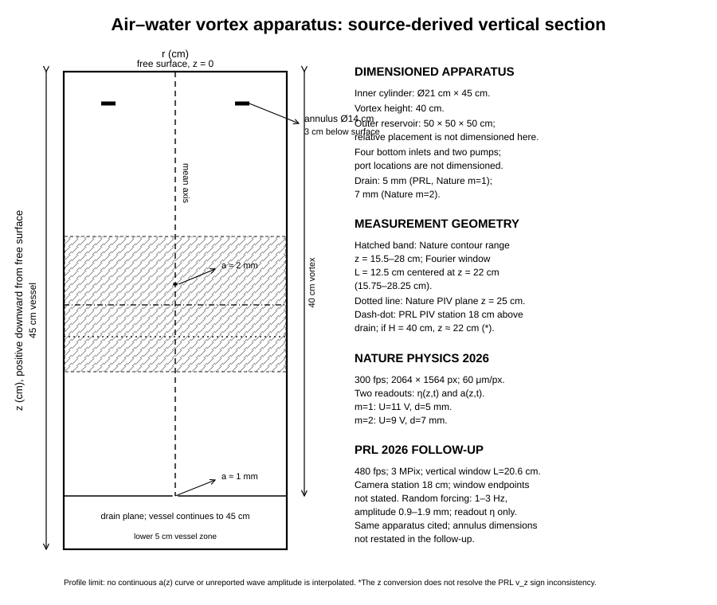
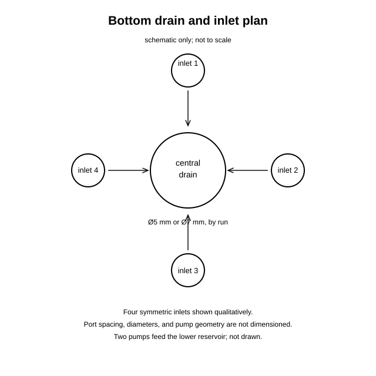
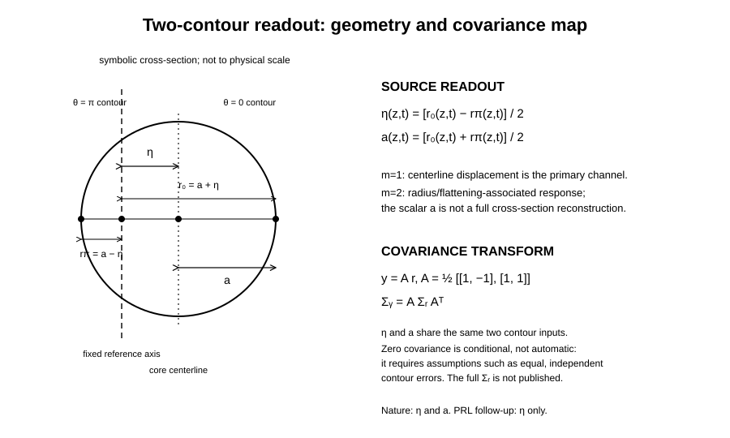

# Source-derived geometry audit: air-water vortex core

**Submission ID:** aster-air-water-vortex-geometry-20261103t1824z-s2-001  
**Status:** SOURCE_AUDIT_ONLY / WORKING_GEOMETRY / NOT_FACTORY_FLOOR / NOT_A_P2_SELECTION  
**Independent hostile review:** pending  
**CODATA:** no CODATA constants used; calculations below use published fluid parameters, exact π, and dimensional algebra only.

## Executive finding

The 2026 Nature Physics propagation paper and the September 2026 Physical Review Letters turbulence paper concern the same general air-water vortex apparatus, but they are **distinct experiments and must not be merged into one dataset**.

- The Nature paper resolves both centerline displacement η(z,t) and a radius channel a(z,t), and declares a public Figshare dataset: [10.6084/m9.figshare.30903347](https://doi.org/10.6084/m9.figshare.30903347). The DOI is identified in the paper, but raw files and dataset-version metadata were not retrieved in this run.
- The PRL follow-up studies a randomly forced turbulent regime and reports six-wave/pentacoherence evidence, but its data-availability statement says the data are **not publicly available** and may be requested from the authors.
- The PRL paper reports η(z,t), not the separate a(z,t) channel. Its Fig. 2 caption gives vz = −0.63 m/s, while the text defines downward velocity as positive. That sign conflict is left unresolved.
- These figures are source-derived working diagrams. They are not independent measurements, not a complete 3-D reconstruction, and not Factory Floor material.

## 1. Apparatus geometry

Dimensioned facts reported in the primary papers:

| Feature | Reported geometry |
|---|---:|
| Inner cylinder | 21 cm diameter × 45 cm height |
| Vortex column | 40 cm height |
| Outer reservoir | 50 × 50 × 50 cm |
| Annulus (Nature apparatus description) | 14 cm diameter, 3 cm below free surface |
| Drain | 5 mm in PRL and Nature m=1 example; 7 mm in Nature m=2 example |
| Bottom injection | Four symmetric inlets; two pumps |
| Core-radius description | About 1 mm near drain, about 2 mm near mid-height, widening below free surface |

The apparatus SVG uses z positive downward from the free surface, as in the Nature apparatus figure. The 40 cm vortex height and 45 cm vessel height are shown separately. The outer reservoir is not drawn to scale because its exact placement relative to the cylinder is not dimensioned in the text. The four-inlet plan is schematic: port spacing and diameters are not published.

**No continuous a(z) curve is invented.** The paper gives a qualitative profile and local/mean values, not a complete measured radius function. The upper flare is therefore described but not interpolated.

### Acquisition geometries are separate

**Nature Physics 2026**

- 300 fps; 2064 × 1564 px; 60 μm/px.
- Core-contour range: z = 15.5–28 cm.
- Spectral window: L = 12.5 cm centered at z = 22 cm, i.e. 15.75–28.25 cm.
- PIV plane: z = 25 cm.
- Two readouts: η(z,t) and a(z,t).
- Example runs: m=1, pump drive U = 11 V and drain d = 5 mm; m=2, U = 9 V and d = 7 mm.

**PRL 2026 follow-up**

- 480 fps; 3 MPix; vertical window L = 20.6 cm.
- Camera station reported at 18 cm; exact window endpoints are not stated in the text.
- PIV station reported 18 cm above the drain. If the 40 cm vortex height is used as the coordinate span, this corresponds to z ≈ 22 cm from the free surface. This conversion does not resolve the separate vz sign conflict.
- Random annulus forcing: 1–3 Hz, displacement amplitude 0.9–1.9 mm.
- Reported readout: η(z,t) only. The follow-up cites the same apparatus but does not restate all annulus dimensions.

## 2. Readout map and projection limits

The Nature paper's two contour radii are r0(z,t) and rπ(z,t):

\[
\eta(z,t)=\frac{r_0(z,t)-r_\pi(z,t)}{2},\qquad
a(z,t)=\frac{r_0(z,t)+r_\pi(z,t)}{2}.
\]

In matrix form, for r=(r0,rπ)^T and y=(η,a)^T,

\[
y=A r,\qquad
A=\frac12\begin{pmatrix}1&-1\\1&1\end{pmatrix},\qquad
\Sigma_y=A\Sigma_r A^T.
\]

The two output channels share the same two contour inputs. Zero covariance is **conditional**, not automatic; it follows under additional assumptions such as equal, independent contour errors. The full contour covariance Σr is not published in the sources inspected here.

The paper identifies m=1 primarily with centerline displacement and m=2 with a core-radius/flattening response. The scalar a(z,t) is not a reconstruction of the full azimuthal cross-section. The PRL follow-up's η-only measurement does not replace the separately measured radius channel.

### Explicit support and measurement chain

Let C_t ⊂ R³ be the finite air-core region at laboratory time t. Its history is a 4-D set

\[
W_{\rm core}^4=\{(x,t):x\in C_t\}\subset\mathbb R^3\times\mathbb R.
\]

The experiment's observation chain is:

\[
W_{\rm core}^4
\xrightarrow{\text{time slice}}
C_t
\xrightarrow{\text{camera projection}}
I(u,v,t)
\xrightarrow{\text{contour extraction}}
(r_0,r_\pi)
\xrightarrow{A}
(\eta,a)
\xrightarrow{\text{window/FFT}}
S_\eta,\ S_a.
\]

The PRL analysis continues from η to spectra and higher-order coherence statistics. Camera projection and two-contour extraction are many-to-one: they do not uniquely recover the full 3-D core or its 4-D history.

**Missing H(s)H map:** no explicit map G_HsH from an H(s)H generator to W_core^4 has been defined. The physical apparatus is a valid external comparator, not evidence that its constitutive physics is identical to an H(s)H worldtube or timesheet.

## 3. Scripted nominal calculations

For a Rankine-core parameterization,

\[
\Omega_0=\frac{\Gamma}{2\pi a_0^2},\qquad
v_\theta(a_0)=\frac{\Gamma}{2\pi a_0},\qquad
\chi=\frac{v_z}{v_\theta(a_0)},\qquad
\mathcal A=\frac{L_{\rm vortex}}{a_0}.
\]

The values below are calculated from parameter sets printed in the papers. Ω0, vθ, χ, and A are derived descriptors, not additional measurements. For the PRL paper, only |χ| is used for cross-paper magnitude comparison because its printed vz sign conflicts with its stated downward-positive convention.

| Study / context | a0 (mm) | Γ (m²/s) | vz (m/s) | Ω0 (s⁻¹) | vθ(a0) (m/s) | |χ| | L/a0, L=0.40 m |
|---|---:|---:|---:|---:|---:|---:|---:|
| Nature, m=1 forced | 1.90 | 0.022 | +0.57 | 970 | 1.844 | 0.309 | 210.5 |
| Nature, m=2 unforced | 2.20 | 0.011 | +0.85 | 362 | 0.796 | 1.068 | 181.8 |
| PRL, Fig. 2 parameter set | 1.47 | 0.018 | −0.63* | 1325 | 1.948 | 0.323 | 272.1 |
| PRL, Figs. 3–5 parameter set | 1.30 | 0.018 | −0.63* | 1696 | 2.203 | 0.286 | 307.7 |

\*The PRL caption prints vz = −0.63 m/s, while its text defines downward velocity as positive. No sign correction is adopted.

### Measurement and uncertainty discipline

- **Nature paper:** a0 is image-derived; Γ and vz are fit-conditioned from the dispersion relation and checked against PIV/PTV. The paper reports approximate PIV circulation uncertainty 0.005 m²/s, PTV vertical-velocity uncertainty 0.05 m/s, and typical per-position core-radius/position uncertainty around 0.1 mm; the mean a0 uncertainty is described as negligible. These are not a published joint covariance matrix.
- **PRL follow-up:** Γ = 0.018 m²/s is obtained from PIV; a0 = 1.47 mm appears in Fig. 2 and a0 = 1.3 mm in Figs. 3–5. The paper does not state a usable joint uncertainty/covariance for these parameters in the inspected text. The printed vz sign conflict remains open.
- The PRL a0 values are retained as separate figure contexts, not averaged. The Nature narrative's approximate 1–2 mm radius description and its m=2 mean a0 = 2.2 mm are also retained as separate source statements pending raw-profile reconciliation.
- First-order relative sensitivities are
  \[
  d\ln\Omega_0=d\ln\Gamma-2\,d\ln a_0,\qquad
  d\ln|\chi|=d\ln|v_z|+d\ln a_0-d\ln\Gamma.
  \]
  Without the joint covariance and raw arrays, no full uncertainty interval is claimed.

A descriptive observation is that |χ| is about 0.31 in the Nature m=1 set and about 0.32 in the PRL Fig. 2 set, while the Nature m=2 set is about 1.07. This is **not** an established regime law: the papers use different parameter provenance, the PRL sign is unresolved, and the studies are not independent replications. It is only a candidate discriminator for a future blind test.

## 4. Linear and nonlinear targets for a generative model

The PRL follow-up reports

\[
S_\eta(\omega)\propto\omega^{-7/3},\qquad
S_\eta(k)\propto k^{-11/3},
\]

but notes that the Kozik–Svistunov and L'vov–Nazarenko spectral exponents are too close to distinguish experimentally. Its more discriminating claim is six-wave interaction evidence from pentacoherence, together with the absence of nontrivial four-wave resonances.

A useful falsifiable H(s)H target would therefore be **more than reproducing a fitted dispersion curve or a spectral slope**. A forward model should predict, from independently measured inputs:

1. the dispersion branch and its propagation direction;
2. the η spectrum;
3. the six-wave resonance/pentacoherence structure and the reported absence of nontrivial four-wave resonances;
4. where the two-channel data exist, the separate a response associated with the m=2 mode.

The PRL raw data are not public, so its six-wave result cannot currently be independently reanalysed from the published source alone.

## 5. Cross-scale comparators: separate geometries, no assumed equivalence

| System | Measured structure | Shared geometry | Not interchangeable |
|---|---|---|---|
| Air–water vortex (2026) | Finite 3-D air core in water; rotating flow; Kelvin modes | Finite core, rotation, propagating helical disturbances | Fluid interface and camera-contour map |
| Superfluid ⁴He reconnection (PNAS 2014) | Quantized vortex line; Kelvin waves after reconnection | Helical perturbations on a vortex line | Nanoscopic quantized core; tracer particles are not guaranteed to be locked to the core |
| WWRD climbing rope | Material rope under tension/contact/friction | Finite cross-section and propagating mechanical disturbances | Material constitutive law, contact and friction; not a fluid vortex |
| GW150914 inspiral | Relativistic binary inspiral; public calibrated strain | Time-dependent worldline/worldtube geometry | Strong-field GR waveform and detector response; not a fluid-core model |

The rope comparison remains a first-blush geometric heuristic, not a physical equivalence. The classical/quantum Kelvin-wave connection is a test hypothesis, not a demonstrated identity of constitutive mechanisms. GW150914 is a future inspiral benchmark only; no inspiral calculation is performed here.

## 6. SAT-O / Blockwave source boundary

The existing source crosswalk is [Kestrel's one-core finite-core / SAT4D / Blockwave audit](https://github.com/Satobloc/HsH/blob/main/WORKSPACES/COMMON/PUBLISHED_SUBMISSIONS/kestrel-one-core-finite-core-sat4d-blockwave-crosswalk-20261102t2200z-s0-003.md). The source locators rechecked for this audit are:

### SAT-O 2.0 Module O1 and SAT4D live draft

- SAT-O O1 file: blob SHA 7577aa1ee5a6c3850ce3b226c75377de6367aedc; file-index created 2025-06-07, modified 2025-06-09; unbylined.
- SAT4D live draft: blob SHA 2a79fe25018cce7e99a2c33786d88b0551db6ae7; file-index created 2025-06-08, modified 2025-06-09; imported in commit 0821d8ed on 2025-10-27; unbylined.
- The two files carry the same displayed 1-D curve/action structure; they are not independent empirical confirmations.

Verbatim mathematical structure:

\[
\gamma:\mathbb R\to\mathbb R^{3,1},\quad
\gamma^\mu(\lambda)=
(\lambda,A_x\sin(k_x\lambda+\phi_x),
A_y\sin(k_y\lambda+\phi_y),
A_z\sin(k_z\lambda+\phi_z)),
\]
\[
v^\mu=\frac{d\gamma^\mu}{d\lambda},\quad
S[\gamma]=\int d\lambda\,L(\gamma,v),\quad
L=\frac12 m v^\mu v_\mu-V_{\rm tension}(\gamma).
\]

The O1 prose defines a filament as a smooth one-dimensional object γ:R→R^{3,1}, then calls the “worldtube” the 4-D volume swept by the vibrating filament. The displayed 1-D curve does not itself construct a 4-D volume. No thickening/support map is supplied to make that wording precise.

### Blockwave source artifact

- Source path: DEVELOPMENT_FULL_CONVOS/MOSTLY_EARLY_NLM/🧱BLOCKWAVE.txt.
- Blob SHA: ffdb8aadb6ac93e3c9d5f48aad8153dcedaf997d.
- First visible Git path commit: 2026-10-08.
- No internal date/byline recovered. The file is user-supplied, but embedded assistant-voiced prose does not establish Nathan authorship.

Verbatim source-level structural text includes:

> u^μ u_μ = -1; θ ~ θ + 2π.  
> P^μ{}^ν ≡ δ^μ{}^ν + u^μ u_ν.  
> J^{μν} is the conserved two-form “filament worldsheet” current; ∇_μ J^{μν}=0.

The displayed action begins with ∫d⁴x √(-g) and includes an Einstein-Hilbert term, compact-phase terms, projected time-flow elasticity, a J-current self-energy and gradient term, a holonomy coupling F_{μν}(θ)J^{μν}, and a mixing/medium-response kernel. The raw source has malformed tokens, including P^μ{}^ν, ∇α u_μ, u^μ uμ, P^μ{}{ρ}, J{μν}, and M^{μν}{}{ρσ}. These are retained as source defects, not silently repaired.

The source's J is a 2-form current supported on 2-D worldsheets. That is not the same support type as a finite 4-D core volume.

### Later direct H(s)H statements and provenance

- Meridian Free Build raw blob: 7af1561b321f4d9364da5eb111df689efc652827; conversation ID 6ac45d1f-17b0-83ea-ad1f-fa524602378b.
- User-role message 1178f25c-9f92-4d1c-b43b-06482e6bf1b1 at 2026-10-09T07:40:38.859Z distinguishes one helical core from the larger hollow coil and describes the 3-D rendering as an intersectional trace of a 4-D filament, not the filament itself. The same source set records that stiffness/coil scale should be constrained from measured momentum data under known force; no constitutive law or dataset was supplied.
- Meridian Minkowski Ring Analysis raw blob: 56a84cb85d5c386efa4ea11d322d11e95e2c7703; conversation ID 6ad7e9c0-e8a0-83e9-984e-94d020de3abf.
- User-role message c5525f53-b7cc-4444-8102-3bf6fdb1c892 at 2026-10-21T13:55:40.771Z specifies cw=t and the positive-definite (++++) normalization. This is separate from the older assistant w=ct convention and the Lorentzian R^{3,1}/√(-g) source equations.
- The earlier 2024 local helix/plane toy is a separate construction: fixed plane selects one point; moving the plane traces a circle; the helix radius is its cross-sectional radius, not pitch; a perfect helix has no maximum/minimum radius. Its user-role source messages are listed in the crosswalk.

### Assistant syntax repairs, separated from source

The following are **assistant-authored transcription/index repairs**, not Nathan-authorized physical corrections:

\[
P^\mu{}_\nu=\delta^\mu{}_\nu+u^\mu u_\nu,
\]
\[
(\nabla_\alpha u_\mu)(\nabla_\beta u_\nu),
\qquad
\lambda(u^\mu u_\mu+1),
\]
\[
P^\mu{}_\rho P^\nu{}_\sigma,\qquad
J_{\mu\nu}\mathcal M^{\mu\nu}{}_{\rho\sigma}J^{\rho\sigma}.
\]

The separate assistant response also defines A_μ = α_*∇_μθ and F_{μν}=∇_[μA_{ν]}. For a smooth single-valued scalar and torsion-free connection, d(dθ)=0 locally; a nonzero local field therefore needs defect/singularity or patching data. This is a mathematical source check, not a repair of the physical theory.

### Corrections

**No physical corrected equation is proposed in this audit.** The source strings and source defects are preserved above; the assistant repairs are separately labelled. No conversion between Lorentzian R^{3,1}/√(-g) and the later (++++) convention is supplied. No thickening map from the 1-D curve to a 4-D volume is supplied. No degree-changing map from the Blockwave 2-form current to a finite-core 4-D region is supplied.

## 7. Lean, archive tools, and publication boundary

- **Lean PR #873:** KestrelKelvinVortexReadout.lean compiled and its #eval examples executed in the recorded Actions run. The full PR build is not green: KestrelMovingSlice.lean retains separate unsolved goals. This is module-level success, not whole-branch success.
- **Lean PR #1309:** the covariance module failed because contourToReadout and readoutCovariance use real division in definitions Lean treats as noncomputable. A likely repair is to mark the real-valued definitions noncomputable, keep the symbolic theorem in ℝ, and add a separate rational-valued executable example. No patch was made; Kestrel owns that branch.
- Lean checks the formalized algebraic statement. It does not establish that the source-to-geometry translation is faithful or that the physical premises are true.
- **Math Hopper:** existing extraction tooling and a three-repository Actions pilot are documented, but end-to-end pilot execution remains unverified.
- **Whirligig:** the existing RQ/torus engine reports 13/13 Python tests passing; it is not a fluid-vortex solver and no new tooling was built.
- **SciSpace:** search surfaced the PRL follow-up and adjacent quantum-vortex literature but did not reliably resolve the Nature paper. Its add-column output mixed dataset/method context across the related studies; primary article sources control.
- No public forks of the three repositories surfaced in repository search. No local repository checkout or Lean/Lake executable was present in this runtime. No paid service or new tool was used.

## 8. Review and disposition

- WORKING_GEOMETRY / SOURCE_AUDIT_ONLY.
- Independent hostile review is pending.
- Not admitted to Factory Floor.
- No P2 system selected; the Nature paper remains a candidate with raw Figshare retrieval still outstanding.
- The PRL follow-up is supporting physical context, not a second public dataset.
- No BEDROCK theory promotion, paper-gate change, or new branch is proposed.

### Required next checks

1. Retrieve the Nature Figshare article's exact version, file list, raw arrays, and checksums; then independently reconstruct contour and PIV/PTV parameter covariance.
2. Obtain the PRL raw data only through an authorized author request; until then, do not claim independent six-wave reanalysis.
3. Resolve the PRL vz sign convention against its coordinate definitions and raw PTV direction; do not silently flip the printed sign.
4. Commission an independent hostile geometry review of the apparatus and readout diagrams before any Factory Floor admission.
5. Define the missing H(s)H generator-to-W_core^4 map and test it against dispersion, η, a, and higher-order coherence without fitting the same observable twice.

## Primary sources

- Barckicke, Falcon & Gissinger, “Kelvin wave propagation along vortex cores,” Nature Physics (2026), DOI 10.1038/s41567-026-03175-w; dataset DOI 10.6084/m9.figshare.30903347.
- Barckicke, Gissinger & Falcon, “Experimental evidence of Kelvin-wave turbulence along a vortex core,” Physical Review Letters (published 2026-09-21), DOI 10.1103/t3bt-m431; arXiv:2607.07535v1. Data not publicly available in the paper's data-availability statement.
- Fonda et al., “Direct observation of Kelvin waves excited by quantized vortex reconnection,” PNAS (2014), DOI 10.1073/pnas.1312536110.
- GWOSC, GW150914 open strain data and calibration documentation; fix the exact data release and version before any inspiral calculation.
