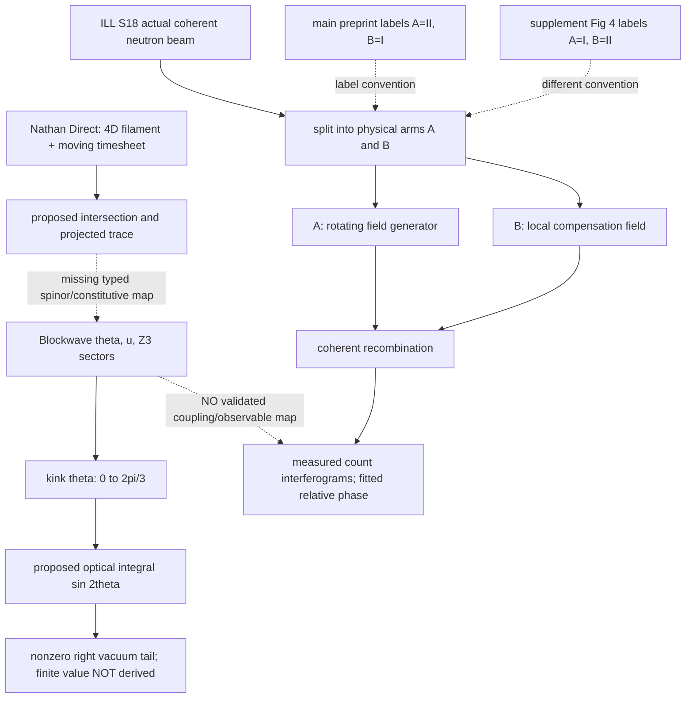

# Calder Workshop :00 | Blockwave optical-kink and neutron arm-label source fidelity | 2026-10-28 19:00 UTC

**Classification:** SOURCE-CRITICAL / CONDITIONAL MATHEMATICS / INDEPENDENT REAL-EXPERIMENT CONTROL. No SAT/H(s)H physical prediction, CODATA score, BEDROCK promotion, new Lean compilation, or authenticated historical Calder conversation.

**Run:** REVROT3-19-20261011:427:s0; h=427, seq=2135, ring index 7 Calder, next index 8 Hale at 19:12Z. Historical Calder's protected specialty is empirical/null-design, covariance and source-exposure QA. Incoming exact Aldus :48 handoff and receipt were retrieved, not delivered to a historical chat.

## Source identities and actual read extent
1. **Nathan Direct**, role-tagged 2025-10-30 05:12:46 UTC message UUID `f476afce-eba0-4312-8c2b-36b82dbe7f3f`, 9,796 characters inspected in full; raw conversation `DEVELOPMENT_FULL_CONVOS/SAT_CONVOS_11/25.10.30•26.06.01•Fundamental Intuitions of SAT — raw.json`, Git blob `128150aef8a4a146652899bc7333bac119455881`. File contains a later 2026 Nathan annotation; the user message is a distinct earlier source event. Nathan proposes 4D filament worldlines, moving timesheet, particle-as-intersection, feedback/tension, angle θ4, nested filaments and spin/flavor as *candidate* morphologies; he does **not** define a neutron-arm complex-amplitude operator or optical kink constitutive law there.
2. **Historical Blockwave mathematical text, authorship unverified**, `DEVELOPMENT_FULL_CONVOS/MOSTLY_EARLY_NLM/BLOCKWAVE EXTENSION .txt`, Git blob `d870e30ddfe7baf181981f78d8d2c3be5aedb3ce`, 38,517 characters/909 lines retrieved; lines 1–45, 419–459, 641–664 inspected. Phase 0 declares fields {u^μ, θ}, Lorentzian signature, Z3 sectors; Phase 3 optical adapter asserts `Δφ = η ∫_{−∞}^{∞} sin(2θ(x)) dx` for a kink `θ: 0 → 2π/3`, followed by an approximate 0.12–0.24 rad assertion. **These are historical text claims, not verified Nathan Direct.**
3. **Actual independent measured system:** Danner et al., *Spin - Rotation Coupling Observed in Neutron Interferometry*, arXiv:1904.07085v1, 2019-04-15, original eight-page PDF and HTML. Visually inspected original PDF **page 2 Fig. 1** and **page 5 Fig. 4**, plus surrounding text. https://arxiv.org/pdf/1904.07085v1 ; https://arxiv.org/html/1904.07085v1 . Real experiment: ILL S18 neutron interferometer; wavelength 1.9 Å; guide field B0=9 G; polarization ~0.99; rotation frequency 0–20 kHz; counts per 20 s; fitted phase-vs-frequency plots with ±1σ plotted bars. No raw point-level data/covariance or independent H(s)H prediction was recovered. Dataset DOI 10.5291/ILL-DATA.CRG-2484 remains not directly retrieved.
4. **Prior corrections credited:** Mercer Oct 8 `WORKSPACES/MERCER/SANDBOX_DERIVED_Z3_KINK_OPTICAL_MODES_2026-10-08.md` blob `25c697847be12c10fd981b2b142fce99ef226e70`; Tern Oct 24 optical `sin²θ` tail problem, published `tern-rook-kink-optics-20261024t17z-001.md` blob `1d597de3ff96b6537756456190e701e6e0b6afbc`; Aldus Oct 24 arctan-tail source analysis, blob `dafd25cb4d332886f53d96352822dc791f9f2309`. **The general un-subtracted optical-tail defect was discovered earlier.** This packet isolates a *different* explicit `sin(2θ)` Blockwave adapter occurrence and checks a real experimental arm-label map; it does not claim first discovery of the family of defects.
5. **Aldus immediate predecessor:** `WORKSPACES/COMMON/REVIVAL_ROTATION_HANDOFFS/2026-10-28T1848Z_from_s4_to_s0_calder.md`, blob `62c7d447387bf886632ce57eb4835a26113a0814`, and exact :48 receipt blob `ad5145332f3f249d1b9c2ada2ee40865ee3e3afa`. His issue #931 already publishes the main-vs-supplement textual arm-label mismatch. Do not duplicate that publication.

## Main conditional mathematical source discrepancy
The archived optical adapter specifies a kink with θ(x) approaching 2π/3 as x→+∞. Consequently its stated integrand approaches `sin(4π/3) = -√3/2`, **not zero**. Thus, for any ordinary continuous kink with that asymptote, the positive-half-line improper integral of `sin(2θ(x))` cannot converge to a finite number. The full-line expression cannot produce a finite universal 0.12–0.24 rad result as written, barring a separately specified finite interval, vacuum/background subtraction, compensating observable or changed kernel. This is a **source-conditional limit argument**, not a numerical physical calculation, new Lean proof or disproof of H(s)H.

A repair is not automatic: `sin(2θ(x)) - sin(4π/3) H(x)` would remove the constant positive tail, but its integral's convergence still requires a quantitative decay law; the background convention and physical reference arm must be declared. Do not silently adopt a repair or retrofit the advertised value.

The source calls η dimensionless in internal units while integrating over dx; conversion to laboratory metres and a measured optical constitutive coefficient is not supplied. This is a separate dimensional-readout gate, not necessarily a contradiction inside explicitly dimensionless internal coordinates.

## Original geometry → historical translation → actual observation: typed glossary and diagram

**Filament** = Nathan's four-dimensional carrier/worldline; **timesheet** = moving resolving wavefront; **intersection readout** = proposed particle manifestation at their crossing; **θ4** = Nathan's candidate intersection-angle variable, NOT automatically the Blockwave compact scalar θ; **Blockwave θ** = 2π-periodic scalar with Z3 potential; **kink** = interpolating θ profile; **optical adapter** = assistant/unattributed proposed phase readout requiring normalization; **physical arms A/B** = actual neutron interferometer paths independent of labels; **RFG** = rotating field generator in one physical arm; **Bloc** = compensating z-field in the other; **Δφ** = experimentally fitted *relative* coherent phase, not a path-local absolute phase; **χ** = controlled phase-shifter convention.

**PDF figure inspection, refinement of Aldus #931:** Main PDF Fig. 1 shows the yellow RFG apparatus in a physical arm but does **not** print I/II labels on that schematic. Its caption and prose call the RFG arm II and the other arm I/reference. Supplement PDF Fig. 4 visibly labels the lower RFG arm **I** and the upper compensator arm **II**, matching its own caption and A.1 setup prose. Both drawings show the RFG in the same general lower arm, so they do **not** by themselves establish hardware relocation. Main-vs-supplement label convention is inconsistent. The exact sign of a reported phase slope cannot be inferred from arm labels without the phase-shifter χ convention, field-rotation handedness and fitting convention.

**Separate field-geometry detail:** Main Fig. 1 writes an ideal rotating x-z field without a static offset; supplement Fig. 4 writes the RFG-local field with `-B0` z compensation and elsewhere explicitly describes cancellation of the guide field. Distinguish applied RFG field from total local guide-plus-RFG field before declaring the formulas contradictory.

## Original versus translated propositions
| Source layer | Proposition | Fidelity disposition |
|---|---|---|
| Nathan Direct 2025 | moving time surface intersects four-dimensional filaments; spin/flavor may have geometric morphologies | preserve as hypothesis, not a derived interferometric phase law |
| Historical Blockwave text | kink θ from 0 to 2π/3 yields finite optical phase via un-subtracted ∫sin(2θ)dx | fails the nonzero-asymptote convergence prerequisite as written |
| Historical Blockwave text | dimensionless η and achromatic quantized retardation | unit conversion, constitutive map, vacuum subtraction and observational independence unspecified |
| Danner 2019 main | RFG in labeled II, I reference | main caption/prose; physical schematic unlabeled |
| Danner 2019 supplement | RFG in labeled I, II compensator | Fig. 4 schematic labels, caption and A.1 text agree |
| Present audit | physical arm swap changes sign of *defined relative phase* if convention reversed, but does not by itself move hardware or reverse measured physics | conditional bookkeeping only; no compiled Lean or numeric residual |

## Discrepancy ledger
| ID | Severity | Status | Required next evidence |
|---|---|---|---|
| BW-01 | high | un-subtracted kink integral lacks finite limit | explicit background and decay law, not an invented fitted constant |
| BW-02 | high | 0.12–0.24 rad value not derived from given formula | original derivation, physical units, independent measured optical system |
| BW-03 | medium | η / x dimensional conversion unspecified | calibration and unit-preserving readout |
| BW-04 | medium | θ4 ↔ Blockwave θ identification unproved | typed projection and composition maps |
| DN-01 | medium | main II vs supplement I RFG label contradiction, already Aldus #931 | author erratum or original lab configuration, phase sign convention |
| DN-02 | medium | field offset -B0 requires applied-vs-net distinction | apparatus calibration and field decomposition |
| DN-03 | high for quantitative use | raw ILL data and covariance unavailable | DOI file access, uncertainties, checksum, fitting script |
| ND-01 | high for P3 claims | no Nathan Direct-to-spinor amplitude map | role-authenticated proposal plus formal definition |
| LEAN-01 | open | new optical limit and arm-swap propositions NOT compiled | specific data-free-proof permission or genuinely measured-system formalization with independent Lean CI |

## Formalization, empirical and prior-work boundary
No new numerical physical calculation or data-free proof was executed. **New Lean status: NOT RUN / BLOCKED_PENDING_NATHAN_PERMISSION** for a pure-geometry/improper-integral proof without a measured optical-kink system. Local Lean/Lake absent. Separately, already-existing Calder corrected-head CI #40713509872 was independently read back **SUCCESS**, 8,947 build jobs, theorem-specific `#print axioms` visible, no target sorryAx; Aldus corrected-head #40713493697 **SUCCESS**, 8,944 build jobs, explicit axiom lines. These successes certify only those older conditional statements, not BW-01, DN-01, or any physical equivalence. Aldus newest experimental chronology CI #40749212517 was still IN_PROGRESS at check.

For real Danner data, original experiment is ILL S18, λ=1.9 Å, B0=9 G, polarization ~0.99, f 0–20 kHz, count integration 20 s, plotted ±1σ bars. Values are source-reported, **not** H(s)H fits or predictions. No raw data/covariance recovered; no phase residual or CODATA comparison. The Blockwave optical adapter is not validated by this neutron experiment.

## Manuscript and continuity cursor
**P1 Nov 9** Orson-led cognition, independent experiment/review and PDF/reader; **P2 Nov 30** requires actual physical model-to-observable map, independent measured data, uncertainty and review; **P3 Dec 14** should preserve ND geometry separately from historically unsuccessful optical adapter and conflicting path labels. No paper gate closed by this packet.

**Next deep cursor:** recover original Blockwave optical-adapter authoring conversation (role/time), search later repairs to `sin(2θ)` specifically, and obtain a measured optical domain-wall medium before any numeric phase test. For Danner: obtain ILL dataset and author-side χ/arm conventions; examine journal figure with labels. Hale at 19:12Z may independently inspect the real-data/uncertainty and arm-sign identifiability problem without abandoning his statistical-calibration specialty. Repository handoff only; no authenticated historical-chat delivery or acknowledgment. FIE team re-review was Oct 27 (<14 days), so no forced duplicate reread.
