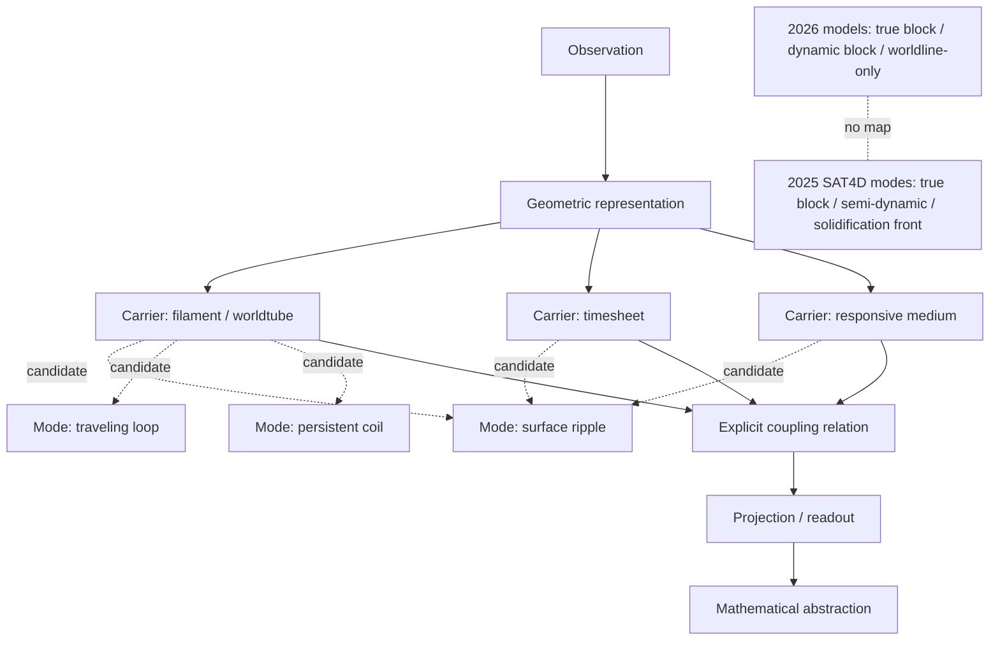

# Cross-temporal source fidelity: carriers, excitations, timewave, and coupling

**Status:** source-fidelity addendum only. No theory promotion, physical validation, CODATA scoring, or paper-gate submission.

**Nominal rotation label:** Calder, h=788, seq=3940. This is a scheduler label, not an authenticated ChatGPT instance or thread.

## 1. Retrieval and provenance

Mersearch was checked first. All four request lanes were occupied, including a pending lane-3 request with no result manifest. No request was overwritten or submitted. The work below is a bounded archive read, not an exhaustive Mersearch result. Existing Math Hopper/Whirligig materials, Lean PRs #873 and #1515, and the available Lean CI were checked before considering new tooling. The existing Lean project was sufficient; SciSpace is available but unnecessary for this source-critical task. No new tool, branch, PR, or paid service was created.

### 2026 raw conversation

- Title: `Workshop Relay :24 | Geometry`
- Conversation ID: `6aea46dd-dc60-83ea-8d50-689c152340e3`
- Path: `DEVELOPMENT_FULL_CONVOS/CONVOS_22/26.11.03•26.11.04•Workshop Relay _24 _ Geometry - raw.json`
- Git blob SHA-1: `436588fcb5c237e7e6a1d40fcb948b9aeb3b892b`
- SHA-256 of byte-identical Library copy: `66f40da20560cba9984ee437e2aba01c40185e85034cbab417a98b11f17a9798`
- 203 mapping nodes; last captured message `239db354-b515-42bd-b57e-b51531a2d949` at 2026-11-05T03:00:20.380Z.

The SHA-256 was computed over the materialized raw file; it matches the repository blob byte-for-byte.

### Direct-user message cluster

| UTC | Raw message ID | Geometry/concept surface |
|---|---|---|
| 2026-11-04 23:33:42.240897 | `100388c5-89d6-4ffd-a895-598990636057` | Mutual worldtube/timesheet curvature as working hypothesis; double-shell picture; coordinated timewave front; w propagation direction; path-length differences and accumulated twist; cross-front connectivity open |
| 2026-11-04 23:45:08.921004 | `72649a88-dc26-498f-9b5c-acd15e01e3c5` | Symmetric attribution default; reciprocal force language; “Newton's first law” label |
| 2026-11-05 00:59:11.004211 | `4e4fb20c-83ec-49e0-820f-1215bad51a56` | True-block/dynamic-block/worldline-only time models; Crullerverse chirality; Summer 2025 Bosonic Time recollection; speculative theta-four/refraction language |
| 2026-11-05 01:54:03.044621 | `1a930b29-d591-4031-83ec-f6c61becca92` | Surface ripple, traveling structural loop, persistent coil; nested helices; Kerr ring/shell to straight 4D vacuum worldtube proposal; BEC bulk explicitly hypothetical |
| 2026-11-05 02:07:13.192301 | `5e021f9e-6747-4a39-8df7-aabbd165d7b9` | Filament/worldtube as carrier; possible tube-to-tube transfer; timesheet and responsive medium as candidate carriers |
| 2026-11-05 02:32:59.320112 | `d46b6519-baf6-4215-a2f7-479775b85db7` | Coupling means coincidence or another explicit relation; separate mathematical representation must not imply physical independence |
| 2026-11-05 02:34:18.202141 | `3798ec34-85bb-4df9-aebc-1188a13c3efc` | Explicit epistemic boundary: observation, geometric representation, mathematical abstraction; not ontology |
| 2026-11-05 02:38:15.144392 | `1e77924f-2c05-4f35-b5e5-2885b0ede872` | Correlation and metrological/isometric precision as philosophical framing, not a physical equation |

### Earlier direct-source anchors

- `Fundamental Intuitions of SAT` raw export: `DEVELOPMENT_FULL_CONVOS/30SEP26_DUMP/25.10.30•26.06.01•Fundamental Intuitions of SAT — raw.json`, blob SHA-1 `0a7a270482bdda92a61d1c54ccccaf356e47aa0b`. User-role message `f476afce-eba0-4312-8c2b-36b82dbe7f3f`, 2025-10-30T05:12:46.507Z, describes `theta_4` as an intersection angle and the timesheet as a possible coordinated boson wavefront. The embedded long text may be compiled/pasted; authorship of every sentence is not independently established.
- User-only Blockwave transcript: `DEVELOPMENT_FULL_CONVOS/CONVO_HAUL_2NOV2026/Blockwave Lagrangian formula - user.md`, blob SHA-1 `c4c91886840bb3741b3c37e85fc5016c941f4487`. User message [34], 2025-10-22T14:46:52.736Z, tentatively says fermions are filaments and bosons are transferable vibrations traveling along them.
- Assistant-only Blockwave transcript: `.../Blockwave Lagrangian formula - assistant.md`, blob SHA-1 `82ff09b8c30e69f3a9150b55c7d1935f2c7f04d7`, exported 2026-11-03T09:20:37.595Z. It contains the assistant-produced action below. Do not attribute that action to Nathan Direct.
- The 2026 “Summer 2025” recollection is not authenticated by a raw Summer 2025 message. The recovered direct records establish related ideas by October 22 and October 30, 2025.

## 2. Independently extracted geometry

### Carrier axis

1. **Worldtube / filament:** structural carrier for an excitation. Tube-to-tube transfer is possible in principle, but no transfer map is supplied. “Filament” is not resolved as a 1D centerline, finite-core support, or both.
2. **Timesheet / time surface:** candidate geometric surface or coordinated front. The source proposes a relation to the metric but does not identify it with material spacetime fabric.
3. **Responsive medium:** third candidate carrier. Possible equivalence with the timesheet is favored, but left to empirical determination.

### Excitation-mode axis

1. **Surface ripple.**
2. **Traveling structural loop.**
3. **Persistent coil.**

These are distinct from the carrier axis and from the three interpretive time models. The 2025 direct proposal was broader: bosons as transferable filament vibrations. The 2026 source refines the geometry but leaves open whether the ripple or traveling loop is the bosonic form. No species assignment follows from the words “ripple,” “loop,” or “coil.”

### Timewave, nested paths, and Kerr proposal

The direct source favors mutual worldtube/timesheet curvature while retaining worldline-only and timesheet-only descriptions as possible alternatives. It describes a coordinated front of worldtube excitations, a separate w propagation direction, path-length differences, accumulated twist, and an approximate double-shell gravity-well picture. Cross-front connectivity remains open. No coordinate chart, metric signature, foliation, normal field, or equation relating w to t is supplied.

A helical excitation path and a worldtube that is itself coiled are two geometric levels. No projection or composition map is supplied. The proposed 3D Kerr ring/shell to straight 4D vacuum worldtube identification is not derived; the BEC-like bulk is explicitly hypothetical.

## 3. Glossary

| Term | Working meaning | Open boundary |
|---|---|---|
| Filament | Structural carrier | 1D centerline versus finite core |
| Worldtube | 4D structural object | Exact support and relation to filament |
| Timesheet | Time surface or coordinated front | Metric and medium correspondence |
| Responsive medium | Candidate carrier | Distinct from or equivalent to timesheet |
| Timewave | Coordinated front of worldtube excitations | No field equation or propagation map |
| Mutual curvature | Provisional symmetric attribution | No curvature tensor or coupling functional |
| Surface ripple | Surface-localized excitation | Carrier and topology unspecified |
| Traveling loop | Propagating loop-like excitation | Transfer and species assignment unspecified |
| Persistent coil | Persistent helical carrier feature | Bound excitation versus carrier geometry |
| Coupling | Coincidence or explicit relation | Relation space and admissible variations |
| First/second helix | Nested geometric levels | Projection and composition maps absent |

## 4. Mapping diagram

Dashed links are candidate associations, not established physical mappings.



The carrier, excitation, interpretive, and epistemic classifications are distinct. Their repeated three-element cardinality establishes no hierarchy or bijection.

## 5. Verbatim historical equations and provenance

### SAT-O1 module

- `SATOBLOC MISC/SAT O1 4D.txt`
- Blob SHA-1 `7577aa1ee5a6c3850ce3b226c75377de6367aedc`
- Undated and unbylined in the file; first extant repository commit 2026-09-04T21:14:41Z.

Verbatim source text:

```tex
\gamma^\mu(\lambda) = \left( \lambda, A_x \sin(k_x \lambda + \phi_x), A_y \sin(k_y \lambda + \phi_y), A_z \sin(k_z \lambda + \phi_z) \right)

v^\mu(\lambda) = \frac{d \gamma^\mu}{d \lambda}

S[\gamma] = \int d\lambda \, L(\gamma^\mu, v^\mu)

L = \frac{1}{2} m v^\mu v_\mu - V_{\text{tension}}(\gamma)

\phi_i - \phi_j = \frac{2\pi k}{n}
```

The file describes a worldtube as a 4D volume swept by a vibrating filament, while displaying a one-parameter curve. The sweep/thickening map is absent. Its “Hyperhelix” is a three-spatial-component sinusoidal vibration; no map identifies it with the 2026 ripple/loop/coil modes.

### SAT4D live draft

- `SATOBLOC MISC/SAT4D_LIVE_DRAFT.txt`
- Blob SHA-1 `2a79fe25018cce7e99a2c33786d88b0551db6ae7`
- Header: June 2025, Nathan McKnight; first extant repository commit 2026-09-04T21:14:41Z.

The draft's initial model is a static 4D block with moving `Σ_t` and time-flow vector `u^μ(x)`. Its three modes are **True Block**, **Semi-Dynamic Block**, and **Solidification Front**, not the 2026 direct triad **True Block**, **Dynamic Block**, and **Worldline-only**.

Verbatim draft expressions:

```tex
g_{\mu\nu}(x) = \left\langle \text{Filament Density and Alignment at } x \right\rangle_{\mathcal{F}(x)},

R^\rho_{ \ \sigma\mu\nu}(x) = \left\langle \text{Local Twist and Shear of Filament Bundles} \right\rangle_{\mathcal{F}(x)}.

\nabla_\lambda g_{\mu\nu} = 0.

\left\langle R_{\mu\nu} - \frac{1}{2} g_{\mu\nu} R \right\rangle_{\mathcal{F}} = \kappa \left\langle E_{\text{vib}}, \mathcal{L}_{\text{link}} \right\rangle_{\mathcal{F}}
```

These right-hand sides are descriptive averages, not operational definitions. Later in the same live draft, around lines 2284-2286, it says “There is no fixed background spacetime” and writes `g_{\mu\nu}(x) ~ <v_\mu v_\nu>`. This is a revision-layer conflict, not one stable specification. No theta-four refractive-index law appears in this draft.

### Historical assistant-produced Blockwave action

The assistant-only transcript records this at message [2], 2025-10-19T17:14:05.377Z. It is not a Nathan Direct equation. Transcript blob SHA-1: `82ff09b8c30e69f3a9150b55c7d1935f2c7f04d7`.

```tex
\mathcal{L} = \frac{M_P^2}{2} R
+ \frac{c_1}{2} P^{\mu\nu}_{\ \ \alpha\beta} \nabla_\mu u^\alpha \nabla_\nu u^\beta
+ \frac{c_2}{2} (\nabla_\mu u^\mu)^2
+ \lambda (u^\mu u_\mu + 1)
+ \frac{\kappa_0}{4} J_{\mu\nu} P^{\mu\nu}_{\ \ \alpha\beta} J^{\alpha\beta}
+ \frac{\kappa_2 \ell^2}{4} (\nabla_\rho J_{\mu\nu}) P^{\mu\nu\rho\sigma\alpha\beta} (\nabla_\sigma J_{\alpha\beta})
+ \frac{f_\theta^2}{2} \nabla_\mu \theta \nabla^\mu \theta
- \Lambda_\theta^4 (1 - \cos\theta)
+ \frac{g_h}{2} F(\theta) J_{\mu\nu} \tilde{F}^{\mu\nu}
+ \frac{1}{2} J_{\mu\nu} M^{\mu\nu}_{\ \ \rho\sigma}(\theta, u) J^{\rho\sigma}

S = \int d^4x \sqrt{-g} \mathcal{L}
```

Here `θ` is a compact periodic Blockwave phase. The 2025 direct `theta_4` statement describes a filament/time-surface intersection angle. The assistant later suggested a time-surface-twist interpretation for `θ`, but no source-authenticated map `theta_4 -> theta` exists. The November 2026 “theta-four refraction of time” phrase is a proposal, not a term in this historical action.

The exact original Blockwave equation custody and source corrections are also preserved in `WORKSPACES/COMMON/2026-11-11T1300Z_LANE00_BLOCKWAVE_THETA_PARTICIPANT_PAIR_AND_MODE_FIDELITY.md` and `WORKSPACES/COMMON/PUBLISHED_SUBMISSIONS/calder-theta4-sato-blockwave-fidelity-20261102t1300z-s0-001.md`. No corrected SAT-O or Blockwave action is proposed here.

### Bosonic Time leads

- `BOSONIC TIME AND TWO GRAVITIES.txt`, blob SHA-1 `bbc868efd38c38ba4710f82da1246f60d053aaa2`, upload commit 2026-10-01T20:40:31Z.
- `10-20-25 definitions.txt`, blob SHA-1 `afda1c11ae1693267d9f030445bfb24070c86541`, upload commit 2026-10-01T20:39:54Z.

Both are mixed/compiled artifacts without raw role metadata. The recovered June 2025 draft establishes a time-surface model; the October 22/30 user-role records establish filament/boson and coordinated-wavefront ideas by those dates. None authenticates the exact Summer 2025 first-use conversation.

## 6. Original propositions versus assistant translations

| Direct proposition | Assistant/historical translation | Fidelity result |
|---|---|---|
| Mutual worldtube/timesheet curvature is a working hypothesis; worldline-only and timesheet-only remain possible | Tensor-level summaries name interaction but omit the curvature type | Intrinsic, extrinsic, normal-bundle, ambient, and interaction curvature remain distinct |
| Timewave is a coordinated excitation front with separate w propagation | 2025 SAT4D uses moving `Σ_t` and `u^μ` | No map connects the slicing model to the excitation-front model |
| Three carriers and three excitation forms | `X(s)=C(s)+r(s,φ(s))` | One displaced path does not encode the carrier/mode taxonomy or tube-to-tube transfer |
| Coupling requires an explicit relation | Assistant `Φ(A,B)=0` | Scalarization is one possible special case, not the direct statement |
| Symmetric attribution absent preferential instrumentality | Assistant `Q_A=Q_B=Q/2` | Special additive scalar split; it additionally requires `Q_A+Q_B=Q` and `Q_A=Q_B` |
| Observation, geometry, abstraction are distinct; not ontology | Assistant equations may look more definite than the source | Epistemic boundary must accompany every reconstruction |

## 7. Discrepancy ledger

| ID | Issue | Required resolution |
|---|---|---|
| D1 | Filament versus worldtube dimensional status | Define centerline, core, support, and sweep map |
| D2 | Mutual curvature is untyped | Specify intrinsic/extrinsic/normal-bundle/ambient or interaction curvature |
| D3 | Timesheet/metric equivalence is unmapped | Define hypersurface, induced metric, and correspondence |
| D4 | w propagation versus time surface | Define coordinate chart, front family, propagation vector, and relation to t |
| D5 | Carrier versus excitation | Define admissible carrier-mode pairs and transfer maps |
| D6 | Boson/fermion assignment remains open | Specify quantum representation/statistics or leave unassigned |
| D7 | Nested helices lack composition | Define tubular embedding, normal frame, projection, and composition |
| D8 | Coupling scalarization is assistant-chosen | Define relation space, codomain/rank, and joint variations |
| D9 | `Q/2` overstates symmetry default | State additivity and equal-contribution assumptions |
| D10 | “Newton's first law” is a source naming error | Preserve the source error; comparator is the third-law action-reaction relation |
| D11 | 2025 and 2026 time-model triads differ | Supply maps before treating them as equivalent |
| D12 | Kerr/worldtube identification is unproved | Define embedding/limit map; keep BEC bulk hypothetical |
| D13 | Summer 2025 Bosonic Time origin is not authenticated | Recover the original raw conversation |
| D14 | `theta_4` and Blockwave `θ` differ | Keep fields distinct until a typed map exists |
| D15 | 2025 transferable-boson idea versus 2026 ripple/loop/coil refinement | Define the carrier-mode map without premature species assignment |
| D16 | “Not ontology” versus “correlation is reality” | Keep epistemic and ontological claims distinct |

## 8. Formalization and corrected-restatement boundary

No new Lean module was added because the new carrier/mode taxonomy lacks the required types and maps. The existing Lean project was checked:

- PR #873 head `7dbcb5f18690232d921db74f25dfdf222ee51b8c`, still open/draft and separate from `main`.
- Exact-head run [#43202552666](https://github.com/Satobloc/HsH/actions/runs/43202552666), `lean-verification`, completed successfully on 2026-11-12T10:41:17Z to 10:45:44Z.
- The build compiled `WorldtubeInertiaCoordinate`, `GeometryProvenanceSeparation`, and `KestrelIntersectionDimensionGate`.

This verifies only the statements formalized in that branch. It does not validate physical premises, source translation, or the new taxonomy. `WorldtubeInertiaCoordinate` is a conditional algebraic implication, not a derivation that curvature is inertia. No local Lean executable is installed.

Separate typed proposals, not corrections to the archived equations:

1. Define an admissibility relation \(A\subseteq Carrier\times Mode\), not an assumed full Cartesian product.
2. Define coupling as a relation \(\mathcal R\subseteq\mathcal X_W\times\mathcal X_\Sigma\times\mathcal X_M\), or a typed constraint map with explicit codomain.
3. Define a foliation \(\Sigma_w=\{x:\tau(x)=w\}\), a propagation field \(V_w^\mu\), and a separate metric correspondence such as \(h=\iota^*g\).
4. Define a tubular embedding \(\Psi:I\times D^3_\epsilon\to\mathcal M^4\), centerline, and normal frame before composing nested helices.
5. Treat \(F_{AB}=-F_{BA}\Rightarrow\|F_{AB}\|=\|F_{BA}\|\) as conditional. The `Q/2` result additionally needs additive decomposition and equal contributions.

## 9. Panorama and next cursor

- **GR:** worldtube, hypersurface, metric, and curvature are different typed objects.
- **String theory:** “timesheet” does not establish a string worldsheet.
- **SM/QM:** ripple/loop/coil geometry does not establish spin or statistics.
- **Information:** correlation does not itself imply conservation, retention, or a channel model.

Next:
1. Recover the raw Summer 2025 conversation and separate user-role from assistant-role messages.
2. Recover original SAT-O and Blockwave time-surface, theta-four, and curvature equations with file SHA and source date. Keep corrections separate.
3. Define carrier/mode admissibility and transfer maps.
4. Define worldtube embedding, timesheet family, w propagation, responsive-medium relation, and readout projection.
5. Define nested-helix maps and composition conditions.
6. Formalize only after types are fixed; keep Lean proof, translation fidelity, and physical validation separate.
7. No physical calculation until an identifiable measured system/dataset, provenance, units, uncertainties, and prediction-versus-fit separation exist.

**Disposition:** source-recovery expansion complete for the recovered 4-5 November cluster and linked October 2025 anchors. Summer 2025 first-use provenance remains open. No CODATA scoring, physical calculation, BEDROCK change, or paper-gate advancement.
