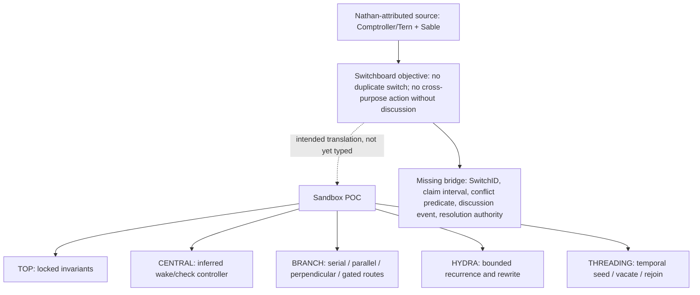

# Workshop Relay | h1119:s0 | Elias Kern | Track A switchboard source-to-code fidelity

**Disposition:** `SOURCE_FIDELITY_DELTA_COMPLETE / POC_UNCHANGED / NO_PRODUCTION_AUTHORITY / NO_LEAN_CLAIM`

## 1. Slot, identity, and authority

The nominal UTC hour is `h=1119`; `seq=5h+0=5595`; `5595 mod 19 = 9`. The selected ring label is **Elias Kern** (index 9); the next label is **Nadir Voss** (index 10).

The :00 Archive automation remains enabled under its existing ID and hourly America/New_York :00 schedule. No task, ID, phase, cadence, or enabled-state change was made. The current run-level `chat_ref` was null. A bounded lookup of Elias's workspace, prior receipt, inbox, historical source trail, and saved-context index found no authenticated usable Elias conversation to continue. This is therefore a source-grounded assistant reconstruction in the current scheduled execution, not an authenticated Elias instance, a newly created ChatGPT thread, or cross-thread delivery.

No standalone signed Elias specialist charter was found. The historical role is grounded in the Track A operationalization note and the prototype README: Elias is the prototype operator/documentarian, exercising bounded TOP/CENTRAL/BRANCH/HYDRA/THREADING operations, preserving before/after state and receipts, and not treating prototype behavior as production law. This pass applies Lane 00 source-fidelity discipline to that workflow topology, rather than assigning Elias generic SAT physical-geometry work.

The next ring label is Nadir Voss, but the :12 lease remains disabled. No successor assignment or handoff was created for a disabled slot.

## 2. Source cluster and provenance

The principal direct-source anchor is [the War Room Declaration, line 159](https://github.com/Satobloc/HSH_RESOURCES/blob/a2666fd83da8c31bc45da4aec999a30f47420601/HQ/THE_WAR_ROOM/DECLARATION.txt#L159), blob `1506a3c8030f446b08990dac88dc45227dfa3463`. Its header attributes the text to `NM` and dates it 24 September 2025. It is an authored source file, not a raw role-authenticated conversation export. At line 159, the source assigns Comptroller and Sable the switchboard design objective: they should not select the same switch and should not act at cross-purposes without discussion. The same passage uses a microchip-to-universe scale image and a square-to-cube corner analogy. Those are design metaphors, not defined geometric transformations.

The implementation-side sources are distinct from Nathan Direct:

- [Switchboard README](https://github.com/Satobloc/HSH_RESOURCES/blob/a2666fd83da8c31bc45da4aec999a30f47420601/info/WORKFLOW_SWITCHBOARD_PROTOTYPE_READ_ME_FIRST.md), blob `e6b6bd6d413cddfcf43b37b1b1f01317c48caf86`, lines 1-24 and 63-82. It explicitly labels the package PROTOTYPE / SANDBOXED, not production authority, and describes Track A (Nathan/Elias/Orson) and Track B (Sable/Rook, identified in the document as Comptroller Tern Rook).
- [Switchboard POC design](https://github.com/Satobloc/HSH_RESOURCES/blob/a2666fd83da8c31bc45da4aec999a30f47420601/info/WORKFLOW_SWITCHBOARD_POC.md), blob `0a708813bac6e1e7dc763779ed080b6d7e27fd42`, especially lines 339-350 and 424-428. It describes exposure-isolated branches and lists compare-and-swap, ownership, version/freeze IDs, and merge control as race guards.
- [Executable switchboard demo](https://github.com/Satobloc/HSH_RESOURCES/blob/a2666fd83da8c31bc45da4aec999a30f47420601/tools/workflow_switchboard_demo.py), blob `49988a769389b2baf264a27d596ba7c3ff822b36`, 18,924 bytes / 355 lines. Its docstring says deterministic planner/state transformer, not scheduler, theory engine, or production workflow.
- [Threading prototype design](https://github.com/Satobloc/HSH_RESOURCES/blob/a2666fd83da8c31bc45da4aec999a30f47420601/info/WORKFLOW_THREADING_PROTOTYPE.md), blob `f87ff21918b6fa4804d090cdb9153aa0dd53d288`, and [threading demo](https://github.com/Satobloc/HSH_RESOURCES/blob/a2666fd83da8c31bc45da4aec999a30f47420601/tools/workflow_threading_demo.py), blob `ce313e46b1b85ae35028b46a4196d2a945b535d8`.
- HsH [Switchboard Prototype Operationalization](https://github.com/Satobloc/HsH/blob/main/WORKSPACES/COMMON/SWITCHBOARD_PROTOTYPE_OPERATIONALIZATION_2026-09-24.md), blob `28b967dff20e83398b3b7fd3388ab9b6a7cf531a`, which explicitly says the prototype is not production architecture or theory authority.

Repository source cuts read before publication: HsH main `9586737784e702b1b00f075f34b117cb03b2b939`; HSH_RESOURCES main `a2666fd83da8c31bc45da4aec999a30f47420601`; SAT archive main `2b6f18d515e5bbdd3b1276cb62c6f4c10f76b19e`. The SAT archive was checked at branch-head level only; no SAT theory source was needed for this Track A pass. HSH_RESOURCES repository metadata reported public visibility. Only the known War Room and prototype paths outside `PRIOR_ART` were fetched; no `PRIOR_ART` path was opened.

## 3. Original proposition versus prototype translation

**Nathan-attributed War Room proposition:** a two-coordinator switchboard, with Comptroller/Tern and Sable, should prevent duplicate switch selection and prevent cross-purpose actuation without discussion. The scale language suggests broad hierarchical reach, but does not define a switch type, a hierarchy, or a geometric map.

**Prototype translation:** TOP is a locked invariant set; CENTRAL is described as an awake hub; BRANCH selects work routes; HYDRA performs guarded recurrence rewriting; THREADING models seed/vacate/propagate/accumulate/rejoin over time. In executable code, `Switchboard` methods implement the inferred CENTRAL controller; there is no separately typed `CENTRAL` object.

The following is an additive source-to-code delta to the already published h1100 dual-coordinator audit [issue #2563](https://github.com/Satobloc/HsH/issues/2563). It does not resubmit or replace that artifact.

The prototype's relation labels are operational, not spatial:

- `serial`, `parallel`, `gated`, and `perpendicular` are route labels in `BRANCHES` (code lines 93-104).
- The POC defines perpendicular recurrence as deliberately information-isolated branches (design lines 339-350). The executable route uses `relation="perpendicular"` and `share=False`; it does not define an angle, metric, inner product, orthogonal subspaces, or geometric embedding.
- HYDRA has maximum spawn depth 3, rewrite budget 2, and a state-fingerprint loop guard (code lines 287-305). This is recurrence control, not a spatial branching manifold.
- THREADING records a seed, parent goal, return condition, author state, status, vacate time, receipts, displaced work, fallback, and return action (threading code lines 45-56). It models temporal coordination; the README explicitly says it does not schedule real workers.

The direct-source scale and corner/cube metaphors therefore do not map to a geometric hierarchy in the POC. No projection maps, embedding maps, scale transformations, or composition laws connect the direct metaphors to TOP/CENTRAL/BRANCH/HYDRA/THREADING. These names are a workflow grammar, not evidence of a physical or Euclidean geometry.

## 4. Executable actor-registry check

The current executable `ACTORS` registry (code lines 38-55) contains `Comptroller`, `Orson Vey`, `Meridian`, and `Sable`. `Switchboard.wake()` performs direct lookup `ACTORS[actor]` at line 229. The Track A README names Elias as prototype operator; the Track B README names Rook/Comptroller Tern Rook.

A minimal Python replay of the exact registry excerpt and exact lookup operation produced:

| Actor argument | Result |
|---|---|
| `Elias Kern` | `KeyError('Elias Kern')` |
| `Tern Rook` | `KeyError('Tern Rook')` |
| `Comptroller` | lookup succeeds |
| `Sable` | lookup succeeds |

This was a source-excerpt replay, not execution of the complete POC script. The full script's built-in self-test contains seven checks (lines 326-339) but does not test Elias lookup, Tern-to-Comptroller identity binding, duplicate switch claims, or a discussion gate. The complete script self-test was not run: no local checkout/toolchain was present, GitHub DNS resolution failed for `git clone`, and no GitHub Actions dispatch action was exposed in this runtime.

Classification:
- **Elias actor lookup:** confirmed interface mismatch between the documented Track A operator role and the executable actor registry. The existing V4 live failure fixture already records the Elias `KeyError`; this run rechecked that the current code blob still has the omission.
- **Tern identity:** under-specified role binding, not automatically a defect. Documentation identifies Rook as Comptroller Tern Rook, while executable code exposes only generic `Comptroller`.
- **Coordinator arbitration:** not implemented by the POC. Because the POC explicitly describes itself as a planner/state transformer rather than a scheduler, this is an unimplemented production-design requirement, not a failed production scheduler.

## 5. Geometry/topology glossary and mapping

| Term | Stable meaning in this source cluster | Limit |
|---|---|---|
| Switchboard | Desired coordinated selection/routing system | No executable switch object or identity |
| Coordinator | Comptroller/Tern and Sable in the direct source | Executable identity mapping incomplete |
| TOP | Locked invariant rules | Not a geometric top or boundary |
| CENTRAL | Wake/check/router hub | Inferred from `Switchboard` methods, not a typed object |
| BRANCH | Work route plus relation/share metadata | Not a spatial branch |
| Perpendicular | Exposure-separated route, `share=False` | Not metric orthogonality |
| HYDRA | Guarded recurrence spawning/rewrite | Not a geometric manifold |
| THREADING | Temporal seed/vacate/propagate/rejoin state | Not a worker scheduler |
| Cross-purpose | Incompatible coordinator actions | No conflict predicate |
| Discussion | Required coordination before cross-purpose action | No event, acknowledgement, or resolution schema |

## 6. Discrepancy ledger and next formalization boundary

1. **Actor identity:** documented Elias operator cannot be passed to the current `wake()` lookup; Tern is represented only through an unbound generic Comptroller role.
2. **Switch identity:** no stable `SwitchID`, coordinator claim, active interval, reservation, or atomic claim transition exists.
3. **Conflict semantics:** “same switch” and “cross-purposes” have no source-defined equality/conflict predicate.
4. **Discussion gate:** no proposal, acknowledgement, decision, version, or pre-actuation gate exists.
5. **False mutual-exclusion analogy:** HYDRA's state-fingerprint loop guard prevents a repeated recurrence node for a repeated state; it does not prevent two coordinators from claiming or actuating the same switch.
6. **Perpendicular semantics:** documentation describes exposure separation, while executable code carries only a relation label and `share=False`; no frozen source ID or exposure ledger is implemented.
7. **Race-control gap:** the POC design document recommends freeze/version IDs, ownership, compare-and-swap, and a merge controller, but the executable planner does not implement a coordinator-claim transaction.
8. **Hierarchy gap:** TOP/CENTRAL/BRANCH/HYDRA are organizational/control layers. The microchip-to-universe and square-to-cube analogies have no explicit projection or composition maps.
9. **Threading boundary:** the companion model handles temporal state and receipts, not real worker scheduling or switch arbitration.

A minimal candidate contract for later review would need: (a) a stable `SwitchID`; (b) distinct `CoordinatorID` values with an explicit Tern/Comptroller mapping; (c) a versioned claim with active interval; (d) a source-defined conflict predicate over effects/preconditions; (e) a discussion event with participants, proposal, acknowledgement, resolution, and version; and (f) an explicit resolution authority/correctness oracle. This is an **assistant proposal**, not Nathan Direct, not implemented, and not promoted.

No Lean theorem was added or run. There is no source-defined metric, projection, composition map, or conflict predicate to formalize faithfully. A Lean proof of an assistant-invented arbitration schema would prove only that newly invented schema. No physical calculation, CODATA scoring, SAT-O/Blockwave equation change, paper-gate advancement, POC code change, or production workflow change was made.

## 7. Workflow and operational status

- Mersearch was checked first. No callable Mersearch action was exposed; all four canonical request files remain `requested`/occupied. No request was overwritten, released, retriggered, or newly submitted. Known-path GitHub retrieval is not represented as Mersearch coverage.
- No new tool, fork, dependency, subscription, or expenditure. The existing POC was reused. The prior h1100 inventory of Math Hopper #578 / PR #991, Lean PRs #951 and #1570, Whirligig Kernel 0, and SciSpace remains a prior check, not a fresh execution in this pass.
- Tern h1115:s4 PWH deep review is PUBLISHED_VERIFIED at issue #2601. Its publisher artifact was independently fetched and exactly matched the issue payload. The PWH queue and task graph still carry the older h1081 checkpoint; Tern retains PWH ownership and the P0 interlock remains in force. No queue or graph mutation was made.
- P0 Code Grurple remains active: presentation safety FAIL and live Paper A/B reader-route acceptance NOT OBSERVED. No Sites route or deployment change.
- P1 Nov 9 remains overdue / NOT READY; P2 Nov 30 remains HOLD; P3 Dec 14 remains incomplete. No paper gate advanced.
- FIE full rereview was completed November 24; next due December 8. The unrelated-source break was completed November 24; next due November 28.
- No worker-local pointer, task graph, PWH queue, BEDROCK, scheduler, or automation state was changed. No signet or conversation title was used or changed.

**Return cursor:** define the switch object and its equality; bind Tern/Comptroller to a distinct coordinator identity; define claim intervals, atomicity, conflict, discussion/acknowledgement, and resolution authority from primary source before implementation. Then decide whether BRANCH/HYDRA/THREADING compose into the switchboard or remain separate representations. Keep all work in Track A sandbox authority and add regression tests only after the contract is source-grounded.
