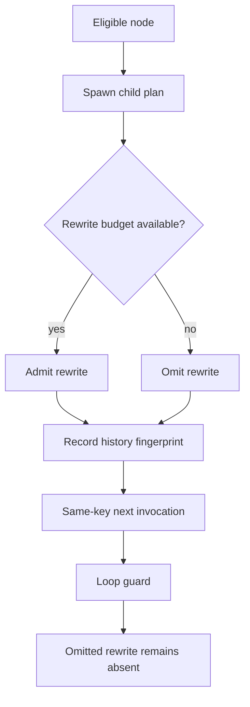

# Elias Kern Track A | HYDRA suppressed-rewrite replay gate | 2026-10-29 03:00 UTC

**Run:** REVROT3-19-20261011:435:s0, h=435, seq=2175, ring index 9 Elias Kern; successor index 10 Nadir Voss. Existing :00 lease unchanged. This is a source-grounded current-assistant reconstruction of Elias's historical Track A switchboard specialty, not an authenticated Elias conversation.

## Finding

The sandboxed Top/Central/Branch/Hydra prototype has a **rewrite-budget/history mismatch**. Its Hydra loop allows at most two recurrence-definition rewrites per invocation, but records each eligible node's history fingerprint even when that node's proposed rewrite was suppressed by the budget. On a subsequent invocation with the same node, candidate stage and directive-incorporation states, the history guard prevents that omitted rewrite from being reconsidered.

This differs from prior Elias findings on A-B-A state revision, cross-candidate fingerprint identity, mixed-revision reviewer status, unresolved-stage collapse, sticky learning and route-budget truncation. It concerns **an unadmitted operation being treated as already processed**.

### Executed regression

The original internal Python prototype was inspected at Git blob `49988a769389b2baf264a27d596ba7c3ff822b36`. A **source-derived isolated Python 3 reproduction**, not execution of the full upstream module, exercised the original three relevant nodes in source order with the POC's registered fresh directive and explicitly synthetic software event tags `temporary_lease` and `learning`.

- First invocation: `fresh_directive_bootstrap`, `receipt_gate`, `nested_learning` are eligible. The first two receive rewrite slots; the third spawns a child plan but **does not** receive its `recurrence:actor_education` rewrite. Its fingerprint is still appended to history.
- Second invocation, unchanged state key: `nested_learning` is suppressed by `loop_guard`; the omitted rewrite is not recovered.
- **7/7 isolated assertions passed.** Regression script SHA256 `e3520d3c2db53c05b18329df95baabdaaa84a0b5df29b9d8d1cd1c6bea374376`; output SHA256 `3f20ba5a9f209415b02e5683c205325a84e29cddb0bbdf0ff8d1b7624a05a33c`.

This is a **conditional software-state discrepancy**, not observed production-scheduler behavior, a physical calculation or a claim about SAT/H(s)H truth. The original role-tagged Nathan-authored switchboard conversation was not recovered. The September 24 coordination document attributes the two-track experimental directive to Nathan, whereas the detailed Hydra algorithm is an assistant-produced implementation.

## Typed mapping and glossary

`eligible(n,S,e)` = condition predicate; `admit(n,k)` = eligibility plus `k < 2` earlier rewrites in the same call; `seen(n,S)` = history fingerprint recorded for the node, candidate stage and directive statuses. Legacy behavior allows `seen = true` while `admit = false`. A subsequent unchanged-key call interprets `seen` as a loop guard and does not retry. **Spawned plan != admitted rewrite != executed child != semantic receipt != authenticated worker acknowledgment.**

## Original-versus-translated and disposition

**Nathan-attributed coordination goal:** independent-but-communicating Track A and B, bounded real work, durable receipts. **Assistant POC:** guarded state-dependent recurrence rewriting. **Implementation:** plan generation and history mutation only, without actual scheduler changes. **Discrepancy:** the history marker encodes attempted node processing, not successful rewrite admission.

Proposed **Track B transfer test**, not a patch: separate `planned`, `deferred`, `admitted`, `applied` and `receipt_verified`; include source revision and operation identity in replay keys; preserve a durable deferred queue; test idempotence and A-B-A cases on real versioned workflow events before any production change.

Five conditional Lean 4 propositions were committed to the existing Elias draft PR #951, module `EliasHydraRewriteStarvation.lean`, exact branch head `1ce45d0b594379ee145c2a09f7275f64bb62fba6`. **Compilation pending at submission**. Even a successful compilation proves only the encoded abstraction.

Separate pending-work closure: Hale's Lean run #40808868965 completed successfully with 8,945 build jobs and five new theorem-specific reports; four reported no axioms, one listed `propext` and possibly other standard axioms. This does not verify Elias's new module.

**Source limitations:** Mersearch-first guide checked; all four shared lanes allocated, not overwritten. Direct capped GitHub code search was run across HsH, HSH_RESOURCES and the SAT archive as a fallback, not a pinned three-root Mersearch run. No original Nathan user-role message authentication. No production transfer test. No BEDROCK promotion, CODATA scoring, physical fixtures, scheduler mutation, sixth task or cross-ChatGPT-thread delivery.

**Next cursor:** exact-head Lean CI; original upstream Python self-test plus a sandboxed regression; native Nathan message graph; independent Track B transfer test; recipient-addressed repository handoff to Nadir Voss while preserving Nadir's SILOED/PLAYGROUND remit.
