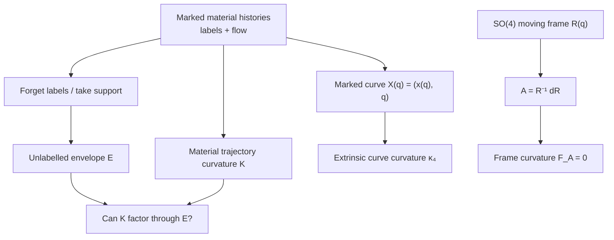

# Elias Kern h1024:s0 | Material-flow curvature and worldtube projection

**Disposition:** SOURCE-FIDELITY DELTA / MATHEMATICAL COUNTEREXAMPLE DERIVED / GENERIC PROJECTION THEOREM REUSED FROM EXACT-HEAD LEAN CI / NO THEORY PROMOTION.

## 1. Scope and source hierarchy

This is a bounded Lane 00 source-fidelity review of the October 21, 2026 rotation/worldtube-curvature exchange and its later assistant-authored correction. It does not change Elias Kern's standing Track A switchboard remit or authority. No Track A code, branch, PR, P0 ownership, or production permission was changed.

The primary user statement is that three-dimensional rotation is four-dimensional curvature and that three-dimensional acceleration is represented as four-dimensional curvature. The assistant's subsequent correction distinguishes material-trajectory curvature from the curvature of a moving-frame connection. The public correction record is:

[Rotation as worldtube curvature correction](https://github.com/Satobloc/HsH/blob/main/WORKSPACES/MERIDIAN/SANDBOX_2026-10-21_ROTATION_AS_WORLDTUBE_CURVATURE_CORRECTION.md)

- Current Git blob SHA-1: `ad2202a856e6d99e552d553af5a1ab84f18ff7bd`
- Original correction date: 2026-10-21
- Source-fidelity amendment: 2026-11-05

The November 5 amendment is important: the `q = c t` curve used in the Euclidean calculation is an **external comparator**, not the native H(s)H coordinate convention. Current BEDROCK preserves the literal `cw=t` notation, the `++++` ambient convention and the Forest Normalization, while leaving the symbol/type map unresolved. Do not identify `q = c t` with native `w` or proper time.

Mersearch was checked before fallback retrieval. All four canonical request lanes were occupied; the one available compact receipt concerned a different archive query and did not supply geometry hits. No request was overwritten, released, or retriggered. This report therefore uses the primary raw source retained in the user's archive plus existing public HsH/SAT records; it does not claim a Mersearch result.

Source classes used below:

- **Nathan Direct:** the October 21 user-role statement about rotation and four-dimensional curvature; the later native-coordinate statement is separately preserved in BEDROCK.
- **Assistant reconstruction:** the Euclidean lifted-curve formula and the unlabelled-envelope observation in the correction file.
- **Historical formalization:** SAT-O1 4D and Blockwave originals, with provenance below.
- **Standard mathematical result:** the factorization criterion already formalized in PR #1115.
- **Proposal:** the axisymmetric example below, used as a mathematical test of the assistant's envelope claim.
- **Independent measurement:** none. No physical measurement or prediction is claimed.

## 2. Three different meanings of curvature

The historical assistant initially treated a flat pure-gauge frame connection as if it ruled out curvature of the material trajectory. That inference is invalid because three different objects are involved.

1. **Frame-connection curvature.** For a smooth moving frame \(R(q)\), the Maurer-Cartan form \(A=R^{-1}dR\) is pure gauge and its gauge curvature \(F_A=dA+A\wedge A\) vanishes.
2. **Material-trajectory curvature.** A marked material point can trace a curved path in flat Euclidean four-space. Its Frenet curvature can be nonzero even when the frame connection is flat.
3. **Ambient Riemann curvature.** The ambient Euclidean \(\mathbb R^4\) can remain intrinsically flat while embedded material curves are extrinsically curved.

Thus \(F_A=0\) does not imply \(\kappa_4=0\), and neither statement establishes nonzero ambient Riemann curvature. The direct claim is most naturally compared with item 2, not item 1 or item 3.

## 3. Conditional Euclidean lift

The assistant correction uses the external Euclidean comparator

\[
X(q)=(x(q),q),\qquad x(q)\in\mathbb R^3,
\]

with \(q\) an affine length coordinate, \(v=dx/dq\), and \(a=d^2x/dq^2\). Under the Euclidean `++++` metric,

\[
\kappa_4^2=
\frac{(1+\|v\|^2)\|a\|^2-(v\cdot a)^2}
     {(1+\|v\|^2)^3}.
\]

By Cauchy-Schwarz, \((v\cdot a)^2\leq \|v\|^2\|a\|^2\), so the numerator is at least \(\|a\|^2\). Therefore, for this graph-over-\(q\) lift,

\[
a\neq 0\quad\Longrightarrow\quad \kappa_4>0.
\]

This is a correct conditional geometric identity. It assumes a \(C^2\) curve representable as a graph over an affine \(q\) coordinate and the Euclidean metric. It is not a derivation of the native `cw=t` convention, a Lorentzian proper-acceleration law, an inertia law, or a physical force equation. Curves that turn back in \(q\) are not covered by a single global graph chart.

## 4. New additive result: the unlabelled envelope is not enough

The correction file also proposes that a rotating body's unlabelled worldtube envelope can coincide with the envelope of a nonrotating body even though the marked material trajectories differ. This is an assistant reconstruction, not a separate Nathan Direct statement. It is correct for symmetric bodies, but its scope should be made explicit.

Take an axisymmetric disk \(D_R\subset\mathbb R^2\), a longitudinal coordinate \(z\), and an external Euclidean coordinate \(q\). Let

\[
F_\omega(p,z,q)=(\operatorname{Rot}_{\omega q}p,z,q).
\]

Because every planar rotation preserves \(D_R\),

\[
\operatorname{Rot}_{\omega q}(D_R)=D_R,
\]

and therefore the unlabelled swept support is

\[
E_\omega=D_R\times[-H,H]\times I_q=E_0
\]

for every \(\omega\). The support set is identical for the rotating and stationary cases.

But a marked rim point follows

\[
X_\omega(q)=
(R\cos(\phi+\omega q),R\sin(\phi+\omega q),z,q).
\]

Its Euclidean four-dimensional curve curvature is

\[
\kappa_\omega=\frac{R\omega^2}{1+R^2\omega^2}.
\]

Hence \(\kappa_0=0\), while \(\kappa_\omega>0\) for \(R>0\) and \(\omega\neq0\). The same unlabelled support therefore corresponds to different material flows and different material-trajectory curvature.

**Result:** the map from marked material histories to unlabelled support is non-injective. Any readout that depends on material rotation or trajectory curvature cannot be reconstructed from the support set alone. The representation must retain material labels, a flow/velocity field, or another equivalent internal record. This is a mathematical counterexample, not a measured physical fixture.

## 5. Formal projection condition and Lean evidence

Let \(S\) be the space of marked material histories, \(O:S\to E\) the map that forgets labels and retains only the unlabelled envelope, and \(K:S\to\mathcal K\) a material-curvature readout.

A reduced envelope representation preserves \(K\) exactly when there exists \(\bar K\) such that

\[
K=\bar K\circ O.
\]

Equivalently, \(K\) must be constant on every fiber of \(O\):

\[
O(s_1)=O(s_2)\Longrightarrow K(s_1)=K(s_2).
\]

The axisymmetric example supplies a witness pair with the same envelope and different curvature, so this curvature readout does **not** factor through the unlabelled envelope.

The generic equivalence is already formalized in:

[PR #1115: ObservableProjection.lean](https://github.com/Satobloc/HsH/blob/883003fef9ff77e771bce30eac8a112741728fbc/FORMAL_VERIFICATION/HsHVerification/ObservableProjection.lean)

- Exact PR head: `883003fef9ff77e771bce30eac8a112741728fbc`
- Exact-head GitHub Actions run: [#43404565082](https://github.com/Satobloc/HsH/actions/runs/43404565082)
- Job: `131815614359`
- Lean: 4.34.0; Lake: 5.0.0; Mathlib build completed successfully.
- The theorem `evidence_invariant_assessment_iff_factors_through_observation` uses `Classical.choice`; no `sorryAx` was observed in the recorded build output.
- PR #1115 remains open/draft and unmerged. It is protected existing work; it was read and reused, not modified.

**Formalization limit:** the exact-head Lean build proves the generic factorization equivalence. The axisymmetric rotating-disk witness and its curvature expression were derived analytically here, not added as a new Lean theorem or separately compiled. The Lean result does not prove that the proposed observation map is the physically correct H(s)H representation, nor that the physical premises are true.

## 6. Historical SAT-O1 and Blockwave equations preserved verbatim

These are separate historical formalizations. Neither is the direct October 21 curvature statement, and neither is identified with the Euclidean frame connection above.

### SAT-O1 4D

[Original SAT-O1 4D text](https://github.com/Satobloc/SAT_THEORY_ARCHIVE_2023-25/blob/main/SATOBLOC/SAT%20O1%204D.txt)

- Git blob SHA-1: `7577aa1ee5a6c3850ce3b226c75377de6367aedc`
- File-index last-write: 2025-06-09 18:44:50 local time
- First extant Git commit: 2025-10-27
- Attribution: unbylined historical formalization.

Verbatim core:

```text
γ^μ(λ) = (λ,
          A_x sin(k_x λ + φ_x),
          A_y sin(k_y λ + φ_y),
          A_z sin(k_z λ + φ_z))

v^μ(λ) = dγ^μ/dλ
S[γ] = ∫ dλ L(γ^μ, v^μ)
L = 1/2 m v^μ v_μ - V_tension(γ)
φ_i - φ_j = 2πk/n
```

### Blockwave Clean Action

[Original Blockwave attachment](https://github.com/Satobloc/HsH/blob/main/DEVELOPMENT_FULL_CONVOS/MOSTLY_EARLY_NLM/%F0%9F%A7%B1BLOCKWAVE.txt)

- Git blob SHA-1: `ffdb8aadb6ac93e3c9d5f48aad8153dcedaf997d`
- Attachment event: 2025-09-16T16:31:26.687Z
- First extant Git commit: 2026-10-08
- Attribution: assistant-voiced; authorship unresolved.

Verbatim core:

```text
u^μ u_μ = -1
P^μ{}_ν = δ^μ{}_ν + u^μ u_ν
J^{μν} = 1/2 ε^{μνρσ} ∇_ρ B_σ
∇_μ J^{μν} = 0
A_μ(θ) = α_* ∇_μ θ
F_{μν}(θ) = ∇_[μ A_{ν]}(θ)
```

The `F_A` of the SO(4) frame connection is not Blockwave's \(F_{\mu\nu}(\theta)\). Blockwave's \(J^{\mu\nu}\) is a two-form current, not the material-flow map or the one-form frame connection. No map from either historical formulation to the current native `cw=t`, `++++` geometry is established here.

**No original SAT-O1 or Blockwave equation was edited. No replacement equation is promoted.** The Euclidean curve-curvature formula above remains a separately labelled assistant reconstruction.

## 7. Original versus translated propositions

| Source proposition | Historical translation | Fidelity assessment |
|---|---|---|
| Nathan Direct: 3D rotation/acceleration is represented as 4D curvature | Initial assistant inference from a flat pure-gauge frame connection | **Mismatch:** \(F_A=0\) does not imply zero material-trajectory curvature |
| Nathan Direct: rotation is a property of the 4D material history | Corrected Euclidean graph lift \(X(q)=(x(q),q)\) | **Conditional match:** valid for a \(C^2\) graph in Euclidean \(++++\); not a native `cw=t` derivation |
| Assistant reconstruction: an unlabelled envelope may coincide for rotating and stationary bodies | Axisymmetric disk example | **Verified mathematical scope:** true for rotationally invariant support; not universal for arbitrary bodies |
| Current native H(s)H convention | Literal `cw=t`, `++++`, Forest Normalization | **Unmapped:** keep separate from external `q=ct` comparator |
| SAT-O1 4D | One-parameter curve and curve action | **Unmapped:** no material-flow/envelope projection supplied |
| Blockwave | Two-form current and phase-gradient connection | **Unmapped:** not the SO(4) frame connection or material-flow map |

## 8. Glossary

| Term | Working meaning | Status |
|---|---|---|
| Marked material history | Material labels plus their trajectories through the 4D ambient space | Required to recover flow-dependent observables |
| Unlabelled envelope/support | The set of points occupied by the body/worldtube, with material labels forgotten | Many-to-one projection |
| Frame connection \(A\) | Connection induced by a moving frame | Pure-gauge example can have \(F_A=0\) |
| Gauge curvature \(F_A\) | \(dA+A\wedge A\) | Not trajectory curvature |
| Ambient Riemann curvature | Intrinsic curvature of the ambient metric | Can vanish while embedded curves bend |
| Curve curvature \(\kappa_4\) | Extrinsic Frenet curvature of a marked 4D trajectory | Nonzero in the Euclidean lift when \(a\neq0\) |
| Projection fiber | All marked histories mapped to the same envelope | Curvature must be constant on fibers to survive reduction |
| Native \(w,t\) notation | Current H(s)H coordinate convention | Keep distinct from external \(q=ct\) comparator |

## 9. Mapping diagram



The diagram separates the frame-connection calculation from the material-trajectory calculation and makes the lossy support projection explicit.

## 10. Discrepancy ledger

| Status | Finding |
|---|---|
| Corrected historically | Pure-gauge \(F_A=0\) was initially conflated with absence of material-path curvature; the later correction separates them |
| New additive result | An axisymmetric rotating body and a stationary body can have identical unlabelled support but different marked-trajectory curvature |
| Formal criterion reused | A readout survives a projection iff it is constant on every projection fiber |
| Open | Whether the intended H(s)H worldtube object includes material labels/flow or only unlabelled support |
| Open | Native `cw=t` type map; do not identify it with external `q = c t` |
| Open | A native projection from SAT-O1's one-parameter curve or Blockwave's two-form current to the marked material-history object |
| Not established | Physical inertia law, force law, empirical prediction, or independent measurement |

## 11. Next deeper cursor

1. Define the native H(s)H material-state object: labels, flow, embedding, and support.
2. Decide which observables must survive the projection from marked histories to an unlabelled envelope.
3. Formalize the axisymmetric witness in a separate authorized Lean module without modifying PR #1115.
4. Specify the native `w`/`t` type map; keep the external Euclidean `q` comparator separate.
5. Define explicit maps from SAT-O1's curve action and Blockwave's two-form current to the chosen material-state representation, or record that no such map is presently defined.
6. Do not infer a physical inertia law or make a prediction until an identifiable measured system, provenance, units, uncertainties, and prediction-versus-fit separation are available.

**Run boundary:** no CODATA scoring, no physical calculation, no new tooling, no theory promotion, no BEDROCK edit, no change to worker ownership, task ID, schedule, phase, or automation configuration.
