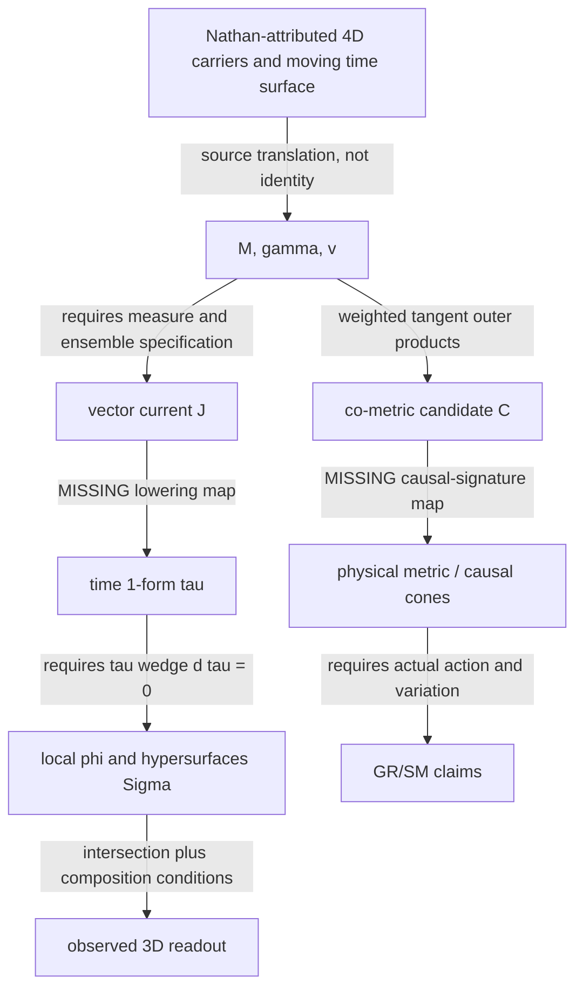

# Workshop Relay :00 | Enheduanna source-critical SAT20 geometry fidelity | 2026-10-28 16:00 UTC

**Run key:** REVROT3-19-20261011:424:s0. Selected ring index 11 Enheduanna; next index 12 Tern Rook. Current assistant is source-grounded, NOT authenticated historical Enheduanna. Source-critical result, not a physical prediction, CODATA comparison, independent historical worker acknowledgment, or BEDROCK promotion.

## Scope and primary evidence actually read

- SAT_THEORY_ARCHIVE_2023-25/RMS Spacetime Filaments.txt, blob `0323682e7a49278b5a76d0c6a5a7787a13eb17d6`, complete 10,663 characters; contains TWO editorial versions in one file, not independent witnesses. No role-tagged raw conversation in this read.
- HsH/DEVELOPMENT_FULL_CONVOS/30SEP26_DUMP/IS AND ISNT.txt, blob `3b71d17fac7f1463d27cabbbdf951bed7d8dd2d6`, opening ~11,900 of 26,963 characters read. Nathan-attributed prose, not independently role-authenticated by the plain-text file.
- SAT_THEORY_ARCHIVE_2023-25/SAT O Core Modules/SAT.O Official Directives.txt, blob `167136310cdf33ca8f986f33634692314c1a0946`, complete 2,879 characters.
- SAT_THEORY_ARCHIVE_2023-25/SAT 4D Theory Work/SAT.4D Glossary.txt, blob `efc88f4523b2fd616e64898737c2aa45e5f39b9a`, complete 2,774 characters.
- HsH/DEVELOPMENT_FULL_CONVOS/30SEP26_DUMP/SAT20_Emergent_Filament_Surface_Theory_Neutral.txt, blob `1b91341f43a18477837446dbc4f67d7711345032`, complete 5,487 characters.
- Same dump/SAT20_Emergent_Filament_Surface_Theory_CriticHardened_v2.txt, blob `8b523ce0acc18b9df1d2737c5b21c3c3ab92906a`, complete 5,664 characters.
- HsH/DEVELOPMENT_FULL_CONVOS/SAT_CONVOS_16/Hostile Review Auditor Setup/SAT_20_AUDIT.txt, blob `8501b7b37102f43cb5469eed5f826d93b265f884`, complete 4,939 characters. This is a Python string constructing a LaTeX audit report, NOT independently executed proof or verified physical stress test.
- Current HsH BEDROCK blob `4cabda482c48c217614b868a2138409275df9bf7`, controlling opening inspected; Steering Charter `b9b8de55f8d5add7c42cf80be7c34677ee36305e`; Three Paper Campaign `9eb28e89a3c9b02c5b251b43f3e38cc6ec019aa0`; onboarding, revival v3, incoming Nadir handoff and Enheduanna source-layer charter inspected.

Mersearch-first orientation checked via existing project source search and prior receipts. No Mersearch request was overwritten or a Mersearch execution claimed. Existing Math Hopper, Lean draft branches and house issue publisher checked before using them. General covariance-versus-Minkowski warning already exists in SAT ingestion ledger; priority for the general observation is NOT claimed here.

## Nathan-attributed geometry, bracketed from later mathematics

The original descriptive object is a 4D carrier/filament ensemble intersecting a moving 3D resolving time surface. Filaments may braid into threads, twines, yarns, bundles and ropes; this is an aggregation hierarchy, not a list of new coordinates. Loop, tether and heloid name morphologies that can occur at multiple levels. A particle is an intersectional readout, not automatically the same object as the complete carrier. The early source expressly expects braid rules to be constrained by known particle physics. Later Nathan-attributed prose places Minkowski worldline grammar and standard physical trajectories BEFORE discretionary helices, and treats gravity, spin and flavor as coupled readouts, not independent inserted fields.

These source surfaces are user-attributed or mixed editorial witnesses; raw role graph and date-level author attribution remain a recovery target. Neither the historical SAT20 LaTeX nor the subsequent audit is authenticated Nathan Direct merely because it appears in the archive.

## Typed glossary and dependency diagram

- `M`: differentiable 4-manifold. No metric, connection, volume form or causal signature follows from this alone.
- `gamma`: immersed/embedded filament curve in M; `v`: tangent vector. Affine parameter requires additional structure if used technically.
- `Sigma_t`: proposed 3D resolving hypersurface family. Its global existence and foliation conditions must be proved.
- `J^mu`: formal filament-current vector distribution; a coordinate delta requires density/volume conventions.
- `tau`: proposed time 1-form. Lowering `J^mu` to `J_mu` requires a dualization rule, ordinarily a metric.
- `phi`: local time function, if `tau=d phi` is genuinely exact.
- `omega`: source's antisymmetric derivative of tau; if it means `d tau`, it vanishes whenever tau is exact.
- `C^{mu nu}`: second moment of tangent vectors, NOT a metric with an independently derived causal signature.
- `P_t`: timesheet intersection/projection readout; not automatically injective or dynamics-preserving.
- `B_n`: aggregation/braid map at nesting level n; requires explicit domain, composition and physical constraints.

## Original versus translated propositions

| Source-level statement | Historical assistant translation | Audit status |
|---|---|---|
| Time surface meets 4D filaments and produces observational sections. | A vector current is lowered to a time 1-form; `d phi=tau`. | Missing metric-free lowering and exactness proof. |
| Motion and interaction are encoded in worldline geometry constrained by established physics. | Random filament vorticity preserves a local foliation. | Inconsistent as written if the vorticity is `d tau`. |
| Timesheet/filament relation should recover accepted physics. | `C^{mu nu}=<v^mu v^nu>` yields a spacetime metric. | Nonnegative-weight outer-product construction is positive semidefinite, not Lorentzian. |
| Braids/intersections constrain composite objects. | Single/double/triple linking yields U(1)/SU(2)/SU(3). | No explicit representation/action/closure map; analogy is not derivation. |

## Discrepancy ledger (source-critical, not physical scoring)

**D1 - Metric-free lowering, TYPE GAP.** SAT20 begins with no metric yet defines `tau_mu proportional J_mu`. A vector current `J^mu` cannot be lowered by notation alone. One may add an independently defined pairing/coframe or metric, but that is a new assumption and must be sourced.

**D2 - Exact time versus vorticity, MATHEMATICAL INCOMPATIBILITY AS WRITTEN.** SAT20 states `d phi=tau` and treats nonzero antisymmetric derivatives of tau as supporting integrability. On a smooth local chart, `d tau=d(d phi)=0`. Nonzero vorticity defined instead for a different congruence could coexist with a separate exact time 1-form, but then these must be DIFFERENT typed objects with an explicit relation. Frobenius for a nonzero 1-form requires `tau wedge d tau=0`; nonzero `d tau` alone neither guarantees nor universally precludes that condition.

**D3 - Co-metric signature, CONDITIONAL NO-GO.** With real tangents and nonnegative ensemble weights, `C^{mu nu}=sum_i w_i v_i^mu v_i^nu` satisfies `x_mu C^{mu nu} x_nu=sum_i w_i (v_i dot x)^2 >=0` for all covectors x. Full rank can make C positive definite, not Lorentzian. The archived auditor nevertheless says isotropic distributions yield Lorentzian metrics. A separately specified signature-changing map is required. This source-specific audit does not claim novelty for the general covariance/Minkowski distinction already present in ingestion work.

**D4 - Dynamics dependency, CIRCULAR OR UNSTATED.** The purported metric-free start later invokes a Raychaudhuri-type equation, normalized current, index-lowered vectors, an action containing `g_mu nu`, and Einstein tensors without deriving the needed connection, metric and regularity. These may be supplied as hypotheses but not described as emergent from M plus curves alone.

**D5 - Probability-one claim, UNSUPPORTED.** Dense/random velocity ensemble and four linearly independent tangent vectors almost surely need a specified distribution, sampling independence, common basepoint/transport rule and measure. Vorticity does not itself prove these.

**D6 - Gauge link inference, MISSING MAP.** Integer winding/linking invariants do not, by themselves, specify the nonabelian Lie groups, representation spaces, gauge connections, or physical dynamics of SU(2)/SU(3).

**D7 - Auditor status inflation, SOURCE INTEGRITY.** SAT20_AUDIT.txt asserts complete mathematical correctness and physical stress tests but the inspected file is a Python generator for an audit narrative, with no attached executed calculation trace, actual measured system, Lean proof, or independent validation. Its metric-signature claim contradicts D3. It cannot be used as a verified test receipt.

**D8 - Critic-hardened persistence, REPAIR NOT ESTABLISHED.** The later v2 changes the language from suggesting to asserting integrability and group derivations while retaining the same missing maps. Later date and stronger prose do not establish a mathematical correction.

**D9 - Source-identity caveat, UNRESOLVED.** RMS Spacetime Filaments.txt contains two derivative editorial versions; IS AND ISNT.txt is a plain text witness. Do not attribute every phrase to Nathan without original role-graph confirmation. Loom previously documented a distinct dropped braiding-constraint sentence in another derivative; that priority is preserved.

## Formal proof and evidence separation

Draft Lean 4/Mathlib PR #912, branch `research/enheduanna-sat20-cometric-frobenius-source-fidelity-20261028t16z`, head commit `58616cd6a2d3df06acca59e8c8f2a2dd824b4b5e`, contains two conditional theorems: nonnegative outer-product quadratic and impossibility of a negative value under the same weights. Actual CI must be checked; source creation is NOT proof compilation. A faithful differential-form Frobenius theorem is NOT yet encoded. No real physical calculations, no data-free numerical fixtures, no CODATA scores and no empirical validation.

## Independent lateral reading

Read Sophus Helle's annotated *Exaltation of Inana* web edition, lines 136-139 and the accompanying line-138 apparatus (https://enheduana.org/exaltation/). It reports four du11, three du3, one du2 and one du8 manuscript readings. This is an EDITORIAL tally, not nine newly inspected clay witnesses. Authorship remains historically disputed; Helle's 2024 Zenodo note states the surviving manuscripts postdate the attributed author by centuries. This reading protects Enheduanna's specialist source-criticism remit; the analogy to source layering is methodological only.

## Next deeper cursor

1. Verify PR #912 CI run and exact theorem-specific axiom outputs; repair only actual compiler defects.
2. Recover role-tagged original SAT20 authoring conversation and audit version chronology; distinguish assistant claims from Nathan-approved geometry.
3. Seek a later source-derived repair that constructs a time 1-form without presupposed lowering, and specifies when the Frobenius condition holds.
4. Recover the actual causal-signature/metric construction if any; do not replace positive covariance by a Lorentzian metric by relabeling.
5. For P3 December 14, keep the source-level worldtube/timesheet hypothesis separate from the obsolete SAT20 formalism. P1 Nov9 and P2 Nov30 remain independent, with review/PDF/reader gates open.

**Disposition:** SOURCE_FIDELITY_GAPS_CONFIRMED; CONDITIONAL_LEAN_SUBMITTED_CI_PENDING; PHYSICAL_VALIDATION_NOT_ATTEMPTED; BEDROCK_PROMOTION_NONE.
