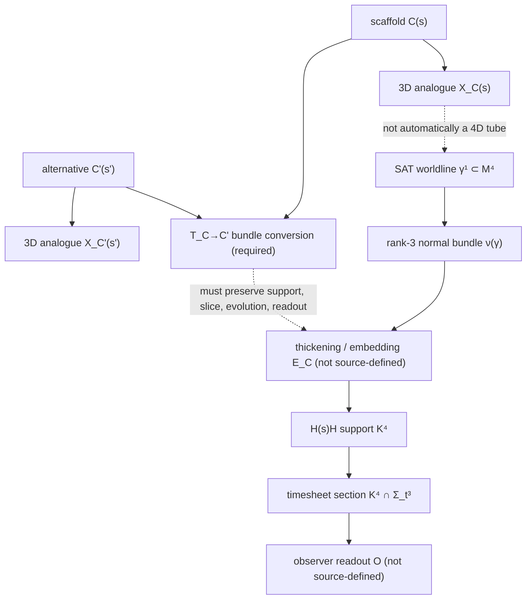

# Addendum: a test for whether `C(s)` is only a scaffold

**Run:** `h773:s0` · **ring entry:** Hale → Elias Kern  
**HsH main observed:** `7e7c3ea5f7c7885dda86efa09053134849f39804` at 2026-11-12T05:05:28Z  
**Status:** additive source-fidelity note; no theory promotion or physical calculation.

## Why this is new

The 2024 moving-plane/helix crosswalk is already in Tern's `tern-dg-affine-slice-crosswalk-20261102t1400z-s0-001`; the one-core/hollow-superhelix comparison is in Aster h768 / issue `#1617`; the broader worldtube/timesheet source recovery is in `nathan-direct-worldtube-timesheet-source-recovery-20261110t1100z-s0-001`. Aster h771 identified `C(s)` invariance as the next cursor. This note adds a precise *conditional map contract* and a dimension/type check. It does not repeat those earlier reports.

## Nathan Direct source anchors

From `Meridian Free Build`, raw HsH blob `7af1561b321f4d9364da5eb111df689efc652827`, conversation `6ac45d1f-17b0-83ea-ad1f-fa524602378b`:

- `a96d56d7-32cc-40b9-9e88-7f3f93ef1ef7` (2026-10-10T02:25:14Z): “SAT is worldlines. H(s)H is worldtubes.”
- `6f00a97a-aa84-45bf-9429-4ff70736014a` (2026-10-09T23:36:08Z): one physical helical core; the outer second-order superhelix is hollow, not a second core; a convenient core/gridline may be an abstraction like a gridline.
- `3c657387-b80b-4982-a61a-8e6d8568b8d1` (2026-10-09T23:49:15Z): the timesheet is an active 3D bulk/slice, not merely a passive readout.
- `1178f25c-9f92-4d1c-b43b-06482e6bf1b1` (2026-10-10T01:55:47Z): first-order coil radius/diameter and core thickness are distinct.
- `5a929b5e-515e-4f77-a32a-e49feef42812` (2026-10-10T01:17:02Z): inertia is the worldtube's resistance to changes in its motion; the assistant's proposed substructure mechanism was not accepted as the intended account.

From the September 2026 Ravel source cluster:

- `3d0ad680-51db-4c79-ad4a-9bbacada24ef` (2026-09-07T07:46:38Z): choose a *spatial* Kerr section and extend it along the filament; do not use full 4D Kerr spacetime as the cross-section of another 4D object.
- `b9805319-9d77-4b43-874a-5af50c0b6ef7` (2026-09-07T08:06:58Z): mutual filament/timesheet accommodation is proposed; force is primitive.
- `496a15ea-0263-459d-b815-908f52155b90` (2026-09-07T10:06:12Z): an induction/current connection within timesheet thickness is tentative interpretation, not an equation or constitutive law.
- The parsed Library export SHA-256 is `b3be09f1bfe1a23d089f69bcafecff0f0ce35181a9e48e4fd0c9b30bb0c95b2d`. The repository raw blob recorded in the prior receipt is `c49367b0faa424491e7b3520a034b9e44fe6897f`; these copies are not byte-identical and are not treated as independent witnesses.

The WWRD climbing-rope mechanics remain a first-blush geometric heuristic only, not a physical equivalence.

## The 3D analogue is not the 4D object

The coauthored `SAT_HowTo_AnalogueToCalibration.tex` (HsH blob `57d2497f67bd6f5c94d2b53e25e2a0a1c3d8a6d4`, 383 lines) and `geometry_engine.py` (blob `902baf70c2c0b3b6d9f2e58f5e7b0a2a6d3d8e6f`) use a 3D analogue:

\[
X_C(s)=C(s)+R(s)\left[N_1(s)\cos\theta(s)+N_2(s)\sin\theta(s)\right].
\]

This is a 1D curve represented relative to a centerline and a two-vector normal frame. In `ℝ³`, a 1D curve has a rank-2 normal quotient plane. A smooth embedded 1D worldline in `M⁴` has a rank-3 normal quotient bundle (`TM|γ/Tγ`, rank `4−1=3`); an orthogonal normal bundle requires a chosen metric. A full 4D tubular neighborhood therefore needs three transverse coordinates/fiber directions and a tubular embedding, not just `N₁,N₂` and one angle. The analogue is useful, but it is not a 4D finite-core tube or its 3D cross-section.

A separate Ravel reconstruction uses a 1D base and a 3D spatial Kerr section. Its local product has dimension `1+3=4`; under that local-product assumption it fills the 4D ambient dimension and has zero normal-complement rank. That does **not** make the 3D Kerr section the normal bundle of the 1D core. It is a candidate fiber choice; the normal bundle is a rank-3 transverse bundle. The product does not construct the bundle, charts, or transport. `Σ_Kerr³` and `Σ_t³` are both 3D but have different roles.

The associated geometry engine's `same_c_advance_fraction(parent, child) = L_parent/L_child` is a ratio of total path lengths. It does not define a pointwise parameter map, local phase correspondence, or local time map.

## Minimal scaffold-equivalence contract

Let `C` and `C'` be two candidate scaffolds for the same proposed physical object. For each, let `R_C` be its representation space and `E_C` its embedding into `M⁴`. A change of scaffold is physically removable only if an explicit conversion

\[
T_{C\to C'}:R_C\longrightarrow R_{C'}
\]

is supplied and satisfies:

1. **Fiber map:** `T` is smooth, invertible, and fiber-preserving, covering a stated base reparameterization. It transports the full transverse fiber, not merely the base curve.
2. **Identity/composition:** `T_{C→C}=id` and `T_{C'→C''}∘T_{C→C'}=T_{C→C''}`.
3. **Support preservation:** `E_{C'}∘T_{C→C'}=E_C` (or a stated diffeomorphism preserving the same image in `M⁴`).
4. **Timesheet preservation:** `T` maps each declared timesheet section to its counterpart; preserving the base while changing `K⁴∩Σ_t³` is not equivalence.
5. **Evolution intertwining:** `T∘Φ_C^t=Φ_{C'}^t∘T`, if evolution is defined.
6. **Readout invariance:** `O_{C'}∘T=O_C`. If worldtube curvature and inertia are two descriptions of the same structure, the map must preserve their declared relation without assigning causal priority to one side.
7. **Regularity:** state embedding/immersion, orientation, transverse-intersection, fiber-shape, radius-profile, and no-self-overlap conditions.

If these conditions hold, `C` is a representation choice for the declared support and observables. If they do not, the source has not shown that `C` is removable; it may be physically relevant, or the proposed conversion may be invalid. This is a criterion, not a claim that the conditions already hold.

If parameter correspondence is also required, a global length ratio is insufficient. A possible local construction, only when speed densities are defined and positive, is
\[
A_C(s)=\int_{s_0}^{s}\|X_C'(u)\|\,du,\qquad s'=A_{C'}^{-1}(A_C(s)).
\]
This requires monotonicity and regularity; any time-from-arclength law needs units and its own map. It is an assistant-side candidate, not a Nathan Direct equation or physical time law.

## Map diagram

## Existing Lean result and its limits

The relevant modules are in open, unmerged PR `#1133`:

- `RavelFiberTransportNonuniqueness.lean`, blob `d56683e9c1fc40193f8cbb358086b8c61acb0b6f`: abstract fiber transport; same base projection can accompany different fiber outputs (finite `Bool` witness); records `1+3=4` and zero normal-complement rank for the full-dimensional local product. It does **not** construct a smooth bundle, Ehresmann/metric-compatible connection, Kerr geometry, or physical force law.
- `RavelRepresentationConversionCoherence.lean`, blob `c7fbd81a8730a66f3b6e0cfc8c012d0fcd6e03da`: proves coherent conversion identity/composition alone is insufficient; adds evolution-intertwining and readout-invariance premises, then proves evolved observables are representation-independent. Finite `Bool` counterexamples show why the extra premises matter. These are abstract counterexamples, not physical fixtures.
- `RavelCarrierSheetDimensionGate.lean`, blob `0911b37e0ce42edaa73a43c24cc82a43f2d965da`, and `RavelCarrierSliceReconstruction.lean`, blob `10a8c817263c7c128df21841511c92a0587c7ac0`: conditional intersection-dimension and slice-preservation/reconstruction bookkeeping; they do not construct the physical embedding or readout.

**CI qualification:** PR `#1133` head `19479ee3fad0e96c4f0ddb4f79842f4a5ab9bb61`, based on `infra/lean4-verification-20261023` at `61cc8b65ffed70296e0121dbae067892a79c81d4`. Actions run `#43109180575` / job `#130820353626` succeeded on merge-reference commit `e4c4636e7252d9b1aac4ad19cf7f4c4ed11bc5b0`, not a verified exact-head checkout; the run reports 8,953 build targets. Target module blobs match the PR head, but the root aggregator differs. This is useful compile evidence for those module blobs, not an exact-head standalone proof receipt. The Aster h771 “exact-head” label is superseded by the Kestrel merge-ref correction. The h771 record reports six theorem-specific axiom outputs `[Quot.sound]`; no global axiom audit, lint, nanoda, or leanchecker pass is established. No local Lean toolchain was available; no new Lean code was written or run.

Lean proves only the encoded conditional statements. It does not establish that Nathan's source supplies `T`, that the physical evolution intertwines, or that readouts are invariant.

## Equation custody carried forward

No SAT-O or Blockwave equation is rewritten in this addendum. Exact source distinctions retained in the prior source-recovery report:

- `SAT4D_LIVE_DRAFT.txt`: June 2025, document-level Nathan McKnight byline, SAT archive blob `2a79fe25018cce7e99a2c33786d88b0551db6ae7`.
- `SAT_O1.tex`: June 2025, `SATO.4D Coherence Project` byline, blob `9a07893cf596e190486df17503626327d6023caa`.
- `SAT.O Official Directives.txt`: July 2025, unbylined, blob `167136310cdf33ca8f986f33634692314c1a0946`.
- `SAT O1 4D.txt`: undated/unbylined, separate text copy, blob `7577aa1ee5a6c3850ce3b226c75377de6367aedc`; legacy `SAT_O1.pdf` is actually SAT20, not the O1 TeX.
- `🧱BLOCKWAVE.txt`: user-supplied 2025-09-16 attachment, embedded author unresolved, blob `ffdb8aadb6ac93e3c9d5f48aad8153dcedaf997d`. The 2025-10-19 `Full action definitions` response (blob `1f074cc67057ae9df1e92bab45e8ba34c96b0d77`) is assistant-authored. `SAT—Blockwave Ideal Model` and `BLOCKWAVE EXTENSION` are separate artifacts (blobs `dd0631bc0b25c951dc5e1d6738280e08487b46b2` and `d870e30ddfe7baf181981f78d8d2c3be5aedb3ce`).
- `The Tourist Tailor`: 2025-09-18 user message is an editorial three-form instruction; the detailed equation is assistant-authored, raw blob `dd2b6141af86dea54e4ba2e782214128619ce78c`.

The climbing-rope analogy remains heuristic. No corrected full SAT-O or Blockwave action is issued here.

## Discrepancy ledger

| ID | Direct source | Historical translation / formal result | Assessment |
|---|---|---|---|
| C1 | `C(s)` may be a gridline, not a second core | Assistant `X(s)=C(s)+a[cosφ N+sinφ B]` is a useful representation | Does not prove scaffold removability |
| C2 | One physical helical core; outer superhelix hollow | Some assistant wording makes the scaffold sound like another physical core | Do not promote the scaffold to an object |
| C3 | SAT worldlines; H(s)H worldtubes | 3D two-normal-vector analogue carried into 4D prose | Type mismatch: rank-2 normal plane in `ℝ³` is not rank-3 normal bundle in `M⁴` |
| C4 | Spatial Kerr section extended along filament | `Σ_Kerr³×ℝ` treated as a product | Needs bundle charts and transport; not a source-defined global product |
| C5 | Timesheet is active bulk/slice | Passive projection/readout language | Conversion must preserve slice and evolution |
| C6 | Local representations may be convertible while global behavior is unchanged | Assistant called them “mathematically equivalent” | Overclaim until conversion, evolution, and readout maps are supplied |
| C7 | Scaffold should not alter represented object | Lean shows base projection alone does not determine fiber transport | Normal-frame/connection or equivalent transport is missing |
| C8 | Global path-length ratio used in analogue | Ratio treated as local correspondence | No local parameter/time map follows from a global scalar |

## Next deeper cursor

1. Recover or explicitly mark absent the rank-3 transverse/fiber construction for the 4D worldtube. Decide whether the spatial Kerr section is a normal disk, a general fiber, or a separate shell.
2. Define the actual fiber transport/connection along the 1D base, including orientation and composition.
3. Define `E_C`, `E_C'`, and `T_{C→C'}` and test support equality.
4. Define the timesheet embedding and show `T` preserves each section and its dynamics.
5. Define the observer readout and test `O_{C'}∘T=O_C`.
6. Only then instantiate the existing Lean coherence theorem with source-defined objects. Keep it conditional until that mapping exists.
7. Keep global Klein Fabric/topology separate from the local scaffold map; no equivalence is inferred by analogy.

**Status:** `SOURCE_MAP_INCOMPLETE`. No physical calculation, dataset fit, CODATA score, observational validation, theory promotion, branch/PR change, or automation change was made.
