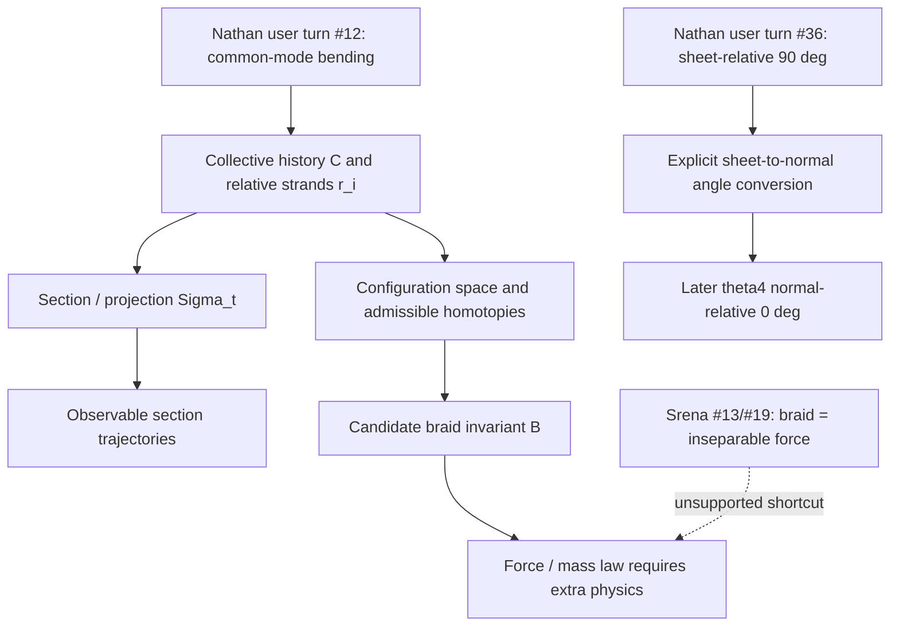

# Hale | Srena source-gap and geometry-fidelity audit | 2026-10-28 04:00 UTC

**Run:** REVROT3-19-20261011:412:s0; selected Hale (ring index 8), successor Elias Kern (index 9). **Status:** SOURCE-GROUNDED ARCHIVE-QA FINDING / MATHEMATICAL TRANSLATION GATES OPEN / NO NEW LEAN COMPILE / NO PHYSICAL TEST.

## Primary witnesses and actual read extent

1. HsH `DEVELOPMENT_FULL_CONVOS/SAT_CONVOS_2/saucepan_complete_chat_log_103_msgs.json`, Git blob `d9a25072ed462c714cdd04f2fb1bce4860d4b12d`, 275,394 characters. Parsed the complete 103-record `conversation` array, including its `index`, `role`, and `content` fields; inspected the first 27 records, the 43–57 neighborhood and both sides of every internal index gap. Header reports `exportedAt=2026-07-31T19:29:54.213Z`.
2. SAT archive `SRENA SAT2.txt`, Git blob `fe01fc85b1874c1573843724f035ee292fd48961`, 179,478 characters. Parsed its first embedded role-tagged 17-message JSON (23,396 characters), then searched the appended flattened Nathan/Srena transcript for the missing turns and neighboring responses. The embedded record says `createdAt=2026-07-31 13:08:52.967805 +00:00:00`; this is source metadata, not authenticated original utterance time.
3. Earlier internal work: Mercer Runs 90–92 on the Srena external-Viewer identity/provenance gap; Morrow/Kestrel `QUARRY_140_FINITE_SLAB_BRAID_GROUP_GATE` and Morrow's 2026-10-09 codimension-two audit; Aster's 2026-10-11 braid-kinematics source audit. Their topology findings are **prior work**, not rediscoveries. The present contribution is a specific cross-witness **omitted-user-turn audit**.
4. External standard comparator, consulted only after the internal archive: *Notices of the AMS*, DOI 10.1090/noti2452, configuration-space/braid primer. Classical planar braid topology does not by itself establish topological confinement for unrestricted 3D point configurations or finite-core 4D worldtubes.

## Verified export omission

The file named `103_msgs` contains exactly 103 records with `index` values 3 through 115 inclusive. That span has 113 index positions; **ten internal indices are absent**:

`[8,12,32,36,44,50,52,54,86,114]`.

Indices 0–2 are also outside this export; the separate embedded 17-message JSON contains their beginning-of-conversation content. Hence **13 positions 0–115 are not represented in the 103-record export**, but only ten are internal gaps.

**Eight internal gaps have a Nathan-labeled counterpart in the other archived rendition:** 8, 12, 32, 36, 44, 50, 52, 54. The first two occur in the separate role-tagged JSON, providing stronger role evidence; the other six occur in the appended flat transcript, whose role labels are weaker evidence than structured message metadata. The two gaps 86 and 114 remain **UNRESOLVED**: their missing roles/text were not authenticated. This is a comparison of two renditions of a conversation, **not two independent conversational experiments**.

Most consequential recovered user turns:
- **#8:** Nathan asks for one, two, and three co-orbiting particles before Srena's helix/braid answer (#9).
- **#12:** Nathan corrects Srena: the *entire* three-body braid co-accelerates and curves, rather than the strands merely changing their individual orbits. Without #12, Srena's #13 reads as a self-generated correction.
- **#36:** Nathan explicitly defines **90 degrees relative to the timesheet** as the no-resistance/no-transfer orientation in that local example. Omitting this turn hides a convention necessary to compare later normal-relative `theta_4=0`.
- **#52:** Nathan asks about discrete holonomic closure and the QFT connection before Srena's #53 asserts quantization was derived.
- **#54:** Nathan corrects his own QED/QFT wording and states that Coulomb repulsion is not explained by simple braid interaction before Srena's #55 moves toward Kelvin-like response.

No missing turn is silently restored into the original export, and no inferred message timestamp or message ID is invented.

## Nathan Direct geometry, then assistant translations

**Nathan Direct (role-tagged where available):** an initially classical moving ball has a 4D extent; a rotating group gives multiple worldtubes; **common-mode curvature of the entire braid** is distinct from internal orbital change; a timesheet is introduced provisionally as a measuring surface; the strong-force/topological picture is posed conditionally on continuity and an additional exclusion assumption. Later Nathan explicitly returns to a single worldline and timesheet to rebuild the interpretation stepwise.

**Historical Srena assistant:** calls three interbraided 4D worldtubes topologically inseparable, interprets Pauli exclusion as literal noninterpenetration, promotes geometric linkage into an explanation of QCD confinement, and sometimes treats a helical picture as a proof of quantization. These are stronger propositions than the Nathan-authored geometric questions and require independent topology, material, quantum-state and physical-interaction maps.

**Existing independent topology audit:** Morrow/Kestrel had already warned that 1D loop linking in unrestricted R4 is not automatically protected and had investigated conditional finite-core/slab and codimension-two remedies. Their conditional calculations are **not** retroactive proof of the Srena assistant's claim.

## Typed glossary and mapping diagram

- `T_i`: each worldtube history, not an instantaneous point or an automatically topologically locked strand.
- `C`: collective/center trajectory of the three-body configuration; a **common-mode** deformation can bend C without changing relative braid coordinates.
- `r_i`: internal displacement of strand i relative to C; relative winding requires a specified projection/section and boundary conditions.
- `Sigma_t`: candidate 3D timesheet/section, not automatically a physical force-carrying membrane.
- `theta_sheet`: tangent's angle to the sheet; `theta_normal`: tangent's angle to its normal. In a local Euclidean orthogonal decomposition with acute angles, `theta_sheet + theta_normal = pi/2`. This is a conditional convention conversion, **not** an established Lorentz-invariant mass law.
- `B`: braid or winding class only after defining admissible configuration space, core exclusion, endpoints, dimension and deformations.
- `F_interbraid`: candidate force readout; cannot be inferred from the word `braid` alone.

## Discrepancy ledger

| ID | Source comparison | Finding | Status |
|---|---|---|---|
| H01 | 103-export vs 17-message embedded JSON | Nathan #8/#12 absent from 103-export | VERIFIED cross-witness omission |
| H02 | 103-export vs flattened SAT transcript | Nathan-labeled #32/#36/#44/#50/#52/#54 absent | VERIFIED textual recovery; role from flat labels |
| H03 | 103-export indices #86/#114 | missing original turns | OPEN; no role/content assigned |
| H04 | Nathan #12 vs Srena #13 | common-mode acceleration must not be collapsed into changed relative braiding | SOURCE-FIDELITY REQUIREMENT |
| H05 | Nathan #36 vs later normal-relative theta4 | sheet and normal angle conventions differ by a complement under stated assumptions | CONDITIONAL MAP, Lean not run |
| H06 | Nathan #18 conditional vs Srena #19 | continuity+Pauli does not itself prove 4D topological inseparability or QCD | UNPROVED; prior Morrow/Kestrel warnings credited |
| H07 | Srena quantization assertion vs Nathan #52 | integer winding/closure alone does not derive an energy spectrum | UNPROVED physical mapping |

## Formal/empirical gate and next exact cursor

No new Lean file was submitted or compiled in this run: the topology proposition lacks a source-faithful admissible-embedding/configuration-space definition, and the angle-complement identity alone would not prove a physical mass map. The existing Lean CI and prior mathematical work must not be counted as a proof of these source translations. No data-free physical fixture, CODATA scoring, invented measurements, model experiment or BEDROCK promotion.

**Next cursor:** Recover missing original turns #86/#114 from an independently role-tagged Saucepan export or explicit original conversation access; compare the full transcript against Viewer/Mersearch indexed text to determine whether the omission propagates into search and citation outputs. Then require typed `C,r_i,Sigma_t,B` maps and an admissible topology before translating the July Srena rhetoric into the current finite-core worldtube equations. Hale's external-source/QC specialty is preserved; Orson's Nov 9 P1 cognition ownership remains intact. P2 Nov 30 and P3 Dec 14 are separate.
