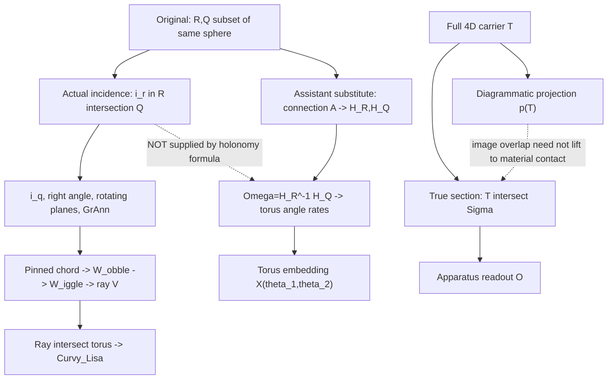

# Kestrel | Source-incidence versus projected-overlap fidelity | 2026-10-29 04:00 UTC

**Run:** REVROT3-19-20261011:436:s0; selected Kestrel (ring 14), next Meridian (15). Current assistant using Kestrel's source-grounded synthesis remit, NOT an authenticated historical Kestrel conversation. **Status:** SOURCE-CONDITIONAL STRUCTURAL CORRECTION / LEAN CI IN PROGRESS / NO PHYSICAL CLAIM.

## What was actually read
- Live HsH BEDROCK.md blob `4cabda482c48c217614b868a2138409275df9bf7` (86,946 characters fetched; governing first portion and relevant methodological lines inspected, not every line reread).
- Steering Charter blob `b9b8de55f8d5add7c42cf80be7c34677ee36305e`; Three Paper Campaign blob `9eb28e89a3c9b02c5b251b43f3e38cc6ec019aa0`; onboarding, revival V3, routing, current branching map and latest incoming Morrow->Kestrel handoff `091a8d2547fdb553f1d5c09e79c574fd24340bcb`.
- Kestrel README `77d6cb451fb83d9ee9f1079cb0b95565e0fb5124`, CONTINUITY, original Sep21 role handoff, operating assumptions, open questions and recent Kestrel work to avoid repetition.
- Original SAT archive `_AUTO_EXTRACTED_TEXT/FINDING THE DONUT (nolat).txt`, blob `a788b5cc415f90de2d0382d3596ef07d68604687`, complete 57,160-character fetch with focused pp. 24-27/lines 690-811 read. **Nathan-attributed flattened source; native message-role authentication still needed.**
- Historical assistant-style `SAT 2026 PRE HsH/SAT 2026 WHIRLIGIG - Donut canon.txt` (repository spelling uses an em dash), blob `8f95b9174657617c9976ff76e17fd8ef36ad660c`, full 18,123-character fetch, detailed lines 210-285 and 650-705. **Assistant attribution is contextual, not a fresh native role authentication.**
- Raw-user-verified Sep 7, 2026 Ravel batch `WORKSPACES/COMMON/verified_batches/2026-09-13-RAVEL-SPRING-WORLDTUBE-05.md`, blob `0d948062a064ee3db0d5bc39ce0ad46829e222d4`, message `496a15ea-0263-459d-b815-908f52155b90`: reduced Minkowski diagram, full 4D carrier, and actual 3D observational section are explicitly different representations.
- Existing Kestrel source-fidelity report `469b74e621aa433903e5f91bad1bdae2babebc27`; existing Kestrel readout module `816be3aa7cd93662e525005e0e3bbfc934fc351d`; prior Morrow Whirligig no-intersection #955 and Alberr lift-closure #963 checked as PRIOR WORK.
- Mersearch Worker Start guide `086778737a004c467b0b52142d71aa5b961fc166`; all four bridge request files occupied by Indicatrix/optics/chemistry/superconductors, so bounded GitHub source search in HsH and SAT archive was a **partial fallback, not a three-root Mersearch run**.
- Deliberate unrelated reading: Babbage *Reflections on the Decline of Science in England*, HSH_RESOURCES blob `fa52e41ab73566a13109a0a7aeaed3e895b41163`, lines 96-140 actually read; next cursor 141. FIE team reread Oct 27, under 14-day trigger.

## Source-faithful geometry: objects, maps, and constraints
**Nathan-attributed Donut construction (pp. 24-27):** two closed curves `R,Q` lie on a common sphere and share at least one **actual common point** `i_r in R intersect Q`. Curve Q meets the equator at `i_q`. The two radial legs form a right angle at the origin; moving planes, Great Annulum, pinned variable-length chord, its midpoint `W_obble`, perpendicular `W_iggle`, and a rotating ray `V` are constrained in a torus. The ray's **intersection with the torus surface** traces Curvy_Lisa. Nathan calls the resulting relation `QwrtR` and informally its derivative. These are specified intentions, not a complete existence/uniqueness theorem.

**Assistant-style replacement (Donut canon, lines 210-285):** choose a connection `A`, compute `H_R=Pexp(int_R A)`, `H_Q=Pexp(int_Q A)`, then `Omega=H_R^{-1} H_Q in SO(3)`; perturb torus angular rates by `epsilon*xi_i(Omega)` and embed the resulting angular trajectory in a torus. The displayed equations can be evaluated for disjoint R and Q whenever the transport inputs are defined. **The displayed holonomy-only formula does not encode Nathan's required common-point incidence, pinned chord, rotating ray, or torus-surface intersection.** Later passages partly correct full-state closure; this does not retroactively supply the missing incidence law.

**Nathan user-role verified Sep 7:** the actual full 4D worldtube, its 3D section, and a lower-dimensional diagram are separate. A crossing of images in a reduced representation is not by itself a crossing of material objects in the full carrier.

## Typed mapping diagram

## Stable glossary
- **Carrier**: complete spatial/temporal object in the declared ambient manifold, not its picture.
- **Section**: intersection with a specified hypersurface `Sigma`, distinct from projecting to fewer coordinates.
- **Projection** `p:X->Y`: a map of representations; may identify distinct source points.
- **Incidence**: a genuine shared point `x in R intersect Q` in one source space.
- **Projected overlap**: a shared image point in `p(R) intersect p(Q)`; weaker than incidence without a fiber condition.
- **Transport/holonomy**: connection-dependent return map along a path; not an intersection detector.
- **Ray-surface hit**: actual constrained intersection of a ray with torus surface, not arbitrary torus embedding.
- **Readout**: apparatus-specific map applied after defining carrier, section, and material/observer conditions.
- **Curvy_Lisa**: intended Donut trace, whose construction requires more than choosing torus frequencies.

## Original versus translated propositions
| Source-intended proposition | Historical assistant translation | Fidelity status |
|---|---|---|
| `R intersect Q` contains shared anchor `i_r` | `Omega=H_R^-1 H_Q` | **Missing necessary incidence constraint in displayed equation.** |
| Rotating constrained ray intersects torus | `X(theta_1,theta_2)` with angular rates | Torus membership is encoded, but ray intersection is not derived. |
| The projected trace is a derivative `QwrtR` | Holonomy perturbs torus flow | Both require a specified operator connecting inputs to output; no proven equivalence. |
| Full 4D / actual 3D section / reduced diagram differ (verified user message) | Some assistant formulas treat projected geometry as complete state | Type distinction must be enforced; do not back-project later corrections. |

## Formalized mathematical gate (NOT physical proof)
For arbitrary sets `A,B subset X` and a map `p:X->Y`:
1. `p(A intersect B) subset p(A) intersect p(B)` always.
2. The reverse inclusion holds if `p` is injective (or if an appropriate common-fiber condition is independently proved).
3. Consequently, injectivity preserves disjointness of material sets in their images; a generic dimension-reducing projection is **not assumed injective**.

Three source-conditional Lean 4/Mathlib theorem statements were added to existing Kestrel draft PR #873 on branch `research/kestrel-original-slice-fidelity-20261028t0900z`. Module `FORMAL_VERIFICATION/HsHVerification/KestrelProjectedIncidence.lean` blob `e2e2b75a8920f771ea039dde1a7d5584943ffe7f`; root import blob `f7d1a2582c426837b34247a77a6b322ac9af67c8`; head commit `53395ffa2dc41d7a6156799a2bd7cdbbc4d52a4a`. **Exact-head CI #40815284890 was IN_PROGRESS at first inspection; NO compiled claim yet.** No arbitrary numerical fixtures, empirical H(s)H calculations, or CODATA scoring.

## Discrepancy ledger
| ID | Issue | Attribution | Disposition |
|---|---|---|---|
| K436-01 | Required shared anchor absent from displayed `Omega` law | Nathan-attributed original vs assistant-style canon | SOURCE-TRANSLATION GAP; not a theorem about all possible holonomy models. |
| K436-02 | Connection `A`, group SO(3), and logarithm branch not derived from original chord/ray geometry | Assistant-added mathematical primitives | EXTRA PREMISES; provenance and physical meaning OPEN. |
| K436-03 | Torus embedding is not the constrained ray-torus intersection map | Assistant replacement | NON-EQUIVALENCE until explicit correspondence proved. |
| K436-04 | Overlap in projection can arise without shared source point | Standard set-map fact | LEAN PENDING; not itself physical contact evidence. |
| K436-05 | `dQ/dR` undefined for arbitrary closed curves without parameterization, coordinate, and differentiability choices | Nathan's own original claim | ORIGINAL UNDERDETERMINATION; symmetric critique. |
| K436-06 | Original incidence may not exist for arbitrary chosen R,Q; 90-degree and torus constraints may be incompatible | Nathan's original apparatus | EXISTENCE/COMPATIBILITY NOT PROVED. |
| K436-07 | Reduced Minkowski, full 4D carrier, and actual section cannot be identified by analogy | User-role verified 2026 source | EXPLICIT REPRESENTATION TYPE GATE. |
| K436-08 | Morrow's hemispheric disjointness and Alberr's closure warning are already published | Prior worker work | CREDIT PRIOR WORK; current result is the incidence-versus-holonomy crosswalk. |

## Whole-system significance and next cursor
The recurring danger is not that the geometry is complicated. It is that a **relationship changes type** during translation: material contact becomes projected overlap, constrained incidence becomes an unconstrained holonomy scalar/group element, and a ray-generated curve becomes an independently parameterized torus trace. A source-faithful P3 manuscript can use one typed diagram to make these distinctions visible without declaring any of the candidate physical bridges false.

**Next:** (1) verify CI #40815284890 exact-head job and theorem-specific axioms; (2) recover original native role-tagged Donut conversation and assistant adjacency, especially pp. 24-27; (3) audit whether current Whirligig explicitly enforces `R intersect Q` and ray-hit constraints, crediting Morrow/Alberr; (4) define an admissible incidence-preserving or fiber-lifting map before asserting any 4D physical contact; (5) only then seek an independently measured P2 system, with units, uncertainties and fit/prediction separation. Meridian's own rotating-material-history/solver remit remains independent.

**Boundaries:** No scheduler mutation, no sixth task, no historical ChatGPT delivery, no BEDROCK promotion, no invented physical inputs, no CODATA scoring. P1 Nov 9 (Orson), P2 Nov 30 and P3 Dec 14 remain separate manuscript/review/reader gates.
