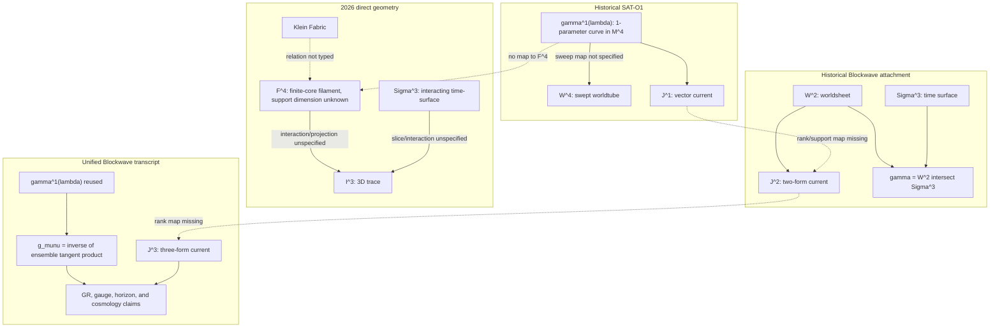

# Lane 00 | Unified Blockwave Proof transcript fidelity addendum

**Date:** 2026-11-24
**Disposition:** SOURCE-CUSTODY DELTA / EMBEDDED AUTHORSHIP UNRESOLVED / ASSISTANT OVERCLAIM IDENTIFIED / NO EQUATION CORRECTION / NO THEORY PROMOTION.

## 1. Scope and principal finding

This is a narrow source-fidelity addendum to the existing SAT-O1 and Blockwave lineage work. It does not repeat the earlier source-lineage report or its projector-token correction. The new object is the two-message archive transcript `Unified Blockwave Proof.md`, exported 2026-11-08.

The transcript contains a user-role message that pastes a long mathematical proposal and asks whether it is impressive, followed by an assistant-role evaluation. The pasted proposal's embedded author is not established. The raw conversation JSON was not recovered; the extant file is a derived Markdown transcript with two messages. Therefore the proposal is **not classified as Nathan Direct**.

The assistant calls the proposal impressive, describes it as internally consistent at the conceptual level, and praises its mathematical closure. That evaluation is not a proof, source-critical review, Lean result, or independent measurement. The transcript itself contains several plain-text contradictions and unbridged changes of geometric object. The assistant should have identified those before offering an endorsement.

## 2. Source custody

Repository snapshots used: HsH `main` at `f558f2f722c3872273b4dfbd3e6264ced44dfe4c`; SAT archive `main` at `028862e6f1b0ffad2f56f4989a2cd0a769d266fd`. File content was fetched at those exact commits. Git tree SHA and commit-signature status were not independently exposed by the available connector, so this is a path-and-content witness, not a complete signed-tree audit.

| Artifact | Immutable identity | Source status and date evidence |
|---|---|---|
| `SATOBLOC/SAT O1 4D.txt` | Git blob `7577aa1ee5a6c3850ce3b226c75377de6367aedc`; raw SHA-256 `8e416ff440c45936c3588de0bd0c2ae49b529655ff452a64093a145416c62937`; 3,521 bytes | Unbylined historical text. File-index metadata records a 2025-06-09 last-write and 2025-10-26 archive-copy creation; neither is an authenticated composition date. |
| `SAT_O1.pdf` | Source SHA-256 `fefe469d88965561f807833def547dd2629f5bb04c4482ffbae2cd438ea2214d` | Three-page, unbylined historical PDF titled `SAT20: Emergent 4D Filament-Surface Theory`. The source digest is taken from its extraction manifest, not independently recomputed from the binary PDF. |
| `_AUTO_EXTRACTED_TEXT/SAT_O1.txt` | Git blob `bd244e49c6b668a72131b4f195e32820d4540746`; raw SHA-256 `3a67199acf644a7ee5718c4f1926829faea6baf4db470bdd2734f8495e53e8f0`; 4,523 bytes | Derived text from extraction pass `2026-09-10_root_pdf_extraction_pass_002`; not an independent source. |
| `DEVELOPMENT_FULL_CONVOS/MOSTLY_EARLY_NLM/🧱BLOCKWAVE.txt` | Git blob `ffdb8aadb6ac93e3c9d5f48aad8153dcedaf997d`; raw SHA-256 `3d393efcedf9dc715cd49a319605fc5adc2011c5b5984abd9a2d280765953664`; 25,255 bytes | User-supplied attachment event 2025-09-16T16:31:26.687475Z; embedded authorship unresolved. |
| `FORMALIZATION DEVELOPMENTS/LEAN CHECK_drafts/SATO-BLOCKWAVE_leancheck.txt` | Git blob `b128efd3004fe34e48dc7da2c39bdd14f9926ddc`; raw SHA-256 `63b0398b581fa85a630855a5d126bb43868c052f38a8e0eeda27594b7555365f`; 8,079 bytes | Text draft with 200 lines, 23 `sorry` placeholders and one `axiom`. No verified Lean 4/Mathlib build is attached to this file. The HsH archive copy is the same blob, not a second proof witness. |
| `DEVELOPMENT_FULL_CONVOS/SAT_CONVOS_24/Unified Blockwave Proof.md` | Git blob `011acff4ab491ed761ccfffef8cdd47ac74afcb1`; raw SHA-256 `36e4bf64dfb828566757b093cbff014e3f68696cc2be8c57eb82bd3f51dccfa1`; 6,230 bytes | Derived two-message transcript, conversation ID `69a5282d-ef1c-832d-b576-3377532acac9`, export time 2026-11-08T12:53:35.090Z. Raw JSON and embedded author of the pasted proof text not recovered. |
| `LIVE CONVOS/26.10.05•26.10.20•Meridian Free Build — raw.json` | Git blob `7af1561b321f4d9364da5eb111df689efc652827`; raw SHA-256 `bc5a2b32d54f91f119f2ee7b6662a54f66da8988e13a5fae98ae02802f98636b`; 11,772,549 bytes | 2,500 mapping nodes; 2,309 nodes on the current ancestry. Selected user-role geometry messages are on the current ancestry. `author.name` is null and `message_source` is absent; attribution to Nathan follows the archive's user-role convention, not external identity authentication. |
| `LIVE CONVOS/26.10.20•26.10.21•Meridian Minkowski Ring Analysis — raw.json` | Git blob `56a84cb85d5c386efa4ea11d322d11e95e2c7703`; raw SHA-256 `07980f28da62cf885fb450497c14643fb69021a62eb3a9da98913d56f93f6fd4`; 17,445,111 bytes | 3,678 mapping nodes; 3,660 nodes on the current ancestry. Selected user-role geometry messages are on the current ancestry. `author.name` is null and `message_source` is absent. |
| `WORKSPACES/COMMON/BEDROCK.md` | HsH main blob `2629ab29a5838d933c31727455553d206577a258` | Current status reference, not a primary source. It records no established universal hard `Q<=3` cap and leaves a universal `Q` or inverse-`Q` mass law unresolved. |

Two Library exports of the Minkowski Ring Analysis conversation have the same conversation ID, byte length, node count, and identical message mapping, but different raw SHA-256 values (`a8307130f74610fc4184d1eff80968b4653a010b7af75dc85998c3d10ffaa874` and `dd8e6250cdd691fed7e39a7f32ad5e76a92e28a48ccc5ed6716ba8e1e6c5358e`). Their observed difference is in the `safe_urls` metadata. They are export variants, not independent witnesses. The HsH repository export above is a separate byte stream.

## 3. Nathan Direct geometry extracted independently

These are user-role messages in the two HsH raw conversation exports. They are treated as direct source under the project's archive convention, while preserving the null `author.name` and absent `message_source` fields.

### Meridian Free Build

- `6f00a97a-aa84-45bf-9429-4ff70736014a` (2026-10-09): the proposed object is a pure second-order superhelix, not wrapped around a carrier; one helical core follows the convoluted path; there is no second-order core; the larger coil is hollow; the finite core is tentatively associated with a Kerr ring.
- `3c657387-b80b-4982-a61a-8e6d8568b8d1` (2026-10-09): at the classical limit, filaments are treated as stationary; particle motion is filament topology, not filament motion. Worldtube resistance to changes in motion is identified with inertia by construction. The message uses `w=ct` for a time-length coordinate in meters.
- `5a929b5e-515e-4f77-a32a-e49feef42812` (2026-10-09): the unquoted user text rejects a passive-readout interpretation. The time surface must interact with matter; the message says `time is just moving space`. The quoted assistant block at the beginning of that message is not attributed to Nathan.
- `1178f25c-9f92-4d1c-b43b-06482e6bf1b1` (2026-10-09): a 4D filament is distinguished from its 3D intersectional trace; the trace should not be mistaken for filament thickness, and self-closure in the 3D cobordism is not assumed.
- `a96d56d7-59bc-48cc-8338-0a37240e8fd4` (2026-10-10): an explicit cross-post from Morrow/Kestrel distinguishes SAT worldlines from H(s)H worldtubes and rejects importing Hopf-fibre and spherical-carrier ontology. Because it is a cross-post, it is not an independent witness.

### Meridian Minkowski Ring Analysis

- `69e7e8b1-86e8-4dea-a38b-9193f7327fb5` (2026-10-20): the visible universe is described as one instantaneous 3D slice of a 4D worldtube.
- `c1b42229-00a9-4119-aac3-cefa6cb97157` (2026-10-20): the cruller/donut rotation and coiling description is a visual hypothesis about worldtube and particle emergence, not a derived equation.
- `f658b2db-32f0-45cd-828b-140691cc9afb` (2026-10-20): `4D curvature of the donut = acceleration` is explicitly called unproved and a working hypothesis.
- `090f5160-1020-486d-9c42-df3d7dff2063` (2026-10-20): the older reciprocal filament/timesheet-deformation formalism is explicitly retired; the message says it has not been the working construction since the Klein Fabric model became common.
- `c5525f53-b7cc-4444-8102-3bf6fdb1c892` (2026-10-21): the message preserves `cw=t`, `Forest Normalization`, and `(++++)`, while leaving the `(c+H0)/2` expression uncertain. This is a notation directive, not a completed dimensional derivation.
- `47cf2603-bf28-439c-82b3-1f0e0c2a7dc8` (2026-10-21): Back Hallways are described as a conceptual program, not fresh SAT formalism.

### Stable glossary

| Term | Source-grounded meaning | Boundary |
|---|---|---|
| `gamma^1(lambda)` | One-parameter curve with four coordinate functions in the older SAT-O1 text. | Its parameterization does not by itself make its support four-dimensional. |
| `W^4` | Older SAT-O1 prose calls the worldtube the 4D volume swept by a vibrating filament. | The sweep/thickening map from `gamma^1` to `W^4` is not specified. |
| `J^1` | The SAT-O1 PDF's vector/one-form filament current `J^mu`. | Not the same tensor type as the Blockwave two-form. |
| `J^2` | The Blockwave attachment's antisymmetric current `J^{mu nu}` associated with worldsheets. | No source-defined map to `J^1` or the proof text's three-form. |
| `J^3` | The proof transcript's horizon/thermodynamic current `J_{mu nu rho}`. | A new rank in the transcript, with no map from `J^2`. |
| `F^4` | The 2026 direct 4D finite-core filament/coil. | Ambient dimension is stated; intrinsic support dimension and embedding are not. |
| `Sigma^3` | The interacting 3D time-surface or instantaneous slice. | Not a passive readout; the interaction operator is not typed. |
| `I^3` | The proposed 3D intersectional trace. | No explicit projection or composition map from `F^4` and `Sigma^3` is supplied. |
| `Klein Fabric` | The current direct-source context that supersedes the older reciprocal deformation formalism. | Its relation to local filament, carrier, and slice objects remains untyped in the inspected messages. |
| `Q` | Topological charge used in historical assistant-produced claims. | Current BEDROCK leaves a universal cap and a universal Q or inverse-Q mass law unresolved. |
| `w` | Time-length coordinate in one direct message. | Both `w=ct` and later `cw=t` appear in direct sources; preserve both without silently reconciling them. |
| `WWRD` | Climbing-rope analogy used as a first-blush braid heuristic. | It is not a physical equivalence or a proof of particle stability. |

## 4. Mapping diagram

The diagram is a source map, not a physical model. Dotted edges are missing maps, not proposed equivalences.

## 5. Original versus translated propositions

| Source proposition | Later translation or extension | Fidelity status |
|---|---|---|
| `SAT O1 4D.txt`: a 1D filament curve is embedded in 4D; its worldtube is described as a 4D volume swept by vibration. | The transcript reuses `gamma^mu(lambda)` but calls it a `4D hyperhelical worldline manifold` and a single unifying primitive. | The parameterized curve is not itself a 4D support. No thickening or embedding map is added. |
| SAT-O1 PDF: `J^mu` is a filament current; `g_tilde_munu = <v^mu v^nu>` is an ensemble object; a filament action and an Einstein equation are stated. | The transcript writes `g_munu = (<v_mu v_nu>)^(-1)` and claims a Gravity Block variation recovers Einstein equations. | The inverse and index placement are not verbatim. The transcript supplies no averaging measure, invertibility proof, or Gravity Block action. |
| Blockwave attachment: `J^{mu nu}` is a two-form current associated with worldsheets; the string trace is written as `gamma = W intersect Sigma`. | The transcript introduces `J_{mu nu rho}` for a horizon staircase. | A rank change from two-form to three-form is not mapped. |
| 2026 direct source: `F^4` filament, interacting `Sigma^3`, and `I^3` trace are distinguished; self-closure is not assumed. | The transcript returns to a one-parameter hyperhelical curve and claims a closed architecture. | The newer direct geometry is not recovered by the transcript's displayed map. |
| 2026 direct source: the reciprocal deformation formalism is retired in favor of the Klein Fabric context; 4D curvature equals acceleration remains an unproved working hypothesis. | The transcript claims topological gauge emergence, `Q<=3`, horizon quantization, and numerical cosmology outputs. | These are extensions, not direct restatements or demonstrated consequences. |

Verbatim equation strings preserved for comparison:

- SAT-O1 4D curve: `gamma^mu(lambda) = (lambda, A_x sin(k_x lambda + phi_x), A_y sin(k_y lambda + phi_y), A_z sin(k_z lambda + phi_z))`.
- SAT-O1 PDF current: `J^mu(x) = sum_gamma int d lambda v^mu(lambda) delta^4(x - gamma(lambda))`.
- SAT-O1 PDF ensemble object: `g_tilde_munu(x) = <v^mu v^nu>`.
- SAT-O1 PDF action: `S_filament = -T int d lambda sqrt(g_munu v^mu v^nu)`.
- Blockwave attachment: `J^{mu nu}` and `gamma = W intersect Sigma`.
- Unified proof text: `m_psi = (T * l_f * c^2) / Q` and prose saying mass is proportional to `Q`.
- Pseudo-Lean draft: `m_Psi_emergent(Q) = (T_tension * ell_f) / (c^2 * Q)` and `m_bare = T_tension * ell_f / c^2`.
- SAT-O1 PDF mass scale: `m_p ~ T * ell_f`.
- Direct notation strings: `w=ct` and, separately, `cw=t`.

No corrected equations are issued in this addendum. The original strings remain unchanged; differences are recorded below.

## 6. Discrepancy ledger

| ID | Discrepancy | Source-critical finding |
|---|---|---|
| D1 | `gamma^1` versus `F^4` | The older parameterized curve and the 2026 finite-core filament are not shown to be the same object. Intrinsic support dimension and the embedding/thickening map are absent. |
| D2 | Worldline versus worldtube | A direct cross-post explicitly distinguishes SAT worldlines from H(s)H worldtubes. The transcript calls a one-parameter worldline a 4D manifold without defining the support. |
| D3 | `J^1`, `J^2`, and `J^3` | The SAT-O1 PDF, Blockwave attachment, and Unified proof text use currents of different tensor ranks. No projection, dualization, conservation map, or support map is supplied. |
| D4 | One primitive versus two-scale coil | Direct source describes one helical core, no carrier, and a hollow larger coil. The transcript's single curve does not encode that core/coil distinction. |
| D5 | Hopf terminology | A direct cross-post rejects Hopf-fibre and spherical-carrier ontology. The historical SAT-O1 and later transcript use Hopf-link/Borromean language. Links and fibres must not be conflated; the transcript does not define their compatibility with the direct source. |
| D6 | Mass-charge prose versus formula | The transcript says mass is proportional to `Q`, while its displayed formula contains `1/Q`. Its `c^2` placement also differs from the pseudo-Lean draft, while the SAT-O1 PDF gives a separate `m_p ~ T ell_f` scale. No correction is made. |
| D7 | Zero-parameter claim | The transcript advertises a zero-parameter economy but also names a 550 Hz dimensional anchor and multiple amplitudes, wave numbers, phases, scales, and constants. The text does not account for them. |
| D8 | Metric and action recovery | The inverse ensemble metric and the claimed variation of a Gravity Block are not derived in the transcript. The SAT-O1 PDF's co-metric discussion is not a substitute for the missing measure, nondegeneracy conditions, and action variation. |
| D9 | `Q<=3` | The proof text treats `Q<=3` as a hard structural result. Current BEDROCK status says no universal hard cap is established and the Q versus inverse-Q mass law remains open. |
| D10 | Current native frame | The direct source preserves `cw=t`, `Forest Normalization`, and `(++++)`; an earlier direct message uses `w=ct`. The transcript's `eta^{ab}` is not mapped to that convention. |
| D11 | Klein Fabric | The direct source says the reciprocal filament/timesheet-deformation construction is retired. The transcript does not represent the Klein Fabric or define a map from it to the hyperhelical curve. |
| D12 | Gauge, horizon, and cosmology claims | U(1)/SU(2)/SU(3), Clifford closure, horizon pixels, `H0=71.2`, and `S8=0.772` are asserted without source-defined derivations or a measured dataset with provenance, units, uncertainties, and prediction-versus-fit separation. They are not independently validated here. |
| D13 | Assistant evaluation | The assistant response calls the text internally consistent and mathematically closed without identifying D1-D12. The praise is not evidence of proof or source fidelity. |

## 7. Formalization and validation status

No new Lean module or Lean run was produced. The source-defined maps needed to state a meaningful equivalence are absent, and this pass is source custody rather than theory development. The existing `SATO-BLOCKWAVE_leancheck.txt` is a draft with 23 `sorry` placeholders and one `axiom`, not a verified Lean 4/Mathlib proof. Existing open Lean PRs prove only their own formalized conditional statements; none establishes the claims in this two-message transcript.

Even a successful Lean build would verify only the formalized proposition. It would not establish that the translation from Nathan Direct geometry is faithful, nor that any physical premise is true. No physical calculation, CODATA scoring, observational validation, paper-gate advancement, or BEDROCK promotion is claimed.

## 8. Next deeper cursor

1. Recover the raw JSON for conversation `69a5282d-ef1c-832d-b576-3377532acac9` and identify the source and history of the pasted proof text. Until then, keep its embedded authorship unresolved.
2. Trace the 550 Hz anchor, beta and epsilon constants, `Q<=3`, the mass identity, `J_{mu nu rho}`, and the `H0`/`S8` values to their original source lines. Preserve each original string; do not silently normalize or repair it.
3. Require typed domains, codomains, support dimensions, and composition conditions before proposing maps among `gamma^1`, `W^4`, `J^1`, `J^2`, `J^3`, `F^4`, `Sigma^3`, `I^3`, and the Klein Fabric.
4. The existing Mersearch finite-core geometry request remains occupied. Wait for its release or result; do not create a new request or overwrite another lane.
5. Keep this addendum as a source-fidelity record. Any future Lean formalization or physical test belongs to an authorized specialist after the source-defined maps and measured inputs exist.

**Bottom line:** the Unified Blockwave transcript is an unverified LLM-era synthesis built around an older SAT-O1 curve. It does not demonstrate equivalence to the later direct 4D-filament/3D-trace geometry, and the archived assistant endorsement materially overstates what the transcript establishes.
