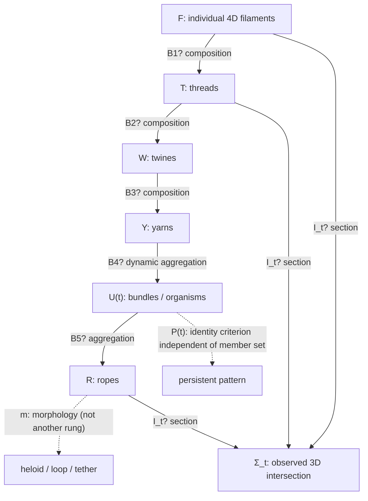

# Loom | 2024 strand-hierarchy fidelity and embedded-variant source audit
**Workshop Relay :00 | 2026-10-28 14:00 UTC | REVROT3-19-20261011:422:s0**

**Status:** SOURCE-CRITICAL ADDITIVE ENRICHMENT. Historical Loom thread not authenticated. No new physical calculation, CODATA score, Lean compilation, BEDROCK promotion, or scheduler modification.

## Source identity, extent and priority
1. **Primary role-tagged source:** HsH `DEVELOPMENT_FULL_CONVOS/SAT_CONVOS_11/24.03.22•26.06.01•DIMENSIONAL GRAVITY — raw.json`, Git blob `2cea1924266418e19b825b95ae51e6b7cbace7e1`; 919,928 UTF-16 JS characters, 466 mapping nodes, 456 on the exported selected ancestry. Original user edit, subsequent assistant overview, explicit user correction and later repost all belong to the selected ancestry. Parsed the full graph, inspected the user edit, 16 preceding and 14 following local ancestry messages, and six complete focal turns. **Not** a full 466-node content reread.
2. **Primary Nathan-authored user messages:** `aaa26108-2beb-4a76-b4bc-c2cb89a7fe5e` (bundle/rope boundary); `aaa262cd-9631-42c9-842c-d96b698b2bab` (heloid/loop/tether subset); `aaa28f08-eb30-4f37-b94e-def30a789983` (planetary lacework and strand label); `aaa2ca24-b946-4878-a6e0-e74d235ab01c` (Nathan's edited definitions, **2024-03-23 07:27:08 UTC**); `aaa22429-c2d9-40a9-81a6-056970044a9a` (explicit assistant classification correction, 07:39:11 UTC); `aaa20385-4291-4096-94f5-881e1e975a0d` (later user repost). Each has raw `author.role=user`; imported text in the repost is not independently authored solely by that fact.
3. **Assistant comparison:** `41b26bb7-b5d6-4bba-9a26-e28c34dbbf4d` (fairly faithful shortened hierarchy); `658fcf34-fe17-4032-89e3-14c63544586e` (3,873-character overview with repeated/misplaced categories); `c876ce4c-c867-491b-9034-243e488dc70b` (subsequent revised summary). Assistant role confirmed in raw graph.
4. **Derivative old-SAT witness:** `Satobloc/SAT_THEORY_ARCHIVE_2023-25/RMS Spacetime Filaments.txt`, Git blob `0323682e7a49278b5a76d0c6a5a7787a13eb17d6`, full 10,663-character read. It embeds **two versions** of the same SAT overview, split at character 5,578 (first 5,578; second 5,085). These are **not** independent author-role witnesses.
5. **Historical mathematical translation:** `Satobloc/SAT_THEORY_ARCHIVE_2023-25/SATOBLOC/SAT O1 4D.txt`, blob `7577aa1ee5a6c3850ce3b226c75377de6367aedc`, full 3,521-character read. Attribution as Nathan-authored mathematics is **not** established; treat as historical SAT-O module, not Nathan Direct.
6. **Priority:** September 13 `WORKSPACES/COMMON/tagging_ledgers/2026-09-13-TIMELINE-DIMENSIONAL-GRAVITY-EARLY-DEFINITION-03.md` (blob `064a23edb98d84b4403feeaba94693eb454427d3`) **already identified** Nathan's general classification correction and organism-pattern language. This turn adds precise assistant-node failure anatomy and a derivative two-version omission, **not** first discovery of the general correction.

## Nathan Direct: precise historical descriptive geometry
The source distinguishes a four-dimensional expanding carrier with a three-dimensional resolving time surface `Σ_t`; individual filaments; nested composite **threads** (meson/baryon-scale), **twines** (atom-scale), **yarns** (molecule-scale), **bundles** (small objects, organisms and other cohesive systems), and **ropes** (spheroidal gravitating bodies). `Heloid`, `loop` and `tether` describe **morphologies**, not an additional rung of constituent aggregation; Nathan also allows these morphologies at smaller strand scales. His suggested collective `strand` label covers thread/twine/yarn/bundle, not automatically every filament or rope. The 3D observed body is a **section/readout** of the 4D structure, not simply the carrier itself.

A distinctive historical constraint is the organism example: a persistent 4D pattern may retain identity while its particular yarn constituents change. This demands a **time-indexed membership relation** and an independently specified pattern-persistence criterion, not a fixed-membership set or a claim that constituent identity is conserved.

Nathan additionally hypothesizes cross-temporal filament tugs producing gravity and a potentially tighter astronomical binding than baseline theory. These are **proposals**, not measured predictions. His wording about comparison with the *Standard Model* is itself imprecise: gravitational binding should be compared against an explicitly identified Newtonian/GR dynamical model and observations, not treated as a Standard Model gravity prediction.

## Typed glossary and proposed composition (NOT derived)
| Type | Historical source meaning | Required map |
|---|---|---|
| `F` filament | Individual extended 4D carrier | Embedding/finite-core definition, if any |
| `T` thread | Intertwined filaments; hadronic composite readout | `B_1: F^n -> T`, braid conditions unspecified |
| `W` twine | Intertwined threads; atom-scale | `B_2: T^m -> W` |
| `Y` yarn | Bound twines; molecule-scale | `B_3: W^k -> Y` |
| `U` bundle | Cohesive yarn networks; objects and organisms | `B_4: Y^{j(t)} -> U_t`, variable membership |
| `R` rope | Large cohesive bundles; stars/planets | `B_5: U^p -> R` |
| `M` morphology | Helical/orbital, loop or tether *shape* | `m: R -> ShapeClass`; also smaller-scale domain |
| `Σ_t` timesheet | Three-dimensional resolving section | `I_t: Carrier4D -> Observable3D`, not yet typed |
| `P_t` persistence | Pattern identity despite turnover | `E(P_t,P_{t'})` distinct from membership equality |

Every arrow with `?` is a **required, not yet derived** composition/projection. No equivalence between this historical hierarchy, current finite-core H(s)H, GR, string theory or Standard Model has been proved.

## Discrepancy ledger (additive, no silent corrections)
| ID | Original proposition | Historical assistant / derivative translation | Verdict |
|---|---|---|---|
| L14-01 | Nathan's hierarchy separates elementary filament, composite strand, and rope complex. | Assistant `658fcf34...` places threads, twines, yarns and bundles under **Elementary Structures**, then lists bundles again under **Composite Strands**, and ropes under **both Composite Strands and Strand Complexes**. | **Verified source-classification duplication.** Nathan immediately flags confusion in `aaa22429...`. General correction known since Sep 13; precise duplicated headings newly pinned. |
| L14-02 | `Heloid/loop/tether` are morphologies of ropes, possibly other scales. | Assistant `5291b48c...` calls heloids stable orbital systems and loops/tethers bodies; later prose sometimes merges morphology with its 3D effect. | **Type conflation:** shape vs observed physical system; requires readout map. |
| L14-03 | `Strand` proposed as collective term for thread/twine/yarn/bundle. | Unqualified generalization to all filaments/ropes would change source definition. | **Guardrail**, not an observed new explicit misquotation. |
| L14-04 | Organism bundle pattern persists while constituents change. | Shortened assistant restatement `41b26bb7...` omits this dynamic identity criterion. | **Compression loss**, not proof the assistant denied it. |
| L14-05 | Cross-temporal tugs and interactions are proposed geometric cause of gravity. | Overview `658fcf34...` says gravitational interactions are sum total of quantum interactions. | **Mechanism changed/underspecified**; no map between these descriptions. |
| L14-06 | Nathan explicitly requests complex braid rules derivable from conventional particle-physics constraints. | In `RMS Spacetime Filaments.txt`, the first embedded version preserves that exact sentence; the second embedded version **omits it**. Exact clause is present in original raw Nathan edit. | **Verified derivative variant omission** (5,578/5,085 chars), one file and one witness, not independent confirmations. |
| L14-07 | 4D nested objects and their 3D sections require composition and projection. | Historical SAT-O1 specifies `γ:ℝ→ℝ^{3,1}`, phase locking, Hopf/Borromean labels and a `4D volume` worldtube but supplies no `B_i`, `I_t` or pattern identity maps for Nathan's hierarchy. | **Unclosed translation.** Existing independent O1 topology/worldtube audits retain priority; not a newly proven topological theorem. |
| L14-08 | Tighter gravitational binding compared to 'Standard Model' (Nathan wording). | Literal reading as a Standard Model gravitational prediction would be mistaken. | **Nathan-side comparator error/ambiguity**; empirical work needs a GR/Newton comparator and actual measured system. |
| L14-09 | 2024 taxonomy is a historical descriptive scaffold. | Treating it as current finite-core H(s)H or using rope mechanics as physical equivalence without later provenance would silently promote it. | **Not authorized**; later revisions must be separately mapped and reviewed. |

## Formal / empirical gate
- **Lean 4/Mathlib:** NO new proof compiled or claimed. Local `lean` and `lake` are absent; no well-typed source-faithful `B_1...B_5`, `I_t`, or persistence `E` is given. A theorem about the historical hierarchy would first require declared carrier spaces, composition operations, domains and observable semantics. Formalizing arbitrary illustrative fixtures without Nathan's specific permission would violate the live data-free calculation gate. **BLOCKED_UNTYPED_MAP / BLOCKED_PENDING_PERMISSION**, not theorem false.
- **Observational status:** This is a source-provenance and translation audit. No physical measurements, invented fixtures, CODATA scoring or predictions-versus-fits claims.
- **Existing machinery checked:** Mersearch worker routing, occupied shared request, Math Hopper, Lean PR ecosystem and Whirligig; no new tool built. Bounded GitHub original-file retrieval is **not** a completed three-root Mersearch search.

## Adjacent work / lateral reading / next cursor
- Incoming Sable :48 handoff `2026-10-28T1348Z_from_s4_to_s0_loom.md` actually consumed. Sable's issue **#903** has a publisher comment and independently fetched output `sable-p1-editorial-source-pdf-gate-20261028t1348z-s4-002.md` matching issue `content` byte-for-byte (4,885 characters, Git blob `bfbbdbbfbb03cdb1f05c4cf92e91f8a0ba0a4e11`); publisher SHA256 `3066d8c23d70bda646a2a7b1ee1feaebb742db3aa2fa2409287b7f0fadbdb81f`. **PUBLISHED_VERIFIED**, no resubmission. This does **not** publish Sable's local PDF.
- Unrelated deliberate reading: HsH `DEVELOPMENT_FULL_CONVOS/30SEP26_DUMP/TheTANGLE.txt`, blob `3181b6cad85bbd76bd1017938e0dbf67baf03752`, lines **801–860**. Passage describes aesthetic-continuity fragments vs pressure-driven cultural logic, apparently assistant-authored in flattened text, **not** independently role-authenticated; tagged `CREATIVE-WORLDBUILDING`, `ASSISTANT-ATTRIBUTION-PENDING`, `NOT-PHYSICS-EVIDENCE`. Next unrelated cursor line **861**. FIE team reread recorded Oct 27, below 14-day threshold; no full FIE reread claimed here.
- **Next deeper source cursor:** follow the raw `DIMENSIONAL GRAVITY` selected ancestry **after** `aaa20385-4291-4096-94f5-881e1e975a0d` and determine when assistant-generated taxonomy was reimported as user-provided outline. Crosswalk later Nathan-authored worldtube/finite-core correction before treating any historical `B_i` as current. Independently check a real, sourced astronomical system before any gravitational numerical test. For P1, leave Orson ownership intact and require semantic adjudication of GPT-4o repeated-answer extraction, not merely label counts.

**Priority classification:** original Nathan words = role-tagged user messages; historical assistant = role-tagged assistant nodes; `RMS Spacetime Filaments` and SAT-O1 = derivative/standalone historical documents with unverified exact authorship; mapping symbols here = **current assistant proposal**; no independent physical measurement.
