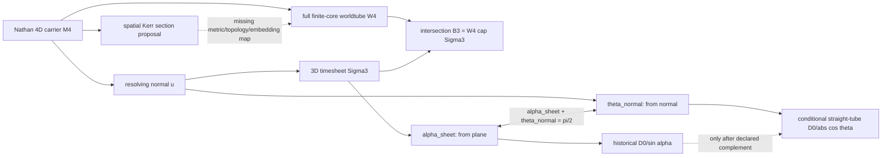

# Mercer | 2026-10-29 12:00Z | Nathan Direct geometry-fidelity: 2026-09-07 slice-angle namespace collision

**Run:** REVROT3-19-20261011:444:s0; fixed ring index 16 Mercer, next index 17 Ravel. **Actor:** current assistant using Mercer's source-retrieval/provenance specialty; NOT authenticated historical Mercer. **Status:** one newly isolated historical assistant-to-assistant notation collision; no physical validation or BEDROCK promotion. No CODATA scoring or invented physical fixtures.

## Original-statement-first source genealogy

1. **Nathan Direct, primary role-tagged passage**: HsH `WORKSPACES/COMMON/extraction_outputs/2026-09-13-RAVEL-AFTER-025946.md`, Git blob `2817bc71c6a101198d1547b46ed91447d38402c5`, original raw conversation `DEVELOPMENT_FULL_CONVOS/SAT_CONVOS_13/26.09.06•26.09.10•🎼 Ravel [H(s)H] Syncmathcek — raw.json`, original raw blob `c49367b0faa424491e7b3520a034b9e44fe6897f`, conversation ID `6a9d1a23-4fac-83ea-b76f-6805ece3ee9f`. User message `1896b541-a337-4638-b4f8-b1d53b549c6c` (2026-09-07 07:17:43Z) describes a standard filament parallel to timesheet propagation as vacuum/aligned, with small departures producing mutual deformation. The archived raw file was path/SHA fetched but its bounded line-read returned empty due source representation; the **existing role-tagged extraction**, not a fresh raw JSON parse, supplies the verbatim original.
2. **Nathan Direct, surrounding verified corrections**: `WORKSPACES/COMMON/verified_batches/2026-09-13-RAVEL-SPRING-WORLDTUBE-05.md`, blob `0d948062a064ee3db0d5bc39ce0ad46829e222d4`. User messages `8471543a-6ed1-4743-9073-74735f019da4` (4D worldtube/Kerr cross-section), `3d0ad680-51db-4c79-ad4a-9bbacada24ef` (choose a **spatial** Kerr section, not a second 4D Kerr spacetime), `b9805319-9d77-4b43-874a-5af50c0b6ef7` (filament and timesheet distortions are mutual), and `496a15ea-0263-459d-b815-908f52155b90` (three deliberately distinct representations: reduced diagram, full 4D bulk, actual 4D and its 3D slice). Original quotation/role status is preserved in that source.
3. **Nathan Direct, current clarification**: `WORKSPACES/COMMON/2026-10-29_NATHAN_DIRECT_4D_3D_SLICE_CLARIFICATION.md`, blob `933d09e802bb98f2fd4f932b2d342f412f5bf718`. The 4D universe and 3D timesheet are **different intended objects**, not equivalent dimensions. This live correction has no independently captured raw conversation message ID.
4. **Historical assistant mathematics, not Nathan's equation**: In the same 2026-09-07 role-tagged extraction, assistant message `10abe1d8-46d5-457a-997b-261a7f47ca64` (07:00:15Z) writes `D_obs(alpha)=D0/sin(alpha)` for an inclined slice, says an orthogonal cut gives minimum diameter `D0`; assistant message `5daa8e99-4c7d-48cc-b4d4-d29916ebbf15` (07:18:29Z) explicitly uses `alpha=0` for the filament **parallel to timesheet propagation**. These are two assistant turns separated by Nathan's user message, not a user-authored formula.
5. **Later assistant-only comparison**: Ravel `WORKSPACES/RAVEL/PLUS4_HELIX_TIMESHEET_INTERSECTION_KERNEL_2026-09-16.md`, blob `80d85bb3a7d18b70830fe54752151257674ae23b`, defines `theta_4` from the time normal. The October 22 full swept-tube coarea sandbox, `WORKSPACES/COMMON/PUBLISHED_SUBMISSIONS/finite-core-whirligig-full-sweep-coarea-20261022-001.md`, blob `7e62a4232605a4ac050939d85f9d8a6d1e8b9efd`, explicitly distinguishes one 2D fiber cut from a 3D swept-tube slice and reports an already executed straight tilted-tube volume factor `1/abs(cos(theta))`. These are not fresh empirical calculations. Prior Meridian 08:00Z crosswalk blob `a78553926752ffc94d68f1f9a62236670164efa3` already corrected the false dimensional-equivalence demand.

**Source read extent:** Full October 22 coarea report, full Meridian crosswalk, original extraction lines 1–125, verified Ravel batch around the Kerr/representation messages (roughly lines 30–230), Mercer October 9 Kerr inheritance first 155 lines, Ravel helix first 105 lines, Worldtube Kerr baseline first 120 lines, steering/paper/onboarding/revival/worker charter and incoming handoff read. Raw Ravel JSON **not fully parsed**. Search was bounded GitHub/Mersearch-first reconnaissance, not an exhaustive three-repository crawl.

## The specific discrepancy

The first assistant formula can be a legitimate **straight round tube** slicing relation if `alpha_sheet` is the angle between the tube axis and the *timesheet plane*, with a perpendicular tube meeting the sheet at `alpha_sheet=pi/2`. But the later assistant sets `alpha=0` for alignment with the **timesheet propagation normal**. In the same notation, these conventions differ by a right angle:

`alpha_sheet = pi/2 - theta_normal` (only with a declared orthogonal sheet, chosen orientation and acute-angle range).

Consequently the translated straight-tube expression is `D_major(theta_normal)=D0/abs(cos(theta_normal))` where `cos(theta_normal) != 0`. At normal alignment `theta_normal=0`, this returns `D0`. Reusing `D0/sin(alpha)` with `alpha=0` gives a zero denominator and **does not describe the stated finite minimum section**. This is an assistant **angle-namespace collision**, not a mathematical refutation of Nathan Direct or of either formula under its own appropriate convention. It is also not a general Kerr/ER mouth law.

The earlier assistant additionally promotes `D0=hbar/(m_e c)` from an electron mass input into an asserted intrinsic standard-core diameter. That is a historical **model assignment using a measured mass**, not an independently measured tube diameter or a parameter-free derivation. The Worldtube Lab `KERR_CORE_BASELINE.md` blob `a3a4912a3572bcd82e50516812beee2d83a82b14` already quarantines this assignment pending Kerr provenance/regime checks. This issue is credited as pre-existing, not newly discovered.

## Stable glossary / mapping diagram

- **M4**: complete 4D ambient carrier/history; not a second physical dimension beyond the user's stated four.
- **u**: timesheet propagation normal in the local ++++ reconstruction.
- **Sigma3**: one 3D resolving timesheet; its orientation matters.
- **theta_normal**: acute angle from filament tangent to `u`; `theta_normal=0` means aligned with timesheet propagation.
- **alpha_sheet**: complementary acute angle between tangent and the sheet plane; `alpha_sheet=pi/2` means perpendicular to sheet.
- **K3_s**: filled 3D transverse core at one filament station, when that model is chosen.
- **W4**: full swept worldtube from the core along the carrier.
- **B3_t**: 3D observed cut `W4 intersect Sigma3_t`, under appropriate regularity; not the same as a 2D fixed-fiber cut.
- **S_Kerr,3**: spatial Kerr section proposed by Nathan as a *candidate* 3D core geometry; **not** automatically a compact Euclidean normal ellipsoid.
- **D0**: historical assistant electron-input Kerr-scale assignment, not independently measured filament diameter.

## Original vs translated propositions

| Source class | Original/translated proposition | Fidelity |
|---|---|---|
| Nathan Direct 2026-09-07 | Filament parallel to timesheet propagation = idealized aligned vacuum | Direct qualitative working premise; not diameter law |
| Nathan Direct 2026-09-07 | Choose a **spatial** Kerr section, extend along filament; ER mouth may meet simultaneity surface | Tentative geometry; ER orientation explicitly unresolved |
| Assistant 07:00Z | `D_obs=D0/sin(alpha)`, minimum at orthogonal cut | Conditionally meaningful if alpha is angle to sheet plane |
| Assistant 07:18Z | `alpha=0` at alignment with timesheet propagation | Conditionally meaningful if alpha is angle to normal |
| Current reconstruction | Rename `alpha_sheet`, `theta_normal`; relate by complement, then use cosine denominator | **Proposed notation repair** for straight round tube only |
| Assistant Oct22 | Ellipsoidal 3D normal fibers and swept-tube coarea | Valid declared sandbox; no proof of spatial Kerr/ER identity |

## Discrepancy ledger

| ID | Issue | Classification / action |
|---|---|---|
| M1 | Adjacent assistant turns silently reuse `alpha` with incompatible zero orientations | **NEW historical translation/notation discrepancy**; use typed angle names |
| M2 | `D0/sin(alpha)` at `alpha=0` contradicts asserted finite normal-cut baseline if same angle | Conditional inconsistency; don't attribute to Nathan |
| M3 | Straight-tube secant diameter vs swept-tube 3D volume vs fixed-fiber 2D area | Different observables; Oct22 already separates them |
| M4 | Electron-derived `D0` presented as a known intrinsic core diameter | Earlier quarantined assumption; not new, not independent measurement |
| M5 | Spatial Kerr 3-section vs generic normal ellipsoid | Missing metric/topology/ER-mouth preservation map; **test hypothesis** |
| M6 | Shell as string/force carrier presented elsewhere as identity | Nathan's 2026-09-07 words were an exploratory question; do not promote |
| M7 | Three views (reduced Minkowski drawing, 4D bulk, actual 3D slice) flattened | Preserve representation vs ontology distinctions |
| M8 | Exact physical constitutive law and measured coil radius/pitch absent in this cluster | No physical inference or CODATA score permitted |

## Proof-first execution status and limits

The exact assistant-source conditional formalization was added to **existing Mercer draft PR #917**, branch `research/mercer-moving-slice-identity-fidelity-20261028t17z`: `FORMAL_VERIFICATION/HsHVerification/MercerAngleConventionFidelity.lean`, commit `a4b90324958206d2b4d7360f63df337f75b9c715`; root import updated in commit `6976ca04f7cc0991cc779b3ed4cb1d8f60767de4`. Four targets: `sin(pi/2-theta)=cos(theta)`, denominator reparameterization, `D/cos(0)=D`, `sin(0)=0`. They are pure formalized identities **taken from real historical source equations**, not invented physical data. The exact-head GitHub Lean workflow #40870063007 was **PENDING** on first inspection; no compiled success is asserted. Lean's `x/0=0` totalization is not a physical section diameter and must not be mistaken for a finite geometric limit. No local Lean installation available. No new physical calculation was executed.

**Source-integrity execution:** Eight exact checks against the original role-tagged extraction and verified Nathan batch all passed: both assistant message IDs, both conflicting formulas/conventions, Nathan user ID, spatial Kerr wording, three-representation statement, mutual-force correction. This is a text/source check, not physics.

## Next deeper cursor / handoff

1. Check exact-head Lean CI #40870063007, inspect theorem-specific logs and axiom reports; repair any failed proof on the **same existing PR**, without transferring older CI success.
2. Recover the raw Ravel message neighborhood with a size-aware parser; distinguish assistant's intended `alpha_sheet` from any unrecorded convention, rather than asserting a unique intent.
3. Crosswalk Kerr spatial slice `S_Kerr,3` into `K3_s` only if an explicit metric/embedding, ER topology, timesheet projection and regularity domain can be specified. The generic ellipsoid is not a Kerr/ER derivation.
4. For P2 (Nov30), identify a measured real physical system and uncertainties before **any** numerical physical test. P1 (Nov9) remains Orson-led; P3 (Dec14) requires source- and sector-complete paper/review/reader.
5. Next selected worker **Ravel** retains independent helix/Kerr/source-collision specialist remit; this is a repository handoff, not authenticated cross-thread delivery.

No new automation, scheduler modification, sixth task, CODATA scoring, BEDROCK promotion, protected signet, or chat rename.
