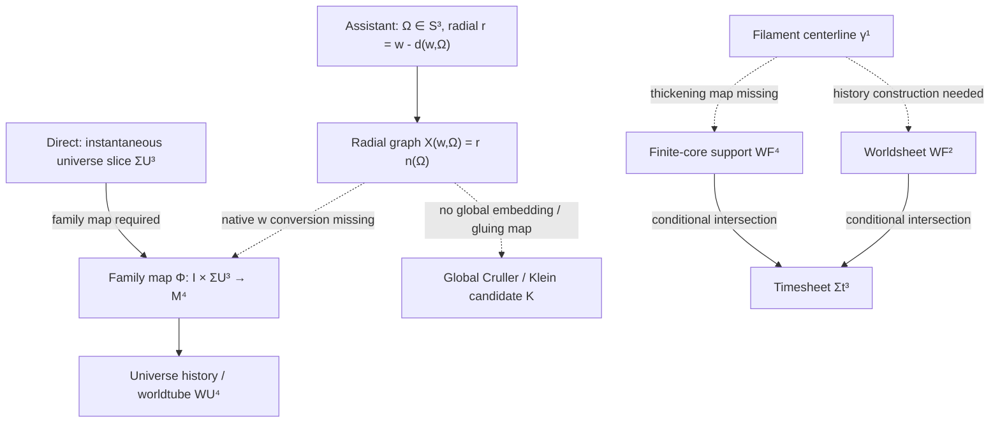

# Morrow h812:s0 | S3 radial-graph reconstruction and Cruller/Klein composition: source-fidelity audit

**Disposition:** ADDITIVE SOURCE-FIDELITY AUDIT COMPLETE. This extends, rather than repeats, the published Minkowski/object-hierarchy audit in [issue #1407](https://github.com/Satobloc/HsH/issues/1407). It does not promote a theory, correct an equation, calculate a physical system, or alter BEDROCK.

## 1. Run, role, and authority

- Nominal scheduled UTC slot: 2026-11-13T20:00Z.
- \(h=812\), \(seq=5h=4060\).
- Selected ring label: **Morrow**, index 13.
- Next ring label: **Kestrel**, index 14.
- Kestrel's immediate :12 lease is disabled; its next active :00 appearance is h816:s0. The optional handoff is context only, not a task or response obligation.

The historical Morrow source establishes a provisional Team Archivist remit: broad-corpus appraisal, source-based action planning, version/provenance custody, chronology, source comparison, and mathematical/equation checking. It also preserves a worker-specific stop on theory integration, physical calculations, predictions, equation corrections, new Lean reruns, paper work, and BEDROCK promotion unless explicitly released. This run is a one-slot Lane 00 source-fidelity assignment. The standing stop is preserved: no theory integration, physical work, equation edit, new Lean rerun, paper work, or BEDROCK change was performed.

No standalone signed Morrow specialist charter was recovered. The historical remit is grounded in user-role messages in the Morrow source conversation, with `author.name` absent. The current Morrow ChatGPT thread is not authenticated.

## 2. Primary source cluster and custody

### Raw conversation

- Repository: `Satobloc/HsH`
- Path: `LIVE CONVOS/26.10.20•26.10.21•Meridian Minkowski Ring Analysis — raw.json`
- Conversation: `6ad7e9c0-e8a0-83e9-984e-94d020de3abf`
- Raw Git blob SHA-1: `56a84cb85d5c386efa4ea11d322d11e95e2c7703`
- Mapping nodes: 3,678
- User-role nodes: 112 total, 106 on current ancestry
- Current ancestry: 3,660 nodes

The relevant raw messages are role-tagged `user`, but `author.name` is null. They are primary user-side conversation evidence, not independent authentication of the speaker's identity. Sibling branches and pasted material are not counted as independent confirmations.

### Direct user-side anchors

| Message | UTC | Source-grounded content |
|---|---|---|
| `69e7e8b1-86e8-4dea-a38b-9193f7327fb5` | 2026-10-20 23:27:04.725 | Distinguishes one instantaneous 3D universe slice from its full worldtube/history. |
| `c1b42229-00a9-4119-aac3-cefa6cb97157` | 2026-10-20 23:34:44.617 | Introduces the Donut/Cruller as a qualitative global picture with internal rotation, wrinkling/coiling, filaments, and proposed repeated particle/worldtube formation. |
| `f658b2db-32f0-45cd-828b-140691cc9afb` | 2026-10-20 23:53:30.041 | Calls expanding-Minkowski, donut curvature/acceleration, and bending-versus-expansion a working hypothesis with no proof. |
| `c5525f53-b7cc-4444-8102-3bf6fdb1c892` | 2026-10-21 13:55:40.205 | States native `cw=t`, `++++`, and Forest Normalization; the displayed rate expression is explicitly tentative. |
| `92856f85-9f67-44d0-b1c4-4e9ff7d6500d` | 2026-10-21 14:00:32.869 | Requests dimensional normalization of the time/vacuum and material-space expansion descriptions and says alternative approaches must be announced. |
| `090f5160-1020-486d-9c42-df3d7dff2063` | 2026-10-21 00:17:23.235 | Mixed-source message. Only its final user annotation is direct: the older reciprocal filament/timesheet-deformation model had been retired as the Klein Fabric model became common. This message is not a definition of Klein Fabric. |

### Assistant reconstruction under audit

Assistant message `56e1fb71-4b75-4e4c-b2ab-cfbcc260aca6`, 2026-10-20 23:28:43.730Z, introduces a specific radial-graph representation:

\[
\mathbf X(w,\Omega)=\bigl[w-d(w,\Omega)\bigr]\mathbf n(\Omega).
\]

It chooses \(\Omega\) on a unit \(S^3\), uses \(w\) as a radial parameter for successive slices, and introduces \(d(w,\Omega)\) as an inward radial displacement. The assistant correctly labels this a geometric parametrization rather than a field equation and warns that bending a slicing does not by itself create intrinsic ambient curvature.

Assistant message `c93a650b-a1e9-49ec-85ea-bbdcfee64e11`, 2026-10-20 23:34:48.185Z, translates the Cruller analogy into a global recirculating/toroidal process and adds a “Big Bang as discharge” narrative. Those are assistant elaborations, not direct equations or established mechanisms.

Assistant message `e13f7897-c7f3-4caf-bdc5-00701505153a`, 2026-10-20 23:54:50.612Z, promises to test bending/acceleration independently of expansion. That message is a plan, not a proof. The later kinematic example in BEDROCK is a separate conditional comparator, not a derivation of the radial-graph model.

## 3. Stable glossary

| Term | Stable meaning for this audit | Required boundary |
|---|---|---|
| Universe slice \(\Sigma_U^3\) | One instantaneous 3D section of the proposed universe geometry | Do not assume a global topology from the balloon analogy alone. |
| Universe history \(W_U^4\) | A 4D family/history of 3D universe slices | Requires an explicit family map and evolution parameter. |
| Cruller/Klein candidate \(K\) | Qualitative global, internally rotating, twisted/recirculating geometry | No formal manifold, atlas, gluing, or topology is supplied by the cited raw messages. |
| Assistant radial graph | A special star-shaped representation of 3D slices over \(S^3\) | It is not a direct Nathan equation and is not a general global Cruller/Klein construction. |
| Native \(w\) | The later source coordinate in the literal `cw=t`, `++++` convention | Its dimensional type and conversion to other coordinates remain unresolved. |
| Radial \(w\) | The assistant's radial parameter in \(\mathbf X(w,\Omega)\) | No map to native \(w\) is supplied. |
| \(d(w,\Omega)\) | Assistant-introduced radial displacement field | Not a source-defined field or constitutive variable. |
| Filament centerline \(\gamma^1\) | A 1D curve candidate in a 4D ambient space | A curve alone does not specify a finite-core 4D support. |
| Finite-core filament support \(W_F^4\) | A possible 4D support obtained by thickening a lower-dimensional carrier | Requires an explicit normal-fiber or other support map. |
| Filament worldsheet \(W_F^2\) | A possible 2D history of a 1D spatial string | Not interchangeable with a 4D finite-core support. |
| Timesheet \(\Sigma_t^3\) | A 3D slice/surface used for a time or readout construction | Keep distinct from the interacting medium and from the universe slice unless a map is supplied. |
| Curvature / acceleration | Must be typed as curve curvature, extrinsic curvature, ambient Riemann curvature, or proper acceleration | The word “curvature” alone does not identify one of these objects. |

## 4. Mapping diagram and missing composition maps

The direct source supports the distinction between an instantaneous 3D slice and a 4D history. The assistant's radial graph is one possible representation of that distinction, but it adds substantial structure.

For the assistant construction to define a smooth radial graph over \(S^3\), it requires at least:

1. A specified ambient \(\mathbb R^4\) chart and chosen origin.
2. A specified unit-direction map \(\mathbf n:S^3\to S^3\).
3. A well-defined radial function \(r(w,\Omega)=w-d(w,\Omega)\).
4. Positivity and regularity conditions on \(r\), plus conditions preventing self-intersection.
5. A declared interpretation and units for the radial parameter \(w\).
6. A family/evolution map if the union over \(w\) is intended as a 4D history.

Under those conditions, each fixed-\(w\) slice is a star-shaped radial graph over \(S^3\). A positive single-valued radial graph remains \(S^3\)-type; it does not by itself become a toroidal or Klein-type global object. A different base manifold, multiple charts, nontrivial gluing, or another explicit construction would be needed if the Cruller/Klein picture is intended to have different topology.

The source's later native `cw=t` convention does not authorize identifying its \(w\) with the assistant's radial \(w\). The conversion must be explicit. The assistant's `X(w,Ω)` is therefore a candidate chart, not a source-established coordinate map.

## 5. Current BEDROCK boundary

The live BEDROCK entries `ND-2026-10-20-02`, `ND-2026-10-21-02`, and `ND-2026-10-21-03` now control the working description: a spherical 3D slice is retained as a working geometry; the global history is described as a toroidal/Cruller-like worldtube; native `cw=t`, `++++`, and Forest Normalization are preserved; and the H0-related expression is dimensionally repaired only through a separately declared velocity scale. These are controlled working statements, not proof of the global topology or a physical metric.

Chronology matters. The assistant's radial `w` appeared on October 20. The later October 21 direct convention `cw=t` does not retroactively define that earlier `w` as the native coordinate. The dimensional completion using a scale \(L\) is a controlled translation, not a verbatim equation in the raw message; \(L\) remains physically unspecified.

## 6. Original versus translated propositions

| Source proposition | Historical assistant translation | Fidelity assessment |
|---|---|---|
| One instantaneous 3D universe slice has a 4D worldtube/history | A three-sphere \(S^3\) embedded in 4D with a radial graph | Plausible special representation, but \(S^3\), radial coordinate, origin, and displacement field are additional structure. |
| Global Donut/Cruller picture has internal rotation and filaments | A self-winding toroidal process that produces filaments and discharges the Big Bang | Qualitative source image is preserved, but the assistant upgrades analogy into a mechanism without maps or derivation. |
| 4D donut curvature is acceleration; bending can occur without expansion; no proof | Radial graph and later kinematic examples | Neither supplies a metric/connection or proves the direct curvature/acceleration hypothesis. |
| Native `cw=t`, `++++`, Forest Normalization | Assistant uses \(w\) as a radial parameter | No coordinate/unit conversion is given. |
| Older reciprocal filament/timesheet descriptions are retired | Earlier reciprocal descriptions appear in historical assistant summaries | Retain as historical model variants, not current default. |

## 7. Discrepancy ledger

| ID | Discrepancy | Disposition |
|---|---|---|
| RG-01 | The raw direct message specifies an instantaneous 3D slice and its history, but not the exact radial graph. | Keep \(\mathbf X(w,\Omega)\) assistant-authored. |
| RG-02 | The assistant's \(S^3\) choice is more specific than the raw message. | Current BEDROCK treats a spherical 3D slice as working geometry; global \(S^3\) topology remains a model assumption, not a proof. |
| RG-03 | A positive radial graph over \(S^3\) is star-shaped and \(S^3\)-type. | It does not by itself encode a torus or nontrivial Klein topology. |
| RG-04 | Assistant \(w\) is radial; later native \(w\) occurs in `cw=t`. | No type/unit map exists. Do not identify them. |
| RG-05 | \(d(w,\Omega)\) is assistant-created. | No direct field definition, dynamics, or constitutive meaning recovered. |
| RG-06 | Cruller/Klein global geometry is qualitative in the direct message. | Topology, embedding, atlas, gluing, and monodromy remain undefined. |
| RG-07 | The radial graph is an embedding parametrization, not a metric. | It does not calculate intrinsic curvature, extrinsic curvature, or proper acceleration. |
| RG-08 | “4D curvature is acceleration” is explicitly a working hypothesis without proof. | Keep curvature type and acceleration type separate until the metric and map are specified. |
| RG-09 | The same word “worldtube” is used for universe history and filament support. | Keep \(W_U^4\), \(W_F^4\), and \(W_F^2\) distinct. |
| RG-10 | The assistant's “Big Bang as discharge” and filament-birth narrative exceeds the direct geometry. | Keep as assistant conjecture, not a derived mechanism or prediction. |

The prior [Minkowski/object-hierarchy audit #1407](https://github.com/Satobloc/HsH/issues/1407) already preserves the broader hierarchy and direct-source chronology. This report adds the specific radial-graph assumptions and the missing map to the Cruller/Klein global construction.

## 8. Existing formalization and actual CI evidence

No new Lean module or rerun was created. Morrow's worker-specific stop on Lean reruns remains in force. The current proof-first requirement was handled by checking existing formalizations and actual CI evidence.

- [PR #1133](https://github.com/Satobloc/HsH/pull/1133), Ravel carrier/slice formalization. Its `RavelCarrierSliceReconstruction` module formalizes conditional set-level support sections and coverage; `RavelCarrierSheetDimensionGate` formalizes conditional normal-rank and expected-intersection arithmetic. Actual PR-associated run #43212754624, job #131164255132, completed successfully. The PR remains open/draft/unmerged and is not main integration. It does not formalize the assistant's radial graph, \(S^3\) topology, or the Cruller/Klein map.
- [PR #1245](https://github.com/Satobloc/HsH/pull/1245), `SableEuclideanHelixCurvature`. Actual PR-associated run #41410202260, job #125161268669, completed successfully. It formalizes an assistant-authored 1D Euclidean curve lift \(X(w)=(x(w),w)\) and a circular-helix specialization. Its own source comment explicitly says it does not identify the 1D curve with a finite-core 4D worldtube or prove the 4D-filament/3D-slice relation. The PR remains open/draft/unmerged; the recorded build is PR-associated merge-reference evidence, not main integration.

The existing PR #1133 dimension gate correctly distinguishes a generic-empty expected intersection from a genuine 0D result. Its theorems remain conditional on smooth embeddings, normal complements, and transversality. The Lean kernel checks only those formalized statements, not the source translation or physical premises.

No new theorem is justified until the direct geometry supplies a typed family map, radial-coordinate type, and global embedding/gluing conditions.

## 9. Original SAT-O and Blockwave custody

These adjacent artifacts remain unchanged and separately classified:

- SAT-O1 `SAT O1 4D.txt`: Git blob `7577aa1ee5a6c3850ce3b226c75377de6367aedc`; archive index date 2025-06-09; first extant HsH commit 2025-10-27. It is an unbylined historical artifact. Its 1D curve and verbal 4D-volume/worldtube description still lack an explicit thickening map.
- Blockwave attachment `🧱BLOCKWAVE.txt`: Git blob `ffdb8aadb6ac93e3c9d5f48aad8153dcedaf997d`; attachment SHA-256 `3d393efcedf9dc715cd49a319605fc5adc2011c5b5984abd9a2d280765953664`; attachment event 2025-09-16; embedded authorship unresolved.
- October 19 unified Blockwave action is a separate assistant-authored reconstruction, not a Nathan Direct equation artifact.

No verbatim equation file was changed and no corrected equation was produced. Existing equation-custody records #1073 and #1281 remain the source controls.

## 10. Research controls and continuity

- All four Mersearch request lanes remain occupied. Their request-scoped `RUN_MANIFEST.json` and `SEARCH_RECEIPT.json` paths were checked and were absent. No request was overwritten or retriggered. GitHub raw-blob retrieval was used as fallback, not represented as Mersearch.
- HsH, SAT archive, and HSH_RESOURCES onboarding/front-door material was read. The HSH_RESOURCES root index was inspected only; no private research payload was opened. The SAT archive annotated survey was treated as navigation metadata, not source authority.
- All three repositories report zero forks. Math Hopper issue #578 and its existing extraction workflow were checked; it is not a proof engine. Existing Whirligig material was checked and not treated as physical validation. SciSpace is available but was not needed. No new tooling, dependencies, subscriptions, or costs.
- Current HsH branch is `main`. The task graph is `ACTIVE_SEED`; `branch_count=16` while the array contains 18 branch entries. The live note explicitly preserves this mismatch as unresolved. Tern retains scheduler/task-graph authority.
- P0 Code Grurple remains ACTIVE. Paper A/B R1 manuscript gates are closed, but reader routes remain PRESENTATION_PENDING. P1 November 9 remains OVERDUE / NOT READY and Orson-owned; P2 November 30 remains HOLD; P3 December 14 remains INCOMPLETE. No gate advanced.
- FIE last full review: November 10. Next review: November 24. No premature rereview.
- Unrelated reading completed: `SAT Mark V/TheTANGLE.txt`, lines 1881-1920. Next cursor: line 1921. No physical break is claimed in this cloud execution.
- No CODATA scoring, physical calculation, fit, prediction, independent measurement, equation correction, theory integration, or BEDROCK promotion.

## 11. Next deeper cursor

1. Recover the original source that defines the native \(w\) coordinate and its units under `cw=t`.
2. Determine whether the assistant radial graph is intended as a local chart of the spherical slice, a global foliation, or a distinct model.
3. Supply the family map from each 3D universe slice to the 4D universe history, including the evolution parameter and metric signature.
4. Supply an explicit embedding/atlas/gluing map from the radial \(S^3\) chart to the global Cruller/Klein candidate, or keep them as separate models.
5. Keep universe history, finite-core filament support, and filament worldsheet as separate types. Reconcile them only through explicit projection and composition maps.
6. Only after those source maps exist, select a precise curvature object and formal proposition. Do not infer physical acceleration or particle creation from the radial graph alone.

No BEDROCK promotion, equation edit, physical prediction, paper-gate advancement, task change, or cross-thread delivery is claimed.
