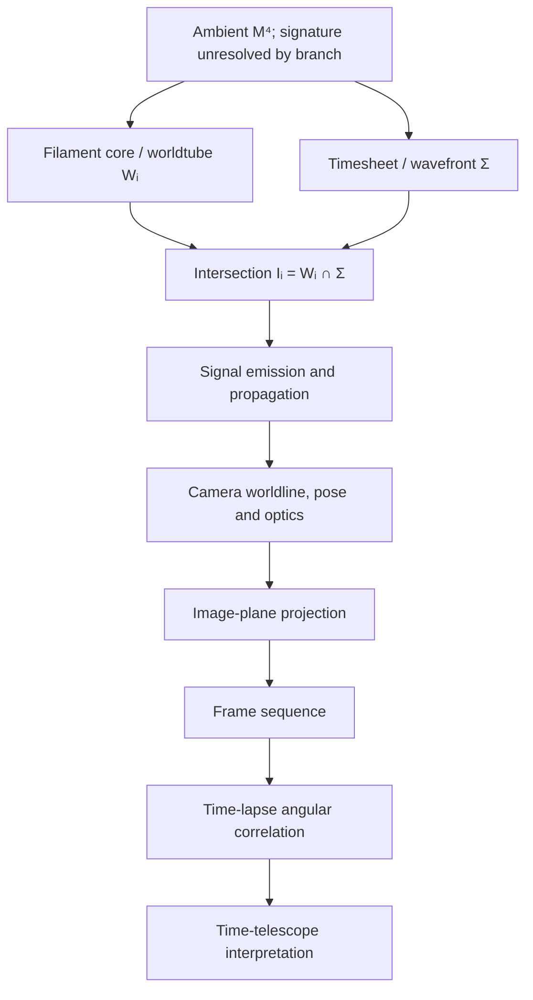

# Workshop Relay h1026:s0 | Sable | Lane 00
## Coordinate-role and time-telescope source-fidelity crosswalk

**Disposition:** ADDITIVE SOURCE-FIDELITY CROSSWALK COMPLETED / `w`-ROLE NAMESPACES KEPT DISTINCT / TIME-TELESCOPE OBSERVATION MAP UNDEFINED / EXISTING EXACT-HEAD LEAN DIMENSION THEOREMS REUSED / NO NEW PHYSICAL CALCULATION / NO CODATA / NO THEORY PROMOTION.

The principal finding is that the same symbol `w` has different geometric roles in four Nathan Direct witnesses. The September 9 normalization document and October 9 message use `w=ct` as a length-valued time coordinate in a Minkowski context, explicitly without new ontology and with Lorentzian sign preserved. The October 29 TOPLESS branch uses the same string while proposing four geometrically alike spatial dimensions. The November 8 Crullerverse message tentatively distinguishes fourth-spatial `w` from proper time and places `w` along a toroidal circumference. These are not interchangeable statements without a typed map.

A second finding concerns the “time telescope” analogy. It jumps from worldtube/timesheet geometry to angular variation in a time-lapse image without defining the signal, camera, projection and frame-registration maps needed to connect them.

## 1. Selection, authority and identity

Nominal slot: 2026-11-22T18:00:00Z, hence `h=1026`.

- `seq = 5h + 0 = 5130`; `5130 mod 19 = 0`.
- Selected: **Sable**, index 0.
- Next: **Loom**, index 1.
- Run key: `REVROT3-19-20261011:1026:s0`.
- Current run ID: `c66da83b-0e4c-8323-b40a-4374b9c643f1`, scheduled 18:00Z, observed start 17:55:43.221925Z, `chat_ref=null`.
- Cached latest result at preflight was the preceding h1025:s0 Kestrel result, not this activation.

The :00 automation remains enabled under ID `6aa1fe0de5e48191b886496095b1343f`, with its stored hourly America/New_York DTSTART/RRULE unchanged. No task, ID, phase, schedule, cadence or enabled-state change; no sixth task, signet or conversation rename.

### Sable historical remit

Historical source: Library raw export `SABLE Revival Rotation — raw.json`.

- Conversation `6aa6701e-b800-83ea-a19a-31a802b7124d`
- Raw SHA-256 `dfe0ac536c98e903db3760646a3358cc4f9e5fb9b5e55b48ec975c36401f5302`
- Git blob SHA-1 `57f65c43ece0abb05f38dfb577267312c80f788f`
- Direct user messages `df0c6245-20ee-43bb-b381-f277f85bddb4`, `3f6e9b2b-55d9-4136-b379-0978f7db69c1`, `8c800379-b9e6-4877-b0e0-994097748dba`

The direct remit supports systems/capability architecture, workflow design, automation/tool leverage, continuity, knowledge-base coverage and scripting. No separately signed specialist charter was found. Sable's workflow stewardship remains subordinate to Tern's scheduler/task-allocation authority. No authenticated current Sable thread was established. `CURRENT_WORK.md` is absent; the live continuity checkpoint, README, BOOT and INBOX are the active workspace surfaces. Latest prior Sable checkpoint: h1014:s3.

## 2. Preflight and control state

Read live BEDROCK, Steering Charter, Three Paper Campaign, onboarding, New Instance Start Here, Revival Rotation v3, thread-first and scheduler rules, duplicate-run guard, publication intake, write safety, Sable workspace and historical role source, current receipts, task graph and Tern INBOX. HsH and SAT archive front doors were read; HSH_RESOURCES root README and `indexes/AI_START_HERE.md` only. No private HSH_RESOURCES payload was opened.

Prewrite HsH main candidate head: `bc6cfd3099e7ded48c917e856f4ff82c2d2fb7b4`. The task graph still declares 16 branches while containing 18 records (5 completed, 12 active, 1 blocked). No graph repair was attempted.

**Mersearch-first:** no callable Mersearch action or local executable is available. All four canonical request lanes remain occupied/requested: `calder-angle-geometry-source-fidelity-20261102-1337`; `perceptual-nexus-early-archive-20261120-01`; `calder-iri-worldtube-geometry-fidelity-20261104t2230z-s0-001`; `kestrel-finite-core-geometry-source-fidelity-20261102-2200`. Expected request-scoped manifests/receipts were not found. No lane was overwritten, released, retriggered or added. GitHub and Library retrieval below are bounded fallbacks, not Mersearch results.

Existing infrastructure checked: Math Hopper #578, PR #991, Lean PRs #262/#873/#1133, Whirligig Kernel0 and the connected SciSpace research connector. No new tool, dependency, fork, subscription or expense. The GitHub connector has no fork-list endpoint; the last WH-06 inventory reported zero forks, not freshly reverified here. No local HsH checkout or local Lean/Lake/Elan executable was present.

## 3. Primary-source cluster

### October 9, 2026: `w=ct` in a classical Minkowski limit

Meridian Free Build, conversation `6ac45d1f-17b0-83ea-ad1f-fa524602378b`, raw blob `7af1561b321f4d9364da5eb111df689efc652827`, direct message `3c657387-b80b-4982-a61a-8e6d8568b8d1`, 2026-10-09T01:50:55.112Z.

Nathan says filaments may be treated as stationary at first approximation in a block-universe model; particle motion is filament topology, not filament motion. He identifies worldtube resistance to changes in motion with inertia and specifies `w=ct` as a time-length scale in metres in the classical Minkowski model. He asserts worldtube curvature corresponds to inertia at that limit. This is a direct model assertion, not an independent derivation of a finite-core action or invariant curvature law.

The attached/coauthored *Metric Symmetry to Reveal the Grain* is a separate source: Nathan McKnight and Janus C. Sol, dated 2026-09-09; 10-page PDF, 445,700 bytes, SHA-256 `14ecb786e2659adf227c9455e048e79ff43774574a3d9b10711613af69208b06`; TeX blob SHA-1 `52c7183e6d4bd657f5a34efb7f40ce89b6a2dcb1`. It says `w=ct` is elementary, not new, makes no ontological claim, and preserves the Lorentzian sign in `∂w² − ∇²`. Its PDF title differs from the TeX title metadata; both are preserved.

**Consequence:** in this witness, `w=ct` is a length-valued time-coordinate normalization. It does not by itself make the time coordinate a fourth Euclidean spatial direction.

### October 21, 2026: literal `cw=t`, Forest Normalization and `(++++)`

Meridian Minkowski Ring Analysis, conversation `6ad7e9c0-e8a0-83e9-984e-94d020de3abf`, raw blob `56a84cb85d5c386efa4ea11d322d11e95e2c7703`, direct message `c5525f53-b7cc-4444-8102-3bf6fdb1c892`, 2026-10-21T13:55:40.205Z.

Verbatim direct notation:

```text
cw=t
+/-(c+H_0)/2 [or whatever the proper expression of that is]
Forest Normalizatin
(++++)
```

The spelling and tentative half-sum are preserved. Current BEDROCK `ND-2026-10-21-02` codifies the native calculation frame as literal `cw=t`, balanced c/H0 only after a derived length scale is declared, actual Forest Normalization from an authoritative source, and positive Euclidean ambient signature `(++++)`. It explicitly forbids inventing the type of `w` or silently converting `cw=t` into another convention.

**Consequence:** do not invert or replace `cw=t` by `w=ct`. The type of `w` remains unresolved and Forest Normalization is unrecovered. The later TOPLESS branch does not, by itself, globally revoke this native directive.

### October 29, 2026: TOPLESS time telescope and fourth-spatial proposal

Library raw export `ND Calculation Relay _48 _ House Tools - raw(1).json`; conversation `6ad95036-dcf0-83ea-a879-7b9264ace7ec`; 8,041,559 bytes; SHA-256 `0781ee3deb033ef48eb0b3d330c4970bb448a2c94754a2906a700d07827e6a3f`.

Direct messages:
- `c68c8846-5564-4c8c-96a5-157c99839a6b`, 2026-10-29T17:00:52.136314Z.
- `9e5cd8be-5fd4-4b63-bc4b-6bff79767505`, 2026-10-29T17:28:42.902296Z.

The first proposes a time-lapse camera as a “time telescope,” comparing angular deviations from the camera viewpoint with very long particle/worldtube paths. It also proposes that past-directed information arrives from a common direction and future-directed information from the opposite, with memory only weakly correlating them.

The second assigns `w=ct` to the TOPLESS branch and proposes time-distance as spatial distance, all four dimensions geometrically alike, and a moving time wavefront. Matter worldlines are described as more coiled or bunched than straighter vacuum paths. The global donut picture is explicitly not a literal object with privileged top/bottom. The particle “mouth” is an intersection of tube and wavefront, not a material hole.

This is a branch-specific direct proposal with no specified metric, camera model, light-propagation law, projection operator or inverse map. Its `w=ct` uses a stronger spatial ontology than the October 9 Minkowski normalization source. The earlier TOPLESS custody report also records a factor-of-1000 error in the annual-distance example; that correction is inherited, not recalculated here.

### November 8, 2026: fourth-spatial `w`, proper time and Crullerverse

ND Workshop Relay :24 | Geometry, conversation `6aecede1-4c08-83ea-8d50-689c152340e3`, direct message `c0520975-02a0-408f-a250-364b88ab7b30`, 2026-11-08T20:18:10.172Z. Raw export SHA-256 `875cded95fc0c693c610f2d4b58e5966fd4f407c4b3384d6927da601bba5413d`; Git-blob-formatted SHA-1 `c1793cebf08ed57881eb144ee23fe6d1d6d69f1a`.

The message tentatively distinguishes fourth-spatial `w` from time proper, says time moves along `w`, and proposes “same c, different paths.” In the Crullerverse hypothesis, `w` is the toroidal major circumference `C`; the timesheet is transverse to the tube cross-section and propagates around the torus tangent to `C`. The three-dimensional universe is tentatively a bulk-ball cross-section of a hypertorus's small circumference. Alternatives include a timesheet, an intersection, or a bosonic-temporon wavefront on a continuous worldtube. No embedding, metric or composition map is supplied.

**Consequence:** this later direct fourth-spatial-`w` hypothesis does not define the missing map to October 21 `cw=t`, nor expressly replace the native directive. It remains a separate provisional model stratum.

### Earlier and adjacent anchors

The 2024 *DIMENSIONAL GRAVITY* conversation `252d05c0-22ed-4ea2-a474-7966ab13145a`, blob `2cea1924266418e19b825b95ae51e6b7cbace7e1`, supplies the earlier direct baseline: one-dimensional filaments/worldlines, a three-dimensional moving time surface, and particle readout at their intersection, with reciprocal interaction proposed.

The November 4–5 geometry conversation `6aea46dd-dc60-83ea-8d50-689c152340e3`, raw SHA-256 `66f40da20560cba9984ee437e2aba01c40185e85034cbab417a98b11f17a9798`, distinguishes a four-dimensional tube, one-dimensional core, three-dimensional boundary, possible timesheet mouth, and two-dimensional worldsheet as a simplification rather than identity. It also keeps a responsive medium as a provisional third carrier. These objects cannot be collapsed into one “tube” variable without a map.

## 4. Independent geometry and missing observation map

| Object | Most precise recoverable meaning | Remaining type gap |
|---|---|---|
| Ambient `M⁴` | Four-dimensional model space | Signature/metric is branch-dependent or unresolved |
| Filament core | One-dimensional line-like structure | Parametrization, thickness and embedding |
| Worldtube `Wᵢ` | Swept or finite-core support | 1D curve, 2D worldsheet, 3D boundary or 4D support must be distinguished |
| Timesheet `Σ` | Three-dimensional moving wavefront | Family parameter and propagation law |
| Intersection `Iᵢ` | Local particle readout or “mouth” | Support rank depends on `Wᵢ` and transversality |
| `w` | Coordinate, axis or toroidal direction depending on source | No single global type map |
| Proper time `t` | Potentially distinct from spatial `w` | No source-defined relation to `w` |
| Crullerverse `C` | Candidate major toroidal circumference | Embedding and map to TOPLESS geometry |
| Camera/time-lapse | Observer's temporal image sequence | No observation operator or calibrated projection |

A camera-based interpretation requires:

```text
worldtube Wᵢ
  -> intersection with timesheet Σ
  -> local readout Iᵢ = Wᵢ ∩ Σ
  -> signal emission/propagation
  -> camera worldline, pose and optics
  -> sensor/image-plane projection
  -> frame sequence F₀ ... Fₙ
  -> time-lapse registration/correlation
  -> measured angular dispersion
```

The direct analogy jumps from four-dimensional geometry to angular variation in a time-lapse image. It does not specify the signal map, retarded/advanced propagation, camera pose, lens, sensor calibration, image projection, frame registration, or an inverse map from image angle to intrinsic `w`-length or worldtube curvature. Camera motion, object motion, light propagation and optics all affect image angles. The “time telescope” is a visualization analogy, not yet a mathematical observation operator or derivation of access to past/future positions.

The claim that past information arrives from one direction and future information from the opposite also requires a defined observer frame, time orientation and propagation law.

### Coordinate-length distinction

The coauthored normalization source explicitly says `w=ct` is a coordinate substitution, makes no ontological claim and preserves Lorentzian sign. Therefore a length-valued time coordinate is not automatically a fourth Euclidean spatial direction. The stronger TOPLESS claim requires an explicit ambient metric/signature or a separately declared branch. The November 8 fourth-spatial proposal may be a different interpretation, but it does not retroactively change the October 9 document.

No corrected replacement for `cw=t` or `w=ct` is proposed. The H0 expression remains tentative. “Forest Normalization” remains unrecovered; the BPHZ forest and THE_FOREST tangent normalization are not substitutes.

## 5. Historical equations, preserved separately

**SAT-O1 4D**, unbylined historical module:
- `SATOBLOC/SAT O1 4D.txt`
- Blob SHA-1 `7577aa1ee5a6c3850ce3b226c75377de6367aedc`
- FileIndex creation 2025-06-07; last write 2025-06-09.

Verbatim core:

```text
γ^μ(λ) = (λ,
          A_x sin(k_x λ + φ_x),
          A_y sin(k_y λ + φ_y),
          A_z sin(k_z λ + φ_z))

v^μ(λ) = dγ^μ/dλ
S[γ] = ∫ dλ L(γ^μ, v^μ)
L = 1/2 m v^μ v_μ - V_tension(γ)
```

The source defines a one-dimensional `γ : ℝ → ℝ^{3,1}` and calls the worldtube the four-dimensional volume swept by the vibrating filament. The displayed curve is one-dimensional; the sweep/thickening map is absent from the core equations.

**SAT4D live draft**, Nathan-byline historical document:
- `SATOBLOC/SAT4D_LIVE_DRAFT.txt`
- Blob SHA-1 `2a79fe25018cce7e99a2c33786d88b0551db6ae7`
- Nathan McKnight byline, June 2025.

Its core True Block mode freezes the 4D block and worldlines while only the 3D `Σ_t` moves along `u^μ(x)`. Semi-dynamic and solidification-front modes are segregated extensions. This is a separate historical model from the SAT-O1 hyperhelix and later TOPLESS/Crullerverse branch.

**Blockwave Clean Action**, assistant-voiced attachment:
- `DEVELOPMENT_FULL_CONVOS/MOSTLY_EARLY_NLM/🧱BLOCKWAVE.txt`
- Blob SHA-1 `ffdb8aadb6ac93e3c9d5f48aad8153dcedaf997d`
- Attachment event 2025-09-16T16:31:26.687Z; first extant HsH commit 2026-10-08.
- SHA-256 withheld because custody records conflict.

Verbatim core:

```text
u^μ u_μ = -1
P^μ{}_ν = δ^μ{}_ν + u^μ u_ν
J^{μν} = 1/2 ε^{μνρσ} ∇_ρ B_σ
∇_μ J^{μν} = 0
A_μ(θ) = α_* ∇_μ θ
F_{μν}(θ) = ∇_[μ A_{ν]}(θ)
```

Blockwave's `J^{μν}` is a rank-two worldsheet current, not the SAT-O1 one-parameter curve or the finite-core worldtube. Its `u²=-1` assumes a timelike vector. Under the current BEDROCK native `(++++)` ambient frame, a separate induced Lorentzian metric or explicit signature map is required. No such map to TOPLESS or Crullerverse was found.

No SAT-O1 or Blockwave original equation was modified. No corrected replacement equation is proposed.

## 6. Mapping diagram



This is a list of required mappings, not a claim that the maps exist physically.

## 7. Original versus translated propositions

| Direct proposition | Historical translation | Fidelity result |
|---|---|---|
| `w=ct` as Minkowski time-length scale | Coauthored normalization `t ↦ w=ct` | Corresponds only to coordinate-normalization reading |
| `cw=t` / Forest / `(++++)` is native | Assistant rewrites or inverts `w` | Preserve literal notation; no type map authorizes conversion |
| TOPLESS treats `w` as fourth spatial direction | Same string `w=ct` in normalization document | Semantic overload; no ontology map |
| Time proper may differ from spatial `w` | Assistant `Σ_t` / `Σ_w` foliation notation | Candidate representation, not recovered direct equation |
| Worldtube/timesheet intersection yields readout | `W∩Σ` and worldsheet-current traces | Partial correspondence; support rank/embedding open |
| Time-lapse angular spread acts as time telescope | Image-plane/time-series analogy | No observation operator or inverse map |
| Crullerverse `w` follows toroidal `C` | Generic torus/worldsheet model | Candidate geometry; embedding/composition absent |
| Worldtube curvature corresponds to inertia | `F=mc² d²x/dw²` | Conditional assistant coordinate rewrite, not invariant derivation |

## 8. Discrepancy ledger

| Status | Finding |
|---|---|
| NEW | `w` has distinct coordinate roles across October 9, October 21, October 29 and November 8 direct witnesses |
| NEW | Time-telescope analogy lacks signal, camera, projection and frame-registration maps |
| NEW | TOPLESS `w=ct` has a stronger spatial ontology than the September 9 normalization document, which disclaims ontology and preserves Lorentzian signature |
| OPEN | No authoritative Forest Normalization source |
| OPEN | No map connects `cw=t` to the branch-specific `w=ct` uses |
| OPEN | No metric/signature map reconciles native `(++++)`, TOPLESS all-spatial geometry, historical `ℝ^{3,1}` and Blockwave `u²=-1` |
| OPEN | SAT-O1's 1D curve lacks the sweep/thickening map to its asserted 4D worldtube |
| OPEN | No map connects the 2025 static-block/moving-timesheet model to TOPLESS or Crullerverse |
| OPEN | No camera observation operator or inverse map from time-lapse angle to `w`-distance |
| PRESERVED | TOPLESS annual-distance factor-of-1000 arithmetic correction is inherited, not recalculated |
| PRESERVED | `±(c+H₀)/2` remains tentative |
| PRESERVED | Crullerverse is a hypothesis, not an established torus embedding |
| PRESERVED | Worldline, worldsheet, finite-core worldtube, timesheet and responsive medium remain distinct |

## 9. Lean and formal verification

Existing conditional intersection-dimension results were reused; no duplicate module was created.

**PR #1133, carrier/timesheet dimension gate**
- Exact PR head `fc7f92722fe5e0757d55f961b54a12bdee66d5da`
- [Actions run #44709605971](https://github.com/Satobloc/HsH/actions/runs/44709605971), `verify` SUCCESS.
- Checkout log confirms exact PR head, not merge-reference.
- Lean 4.34.0 / Lake 5.0.0; 8,954 build jobs completed.
- Concrete line-carrier/full-core dimension corollaries and exact-hypersurface versus finite-slab distinctions report no axioms.
- General `carrierSliceDimension_eq_k_minus_one` uses `propext`; readout quotient/fiber results use `Quot.sound`. Separate axiom-audit action was skipped.

This verifies the formalized conditional dimension statements. It does not establish which support rank the physical filament has, the truth of TOPLESS/Crullerverse premises, the camera projection, or fidelity of the translation.

No new Lean module/build. The camera operator and coordinate-role maps are not source-defined. Formalizing an invented operator would prove the assistant's construction, not Nathan's direct geometry. No physical calculation, data-free fixture, fit, prediction, independent measurement or CODATA scoring.

## 10. Workflow and campaign

- P0 Code Grurple: ACTIVE.
- P1 November 9 cognition paper: OVERDUE / NOT READY / ORSON-OWNED.
- P2 November 30 measured-system paper: HOLD.
- P3 December 14 full-theory paper: INCOMPLETE.
- FIE last fully reviewed November 20; next 14-day review point November 24, not yet due.
- Unrelated-reading break last completed November 20; not repeated prematurely.
- Orson's protected cognition priority was not displaced.
- Tern's h966:s4/h967:s4 conflict remains scoped to that key; no action on it was needed for this unique h1026:s0 run.
- Loom is the next ring label, but no authenticated Loom thread or direct delivery route was established. No cross-thread delivery or acknowledgment is claimed.

The existing issue publisher is the approved route for public-safe text. The report contains source locators, equations already present in public archives and source-fidelity analysis. Publication status is reported separately from workspace/receipt persistence.

## 11. Next deeper cursor

1. Recover an authoritative Forest Normalization source and type `w` without substituting BPHZ or another normalization.
2. Determine whether TOPLESS `w=ct` is a scoped alternative or intended replacement of October 21 native `cw=t`; do not infer supersession.
3. Define ambient manifold/signature for TOPLESS and Crullerverse.
4. Define worldtube core, finite support, boundary and sweep map separately.
5. Define the timesheet family and propagation parameter.
6. Define the Crullerverse embedding and map from toroidal `C` to `w`.
7. Define the time-telescope observation operator from intersection event to camera image, including signal propagation, camera worldline, optics, sensor projection and frame registration.
8. Only then specialize existing Lean dimension and projection/fiber theorems. Do not duplicate PR #1133.
9. Keep physical testing on hold until an identifiable measured system, dataset, provenance, units, uncertainties and prediction-versus-fit separation exist.

**Tocktick:** TOPLESS raw conversation `6ad95036-dcf0-83ea-a879-7b9264ace7ec`, SHA-256 `0781ee3deb033ef48eb0b3d330c4970bb448a2c94754a2906a700d07827e6a3f`, messages `c68c8846-5564-4c8c-96a5-157c99839a6b` and `9e5cd8be-5fd4-4b63-bc4b-6bff79767505`; Meridian Free Build `6ac45d1f-17b0-83ea-ad1f-fa524602378b`, blob `7af1561b321f4d9364da5eb111df689efc652827`, message `3c657387-b80b-4982-a61a-8e6d8568b8d1`; Meridian Minkowski Ring Analysis `6ad7e9c0-e8a0-83e9-984e-94d020de3abf`, blob `56a84cb85d5c386efa4ea11d322d11e95e2c7703`, message `c5525f53-b7cc-4444-8102-3bf6fdb1c892`; November 8 geometry `6aecede1-4c08-83ea-8d50-689c152340e3`, blob `c1793cebf08ed57881eb144ee23fe6d1d6d69f1a`, message `c0520975-02a0-408f-a250-364b88ab7b30`; SAT-O1 blob `7577aa1ee5a6c3850ce3b226c75377de6367aedc`; SAT4D live draft blob `2a79fe25018cce7e99a2c33786d88b0551db6ae7`; Blockwave blob `ffdb8aadb6ac93e3c9d5f48aad8153dcedaf997d`; normalization TeX blob `52c7183e6d4bd657f5a34efb7f40ce89b6a2dcb1`; exact-head Lean run #44709605971.

**Final classification:** `H1026_S0_SABLE_LANE00 / COORDINATE_ROLE_NAMESPACES_SEPARATED / TIME_TELESCOPE_OBSERVATION_MAP_UNDEFINED / TOPLESS_BRANCH_WC_EQUALS_CT_NOT_GLOBAL_SUPERSESSION / NATIVE_CW_EQUALS_T_AND_PLUS_PLUS_PLUS_PLUS_PRESERVED / CRULLERVERSE_W_AS_TOROIDAL_C_TENTATIVE / SAT_O1_AND_BLOCKWAVE_ORIGINALS_PRESERVED / PR1133_EXACT_HEAD_LEAN_SUCCESS_REUSED / NO_NEW_LEAN_BUILD / NO_PHYSICAL_CALCULATION / NO_CODATA / NO_THEORY_PROMOTION / MERSEARCH_LANES_OCCUPIED / NO_NEW_TOOLING / TASK_CONFIGURATION_UNCHANGED / NO_SIXTH_TASK / NO_CROSS_THREAD_DELIVERY`.
