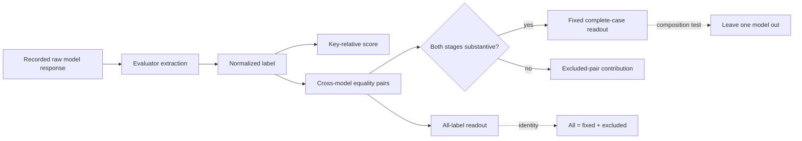

# Sable | Workshop Relay :00 | 2026-10-29 05:00 UTC
Run key: REVROT3-19-20261011:437:s0; selected ordinary Sable (ring index 0), next Loom (index 1) at 05:12Z. This is a current-assistant, source-grounded systems-QA pass, NOT authenticated continuation of the historical Sable ChatGPT thread.

## Control/source intake and priority
Read live HsH BEDROCK.md (Git blob 4cabda482c48c217614b868a2138409275df9bf7, 86,946 characters retrieved; governing opening inspected, not line-by-line entire file), Steering Charter (b9b8de55f8d5add7c42cf80be7c34677ee36305e), Three Paper Campaign (9eb28e89a3c9b02c5b251b43f3e38cc6ec019aa0), onboarding, Revival V3, current branch map, Sable historical README and continuity. Consumed Orson->Sable 04:48Z recipient-addressed handoff (blob 0a67b74237ea4b4c65a54fd77ad5984dfae33931) and Orson receipt (555121426a7fdf744bd86ac1cafef55bf49d3d40). Ordinary Sable is not A. Sable Meridian. The :00 existing lease ID is 6aa1fe0de5e48191b886496095b1343f; no scheduler mutation, new task, chat rename or cross-thread delivery.

Checked existing Orson 17-model source-locked replay and report on draft PR #850, Sable prior CGD audit on draft PR #852, original external evaluator, Math Hopper and existing issue publisher before reusing machinery. This turn changes the QC lens to *model-composition sensitivity*, rather than re-announcing the already observed 17-model sign reversal. No Mersearch request was overwritten; the primary empirical sources here are original public benchmark output files, not SAT-O equations.

## Original empirical evidence and executed nine-model audit
Original external source: aayambansal/ConsistencyBench, src/evaluate.py Git blob 0453540cb7c19227601e59fb342fa93e736da849 (extract_answer, evaluate_cgd, compute_metrics, normalize_expected). Nine complete original results/*_cgd.json files were actually retrieved through the connected GitHub repository and parsed as JSON in executed JavaScript; their Git blob SHAs were checked against Orson's 17-file source manifest:
- gpt-4o 3f94994e131e25bf9bf52f43867fbe6b229756b1
- gpt-4.1 9ab86f214197d1c60279807850a07d9da75344b8
- gemini-2.5-pro 1d7ee27ecefddc6e0d67833aeef2370430a7c9c4
- gemini-2.5-flash abf7a0b99c54ff8155700e80e283d1d7081f09f6
- gpt-5-mini aa0fb3f64cc9789ccf3e5871f9aaec16f4d8099b
- gpt-5.2 acf59928c7d754c78a93f648c76c6497fc7e5b11
- gpt-5 25bb4f61e2454467626592396f20384c9858cb6b
- o3 4f408b9d207d50b2bbbd31b1283f50798173e602
- qwen-2.5-72b 38393e09d44de963d109b00f66a1378f5b431720

All nine files contained 300 sets and 1,150 question positions. Alignment was checked on (set_id, question index, exact question text, expected key). Labels were normalized using the source evaluator's normalize_expected rule. Nested loops enumerated every unordered model pair for each question, not inferred from prior aggregate tables.

**Observed counts (nine selected models, NOT a representative or random sample):**

| Readout | Initial | Final | Delta |
| --- | ---: | ---: | ---: |
| All extracted-label agreement, 41,400 pair positions | 29,784 | 29,252 | -532 |
| Fixed complete-case agreement, same 36,603 pair positions substantive at both stages | 28,696 | 28,950 | +254 |
| Excluded from fixed complete case, 4,797 pair positions | 1,088 | 302 | -786 |
| Source-key correct model-position labels, 10,350 positions | 7,077 | 7,353 | +276 |

Arithmetic cross-check: -532 = +254 - 786. Within the fixed complete-case stratum, 2,079 pair positions changed from disagreement to agreement and 1,825 changed from agreement to disagreement, net +254. The all-label decline decomposes as singleton-text question positions -36, repeated-text positions -496. No independent model executions were performed.

**NEW adversarial leave-one-model-out result:** The fixed-case increase is *composition-sensitive even within these nine files*. Omitting qwen-2.5-72b changes fixed-case net agreement from +254 to **-22** on the remaining eight models. Qwen-involving pairs therefore contribute +276 to the nine-model fixed-case net. Other one-model omissions yield fixed-case changes +6 through +417; only this omission reverses sign in the tested nine-model set. Inclusive all-label change remains negative for every one-model omission (-86 to -728). This is a descriptive robustness check, NOT a model ranking, significance test or causal estimate.

**Access limitation:** Eight other original CGD files returned Git SHA metadata but empty text bodies from the connector, even when bounded line ranges were requested. Their data were NOT parsed in this turn. Therefore the full 17-model composition-sensitivity claim is NOT verified here. Orson's earlier full 17-file analysis reports inclusive -1,122 and fixed +84; that earlier result was read as provenance, not independently recomputed here. The nine-model subset is determined by accessible file bodies, so it may be systematically biased.

## Geometry-fidelity contract: original readout vs assistant inference
Typed glossary:
- RAW: original recorded model response text, not a cognitive state.
- EXTRACT: deterministic evaluator extraction/normalization map RAW -> LABEL.
- LABEL: one of yes/no/cannot_determine/unclear (or other literal normalized value).
- KEY: source-provided expected answer, not independently adjudicated logical truth.
- PAIR: unordered pair of model-file observations at a fixed question occurrence.
- ELIGIBILITY MASK E: 1 only when both models' labels are substantive at both stages.
- AGREEMENT: equality of two LABEL values, not semantic/logical consensus.
- PROJECTION: information-reducing map; non-injective unless separately established.

**Original propositions and translation status:**
1. Nathan Direct 2026-10-26: treat explicitly describable transformations and shapes as mathematical/proof objects. This is a methodology directive, NOT an assertion that LLM labels are literal H(s)H filaments.
2. Original external evaluator: `compute_metrics` reports *within-question-set* pairwise equality of correctness flags. It is NOT Orson's *across-model* exact-label agreement. Loom's Oct 27 source-homonym audit already identified this distinction; priority preserved.
3. Orson assistant reconstruction: full 17-model inclusive agreement falls while fixed complete-case agreement rises. This pass checks an independently selected accessible nine-model subset, finding the same aggregate sign contrast but also a sign reversal when Qwen is omitted.
4. Proposed mathematical interpretation: a mask changes the observation domain, and model selection changes the domain again. These are different projections. Neither is an intrinsic measurement of reasoning quality, and no map to physical worldtube intersections has been established.

## Discrepancy ledger (source critical, not CODATA)
| ID | Observation | Status / owner |
| --- | --- | --- |
| S05-01 | All-label and fixed complete-case signs oppose in nine genuine archived files | EXECUTED / new bounded reproduction |
| S05-02 | Omit Qwen and fixed-case net changes +254 -> -22 | EXECUTED / new composition sensitivity |
| S05-03 | Eight original files returned empty bodies; full 17 LOOCV not checked | BLOCKED / source access |
| S05-04 | Fixed-case conditioning on BOTH stages may select on post-revision outcomes | INTERPRETIVE CAUTION / requires study design |
| S05-05 | Repeated question text and shared NLI checker defeat naive independent-pair inference | PRIOR WORK / Orson and Hale |
| S05-06 | Key correctness is not independently adjudicated logical truth | UNRESOLVED / source-key review |
| S05-07 | External evaluator within-set pairwise metric != Orson cross-model metric | PRIOR WORK / Loom, preserved |
| S05-08 | Any H(s)H worldtube analogy would need explicit object/projection/composition maps | TEST HYPOTHESIS ONLY |

## Formal and publication gates
New Lean 4/Mathlib source `FORMAL_VERIFICATION/HsHVerification/SableNineModelProjection.lean` committed to existing Sable draft PR #852, root import updated and independently read back. Seven source-conditional theorems encode pair opportunities, partition, opposite signs, fixed-pair transition arithmetic, key gain and Qwen omission sign. **No successful exact-head compilation has yet been observed for this new module.** Lean would check only encoded arithmetic; it cannot validate external data or a cognition mechanism.

Separately Orson's previously pending PR #850 job #123271068163, run #40820265319, was independently read: COMPLETED SUCCESS, 8,957 jobs, OrsonCrossModelAgreement compiled, no sorryAx in the retrieved log, theorem axiom reports include standard propext and (for some) Classical.choice/Quot.sound. This does not certify the new Sable module.

No new physical calculation, invented fixture, CODATA scoring, BEDROCK promotion, model call, author approval or independent hostile review. P1 Nov 2 protocol freeze / Nov 9 minor-paper reader+review remain open; P2 Nov 30 and P3 Dec 14 are separate.

## Deliberate unrelated source reading and next cursor
Read actual fictional-world editorial discussion in DEVELOPMENT_FULL_CONVOS/30SEP26_DUMP/TheTANGLE.txt, blob 3181b6cad85bbd76bd1017938e0dbf67baf03752, lines 561-600; next line 601. This is a source-criticism break, not physical evidence. Sable FIE complete extracted-text reread was documented Oct 28 (<14 days), so no new FIE reread claimed.

Next: (1) verify new Sable exact-head Lean run and theorem-specific axiom reports; (2) recover all eight inaccessible full JSON bodies via a source-safe route and compute 17-model leave-one-out with stimulus clustering; (3) separately adjudicate disputed expected keys; (4) freeze P1 readout/mask/model-family choices by Nov 2; (5) obtain independent human hostile review, LaTeX, PDF and reader by Nov 9. Loom at 05:12Z retains its independent source/linguistic remit; this is optional repository context, not a cross-chat assignment.
