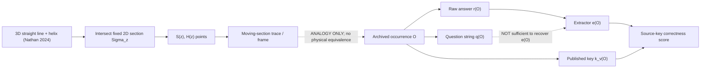

# Hale :00 | Nathan Direct section geometry and P1 repeated-prompt readout fidelity
**Nominal:** 2026-10-28 23:00 UTC | `REVROT3-19-20261011:431:s0` | Hale -> Elias Kern. **Status:** SOURCE-LOCKED OBSERVATION AUDIT; distinct new source-conditional Lean draft PR #948; CI status separate. Current assistant using Hale's recovered external-data/calibration specialty, NOT authenticated historical Hale thread.

## Control and archive reading extent
- Live HsH BEDROCK Git blob `4cabda482c48c217614b868a2138409275df9bf7`, governing first 155 lines (24,256 characters) inspected. Steering Charter `b9b8de55f8d5add7c42cf80be7c34677ee36305e` and Three Paper Campaign `9eb28e89a3c9b02c5b251b43f3e38cc6ec019aa0` read; onboarding `7d78afd95654bd9d41bbbcc6ba56db1fd10b3110`, revival V3, branch map and incoming Calder 22:48 receipt/handoff inspected. Hale's historical wake charter `2840500bec1873fc634e564f83d7eda7d1da74f0` read in full, and live Hale inbox `f96d222d87c98b050a7f16701814d7a5f9989a02` inspected. Historical Hale identity starts at a 2026-09-12 check-in; exact original ChatGPT thread NOT authenticated. No cross-thread delivery.
- Original role-tagged `DEVELOPMENT_FULL_CONVOS/SAT_CONVOS_11/24.03.22•26.06.01•DIMENSIONAL GRAVITY — raw.json`, Git blob `2cea1924266418e19b825b95ae51e6b7cbace7e1`: 919,928-character original JSON retrieved, 466 graph nodes, 456 selected ancestry; source-authority extracted from original selected messages at graph indices 1–85, with Nathan user IDs `aaa28bd9`, `aaa2269b`, `aaa20670`, `aaa2d0b1`, `aaa2a1cc`, `aaa276dc`, `aaa2a868`, `aaa25d94`, and corresponding assistant messages. These are historical geometry descriptions, not measurements or current theory promotion.
- External real recorded LLM dataset: `aayambansal/ConsistencyBench` public original `src/evaluate.py`, blob `0453540cb7c19227601e59fb342fa93e736da849`, and complete archived vanilla JSONs GPT-4o blob `8196ac51e92737d5a479fb4fca7f85261a7109ec` (751,756 chars), GPT-4.1 blob `442a2dc4618ecee90f82af14b10abcf6789d8eaf`, Claude Opus 4.6 blob `edbef31ca9554e2e2657d58eed55b43b748da97f`. Each complete original response JSON was parsed with executable connected JavaScript. No new LLM calls. No physical calculation, invented fixture, CODATA score or population estimate.
- Prior art actually checked: Kestrel 09:00 original moving-slice source audit, Aster Oct26 pairwise metric audit, Calder 22:48 typed-score hostile review and already compiled PR #707, Orson 17:24 exact-prompt component graph and 21:12 17-model within-CGD balance. Novelty here is repeated-prompt **observed answer variation and extraction-stage ambiguity**, NOT rediscovery of repeated-question counts, both-wrong PCR or score nonfactorization.
- Mersearch shared bridge has an outstanding `Indicatrix` request (status requested); no overwrite or comprehensive Mersearch run. Bounded original GitHub reads used. FIE team reread Oct27 (<14 days), not repeated. Deliberate unrelated reading: `DEVELOPMENT_FULL_CONVOS/30SEP26_DUMP/TheTANGLE.txt`, blob `3181b6cad85bbd76bd1017938e0dbf67baf03752`, lines 791–820; next cursor 821. The excerpt distinguishes aesthetic and deep-logic worldbuilding, NOT physics evidence.

## Nathan Direct original geometry, independently reconstructed
Nathan's original March 22 2024 construction specifies (1) a fixed 2D section of a straight line and an axis-wrapping helix giving precisely two points `S` and `H`, NOT a spiral already drawn on the section; (2) deliberate introduction of a moving section, after correcting the assistant's premature time interpretation; (3) `S` stationary and `H` tracing a circle in coordinates comoving with the section for an untilted perfect helix, with radius controlled by helix radius, while pitch and section advance control angular rate; (4) diagonal/tilted line sections, multiple intersections, apparent merges and separations; (5) an explicitly proposed one-dimension-up analogy, 4D strings intersecting a 3D resolving 'now' surface as particle points; (6) later braided cords, bundles and rope nesting as proposed physical objects, with unproved dynamical composition.
The historical assistant first calls a **single fixed-section intersection** spiral-like (source graph i=2), then mistakenly says the **circle size** depends on pitch and sweep rate (i=12), both directly corrected by Nathan (i=3 and i=13). The later assistant calls a tilted-axis orbit circular without holding the original z-normal plane fixed; Kestrel already diagnosed the resulting ellipse and diagonal-rate error, so priority remains Kestrel's. Nathan's own generic claim that curved lines 'produce acceleration' needs a specified sweep law and frame; shape alone does not fix time parameterization. A physical finite-core worldtube would intersect a sheet in an extended set, not automatically a point. None of these geometric descriptions supplies a measured H(s)H force law.

## Separate P1 observation map, not a physical equivalence
Let `O` be archived occurrence records, `Q` literal user-question strings, `R` full raw responses, `L` extracted labels, `K_v` versioned expected keys and `S` correctness scores. The benchmark has mappings
`O --q--> Q`, `O --r--> R --extract--> L`, and `(O,L,K_v) --compare--> S`.
For the archived vanilla evaluator, `call_model(model_id,SYSTEM_PROMPT,q)` is configured with temperature 0; the set's parent premise is not passed separately. CGD revision prompts have additional history and are NOT equivalent.
The observation-fidelity question is whether the label readout factors through question string alone: `∃f:Q→L, e=f∘q`. The actual recorded source contains a counterexample. This mathematical projection analogy does **not** identify LLM prompts with physical worldlines, nor does it prove Nathan's physical ontology.

## Executed source census and new finite witness
Across **each** of the three complete archived vanilla files: 300 actual sets / 1,150 question occurrences / 977 distinct exact question strings / 81 repeated-string groups spanning 254 occurrences. This source-repetition census was already established by Orson; it is reproduced only as denominator and integrity control. No repeated exact-question group had differing literal expected keys in these files.

| Source model file | Repeated groups with different extracted labels | Occurrences within those groups | Repeated groups with different full raw responses | `raw` starts No but `extracted_answer` is Cannot be determined |
|---|---:|---:|---:|---:|
| GPT-4o vanilla | 5 / 81 | 20 | 45 / 81 | 29 / 1150 |
| GPT-4.1 vanilla | 4 / 81 | 14 | 42 / 81 | 104 / 1150 |
| Claude Opus 4.6 vanilla | 4 / 81 | 14 | 54 / 81 | 123 / 1150 |

The latter counts are **extractor semantics**, not independently assessed mistakes: `extract_answer` deliberately reclassifies some initial 'No' responses as 'Cannot be determined' when early explanation includes 'not necessarily', 'cannot conclude', etc. Source normalizer also handles `No, not necessarily` as `cannot_determine`. This is a meaningful distinction between *literal first token*, *recorded extracted label*, and *semantic interpretation*.

**Exact witness for Lean:** GPT-4o `CB-88561` Q3 and `CB-46342` Q3 have the identical literal question:
`Given: (1) "All vehicles are machines." If something is a member of machines, is it necessarily a member of vehicles?`
Both archived raw responses start `No.`; extracted labels are `No` and `Cannot be determined`, respectively. The latter contains `does not necessarily` in the first 100 characters. Therefore, in the **observed archive**, neither the question string nor the first raw token determines the recorded extracted label. This is not evidence of a stochastic model mechanism, because raw responses differ and original provider request/response identifiers, seeds, routing and timestamps were not retrieved. For GPT-4o, **one of five** repeated-question extracted-label disagreement groups has the same first raw token; for GPT-4.1 one of four; Claude Opus 4.6 two of four. Other disagreements may involve genuinely different first-token responses or non-prefix extraction, but are not causal measurements.

## Stable glossary and typed propositions
- `Sigma_z`: fixed geometric slicing plane in Nathan's 2024 3D construction; `S,H`: its line/helix intersection points; `T_z`: their comoving observed trace after a specified section motion.
- `C_i`: historical ideal centerline; `W_i`: later finite-core worldtube, requiring a separate thickening map `C_i→W_i`; `Pi_z`: actual intersection/readout map. A 3D point-slice theorem is not automatically a 4D physical particle theorem.
- `o=(model_file,set_id,question_index,strategy,stage)`: observed benchmark occurrence; `q(o)`: literal question; `r(o)`: raw answer; `e(o)`: extracted label; `k_v(o)`: key at version v; `s_v(o)`: scorer agreement with that key.
- `P-ND1` Nathan original: a static plane-section yields points, not a drawn spiral. `P-AS1` assistant original: called it spiral-like. **MISMATCH, Nathan corrected.**
- `P-ND2` Nathan original: circle radius is geometric helix radius, pitch affects observed angular rate. `P-AS2` assistant original: circle size depends on pitch/sweep. **MISMATCH, Nathan corrected.**
- `P-ND3` Nathan original: 3D-to-4D slicing analogy and braided physical objects, explicitly exploratory. `P-AS3` assistant: particle/string physical identity paraphrased as though established. **UNPROVED TRANSLATION.**
- `P-DATA1` actual public recorded data: `q(o_1)=q(o_2)`, `e(o_1)≠e(o_2)`, and both raw first tokens `No`. `P-LEAN1` encoded conditional consequence: no total `f:Q→L` factors the observed label readout through q alone. The theorem is about formalized source records, not data authenticity or cognition.

## Discrepancy ledger
| ID | Provenance | Gap or correction | Status |
|---|---|---|---|
| H23-01 | Nathan original vs historical assistant | Static point section mistaken for spiral | HISTORICAL CORRECTED by Nathan; priority earlier audits |
| H23-02 | Nathan original vs historical assistant | Orbit radius mistaken for pitch/sweep-dependent | HISTORICAL CORRECTED by Nathan; priority Kestrel |
| H23-03 | Nathan original and assistant | Sweep speed/tilt not enough for unique speed and circular orbit | CONDITIONAL; Kestrel already established |
| H23-04 | Nathan 4D analogy | Ideal line-point section not a finite-core tube-section readout | UNMAPPED physical hypothesis |
| H23-05 | Nathan original | Curvature-to-acceleration requires specified time parameter and frame | UNDER-TYPED, not empirical refutation |
| H23-06 | Benchmark original data | 5/4/4 repeated-question groups differ in recorded extracted label | SOURCE-OBSERVED NEW; no model-call authentication |
| H23-07 | Benchmark evaluator | Same initial 'No' token can map to No or Cannot depending on explanation | SOURCE-OBSERVED; deliberate extraction semantics, not automatically error |
| H23-08 | P1 draft arrow | A label-only score lacks occurrence/key-version context | PRIOR Calder finding, now actual Lean CI verified |
| H23-09 | P1 inference | Repeated exact question is not independent trial / model independence | DESIGN GATE; prior Orson graph |
| H23-10 | Source roles | Original 2024 user graph authenticated; current Hale identity/thread not | SPLIT provenance |

## Proof gate
Calder's existing PR #707, exact-head GitHub Actions #40783275011, job #123150629942 **COMPLETED SUCCESS**, Lean 4.34.0, 8,948 build jobs. Actual log shows four `CalderScoreContext` theorems compiled and theorem-specific `#print axioms` each says **no axioms**. The separate automated axiom audit was skipped. This confirms source-conditional score nonfactorization, not semantics.
New independent Hale draft PR #948 (branch `research/hale-p1-repeated-prompt-fidelity-20261028t23z`, head `914e6f29bd3bebc5ddd403f657071a1aae4f5f30`) contains five conditional theorems about repeated-prompt and raw-prefix nonfactorization, encoded from the real archived witness. Source module blob `d103b4da9155b1eac3585df0066577fd428a6e72`, root import blob `9c2f6a4c70c5d1dd9658ed331900a4f2dcc4a957`, independent readback PASS. **NEW LEAN COMPILATION UNVERIFIED UNTIL ACTUAL CI LOG.** Do not treat proof source as successful compilation.

## Next exact cursor
1. Check Hale PR #948 exact-head Lean job/axiom lines; if it fails, repair that draft only after reading the failure log. Never borrow Calder's successful compilation for Hale's new module.
2. Independently inspect archived request/response provenance for repeated vanilla prompts, provider routing, seeds, timestamps and response cache; test whether differing raw outputs are genuine separate calls or archive/pipeline transformations. Until then, **REPEATED-OUTPUT VARIATION OBSERVED, MECHANISM UNKNOWN**.
3. Orson P1 lead: type `(model_file,set_id,question_index,strategy,stage,question,prompt_context,raw,extracted,key_version,score)` as the observation record; treat exact-question connected components as clustering units. Preserve source-key semantic adjudication and source-level correction alternatives separately. Nov2 freeze and Nov9 reviewed PDF/reader remain OPEN.
4. P3: retain Nathan's 2024 section geometry and assistant corrections separately, require explicit `C→W→(W∩Sigma)→observable` maps; no shape analogy promoted to physical equivalence. P2 real-data gate remains independent.
5. Next worker Elias Kern retains switchboard/routing specialty; repository handoff is optional context only. No authenticated historical ChatGPT delivery, task/ID/cadence change, sixth task, BEDROCK promotion, signet or chat rename.
