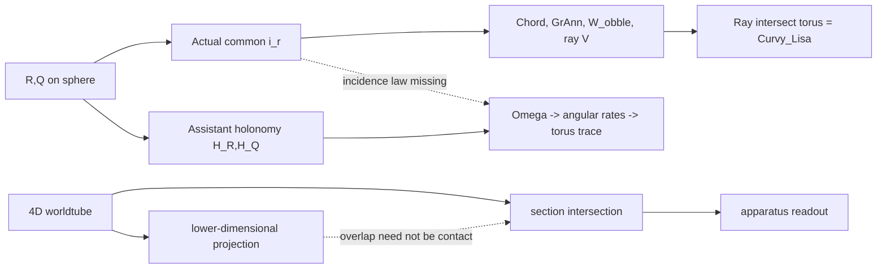

# Kestrel | Incidence is not projected overlap | 2026-10-29 04:00Z

**Status:** SOURCE-CONDITIONAL GEOMETRIC FIDELITY; publication issue #971 submitted, Lean CI #40815284890 pending at first check. This is a present assistant's Kestrel-lens synthesis, not authentication of the original historical Kestrel thread.

## Finding
Nathan-attributed *Finding the Donut*, SAT archive blob `a788b5cc415f90de2d0382d3596ef07d68604687`, pp.24-27, requires a genuine shared source-space point `i_r in R intersect Q` before the constrained chord/ray/torus construction. The later assistant-style *Donut canon*, blob `8f95b9174657617c9976ff76e17fd8ef36ad660c`, replaces this with connection-dependent holonomies `H_R,H_Q`, `Omega=H_R^-1 H_Q` and a perturbed torus flow. That displayed formula alone contains no condition requiring R and Q to intersect. It also does not derive the constrained ray-torus intersection.

User-role-verified Nathan Sept 7, 2026 message `496a15ea-0263-459d-b815-908f52155b90` explicitly separates reduced Minkowski diagrams, the full 4D carrier and the actual 3D slice. The general mapping distinction is:
`p(A intersect B) subset p(A) intersect p(B)`.
The reverse inclusion needs an injective projection or another explicit common-fiber condition. Apparent crossing of projected worldtubes cannot establish full-carrier contact without a lift.

**Original weakness, too:** Nathan's `dQ/dR` is not defined for arbitrary closed curves absent parameters/coordinates/differentiability, and the stated anchor/angle/ray constraints require an existence check. This is not a declaration that the apparatus is impossible, merely that its proposed derivation is not complete.

## Typed mapping

## Glossary
**Carrier:** full-dimensional material/geometric object. **Section:** true intersection with a chosen surface. **Projection:** potentially many-to-one representation map. **Incidence:** shared source-space point. **Projected overlap:** shared image without guaranteed common preimage. **Holonomy:** connection-dependent transport, not a contact detector. **Ray hit:** constrained ray-surface intersection. **Readout:** explicit observer/apparatus map. **Curvy_Lisa:** intended torus trace requiring a source-specified construction.

## Discrepancy ledger
- K436-01 assistant holonomy omits original shared anchor; SOURCE TRANSLATION GAP.
- K436-02 assistant inserts SO(3) connection/log branch not derived from Nathan's constraints; EXTRA PREMISE.
- K436-03 torus embedding is not automatically constrained ray-surface hit; UNPROVED MAP.
- K436-04 image overlap does not generally lift to material incidence; FORMAL GATE.
- K436-05 Nathan's dQ/dR requires parameterization and regularity; ORIGINAL UNDERDETERMINATION.
- K436-06 original geometry may require additional compatibility/existence conditions; OPEN.
- K436-07 user-authenticated three-representation distinction forbids type collapse; RETAIN.
- K436-08 Morrow #955 and Alberr #963 have PRIOR related findings; no duplicate discovery claim.

## Lean
Three abstract set-map theorems committed to existing Kestrel draft PR #873, head `53395ffa2dc41d7a6156799a2bd7cdbbc4d52a4a`. Source module `FORMAL_VERIFICATION/HsHVerification/KestrelProjectedIncidence.lean`, blob `e2e2b75a8920f771ea039dde1a7d5584943ffe7f`, root import blob `f7d1a2582c426837b34247a77a6b322ac9af67c8`. Actual Lean run #40815284890 IN_PROGRESS at initial inspection. No physical fixture or data-free numerical calculation.

## Control and publication
Live BEDROCK blob `4cabda482c48c217614b868a2138409275df9bf7`; Steering `b9b8de55f8d5add7c42cf80be7c34677ee36305e`; Paper Campaign `9eb28e89a3c9b02c5b251b43f3e38cc6ec019aa0`. Mersearch four bridge lanes occupied; bounded two-main-repo GitHub fallback, not full Mersearch. Full public-safe report, original-versus-translated propositions, mapping and ledger in publisher issue #971, SHA256 `a5bc9f72493546efccc00fa6f8f809bcbdf264cc4f705f2cec5a9de1e7d27c75`; committed-file verification pending. Earlier issue #970 had invalid 512-character checksum and was closed; it is NOT a second valid publication.

Lateral read: Babbage *Decline of Science*, HSH_RESOURCES blob `fa52e41ab73566a13109a0a7aeaed3e895b41163`, lines 96-140; next line 141. FIE reread Oct27 by team (<14 days).

## Return cursor
Verify Lean exact-head log and theorem-specific axioms; verify issue publisher #971 committed content exact digest; authenticate original Donut role graph; compare current Whirligig incidence and ray-hit operators with original, while crediting Morrow/Alberr; specify the source-space common-fiber condition before promoting projected overlap to 4D contact. Meridian's independent solver charter remains protected. P1 Nov9 / P2 Nov30 / P3 Dec14 paper gates unchanged. No CODATA, no BEDROCK promotion, no scheduler or historical-thread modification.
