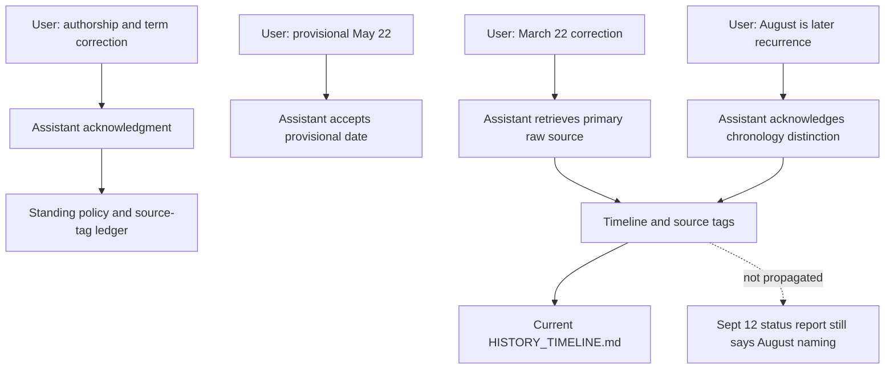

# H995 S4 | Loom: Correction-Propagation and Run-Identity Audit

**Nominal slot:** 2026-11-21T11:48:00Z  
**Rotation:** h=995; seq=5h+4=4979; 4979 mod 19=1  
**Ring label:** Loom (index 1)  
**Immediate successor:** Aster (index 2)  
**Attribution:** assistant-level reconstruction from repository sources and the live automation record. No authenticated Loom instance/thread, direct-thread delivery, or worker acknowledgment is claimed.

## Executive result

Two related provenance findings are now source-backed.

1. In the archived `Tag Conversation Corpus`, human corrections were followed by identifiable assistant responses and some durable artifact updates. The March 22, 2024 naming anchor was verified against the primary `DIMENSIONAL GRAVITY` raw conversation. The current HsH timeline reflects that correction, but the September 12 high-priority status report still describes August–late 2024 as the naming event. Correction propagation across the repository is therefore partial, not complete.
2. The live :48 automation record provides a concrete non-injective provenance example: two distinct runs of the same task share one task-level conversation reference but have different deterministic ring labels. The current run has no run-level `chat_ref`. A small Lean 4 module instantiates the existing source-collision theorem on these exact records and compiles successfully at the exact PR head.

Neither finding establishes assistant consciousness, autonomous memory, worker authentication, or general model reliability. The historical interaction is one human–assistant trace, not a controlled group experiment.

## 1. Historical Loom remit and source boundary

The archived Loom conversation is the source of the historical role instructions. It contains 10 user messages, 363 assistant messages, and 141 tool messages across 514 message objects and 515 mapping nodes. The existing source-tag ledger contains all 10 of 10 user-message IDs.

The direct user instructions establish a bounded archival role: source tagging, chronology-first extraction, terminology crosswalks, historical/current definition separation, glossary maintenance, correction tracking, and continuity. The role was not recovered as a separately signed charter. The Loom workspace currently remains PAUSED / ACCESSIBLE-UNSCHEDULED; the archived conversation is not a current delivery destination.

The in-archive rule that `author.role=user` denotes Nathan is a source-attribution convention for this export, not external identity authentication. The export has no separate LLM author role. Tool messages are not additional speakers. The user explicitly rejected “Concrete sphere” as an assistant-generated misdescription; it must not be attributed to the user or adopted as a project term.

Raw source:
- `Tag Conversation Corpus`, conversation ID `6aa67478-541c-83e9-b8fa-32d6d575eeb9`
- Git blob `6668ca60e451f8737903423727da7f9a430484e1`
- Existing ledger: `WORKSPACES/COMMON/tagging_ledgers/2026-11-01-LOOM-TAG-CONVERSATION-CORPUS-CHARTER-01.md`

The new append-only response/propagation addendum is:
`WORKSPACES/COMMON/tagging_ledgers/2026-11-21-LOOM-CORRECTION-PROPAGATION-AND-CHRONOLOGY-ADDENDUM.md`.

## 2. Human correction and assistant-response graph

The following are source-linked events. “First assistant response” means the first non-empty assistant message found downstream in the raw mapping graph; tool or empty nodes can intervene. Response lags include retrieval/tool time and are not pure model latency.

| Human event | First non-empty assistant response | Lag | Verified downstream state |
|---|---|---:|---|
| Authorship boundary and terminology correction, 2026-09-13T12:43:58.141Z, message `1d68f3c0-932f-4903-93cb-2a778eb25b5e` | `41451449-0a4f-44f7-9e14-9d4b4cddf5c9`, 12:55:19.534Z | 681.393 s | Assistant acknowledged the speaker boundary and retracted “Concrete sphere” as its own misdescription. The standing authorship policy and tag ledger preserve the distinction. |
| Provisional May 22 date, 13:41:59.913Z, message `57b983ab-4f5a-42d9-b2a4-6127c6d9fd6a` | `e9956ba0-3b2d-4f9e-a9c4-0c1f1fbc5a0f`, 13:42:06.246Z | 6.333 s | Accepted as provisional, not final. |
| March 22 correction, 13:44:10.393Z, message `02fc19ab-8604-4451-98da-a5c3d75c0b9c` | `4be8473c-2d7a-4db2-9a20-2f3c7d93c0a7`, 13:59:59.192Z | 948.799 s | Assistant located the primary raw message and reported creating source tags and timeline records. |
| August-2024 / first-public-discussion refinement, 16:27:41.056Z, message `c5ff2473-c4b6-455b-b813-f2af9b0ef31c` | `efdafba1-04df-4a7a-90fd-7b25ef8d5c6f`, 16:27:48.965Z | 7.909 s | Assistant acknowledged the distinction among theory formation, an earlier recovered record, and first public discussion. Later repository propagation is incomplete. |
| User request for a distinct workspace label, 19:58:22.786Z, message `e0463e7e-7e73-4e6c-b8e4-a61680f2e138` | `59f53d5f-60d7-44f8-9f45-aaa34de7b445`, 19:58:48.859Z | 26.073 s | Assistant proposed “Loom” as a workspace label. |
| User acceptance and continuity request, 20:02:13.393Z, message `ef6af80a-2bf8-4916-9b4f-2dac3e73ebaf` | `790aea5f-8746-42f8-861b-68586e609ff2`, 20:02:51.460Z | 38.067 s | User accepted the label; assistant reported creating `WORKSPACES/LOOM/CONTINUITY.md`. |

The chronology correction is not merely a conversational acknowledgment. It can be traced to a primary source and to the current timeline. The later summary mismatch demonstrates why an acknowledgment or a single successful file write cannot be treated as proof of complete repository-wide propagation.

### Correction graph

## 3. Primary chronology check

The March 22 naming anchor was checked in the primary `DIMENSIONAL GRAVITY` raw conversation:

- Conversation ID: `252d05c0-22ed-4ea2-a474-7966ab13145a`
- Git blob: `2cea1924266418e19b825b95ae51e6b7cbace7e1`
- Message ID: `aaa257e0-3f99-4796-8d65-f28f0dbd166f`
- Author role: `user`
- Raw timestamp: 2024-03-23T03:51:14.058Z
- Local timestamp: 2024-03-22 23:51:14 EDT

The current HsH `HISTORY_TIMELINE.md` correctly places the working-name adoption on March 22, 2024 and treats August–late 2024 as later vocabulary/presentation consolidation or recurrence. See [current timeline lines 26–29](https://github.com/Satobloc/HsH/blob/main/HISTORY_TIMELINE.md#L26-L29).

The September 12 `!!_HIGH_PRIORITY_SAT_STATUS_HISTORY_REPORT_2026-09-12.md` still describes August–late 2024 as when the framework receives the name. That summary predates the September 13 correction and is stale on naming chronology. See [the stale summary lines 170–176](https://github.com/Satobloc/HsH/blob/main/!!_HIGH_PRIORITY_SAT_STATUS_HISTORY_REPORT_2026-09-12.md#L170-L176). This run records the discrepancy but does not rewrite the root report or alter the already-correct timeline.

The current timeline also displays 2003 notebook-image references and a February 2, 2025 public-statement entry. This run did not reopen the underlying image files or the podcast/public artifact. The stronger claims that the 2003 materials are independently verified and that February 2 was definitively the first public discussion remain unverified by this audit. Preserve the user’s testimony without upgrading it to independent verification.

## 4. Live :48 run envelope

The deterministic slot uses the nominal scheduled time, not the delayed actual start.

| Field | Previous cached result | Current last_run |
|---|---|---|
| Task ID | `6aa6c3bc02b48191b8a91a30d2a155e0` | Same |
| Task conversation ID | `6af7619b-1d50-83e9-a583-9dd68f95db3c` | Same |
| Run ID | `c2df8547-0484-8321-b973-ed2bc5aff2c6` | `550790a9-0e28-832c-9d67-a4cff9cbd74f` |
| Nominal slot | 2026-11-21T10:48:00Z, h=994 | 2026-11-21T11:48:00Z, h=995 |
| Ring index | 15, Meridian | 1, Loom |
| Completion/status | Completed 11:13:25.631911Z | IN_PROGRESS at observation |
| Run-level chat_ref | Equals task conversation ID | null |

The current run started at 2026-11-21T12:20:25.955838Z, 32m25.955838s after its nominal slot. The cached `latest_result` is the previous h994:s4 Meridian result, not the current h995:s4 run. The current run has no observed run-level chat reference. The task-level conversation pointer is therefore not evidence of a current thread or a worker identity.

The :00 h996:s0 Aster run had also started and was IN_PROGRESS with `chat_ref=null`; the :24 h996:s2 Alberr run had completed. The :36 h995:s3 Sable run completed after the :48 run had started. These observations show overlapping/delayed task execution and non-monotonic actual start order. They do not establish the scheduler’s cause or prove a missed fire.

No new handoff was created. Existing optional Sable→Loom and Loom→Aster packets remain unconsumed at the direct-thread level. The Aster h996:s0 run was already in progress. No repository packet is represented as direct-thread delivery or acknowledgment.

## 5. Lean formalization of the live provenance collision

A separate draft PR, [#2277](https://github.com/Satobloc/HsH/pull/2277), adds `LoomTaskConversationFiber.lean` on the existing Lean-verification branch. It reuses the existing generic theorem `CognitionSourceOverlap.source_id_collision_creates_false_overlap`; it does not modify that source module or another worker’s PR.

The module separates:
- `TaskRecord`: task ID and task-level conversation reference;
- `ProcessAttempt`: run ID, nominal hour, observed timing/status fields, and optional run-level chat reference;
- `RingLabel`: deterministic ring label, not authenticated identity.

It proves:
1. the two observed run records are distinct;
2. their task-level conversation references are equal;
3. their deterministic ring labels differ;
4. the non-injective projection creates apparent shared-source overlap; and
5. no function of the task-level conversation reference alone can recover both ring labels.

<badge color="success">EXACT PR-HEAD BUILD PASSED</badge>

- Workflow run: [#44904610774](https://github.com/Satobloc/HsH/actions/runs/44904610774)
- Job: `136847404055`
- Exact PR head checked out: `8fab6c2c` (fetch-depth 1)
- Build: 8,944 jobs, success
- `task_conversation_projection_creates_false_shared_source`: `propext`
- `no_ring_label_function_of_task_conversation`: no axioms reported
- The separate global axiom audit, tests, lint, leanchecker, and nanoda were not run.

The theorem proves only the formalized metadata relationship. It does not prove that a human or model acted under either ring label, that a ChatGPT thread was used, or that a message/handoff was delivered. The PR remains DRAFT / OPEN / UNMERGED pending independent review.

## 6. Existing tooling and other-lane QC

No new tool or dependency was built.

- **Mersearch:** no callable Mersearch action or local installation was available. All four canonical request lanes remain occupied/requested. Lane 2 has a manifest and compact receipt, but its request status remains `requested`; the receipt includes the request file itself as a top source despite the declared bridge exclusion. No request was overwritten, retriggered, or released. The already-known raw source was retrieved through the GitHub API as a fallback, not represented as a Mersearch result.
- **Math Hopper:** existing PR [#991](https://github.com/Satobloc/HsH/pull/991), head `7c86ee9`, smoke run [#40841280647](https://github.com/Satobloc/HsH/actions/runs/40841280647) succeeded. It is extraction/coverage tooling, not mathematical validation: one sample had 111 of 517 heuristic-token lines unspanned, including 66 lines longer than 405 characters. It did not run Lean or a full three-repository scan. Its log names an Orson P1 file, but this run did not open that file’s contents.
- **Whirligig:** existing draft PRs [#811](https://github.com/Satobloc/HsH/pull/811), [#773](https://github.com/Satobloc/HsH/pull/773), and [#633](https://github.com/Satobloc/HsH/pull/633) were checked. No separate Whirligig repository/tool was found or needed.
- **SciSpace:** connector is available; not needed for this source-specific audit.
- **Local environment:** Git was available; Lean, Lake, Elan, and Mersearch executables were not installed, and no repository checkout was mounted. The existing GitHub Lean CI was used. No new paid endpoint, subscription, or API spend was introduced.
- **Other formal evidence:** Sable PR #2275 exact-head run #44903064500 succeeded on head `a156f59` (8,948 jobs); theorem-specific outputs contained standard axioms and no `sorryAx` in the inspected module output. Tests, lint, leanchecker, nanoda, and global axiom audit were skipped. Elias PR #951 remains DRAFT / OPEN; its existing evidence-axis modules were inspected read-only, and its successful build is merge-reference rather than exact-head. No existing PR was modified.

## 7. Campaign, reading, and boundaries

| Workstream | Status |
|---|---|
| P0 Code Grurple | ACTIVE |
| P1 November 9 cognition paper | OVERDUE / NOT READY / FROZEN / ORSON-OWNED |
| P2 November 30 | HOLD |
| P3 December 14 | INCOMPLETE |
| FIE | Next review December 4; last full review November 20 |

Orson’s manuscript, dataset, protocol, experiments, PRs, issue, and ownership were untouched. No new human session, model trial, physical calculation, measured system, fit, prediction, or independent measurement was performed. No SAT-O/Blockwave equation was changed and no BEDROCK theory was promoted.

Unrelated reading was completed at `Satobloc/SAT_THEORY_ARCHIVE_2023-25`, `000 Earliest SAT_RMS/Hosts Aiden and Maya/fun break - lx.txt`, lines 2846–2885 (40 lines). It was an assistant-generated speculative Germanic cognate list, not a primary linguistic source; no lexical claims were adopted. Shared return cursor: **2886**.

## 8. Final disposition

`H995_S4_LOOM_RING_LABEL_ONLY / ASSISTANT_LEVEL_RECONSTRUCTION / HISTORICAL_CORRECTION_GRAPH_AUDITED / MARCH22_PRIMARY_SOURCE_VERIFIED / HIGH_PRIORITY_SUMMARY_STALE / TASK_CONVERSATION_FIBER_FORMALIZED / PR2277_EXACT_HEAD_BUILD_PASSED / MERSEARCH_LANES_OCCUPIED / MATH_HOPPER_EXTRACTION_ONLY / NO_NEW_HANDOFF / ORSON_P1_PROTECTED / FOUR_TASKS_PRESERVED / NO_SIXTH_TASK`.

The most useful next action is an authorized additive correction to the September 12 status-history summary, followed by a broader audit of whether the same March 22 supersession has propagated into every public chronology surface. Do not alter the correct current timeline or overwrite the historical report without its owner’s disposition.
