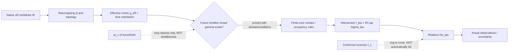

# Meridian | Cosmotopology CTC / inversion source-fidelity audit | 2026-10-28 13:00 UTC

**Status:** SOURCE-GROUNDED GEOMETRY DISCREPANCY; **three conditional Lean theorems actually compiled** in draft PR #895 / Actions #40692772972; exact publication verified. No H(s)H physical validation, no CODATA scoring, no new measured physical calculation, no BEDROCK promotion. This is the current assistant working through Meridian's protected solver/Whirligig remit, not authenticated participation by his historical ChatGPT thread.

## 1. Live control and intake
- Run key `REVROT3-19-20261011:421:s0`; `h=421`, `seq=2105`, `2105 mod 19=15`: **Meridian**; next **Mercer**, index 16, :12. Existing :00 task ID `6aa1fe0de5e48191b886496095b1343f` preserved; no scheduler mutation.
- Live BEDROCK `4cabda482c48c217614b868a2138409275df9bf7`, 86,946 chars retrieved; mandatory real-data/permission section, BR-008, ND-2026-10-20-01/02 and causal-admissibility gates inspected (not full line-by-line). Steering Charter `b9b8de55f8d5add7c42cf80be7c34677ee36305e`; Three Paper Campaign `9eb28e89a3c9b02c5b251b43f3e38cc6ec019aa0`; Common onboarding `7d78afd95654bd9d41bbbcc6ba56db1fd10b3110`; Revival V3 `90863a2a2b82b2d8e37ba1bd9f796389066f5409`; Meridian historical continuity `c757a7a78d59bdd4945d3357747fb09d267b5a93`.
- Incoming Kestrel→Meridian `WORKSPACES/COMMON/REVIVAL_ROTATION_HANDOFFS/2026-10-28T1248Z_from_s4_to_s0_meridian.md`, blob `98988e7493ee990484fabda0195e1f425e9afccb`, consumed. Earlier Meridian 09:12 Earth report `104c61e3257a247453e68e30129c3d511bc9083e` read. Its pending second Lean run #40663826208 independently closed **SUCCESS**, 8,944 build jobs and five theorem axiom reports without target sorryAx; warnings are nonfatal, automated axiom audit skipped. This is an inherited result, not a new proof.
- Mersearch-first: existing `WORKSPACES/COMMON/MERSEARCH_REQUEST.json` blob `c1fa41685d5103f84b0e831a7b1fd898f976f2bf` is occupied by Indicatrix; do not overwrite. Bounded direct original archive search and full source fetch substituted; not an exhaustive Mersearch result. Checked existing Math Hopper, Lean infrastructure/PR #875, Meridian Run 061 stereographic bridge and prior causal-gate work before creating only one distinct proof module.

## 2. Primary cluster, witness type, actual read extent
**Original archived witness:** `DEVELOPMENT_FULL_CONVOS/30SEP26_DUMP/[[[HSH REFORMULATION - INIT]]]/H(SAT)H - init/HsH COSMOTOPOLOGY.txt`, Git blob **`9f42b96adfa1cb9b310ad8d89843b93ae0379922`**, 98,867 characters. Retrieved full UTF-8 text; mechanically identified 64 flattened role markers (32 `NATHAN:`, 32 `CHATGPT (MathtoolExp):`), including nine trailing empty Nathan-labeled placeholders. Inspected the first fourteen substantive Nathan/assistant exchange openings and the full local windows of all claims below; later archive-navigation exchanges sampled. **Flattened role labels are not raw message-role authentication**, and `30SEP26_DUMP` is an archival folder, not an authenticated utterance date.

Source offsets (0-based characters in fetched decoded text): Nathan's first throat/ring/CTC picture `0`; explicit CTC requirement `9234`; assistant fundamental-group inference `9602`; Nathan's literal-inversion correction `16055`; assistant conformal-inversion choice `16107`; Nathan particle-zoo retention `6376`; Nathan inner-longitude intersection `25997`; assistant standard torus chart `26183`; Nathan torus/Klein transition question `31653`; assistant topology-change caveat `31838`; Nathan interlocked Hopf-ring/figure-eight alternatives `37285`; assistant Hopf-band translation `38110`; Nathan circumference-ratio / dark-energy conjecture `44196`; assistant aspect-ratio reconstruction `44608`.

### Nathan-labeled descriptive geometry (original proposition, not mathematical endorsement)
1. Particle as finite-core worldtube/ER-throat-like object with a Kerr-like CSC ring; a globally returning family of **literal CTCs** converges at the ring and intersects the present section as an approximately spherical mouth. Nathan explicitly says replacing CTCs with generic closed curves would lose his intended model.
2. Preserve the inherited particle-zoo topology rather than replace it. Particle/black-hole presentation is proposed as **literal inversion**; exact map not supplied by Nathan in this exchange.
3. Torus inner longitude is a locus of intersections with each meridian, not a single universal intersection point. Klein-like gluing, reconnection and figure-eight/Hopf-ring transformations are **questions/possibilities**, not established topology-changing dynamics.
4. Inner/outer circumference contrast is conjectured to encode dark-energy equation-of-state structure; no constitutive/cosmological equation or observational map supplied.
5. The asserted CTC→exclusion-principle and Kerr/ergosphere/horizon equivalences remain **Nathan hypotheses**, not theorems; they require independent mathematical and physical derivation.

## 3. Assistant translation and precise mathematical tests

### A. Topological winding is not causal closure
Historical assistant correctly writes `π₁(T²)=ℤ⊕ℤ` and the Klein-bottle presentation `⟨a,b | aba⁻¹=b⁻¹⟩`. It then speaks as though nontrivial winding classes provide **closed timelike curves** converging at a Kerr ring. The homotopy computation supplies **closed topological loops**, not a Lorentzian metric, timelike tangent condition, time orientation, future direction, geodesic equation, or common ring incidence.

**Mathematical obstruction:** a spacetime `ℝ×T²` with metric `g=-dt²+h_{T²}` has nontrivial spatial loops but admits the global time coordinate `t`, strictly increasing on every future-directed timelike curve; such a curve cannot return to its own spacetime starting event. This is a standard conditional geometric counterexample, **not** a proposed H(s)H physical system or a data-free numerical fixture. Lean theorem #895 formalizes only the abstract strict-time/endpoint-closure incompatibility, not the full Lorentzian example.

**Positive conditional control already in Meridian (priority preserved):** `WORKSPACES/MERIDIAN/SANDBOX_2026-10-20_CRULLER_FIRST_GLOBAL_TOPOLOGY.md`, blob `b85f37e4137c15ff8b44d8179fc162e37afa86b3`, section 5, constructs a *different* mapping-torus quotient `M_Q=(S³×[0,L])/((n,L)~(Qn,0))` with an explicitly chosen compact-timelike metric `g=R₀²(-ds²+dΩ₃²)`. For sufficiently many traversals `kL>π`, a spatial connection from `n` to `Q^k n` can be timelike and closes under the quotient. This is a **source-grounded conditional CTC construction**, not a validated physical SAT cosmology. It demonstrates why the precise verdict is **topology alone neither forces nor forbids CTCs**: the causal metric and identification matter. The historical assistant did not supply these conditions in its fundamental-group inference.

### B. Ordinary point inversion does not turn one ring into a sphere
After Nathan says inversion should be literal, the assistant chooses `I_L(x)=L²x/(x·x)`, or the spatial Euclidean version `I_L(x)=L²x/|x|²`. It then suggests a microscopic ring maps to a macroscopic spherical horizon. For an origin-centered radius-`a` ring in a plane, every point has `|x|=a`, so `I_L(x)=(L²/a²)x`: its image is a **circle of radius L²/a in the same plane**. More generally, ordinary inversion is a local diffeomorphism away from its singular set and preserves submanifold dimension. It cannot map one smooth `S¹` directly onto a spatial horizon `S²`; a full horizon is a still higher-dimensional null hypersurface. A family of rings with an additional parameter could sweep a surface, but that is a **different, unprovided map**.

The same assistant notes the inversion singularity at the origin and later caveats the Kerr metric. Those cautions do not repair the circle-to-sphere mapping claim. Lorentzian inversion with denominator `x·x` additionally requires a specified metric and excludes its null cone; it must not be silently identified with the Euclidean spatial formula.

### C. A successful assistant correction worth retaining
The assistant's standard torus chart `X(u,v)=((R+r cos v)cos u,(R+r cos v)sin u,r sin v)` with `R>r>0` correctly identifies the inner longitude `v=π`, `C_in=2π(R-r)`, and one distinct intersection with each fixed-`u` meridian. It also correctly distinguishes smooth deformation from a torus-to-Klein topology change, which requires altered identification/reconnection or singular transition. These source translations survive their stated **3D illustrative torus** scope.

### D. Existing Meridian result is a different map
Meridian `WORKSPACES/MERIDIAN/SANDBOX/RUN_061_4D_DONUT_STEREOGRAPHIC_BRIDGE.md`, blob `cec9ae1ed8afb7753c2053c611159e01bd5ec6cd`, constructs a 2-torus inside `S³⊂ℝ⁴` and stereographically projects it to a 2D ring torus in `ℝ³`, preserving topology and dimension (not metric lengths). Its north/south-chart inversion exchanges inner and outer equators, **not a 1D Kerr ring with a 2D event-horizon section**. This is a useful existing positive control, not a new discovery.

## 4. Stable glossary
| Term | Typed meaning / current status |
|---|---|
| `W` worldtube | Finite-core 4D carrier/material history ensemble, proposed; embedding/physical dynamics unclosed. |
| `C_K` Kerr-like CSC ring | Distinguished 1D closed core locus; exact Kerr solution **not** established. |
| `γ` return curve | Continuous closed trajectory; `CTC` only if a defined causal metric makes its tangent everywhere future-directed timelike. |
| `π₁(M)` | Fundamental group of a specified topological manifold; encodes loop homotopy, **not** causal type. |
| `Q` | Candidate global gluing/return map; orientation, smoothness, metric descent and time-orientation compatibility must be specified. |
| `Σ_τ` | Candidate 3D resolving/simultaneity section, not automatically a Cauchy hypersurface. |
| `I_τ` | Intersection `W∩Σ_τ` under transversality and finite-core rules. |
| `ρ_τ` | Observer/measurement projection from `I_τ` to 3D observables; currently unspecified. |
| `I_L` | Conformal point inversion with singular set excluded; a map of points, not an automatic ring/horizon duality. |
| `g_eff` | Required effective Lorentzian metric if literal timelike closure is asserted; not derived from the topological carrier. |
| `T` | A global real time function, if it exists; its strict increase on future timelike paths forbids their closure. |
| `E` | Exclusion/occupancy constraint; **not** obtained from topology or CTC existence without an explicit mechanism. |

## 5. Diagram / composition requirements

Required commutativity is an actual checked equation `ρ_τ(I_τ(W)) = O_τ` for a specified system and detector, not a verbal identification. No such empirical map is established here.

## 6. Discrepancy ledger
| ID | Source proposition → translation | Verdict | Needed next |
|---|---|---|---|
| M13-01 | Nathan requires literal CTC; assistant infers CTCs from `π₁(T²)` / `π₁(K)` | **ASSISTANT UNJUSTIFIED INFERENCE** | Construct `(M,g_eff,Q)` and causal loops, or show obstruction. |
| M13-02 | Nathan requests literal inversion; assistant chooses `I_L` and maps ring to sphere | **ASSISTANT DIMENSIONAL MISMATCH** for one smooth ring | Specify higher-dimensional family/envelope or different map. |
| M13-03 | Nathan says CTCs explain exclusion | **NATHAN HYPOTHESIS UNPROVED** | Explicit occupancy state space, antisymmetry/Pauli derivation. |
| M13-04 | Nathan preserves particle-zoo topology; assistant recasts in global ring/horizon language | **CONDITIONAL** | Injection of local zoo classes into global model preserving invariants. |
| M13-05 | Nathan suggests inner/outer ratio encodes dark-energy `w` | **NATHAN HYPOTHESIS UNPROVED** | Metric, stress tensor, dynamics, and observed `w(z)` map. |
| M13-06 | Assistant inner-longitude/meridian intersection on 3D torus | **MATHEMATICALLY CONSISTENT** under `R>r>0` | Explicit 4D carrier → 3D torus projection. |
| M13-07 | Assistant torus→Klein cannot occur by smooth isotopy alone | **MATHEMATICALLY CONSISTENT** | Identify topology-changing physical process, if any. |
| M13-08 | Flat role-labeled text treated as verbatim selected conversation | **PROVENANCE UNVERIFIED** | Compare raw JSON branch graph, roles, original timestamps. |
| M13-09 | Existing Meridian 4D→3D stereographic torus mapping conflated with ring→horizon inversion | **NON-EQUIVALENCE** | Specify and check composition maps, domains and dimensions. |

## 7. Formal verification / limits
Draft PR **#895**: `FORMAL_VERIFICATION/HsHVerification/MeridianCosmotopologyFidelity.lean`, three conditional statements: (1) future time strict increase excludes same-event closure, (2) constant scaling preserves origin-centered circle equation, (3) scalar inversion preserves the zero transverse coordinate. These do not prove a torus is globally hyperbolic, that a particular H(s)H curve is or is not a CTC, or that no possible nonlinear ring-to-horizon model exists. **Actual Lean 4.34.0 / Mathlib run #40692772972, job #122831565791: SUCCESS**, 8,944 build jobs. All three theorem-specific axiom reports list only `propext`, `Classical.choice`, `Quot.sound`; no target `sorryAx`. Separate automated axiom-audit step SKIPPED. This compilation validates only the precise formalized implications, not original source authenticity, physical CTC existence, a Kerr solution, or a horizon correspondence.

No numerical physical calculation, invented physical system, CODATA scoring, or empirical model claim in this lane. The existing Earth/IERS work is retained as a separate measured-system reference.

## 8. Lateral read, paper gates and next cursor
Read unrelated original `Satobloc/SAT_THEORY_ARCHIVE_2023-25/SAT Mark V/TheTANGLE.txt`, blob `3181b6cad85bbd76bd1017938e0dbf67baf03752`, **lines 556–610** (fragment translation and editorial `[SIC]` provenance), next **611**. No theory inference imported. Team FIE reread 2026-10-27, <14 days; no new full reread claimed.

**Next deeper cursor:** recover the raw message-graph witness of the COSMOTOPOLOGY exchange; determine whether Nathan subsequently supplied a causal metric/CTC admissibility proof or an inversion of a *family* rather than one ring. Cross-check original SAT-O/Blockwave causal/winding equations and their original dates/SHA before elevating any result. Nov 9 P1, Nov 30 P2, Dec 14 P3 remain separate unclosed manuscript/source/review/reader gates. No historical-chat delivery or worker acknowledgment claimed.

## 9. Actual publication readback and durable status
- House issue publisher [#896](https://github.com/Satobloc/HsH/issues/896), submission `meridian-cosmotopology-ctc-inversion-20261028t13z-s0-001`, **PUBLISHED_VERIFIED**: `WORKSPACES/COMMON/PUBLISHED_SUBMISSIONS/meridian-cosmotopology-ctc-inversion-20261028t13z-s0-001.md`, Git blob `5298d247d0b594b9759d2486afe30db6723782d3`, 3,645 chars. Independent connector readback gave exact submitted-content equality and independently recomputed SHA-256 `0dbebb2d515e80de68bfccc980541ed7397e6de3de61a3ecb650fc22b9182564`. The public issue text was submitted before the later positive-control/report expansion; this workspace report is the fuller current version, not a retroactive rewrite of the published issue.
- Draft [Lean PR #895](https://github.com/Satobloc/HsH/pull/895) head `c8434aa0710939aa062904719edb7af0a630b1b1`; actual [CI run #40692772972](https://github.com/Satobloc/HsH/actions/runs/40692772972) and job #122831565791 read. No merge or theory promotion.
