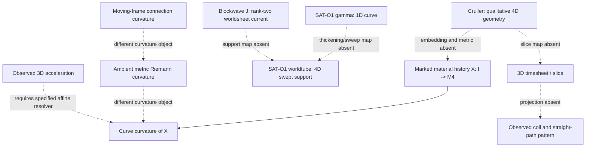

# Meridian h820:s0 | Lane 00 source-fidelity: Cruller, worldtube bending, and curvature

**Status:** SOURCE-FIDELITY AUDIT COMPLETE; EXISTING CONDITIONAL LEAN RESULT REUSED; NO NEW THEOREM; NO PHYSICAL CALCULATION.

- Nominal slot: 2026-11-14T04:00:00Z
- h=820; seq=4100; ring index 15 = Meridian; next index 16 = Mercer.
- Run key: REVROT3-19-20261011:820:s0.
- HsH main prewrite head: f6408e605abcfa80fe3a3add50cfd22946dd83a7.
- The explicit Lane 00 instruction in this turn is treated as a one-run source-fidelity assignment. It is not a persistent role reallocation or P0 standdown. Meridian's Code Grurple P0 assignment remains active and unchanged.

## 1. Historical role, source custody, and scope

No standalone signed Nathan-authored Meridian specialist charter and no authenticated current Meridian ChatGPT thread were found. The historical remit is reconstructed from role-labelled user messages, not an assistant-chosen title.

- Meridian [HsH] Michelstein-on-Meinorly: conversation 6a9aa91b-11f4-83ea-80a1-4d502522e441; raw blob d21e251df093013903cc19789ded562f83b6e6ea. Snapshot: 343 mapping nodes, 342 message objects, 56 user-role nodes; current ancestry: 333 nodes and 52 user-role messages. Direct instructions cover Graticule symmetry/asymmetry comparisons, existing geometric solvers, configurable/scriptable solver inputs and couplings, verification of prior results, and a source-faithful Whirligig GR-QM derivation audit.
- Meridian Free Build: conversation 6ac45d1f-17b0-83ea-ad1f-fa524602378b; raw blob 7af1561b321f4d9364da5eb111df689efc652827. Direct user message 97d301cb-5174-4861-a273-ac4cc0b60d8b, 2026-10-09T10:38:10.722Z, says Whirligig must preserve multiple valid answers and search for the least-wild routes. This is a solver-design constraint, not a physical theorem.
- Meridian Minkowski Ring Analysis: conversation 6ad7e9c0-e8a0-83e9-984e-94d020de3abf; raw blob 56a84cb85d5c386efa4ea11d322d11e95e2c7703. Snapshot: 3,678 mapping nodes, 112 user-role messages; current ancestry: 106 user-role messages. The direct messages below were checked in the raw mapping and ancestry.
- H(s)H Cosmology flattened transcript: HsH COSMOTOPOLOGY.txt, blob 9f42b96...; line 694 has a NATHAN-labelled torus/Klein description. The flattened transcript has no per-message timestamp, so this is transcript-turn attribution, not independent identity authentication.

The role and research sources are historical. Their user-role labels do not authenticate the current scheduled instance or thread.

## 2. Nathan Direct geometry, mathematics bracketed

The strongest interrelated direct propositions in the public source set are:

1. **Inertia and worldtube bending as equivalent descriptions.** The October 9 Free Build message 5a929b5e-515e-4f77-a32a-e49feef42812 is a mixed-source user message. Its leading quoted passage is assistant text; the user-authored correction begins at "Not really, no." The direct correction says SAT began as a 4D visualization and that inertia and worldtube bending are equivalent descriptions of the same system, comparable to describing one chair's position from different walls. It also says a completely inert block-universe readout would not explain interaction, and that the timesheet must interact with matter. This is a direct conceptual equivalence claim, not a typed map or derived equation.
2. **Cruller geometry.** The October 20-21 conversation describes a donut/Cruller-like 4D structure with internal rotation, wrinkled/coiled/tensioned regions, candy-cane-like winding around a toroidal form, internal filaments/bridges, and a central singularity/ring picture. Direct message f658b2db-32f0-45cd-828b-140691cc9afb, 2026-10-20T23:53:30Z, explicitly calls the donut's 4D curvature an acceleration and says bending need not mean expansion in 4D. The message marks this as a working hypothesis without proof.
3. **Rotation and acceleration.** Direct message 59cdedb4-be76-455a-87c8-a6089de951b3, 2026-10-21T23:53:03Z, states: "3D rotation absolutely is 4D curvature. All 3D acceleration is." The message does not define which curvature object is intended, which 3D-to-4D map is used, or what time parameter is affine.
4. **Supersession.** Direct message 090f5160-1020-486d-9c42-df3d7dff2063, 2026-10-21T00:17:23.235Z, says the older reciprocal filament/timesheet-deformation model is no longer current because the Klein Fabric model has become common. The reciprocal model is historical, not an operative default.
5. **Native coordinate witness.** Direct message c5525f53-b7cc-4444-8102-3bf6fdb1c892, 2026-10-21T13:55:40.205Z, records "cw=t", Forest Normalization, and ++++, while leaving the +/- (c+H0)/2 expression explicitly tentative. The source itself says the units still need conversion.
6. **Torus/Klein description.** HsH COSMOTOPOLOGY.txt line 694 describes mapping the object to a torus through the intersection of the hole's inner circumference and the tube's circumferences, and says a Klein topology would be similar. It does not specify a 4D embedding, R/r parameters, a gluing map, or a Big Bang locus.

These are descriptive propositions and working hypotheses. None supplies a complete metric, worldtube support, constitutive law, or empirical prediction.

## 3. Glossary

| Term | Source-faithful working meaning | Still missing |
|---|---|---|
| Cruller | Qualitative toroidal/Donut-like 4D geometry with internal rotation and coil/straight-path structure | Embedding, metric, material labels, finite-core support |
| Worldtube bending | Directly proposed as an equivalent description of inertia | Typed equivalence map to acceleration, force, mass, and metric |
| Marked material history | Assistant's candidate trajectory for a persistent material label through 4D | Direct source does not yet define the mark, parameter, or map |
| Centerline/worldline | A 1D curve used in older SAT-O1 notation | Thickening/sweep map to a finite-core support |
| Worldtube | SAT-O1's older file calls this a 4D swept volume; later Cruller prose uses the term less formally | Stable cross-version object definition |
| Worldsheet current | Blockwave's rank-two conserved current support | Map to SAT-O1 curve or current Cruller worldtube |
| Timesheet | 3D time surface in the native description | Coordinate, normal, metric, and projection to observed 3D |
| Curvature | Must be typed as curve curvature, ambient Riemann curvature, or connection curvature | Source does not choose one in the rotation sentence |
| Winding | Qualitative first- and second-order helical structure | Phase, normal frame, winding integer, and transport map |
| Native time notation | Separate direct witnesses "w=ct" (Oct 9) and "cw=t" (Oct 21) | No conversion or supersession map; do not silently identify them |

## 4. Mapping diagram



The diagram deliberately does not assert that the objects are equivalent. The missing arrows are the research problem.

## 5. SAT-O1 and Blockwave original custody

### SAT-O1

Original archive file: SATOBLOC/SAT O1 4D.txt in SAT_THEORY_ARCHIVE_2023-25. The HsH 30SEP26 dump copy is byte-identical.

- Git blob: 7577aa1ee5a6c3850ce3b226c75377de6367aedc.
- Existing custody SHA-256: 8e416ff440c45936c3588de0bd0c2ae49b529655ff452a64093a145416c62937.
- 3,521 characters; 75 lines.
- No author or date is embedded in the file. Earliest extant SAT archive commit: 2025-10-27T00:40:28Z. Do not treat that commit date as the original composition date.

Verbatim source equations:

```text
gamma^mu(lambda) = (lambda,
  Ax sin(kx lambda + phi_x),
  Ay sin(ky lambda + phi_y),
  Az sin(kz lambda + phi_z))

v^mu(lambda) = d gamma^mu / d lambda

S[gamma] = integral d lambda L(gamma^mu, v^mu)
L = (1/2) m v^mu v_mu - V_tension(gamma)
```

The file describes a filament as a one-dimensional physical object and a worldtube as the four-dimensional volume swept by a vibrating filament. It does not provide the sweep map or the extra parameters needed to obtain a 4D support from the 1D curve. The contraction v^mu v_mu also needs an explicitly stated signature before it can be identified with the later ++++ witness.

### Blockwave

Original user-supplied attachment: BLOCKWAVE.txt, HsH blob ffdb8aadb6ac93e3c9d5f48aad8153dcedaf997d.

- Existing custody SHA-256: 3d393efcedf9dc715cd49a319605fc5adc2011c5b5984abd9a2d280765953664.
- 24,627 characters; 384 lines.
- Raw attachment metadata first appears at 2025-09-16T16:31:26.687Z, immediately after the user message at 16:31:21.862Z. The 16:31:34.670Z message is subsequent tool extraction, not the upload event.
- First extant HsH Git commit: 2026-10-08T02:42:49Z.
- Embedded authorship remains unresolved. The October 19 assistant unified action is a separate reconstruction, not the attachment's origin.

Verbatim source equations:

```text
nabla_mu J^{mu nu} = 0

J^{mu nu} = (1/2) epsilon^{mu nu rho sigma} nabla_rho B_sigma
```

Blockwave describes J as a conserved rank-two filament-worldsheet current. It is not automatically the SAT-O1 1D curve, the SAT-O1 4D swept worldtube, or the Cruller material history. No support or composition map is present.

No original SAT-O1 or Blockwave equation was edited. No corrected equation is promoted here. The conditional assistant reconstruction below remains separate from both originals.

## 6. Assistant reconstructions and formal evidence

### Rotation-as-worldtube-curvature correction

The assistant-authored sandbox uses a Euclidean R4 lifted curve:

```text
X(q) = (R cos(omega q), R sin(omega q), 0, q)
kappa_E = R omega^2 / (1 + R^2 omega^2)
```

This is a valid conditional curve-curvature formula for that chosen Euclidean lift. It is not a native Nathan equation, not ambient Riemann curvature, not a connection field strength, not a finite-core worldtube, and not a physical prediction. The use of q=ct is an external comparator; the direct cw=t witness has not been mapped to it.

The immediate assistant response to message 59cd interprets the user's sentence as bending of a marked material history/worldtube in a fixed affine time slicing. No subsequent user message on the recovered branch confirms that interpretation. Later Meridian continuity text labels those added conditions as Nathan Direct; that attribution is too strong. "Marked material history" and "fixed affine time slicing" are assistant-added assumptions.

### Existing Lean formalization

Reuse [PR #1245](https://github.com/Satobloc/HsH/pull/1245), Sable's existing LiftedCurveCurvature module.

- PR head: 201f428ebf63288ceb8c098ba49f2f411d1f0109.
- Actual Actions run: #41410202260, successful merge-reference build, 8,958 jobs.
- It formalizes the general Euclidean lift X(w)=(x(w),w) and the circular-helix curvature-squared identity.
- Retrieved theorem-specific axiom reports show propext, Classical.choice, and Quot.sound; no sorryAx/admit was reported in the retrieved log.
- Tests, lint, nanoda, and global axiom audit were skipped.
- PR remains open, draft, and unmerged. This is not exact-head standalone or current-main integration evidence.

This proof checks only the formalized Euclidean lift statement. It does not prove the Nathan Direct inertia/worldtube equivalence, the native cw=t geometry, a 4D finite-core support, or physical premises.

The separate Earth-rotation formalization in PR #875 is not a Cruller proof and is not used to claim a physical result here. No local Lean, Lake, or Elan executable was installed. No new module or PR was justified because the source-defined object and projection remain under-specified.

### Assistant-side errors and limits

- The initial categorical phrase "rotation is not curvature" conflated connection/ambient curvature with curve curvature. Those are different objects.
- The later correction is a useful conditional lift, but it silently adds a material mark, Euclidean metric, affine parameter, and external q=ct coordinate.
- The torus parameterization and inner/outer circumference formulas are standard for a 3D ring torus with R>r. The direct source does not supply R, r, a 4D embedding, or a projection. The assistant's "Big Bang inner longitude" title overstates the direct torus sentence.
- The S3/Hopf/mapping-torus/normal-frame winding construction is a sandbox proposal. The direct source asks when second-order winding arises; it does not define the parent curve, normal frame, phase, or winding integer.
- The earlier positive-winding-only instability conclusion was conditional on m>0. The later signed-winding sandbox admits negative m and changes the conclusion for that chosen functional. Neither result is a physical law.
- The arbitrary numerical fixture in the old rotation sandbox is not measured evidence and is not reused. Current BEDROCK requires an identifiable measured system and real data for physical calculations.

## 7. Original versus translated propositions

| Direct source proposition | Historical assistant translation | Fidelity finding |
|---|---|---|
| Inertia and worldtube bending are equivalent descriptions | Euclidean lifted-curve curvature formula | Formula does not establish the inertia map |
| Cruller has internal rotation and coil/straight-path structure | S3/Hopf, mapping torus, nested normal-frame winding | Candidate model, not direct geometry |
| 3D rotation is 4D curvature; all 3D acceleration is | Marked worldtube bending in fixed affine time | Plausible reading, but object and parameter are assistant-added |
| Older reciprocal filament/timesheet model is no longer current | Reciprocal coupling still appears in older continuity prose | Superseded model must remain historical |
| cw=t, Forest Normalization, ++++; (c+H0)/2 tentative | q=ct Euclidean comparator and scalar theta4 | No coordinate/normalization map; theta4 is assistant-defined |
| Inner hole circumference meets tube circumferences; Klein topology similar | Big Bang inner longitude and a torus/Klein model | Direct statement is weaker; embedding and gluing are absent |
| SAT-O1 gamma and Blockwave J are source artifacts | Treating filament/worldtube/worldsheet as interchangeable | Type mismatch; no support map |

## 8. Discrepancy ledger

1. **Curvature type:** curve curvature, ambient Riemann curvature, and moving-frame connection curvature are conflated in the assistant chain.
2. **Acceleration scope:** "all 3D acceleration" is under-specified. Orson's nonlinear-resolver sandbox supplies a mathematical counterexample to the unrestricted reading: apparent 3D acceleration can arise from a straight 4D carrier under a nonlinear readout. That is a counterexample to the broad statement under that resolver, not empirical evidence. A fixed physical affine time and projection would need to be stated.
3. **Coordinate witnesses:** direct w=ct (Oct 9) and cw=t (Oct 21) remain separate. No conversion or supersession is established.
4. **Object dimension:** SAT-O1's 1D gamma, its 4D swept worldtube, and Blockwave's rank-two worldsheet current are distinct. The maps between them are absent.
5. **Cruller embedding:** the torus description is qualitative. No 4D embedding, metric, material coordinates, or core thickness is specified.
6. **Klein language:** "Klein topology" in the cosmology transcript is not automatically the later Klein Fabric model. No gluing or composition map equates them.
7. **Supersession:** the reciprocal filament/timesheet model is explicitly historical after the Klein Fabric update.
8. **Attribution:** assistant-added "marked material" and "fixed affine slicing" were later presented as Nathan Direct in Meridian continuity. This report corrects that attribution.
9. **Winding:** second-order winding has no direct phase, normal frame, or integer definition. Assistant mode results remain conditional on the sandbox functional.

## 9. Governance and campaign state

- P0 Code Grurple remains ACTIVE. Meridian's persistent assignment remains Paper A accepted-R1 presentation support only. The one-run Lane 00 instruction did not stand down P0 or change the persistent role.
- Current-main comparison from baseline 54f814aa506fc869e4888cea8495ec4506b4396f: 947 commits ahead, 0 behind, 300 changed paths; none of the eight protected P0 source/control paths changed. The only PUBLIC_SITE path in this comparison is generated/discovery.json.
- Both Paper A/B routes remain PRESENTATION_PENDING / NOT_OBSERVED. No route probe, manuscript edit, site edit, or presentation promotion.
- P1 Nov 9: OVERDUE / NOT READY, Orson-owned. P2 Nov 30: HOLD. P3 Dec 14: INCOMPLETE.
- FIE last full review Nov 10; next review Nov 24.
- All four Mersearch request lanes remain requested. No callable Mersearch connector and no local three-repository checkout were available. No lane was overwritten or retriggered. This is bounded GitHub/Library fallback, not a Mersearch run.
- HsH, SAT archive, and HSH_RESOURCES front doors were checked. HSH_RESOURCES metadata says public while its README says private/internal; only root README and AI_START_HERE were read, no payload opened.
- All three repositories report zero forks. Existing Math Hopper and Whirligig resources were checked; Math Hopper's full three-repository pilot remains unverified. SciSpace is connected but was not needed for this archive-source audit. No new tool, dependency, fork, subscription, or cost.
- Task graph remains ACTIVE_SEED, 16 declared branches / 18 records; Tern retains graph and scheduler authority.
- Unrelated reading: fun break - lx.txt, lines 1241-1280. Next cursor 1281. FIE rereview was not due.
- No CODATA scoring, physical calculation, fit, prediction, independent measurement, paper-gate advancement, theory promotion, or BEDROCK edit.

## 10. Next deeper cursor

1. Recover the exact source-defined object that rotates: a material mark, frame, worldtube, metric, or some combination.
2. Define the native cw=t coordinate, Forest normalization, ++++ metric, and the mapping (if any) to the separate w=ct witness and the Minkowski comparator.
3. Define a marked material-history map X:I->M4 and the physical time/slice projection. State when the time parameter is affine.
4. Keep curve curvature, ambient Riemann curvature, and connection curvature separate.
5. Define the finite-core worldtube and its centerline; provide explicit maps to SAT-O1 gamma and Blockwave J support.
6. Define the torus/Klein embedding and gluing, plus the nested-winding phase and normal-frame transport.
7. Only then formalize a Nathan Direct equivalence. Reuse PR #1245 for the conditional Euclidean lift; do not relabel it as a proof of the physical theory.

**Final epistemic classification:** direct descriptive geometry and hypotheses recovered; assistant translations separated; standard conditional Euclidean/torus mathematics distinguished; existing Lean evidence reused; no independent measurement or physical validation.
