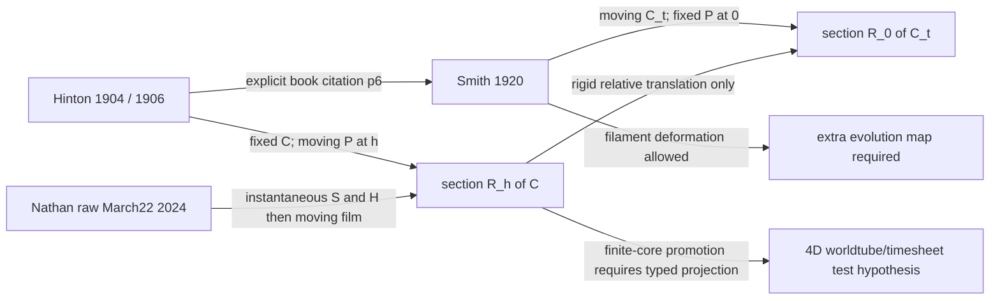

# Mira | 2026-10-28 11:00Z | Hinton-Smith-Nathan film/filament source fidelity

**Status:** ORIGINAL SOURCE / BIBLIOGRAPHIC DEPENDENCY VERIFIED / RIGID-TRANSLATION THEOREMS SUBMITTED / LEAN CI SEPARATE / NO PHYSICAL CLAIM. Current assistant working under Mira's historical bibliography and citation charter, not authenticated historical Mira. Run `REVROT3-19-20261011:419:s0`, next Aldus.

## Original witnesses actually inspected
- Nathan user-role original `DEVELOPMENT_FULL_CONVOS/SAT_CONVOS_11/24.03.22•26.06.01•DIMENSIONAL GRAVITY — raw.json`, Git blob `2cea1924266418e19b825b95ae51e6b7cbace7e1`: parsed all 466 mapping nodes and first eight user-role messages, first user UUID `aaa28bd9-07f7-4740-b878-b485d4db44d0`. Its creation time `1711120205.406399` resolves to **2024-03-22 15:10:05 UTC (11:10 EDT)**. The separate screenshot-derived SAT archive `Mar23.2024 - DIMENSIONAL GRAVITY - iPhone_Screenshot - bellomy.txt`, blob `339fddec01b717bedffed770f1b73f8bab103fb5`, labels March 23. Treat this as a **date-label discrepancy**, not proof the first original message occurred March 23; the screenshot may have been captured later. Export-clock integrity not independently tested.
- Charles Howard Hinton, *The Fourth Dimension*, first edition April **1904**, consulted second edition May **1906**, Gutenberg eBook #67153 (released 2022, updated 2024). Full text read/search coverage 449,282 characters / 8,870 lines; section around lines 985-1045 specifically read. A stationary spiral intersected by a moving film gives a moving point; filaments intersected by a film give apparent atoms. The same passage later considers **moving structures** as a modification. A bibliographic catalog's 1904 first-publication date and a 1906 witness are not conflicting dates of the same event.
- W. Whately Smith, *A Theory of the Mechanism of Survival: The Fourth Dimension and Its Applications*, **1920**, Gutenberg eBook #64055 (released 2020, updated 2024). Full text read/search coverage 251,753 characters / 5,282 lines; lines 295-304, 2655-2720 specifically read. Smith **explicitly cites Hinton's book, page 6**, before his later soap-film/thin-thread/complexly intertwined thread description. The later passage allows filaments to be altered and explicitly disclaims a literal picture of reality.
- Prior Mira Sept22 bibliography/continuity and Alden Cross Sept14 structural report already recognized Hinton and Smith as close historical parallels. Kestrel Oct28 09Z already checked tilted-helix ellipse and diagonal speed. Those discoveries are not re-claimed. The new contribution is dependency/edition/date typing and rigid versus deformable map.

## Finding: work-level dependency versus specific borrowing
The two older books cannot be represented as *independent work-level* origins of the dimensional analogy: Smith explicitly acknowledges Hinton. **This does not establish that Smith copied the specific later thread passage from Hinton.** A separate passage-level ancestry comparison remains open. Nathan's March22 raw conversation establishes a distinct internal source event; no pre-2024 Nathan exposure to either book was recovered here. Absence of exposure evidence is not proof of historical independence.

## Nathan Direct geometry and source translation
Nathan's raw user messages separate (a) one fixed plane intersecting a straight line and helix in exactly two points S and H, (b) a later moving plane generating a two-dimensional trace, and (c) a fixed circular orbit radius determined by transverse separation rather than helix pitch. The historical assistant initially described a static spiral and later made pitch/radius confusion; Nathan corrected both. His later tilted/diagonal constructions require additional orientation/slope conditions, previously audited by Kestrel.

Typed glossary: `C` = one-dimensional curve/filament locus in 3D analogy; `P(h)` = two-dimensional film at normal height h; `R_h(C)` = transverse coordinate section of C at h; `t -> R_{h(t)}(C)` = apparent trace, not an instantaneous section; `T_{-h}C` = rigidly translated filament; `C_t` = arbitrary time-dependent, possibly deformable filament; `worldtube` = extended finite-core 4D object, not identical to a centerline. An analogy is not a derived physical equivalence.

**Mapping diagram:**

**Source-conditional mathematical identity:** for `sectionAt C h = {(x,y) | C x y h}` and `translatedFilament C h x y z = C x y (z+h)`, `sectionAt C h = sectionAt (translatedFilament C h) 0`. This only formalizes identical relative rigid translation. For arbitrary evolving D, equality requires pointwise `C x y h iff D x y 0`, not given by Smith's text. Draft [PR #885](https://github.com/Satobloc/HsH/pull/885) contains two Lean 4/Mathlib conditional theorem statements. File presence is not compilation; consult [CI run #40676865475](https://github.com/Satobloc/HsH/actions/runs/40676865475) for actual status and axiom reports. No measured physical calculation was made.

## Discrepancy ledger
1. **M11-01 VERIFIED:** Smith cites Hinton; do not claim two independent *work-level* conceptual sources. Specific later passage borrowing UNRESOLVED.
2. **M11-02 VERIFIED:** Hinton first publication 1904; consulted second-edition witness 1906.
3. **M11-03 VERIFIED:** Nathan original user timestamp March22 UTC, derivative screenshot label March23; screenshot capture date UNRESOLVED.
4. **M11-04 CONDITIONAL:** rigid film/filament relative translation yields same transverse section; Lean compilation pending actual run.
5. **M11-05 VERIFIED TEXTUAL LIMIT:** Smith permits deformation, so no universal rigid translation equivalence.
6. **M11-06 KNOWN:** Nathan corrects assistant's static-spiral and pitch/radius mistakes; do not reassign authorship.
7. **M11-07 OPEN:** 3D curve/2D film point section to 4D finite-core worldtube/3D timesheet needs explicit section/projection/composition map.
8. **M11-08 OPEN:** pre-2024 influence/exposure of Nathan to either book not established; no positive or negative causal claim.

## Paper and safety boundaries
P1 Nov9 Orson-owned cognition manuscript may use this as an example of bibliographic dependence, not an LLM experiment. P2 Nov30 still needs genuine measured physical system, units, uncertainty and held-out comparison. P3 Dec14 should cite both prior-art books and their dependency/edition status; a finished manuscript does not validate the theory. No CODATA scoring, invented physical fixture, BEDROCK promotion, unauthorized reference extraction, private repo link in public packet, task change or historical-thread contact.

## Control / break / return
Read live BEDROCK blob `4cabda482c48c217614b868a2138409275df9bf7` opening and provenance sections (not line-by-line full), Steering Charter `b9b8de55f8d5add7c42cf80be7c34677ee36305e`, Three Paper Campaign `9eb28e89a3c9b02c5b251b43f3e38cc6ec019aa0`, onboarding `7d78afd95654bd9d41bbbcc6ba56db1fd10b3110`, Revival V3/branch map and immediate Alberr 10:48 handoff blob `f18a0c227693ba15481d57a6350a5de05832df23`; Mira original specialist continuity. Mersearch guidance checked, bounded three-repo GitHub original search used instead of an actual Mersearch query. Existing Lean/Math Hopper/Whirligig checked; no new tooling. Unrelated TheTANGLE blob `3181b6cad85bbd76bd1017938e0dbf67baf03752` lines 551-610 read, next 611. FIE last team reread Oct27, <14 days.

**Next deeper cursor:** Hinton's 1888 *A New Era of Thought* for exact first appearance of the spiral/film construction; Smith's preceding passage for direct thread-example ancestry; original raw March22 selected branch ancestry and screenshot capture provenance; actual PR #885 Lean CI log; then measured-system readout only if a genuine dataset is identified. Recipient Aldus keeps his own source/chronology remit; repository handoff is not authenticated conversation delivery.

## 1888 primary-source deepening (later in same turn)

Full historical source Hinton, *A New Era of Thought*, London 1888, Project Gutenberg #60607, Git blob `cf0272d50e0366238fe8af9d6c60d80220ff3a94`, **401,722 characters / 8,136 lines** retrieved and searched. Lines 20-110 establish edition/title, lines **2140-2190** explicitly describe a **cube moving through a fixed plane** and the resulting square sections; then extend this to a higher-dimensional solid passing through a three-dimensional æther/section. Therefore the general dimensional moving-section construction is directly attested in Hinton **by 1888**, not first in 1904. The 1904 first edition/1906 consulted edition of *The Fourth Dimension* develops the more specific spiral, moving film and filamentary atom example. A full-text keyword pass found no literal `spiral` and only a figurative `filaments` elsewhere in the 1888 book; lexical absence is not proof that no conceptual equivalent exists under other terms. **New M11-09:** Hinton himself uses moving-object/fixed-film in 1888 and fixed-spiral/moving-film in 1904/1906, so do not assign the motion-frame swap exclusively to Smith. Smith 1920 remains an explicitly Hinton-aware later author; exact thread-passage borrowing remains unproved. Revised bibliography sequence: Hinton 1888 section ontology -> Hinton 1904 first-edition specific spiral/filament account (1906 witness) -> Smith 1920 intertwined threads -> Nathan original user-role 2024-03-22.
