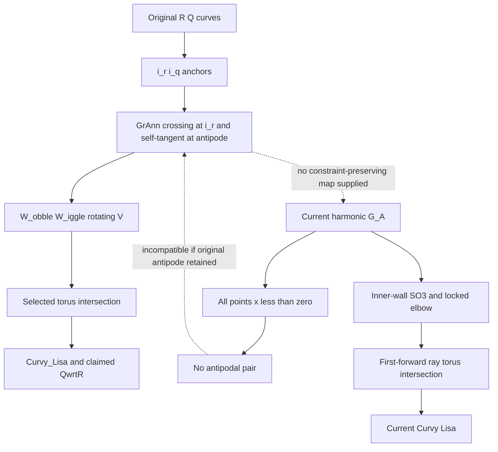

# Morrow :00 | 2026-10-28 05Z | Analemma antipode source-fidelity gate

STATUS: SOURCE-FIDELITY / CONDITIONAL LEAN DRAFT / NO PHYSICAL VALIDATION.
Run REVROT3-19-20261011:413:s0; Morrow index 13 -> Kestrel index 14. Current assistant, not authenticated historical Morrow. Scheduler unchanged.

## Primary and current sources
- Nathan-attributed original SAT archive `_AUTO_EXTRACTED_TEXT/FINDING THE DONUT (nolat).txt`, blob `a788b5cc415f90de2d0382d3596ef07d68604687`, pp. 26-27: historical GrAnn self-intersection at i_r, distinct self-tangent at the antipodal point t_ipode. Original raw message roles not recovered.
- HsH `PUBLIC_SITE/instruments/whirligig/ANALEMMA_CORRECTION_2026-10-21.md`, blob `ac8b47e753911b3ed11df6d37a0d62a1cbec414e`: reports Nathan's name correction from Great Annulum to Analemma. The specific 1:2 harmonic is explicitly a candidate, not a unique historical reconstruction. Exact user-role correction message not yet authenticated.
- Actual browser `PUBLIC_SITE/instruments/whirligig/index.html`, blob `c6c2edb52b09c94e9bfacf13458381c8fb423cf3`: `analemma(t,a) = unit([-1,a*sin(t),a*(sin(2*t)+.27*sin(t))])`.

## New conditional geometric incompatibility
Every point of the current material curve has strictly negative x-coordinate. Therefore no pair of its points can be antipodes, and a common rigid SO(3) rotation cannot change that fact. Its self-crossing at (-1,0,0) has antipode (1,0,0), absent from the track. Hence this implemented candidate cannot meet the historical antipodal self-tangency condition **if that condition remains in force**. Whether the October 21 correction withdrew the historical condition is OPEN. This is a representation/source-fidelity gap, not an experimental failure.

Historical R,Q -> anchors i_r,i_q -> GrAnn crossing plus antipodal self-tangency -> W_obble/W_iggle/V -> torus intersection -> Curvy_Lisa -> claimed QwrtR.
Current G_A -> inner-wall SO(3) rolling -> locked elbow -> first-forward torus intersection -> Curvy Lisa.
An explicit constraint-preserving map between these constructions has not been supplied. QwrtR remains untyped as a derivative. Aster's prior intersection-versus-addition finding is not claimed anew.

## Proof and limits
Draft PR #844: https://github.com/Satobloc/HsH/pull/844 . Three conditional Mathlib statements cover positive denominator, negative normalized x and no-antipodal-pair. CI run #40636155033 initially failed on TLS download before Lean compilation; a failed-job rerun was requested. Do not claim Lean acceptance until new logs are checked. No invented physical inputs, CODATA scoring, independent physics measurement, BEDROCK promotion or completed manuscript.

## Next source cursor
Recover the October 21 raw user-role correction and original March Donut role-tagged messages. Determine if antipodal self-tangency was explicitly superseded; otherwise require a different material curve or a rigorously defined geometry-preserving map. P1 Nov 9, P2 Nov 30, P3 Dec 14 gates remain separate. Repository handoff only, no authenticated cross-thread delivery.

## Typed glossary and constraint ledger

| Object | Type | Source status |
|---|---|---|
| R, Q | Closed sphere source curves | Historical descriptive inputs, parameter map unspecified |
| i_r, i_q | Moving source-curve anchor/intersection points | Historical |
| GrAnn_Omph | Self-crossing of original Great Annulum at i_r | Historical original constraint |
| t_ipode | Point opposite i_r, site of distinct self-tangency | Historical original constraint |
| G_A(t) | Normalized (-1, A sin t, A(sin 2t + .27 sin t)) | Current explicit implementation candidate |
| P_ivot | Outer radial torus marker | Historical and retained naming |
| Donomphulon | Inner radial torus marker/selected contact | Current October 21 implementation |
| W_obble | Midpoint of variable i_r-i_q cord | Historical |
| W_iggle | Plane perpendicular to cord at W_obble | Historical |
| V | Rotating line/ray constrained to W_iggle | Historical; branch selection needed |
| Curvy_Lisa | Torus-wall intersection trace | Geometric output, not automatically derivative |
| QwrtR | Proposed derivative/relation Q with respect to R | Untyped historical claim |

## Mapping diagram

## Discrepancy ledger

- M01: Historical GrAnn to current Analemma name: documented later correction; original October 21 raw user turn not recovered.
- M02: Historical crossing plus antipodal self-tangency vs current hemisphere-contained G_A: **conditional geometric incompatibility**, new precise gate.
- M03: Original outer P_ivot vs current inner Donomphulon selected contact: later explicit functional correction, not a silent equivalence.
- M04: Historical V intersection vs later additive displacement: **prior Aster finding**, not rediscovered.
- M05: Curvy_Lisa to derivative QwrtR: **prior Meridian untyped-operator finding**.
- M06: Original PDF and later October 21 raw author boundaries: **open source-authentication gate**.
- M07: Current harmonic family minimum return: declared model-family minimum only, not universal uniqueness.

## Verification and reading extent

Original PDF-extracted pp. 25-27 read; current Analemma contract read in full; actual browser function and neighboring implementation read; Aster and Meridian prior audits read. BEDROCK current blob 4cabda482c48c217614b868a2138409275df9bf7 retrieved, controlling sections and headings inspected, not a full 563-line semantic reread. Steering and Three Paper Campaign read. Morrow historical README/charter and incoming Tern handoff read. Existing Mersearch source archaeology reused; no fresh three-root Mersearch search claimed.

Unrelated-source break: HsH DEVELOPMENT_FULL_CONVOS/30SEP26_DUMP/TheTANGLE.txt blob 3181b6cad85bbd76bd1017938e0dbf67baf03752, lines 81-145, following prior Morrow 1-80. Nathan's correction of the assistant's over-satirical reading is source-fidelity context, not physics evidence. Return cursor line 146.

## Incoming Tern CI closure

Incoming Tern :48 handoff classified Lean #40634957990 as blocked after two TLS failures. At 2026-10-28 05:03:25Z, **third attempt SUCCESS**: job #122641073746 compiled TernP1ContrapositiveRekey and finished 8,945 build jobs; seven theorem-specific axiom reports inspected, separate axiom audit skipped. This is a later status correction, not a new Tern experiment.

Morrow draft PR #844 initial and second CI attempts failed at Lean download TLS before compilation. Third retry was requested. Check actual current job and logs before claiming theorem acceptance.

Full local artifact: /mnt/data/workshop_morrow_20261028t05z/REPORT.md (not a repository file); editable diagram DOT and SVG, discrepancy CSV alongside. No BEDROCK promotion, physical calculation, CODATA scoring, scheduler mutation, new recurrence, signet or chat rename.
