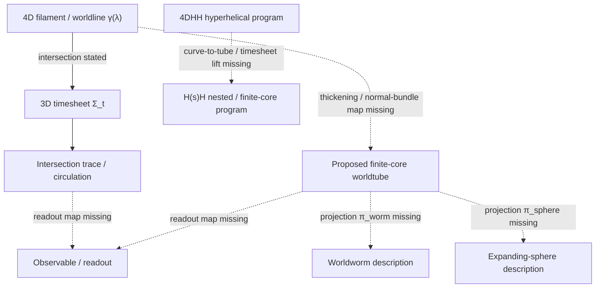

# Morrow h850:s0 — 4DHH / H(s)H source-fidelity audit

**Disposition:** SOURCE-FIDELITY REVIEW COMPLETE WITH OPEN MAPS, MIXED-AUTHORSHIP EQUATION ARTIFACTS, AND A QUARANTINE-STATUS MISMATCH. This is an archival/source-comparison report, not theory integration, a physical result, a paper, or a BEDROCK promotion.

## 1. Run identity, access, and worker boundary

- Nominal UTC hour: **h=850** (2026-11-15T10:00Z).
- Slot: **s=0**; sequence: **4250**.
- Ring selection: **Morrow**, index 13.
- Next ring identity: **Kestrel**, index 14.
- The selected name is a deterministic routing label, not authentication of the historical Morrow instance or its current ChatGPT thread.
- Morrow is recorded as historical-accessible / unscheduled; the former Morrow recurrence is disabled. No current usable Morrow conversation or authenticated cross-thread destination was established.

The historical Morrow remit is archive/source custody, conversation-source identity, chronology, provenance, contextual recovery, source comparison, and bounded theory-material reading/note-taking. The September 13 direct stop remains controlling for theory integration, physical calculation/prediction, equation correction, Lean proof, paper work, and BEDROCK promotion. The September 13 trial invitation permits source comparison and mathematical/equation checking while preserving quarantine and non-authoritative status; it does not expressly lift the earlier theory stop.

Accordingly, this run performs the requested Lane 00 source-fidelity comparison without integrating the theory, correcting equations, producing predictions, or promoting any source. Historical Morrow assistant outputs are examined as historical LLM outputs, not reused as theory premises. Ravel's quarantined Kerr baseline is inspected only to verify its provenance/status and to assess the assistant's source attribution.

## 2. Primary-source cluster and coverage

### Historical Morrow conversation

Raw Git blob: `ee394b446b2e36d35fd1e5ecd004685c0422457b`

- Conversation family: Morrow / Reconstruct H(s)H Synthesis.
- Raw export size reported by the repository: 3,017,953 bytes.
- Mapping: 697 keys; 696 message-bearing nodes; 17 user-role messages.
- The full user-role inventory was scanned. Four adjacent user messages and the corresponding assistant outputs were read closely:
  - `fed478ad-8022-46b1-a972-ac74bf7d37b2`, 2026-09-09T03:25:14.104Z.
  - `87cf1b1c-5ed7-4082-a0fe-6ed5c79dce3b`, 2026-09-09T03:48:08.735Z.
  - `fa3afa98-8d69-4bf1-878a-4d148d4473d2`, 2026-09-09T04:04:44.984Z.
  - The earlier user messages establish the neighboring archive/method context; the later September 13 direct stop and trial invitation were separately read from the same raw export.

### Adjacent equation and geometry artifacts

1. `WORKSPACES/WORLDTUBE_LAB/KERR_CORE_BASELINE.md`, current Git blob `a3a4912a3572bcd82e50516812beee2d83a82b14`, 225 lines. Its controlling status is **PROVISIONALLY QUARANTINED**. The electron-scale assignment, near-core shell/carrier, and frozen starting geometry are not to be used as current-theory premises pending the specified dependency/provenance audit and electron-like over-extreme survival table.
2. `_AUTO_EXTRACTED_TEXT/SAT.4DHH.UC.txt`, Git blob `c3c63e983663a1648aa78ce9f591c28e7997f055`, 194,649 characters / 5,560 lines. Extraction header identifies `SAT.4DHH.UC.pdf`, source PDF is 694,871 bytes, Git blob SHA-1 `1be1a5f1518e9b6b3d41b85ea5222b8efb114c52`, SHA-256 `9b28c5776516af59dd661485ac519983c9b77b56c435a4ec15436d24f8bf028f`, PyMuPDF extraction dated 2026-09-10. The opening contains an explicit “LLM DROP” marker. The relevant opening pages were read; the entire 5,560-line extraction was not.
3. `_AUTO_EXTRACTED_TEXT/4DHH LAGRANGIAN (nolat).txt`, Git blob `24d202bdbc79f3c0d83cfd8a9db584479eed5444`, 43,228 characters / 899 lines. Its source PDF is 220,413 bytes, Git blob SHA-1 `4bc0231f036560ecbf67ecb7795e2708f7a81c67`; independently recomputed PDF SHA-256 `8443a85e8a4117422565745b848bd32764f0059e8fbedb9b73107b34e02a3923`, matching the extraction header. The opening 155 lines were read.
4. `SAT_4DHH_UC.pdf`, 127,945 bytes, Git blob SHA-1 `41db068fb111ed58512163a4f9b46642992b55a1`; independently recomputed SHA-256 `b805d3f94b2d573a7bc7e52c0f0f7264aa88919b4522e4c1d3b92708e3e4be58`. Its separate extracted text is Git blob `b989abdb1f278db771704e5609a3b64ed7360149`, 3,950 characters / 153 lines. The complete short extraction was read.
5. `EARLY 2026/SAT EARLY 2026 — BYO LAGRANGIAN.txt`, Git blob `47ee684888525d9d71a6dd701041685681f3dc49`, 4,178 characters / 41 lines. The complete file was read.
6. `EARLY 2026/SAT EARLY 2026 — UNIT CELL LAGRANGIANS.txt`, Git blob `8adfdc9e5fcd8474c69f1dded679eda5d4434608`, 58,596 characters / 1,430 lines. The opening 130 lines were read.

The root `..findex.txt` refers to a top-level `SAT CORE — BYO LAGRANGIAN.txt` path that is not present at that path in the current tree; the located early-2026 file is the path above. This is a locator/alias discrepancy, not proof that the two names designate identical files.

## 3. Nathan Direct descriptive geometry (paraphrase, not equation reconstruction)

The September 9 source expresses a connected but explicitly tentative geometry:

- A proposed finite core is described as a worldtube associated with a Kerr singularity. Wormhole / ER=EPR / Pauli language and an asymptotic approach are tentative associations, not a typed construction or established identity.
- In the earlier SAT description, circulation is associated with the intersection trace of a helical worldline and a Minkowskian timesheet, described as approximately a closed-string vibration mode.
- The H(s)H possibility adds a shell/ergosphere-like structure, interaction with a time wavefront, possible inductive reconnection or distortion, and a fluid medium with Kelvin vortices. The source presents this as a likely mechanism, not a completed field model.
- A “worldworm” construction and an expanding-sphere construction are proposed as possibly equivalent descriptions when different dimensional information is discarded or retained. No projection, fiber, inverse, or composition map is supplied.
- 4DHH and H(s)H are said to be making the same broad claim. The Lagrangians are characterized as line-based / hyperhelical. The source does not define a map that turns a 4DHH line generator into an H(s)H finite-core worldtube.
- The 24-cell / unit-cell and lattice material is explicitly held back; a later Spheres result might change that status. Historical documents containing a lattice therefore do not, by their existence, authorize its current use.
- Cross-scale self-similarity is proposed, with systematic scaling in four dimensions. No scale transformation, invariant, or composition law is given.
- Twist and relative filament-bundle position are proposed as persistent features; holonomic closure and coil/twist structure are nearer-scale candidates. The global-cycle language remains a candidate, not an established conservation law.
- P and ᚼ are described as abstract symmetry operators. The direct message does not identify either with θ₄ or a particular Lie/gauge generator.
- The source explicitly keeps RMS distinct from SAT as a theory; the relationship described is methodological/epistemic, not theoretical identity.

## 4. Stable glossary for this source cluster

| Term | Source-grounded meaning | Boundary |
|---|---|---|
| Filament / worldline | 1D trajectory or curve in the 4D description | Not itself a finite-core tube |
| Timesheet / time wavefront | The resolving 3D “now” surface used in the intersection description | Embedding, normal, and evolution law not supplied here |
| Circulation | Proposed intersectional trace; H(s)H variant involves shell/wavefront interaction and Kelvin vortices | No field equation or readout map supplied |
| Finite core | Tentative Kerr-associated worldtube | Not automatically the Kerr ring, ER neck, ergosphere, or a specified shell |
| Worldworm | Alternative proposed 4D representation | Relation to expanding sphere remains conjectural |
| Expanding sphere | Alternative proposed representation retaining/discarding dimensional information differently | No explicit projection or inverse |
| 4DHH | Historical hyperhelical formalism with a one-parameter curve generator in the inspected source | A curve generator is not a worldtube construction |
| H(s)H | Broader nested-hyperhelical claim with proposed finite-core/timesheet structure | The 4DHH-to-H(s)H lift is not defined |
| BYO Lagrangian Explorer | A configurable trajectory / geometric-model generator | It asks the user to supply the Lagrangian; it is not itself a unique physical Lagrangian |
| Ravel Kerr baseline | Assistant-produced candidate metrology package | Explicitly provisionally quarantined; not a Nathan Direct premise |
| RMS | Separate methodology/epistemic framework | Not SAT or H(s)H theory |

## 5. Mapping diagram: what is stated versus what is missing

This is a map of source claims and missing interfaces, not a physical model. The dotted edges are required constructions, not asserted equivalences.

## 6. Original propositions versus historical LLM translation

### Proposition A — finite core

- **Nathan Direct:** tentative Kerr-singularity worldtube; wormhole / ER=EPR / Pauli association; asymptotic approach.
- **Historical assistant translation:** “Kerr/ER-type worldtube” expanded to a ring/neck plus a deformable shell or interface, with a possible Pauli contact/approach law.
- **Fidelity assessment:** the broad Kerr/ER association is recognizable, but ring/neck/shell and contact-law detail is imported from the Ravel baseline. That baseline is explicitly provisionally quarantined. The assistant's later “SAT/ACTIVE” status assignment overstates the contemporaneous source and the baseline's own control notice. The current 2026-11-08 methodology does list an ER–Kerr shell worldtube as a working hypothesis, but that later working hypothesis does not retroactively validate the specific electron-scale Ravel package or make it Nathan Direct.

### Proposition B — worldworm versus expanding sphere

- **Nathan Direct:** the two may be more or less equivalent depending on retained/discarded dimensional information.
- **Historical assistant translation:** they are information-different projections of the same 4D construction.
- **Fidelity assessment:** this is a plausible paraphrase of the hypothesis, but “projection” is a mathematical strengthening. No projection domain/codomain, kernel, equivalence relation, inverse, or composition condition is defined. Equivalence remains a test hypothesis.

### Proposition C — 4DHH and H(s)H

- **Nathan Direct:** same broad claim; the named Lagrangians are characterized as line-based.
- **Historical assistant translation:** 4DHH supplies a line-based dynamical skeleton and H(s)H “lifts” it into finite-core boundary, deformation, contact, and readout structure.
- **Fidelity assessment:** the broad continuity claim is direct. The hierarchy and lift are assistant reconstruction. No thickening, normal-frame, timesheet-incidence, boundary, or readout map is present in the cited direct message or the inspected 4DHH excerpts.

### Proposition D — circulation

- **Nathan Direct:** SAT intersection trace; possible H(s)H shell/time-wavefront deformation or reconnection plus Kelvin-vortex medium.
- **Historical assistant translation:** the circulation is “upgraded” from the line-intersection picture to a finite-core process.
- **Fidelity assessment:** the assistant's components are largely traceable, but “upgraded” implies a settled supersession not stated in the source. The source distinguishes SAT and likely H(s)H descriptions; it does not provide a completed transition map or medium dynamics.

### Proposition E — symmetry operators and new objects

- **Nathan Direct:** P and ᚼ remain abstract symmetry operators; the source says it has not found a place for genuinely new objects.
- **Historical assistant translation:** P/ᚼ are speculated to be Lie/gauge-like and possibly descendants of θ₄; ordinary dynamics are said not to require new objects.
- **Fidelity assessment:** both are assistant extrapolations. The live registry has a specific `LOCAL:TRISWALE:θ_4` entry and warns against semantic transfer. No P/ᚼ-to-θ₄ mapping is established. “No new objects found” is not a universal no-new-objects theorem.

### Proposition F — cross-scale self-similarity

- **Nathan Direct:** the same essential equations may apply across scales with proper four-dimensional scaling.
- **Historical assistant translation:** a single nested-hyperhelical program at different levels of explicitness.
- **Fidelity assessment:** the interpretation is compatible at a broad level, but no scale map, invariant, parameter transformation, or commutative diagram is supplied. The assistant's summary is not a derivation.

## 7. Adjacent equation artifacts: what “line-based” actually means

The inspected source set supports a more precise statement than “all the Lagrangians are line-based”:

1. The 4DHH unit-cell extraction explicitly introduces a single nth-order superhelix `γ^μ(λ)`. This is a one-parameter curve generator. The file's opening is marked “LLM DROP”; the entire extraction cannot be attributed to Nathan Direct.
2. The BYO Explorer defines a trajectory generator of the form `y^μ(λ)=r(λ)R^μ_ν(λ)x₀^ν`, with `R(λ)∈SO(4)`. Its functional slot `S=∫F(X,X′,X″,…)ds` is left for the user to supply. This is a path/model generator, not one specified Lagrangian.
3. The separate 4D summary `SAT_4DHH_UC.pdf` writes a 4D bulk action `S_Total=∫d⁴x√−g(L_UC+L_4DHH)`. Thus the underlying hyperhelical primitive may be line-based while a later action is integrated over a 4D domain. “Line-based” should not be expanded to “the whole action is only a line integral.”
4. The adjacent unit-cell file contains distinct 2D-circle, 3D-sphere, 4D-hypersphere, and intersection-evolution Lagrangian forms. These are not identical to the one-parameter 4DHH curve generator.
5. The “nolat” 4DHH document's title conflicts with body text that still refers to an HSUCV / 24-cell lattice. The 4DHH unit-cell PDF and the underscore-named 4-page summary are distinct files with distinct source hashes; no supersession relation was established.

The exact source equations were preserved as encountered. No corrected equation, replacement Lagrangian, or new physical model was authored.

## 8. Discrepancy ledger

| ID | Discrepancy | Classification | Disposition |
|---|---|---|---|
| M850-01 | Assistant promotes Ravel's ring/neck/shell details despite the baseline's quarantine notice | Source/status mismatch | Keep baseline non-authoritative; do not use its electron scale or frozen geometry as premise |
| M850-02 | Assistant treats the worldworm/expanding-sphere relation as a projection without defining maps | Under-typed mathematical translation | Leave as hypothesis |
| M850-03 | Assistant asserts a 4DHH-to-H(s)H lift from line skeleton to finite-core structure | Unsupported hierarchy | Require explicit thickening, incidence, boundary, and readout maps |
| M850-04 | “Upgraded” circulation language implies supersession | Historical-version overstatement | Preserve SAT and H(s)H descriptions as distinct source proposals |
| M850-05 | P/ᚼ-to-θ₄ / Lie-gauge lineage is assistant speculation | Symbol/provenance drift risk | No identification; preserve registry namespace |
| M850-06 | “No new objects” becomes a general default rule | Scope inflation | Keep as a local observation, not a theorem |
| M850-07 | BYO “Lagrangian” artifact is actually a trajectory generator with a user-supplied functional slot | Artifact-type mismatch | Call it BYO Explorer / trajectory generator |
| M850-08 | “Line-based” primitive coexists with 4D bulk actions and separate sphere/unit-cell Lagrangians | Representation-level conflation | Distinguish generator, action domain, and unit-cell model |
| M850-09 | “nolat” filename coexists with lattice references in body | Version/title mismatch | Preserve both; no supersession inferred |
| M850-10 | RMS could be merged with SAT by broad “same methodology” language | Category error risk | Preserve direct distinction: related method/epistemics, different theories |
| M850-11 | Assistant reports 215 lines for Ravel baseline; current file has 225 lines | Snapshot/version uncertainty | Do not call error without the contemporaneous baseline blob; retain both counts and seek version history |

## 9. Formalization and physical-calculation gate

**No Lean module or run.** The global proof-first rule was applied as a formalization triage, but Morrow's worker-specific direct stop still excludes Lean proof absent an explicit Morrow-specific release. Independently, the source does not define the projection/thickening/composition maps needed to state the proposed equivalences as precise propositions. Local `lean`, `lake`, and `elan` are not installed in this runtime. No existing CI build is represented as a new proof.

No physical calculation, data-free fixture, numerical fit, prediction, CODATA scoring, or observational validation. The Ravel baseline's electron-scale assignment remains quarantined; no measured system/dataset, provenance, units, uncertainties, or prediction-versus-fit separation was supplied for a physical calculation.

## 10. Search, governance, and reading controls

- Mersearch was attempted first by inspecting the documented four-lane bridge. All four request files remain `status=requested`; all twelve request-scoped manifest/receipt paths returned 404. No lane was free. No request was overwritten or retriggered. No local pinned checkout exists in this runtime. Bounded GitHub code search was used as fallback, not represented as a Mersearch result. HSH_RESOURCES root README and AI start page were read; no research payload was searched/opened.
- HsH, SAT archive, and HSH_RESOURCES onboarding/root orientation was read. HsH main branch at the pre-write check: `d0531d08a8657f299649cff36a901f68239b69b6` (the verified main head immediately before this report commit).
- The live task graph remains 18 records / declared `branch_count=16`; no graph edit or inferred branch.
- The four existing relay leases remain :00, :24, :36, :48 enabled; :12 remains disabled. The :00 task ID and original hourly schedule were not changed. No sixth task.
- P0 Code Grurple remains ACTIVE. WH-01..WH-09 remain unresolved P1/HIGH; WH-05 is blocked by the occupied Mersearch lanes; WH-02 remains Calder/authorized-maintainer-owned. No queue ownership or priority change.
- Paper gates remain separate: P1 November 9 cognition paper OVERDUE / NOT READY, Orson-owned; P2 November 30 HOLD; P3 December 14 INCOMPLETE. No paper work or gate advancement.
- FIE last recorded full review: November 10; next due November 24.
- Unrelated source reading completed: SAT Mark V `TheTANGLE.txt`, lines 2161–2200. Next cursor: line 2201. This is a reading quantum, not a physical break.

## 11. Next deeper cursor

1. Recover the source-authored 4DHH / hyperhelical / BYO Lagrangian originals and role-authenticated message ancestry; do not treat the LLM DROP or assistant-voice documents as Nathan Direct.
2. Resolve the exact relation among `SAT.4DHH.UC.pdf`, `SAT_4DHH_UC.pdf`, and `4DHH LAGRANGIAN (nolat).pdf` from source manifests and original author messages.
3. If a cleared geometry worker continues the theory-facing lane, define the 4DHH curve-to-finite-core thickening, timesheet intersection, worldworm/expanding-sphere projections, and readout/composition conditions before formalizing.
4. Keep the Kerr baseline quarantined until its own dependency/provenance audit is complete. Do not promote the electron-scale assignment from this report.
5. Preserve the original SAT-O1 and Blockwave custody records unchanged; this run did not edit or re-emit either equation set.

**Final classification:** `MORROW_H850_S0 / ARCHIVE_SOURCE_FIDELITY_ONLY / DIRECT_GEOMETRY_EXTRACTED / ASSISTANT_TRANSLATION_CRITIQUED / KERR_BASELINE_QUARANTINE_PRESERVED / 4DHH_BYO_VARIANTS_CUSTODY_RECONCILED / MAPS_UNDEFINED / NO_LEAN / NO_PHYSICAL_CALCULATION / NO_CODATA / NO_THEORY_INTEGRATION / NO_BEDROCK_PROMOTION`.
