# Visual Catalog — page 4/11

Images **541–720** of **1960** · [index](README.md)

| Thumbnail | File / metadata / current suggestions |
|---|---|
| <a href="https://raw.githubusercontent.com/Satobloc/HsH/main/PUBLIC_SITE/generated/thumbnails/90803c00839c3a979e8049f723cbc28677fb6ca6.jpg">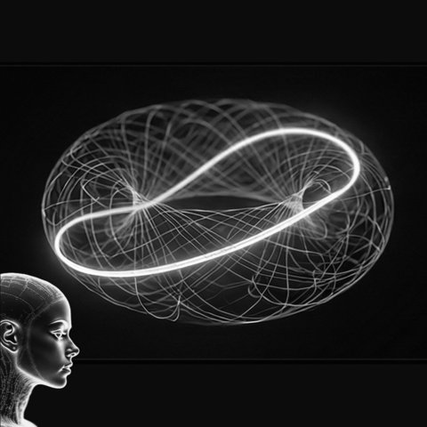</a> | **90803c00839c3a979e8049f723cbc28677fb6ca6.jpg** HsH · PUBLIC_SITE/generated/thumbnails/90803c00839c3a979e8049f723cbc28677fb6ca6.jpg 480×480 · square **suggest:** podcast_art, podcast, website_flavor family: near:000225 |
| <a href="https://raw.githubusercontent.com/Satobloc/HsH/main/PUBLIC_SITE/generated/thumbnails/909bd79eac1142c9d30234f83d2b7e17628b479c.jpg">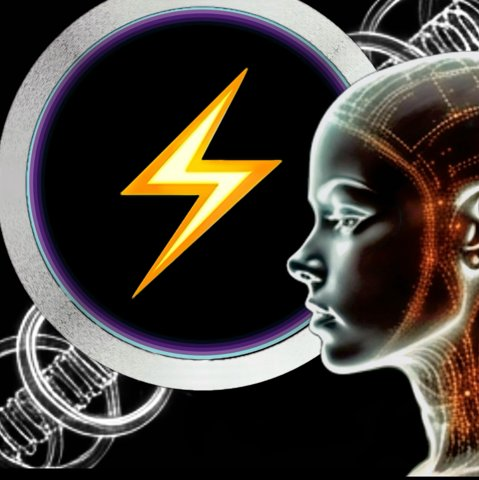</a> | **909bd79eac1142c9d30234f83d2b7e17628b479c.jpg** HsH · PUBLIC_SITE/generated/thumbnails/909bd79eac1142c9d30234f83d2b7e17628b479c.jpg 479×480 · square **suggest:** podcast_art, podcast, website_flavor family: near:000437 |
| <a href="https://raw.githubusercontent.com/Satobloc/HsH/main/PUBLIC_SITE/generated/thumbnails/9261fa62281d92496197d11c078a43615bc087d8.jpg">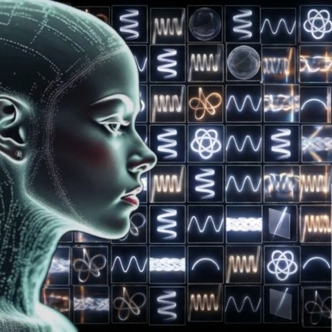</a> | **9261fa62281d92496197d11c078a43615bc087d8.jpg** HsH · PUBLIC_SITE/generated/thumbnails/9261fa62281d92496197d11c078a43615bc087d8.jpg 480×480 · square **suggest:** podcast_art, podcast, website_flavor family: near:000505 |
|  | **9298a81170c24cb5a5d52fcf46c2012cc27f4fe6.jpg** HsH · PUBLIC_SITE/generated/thumbnails/9298a81170c24cb5a5d52fcf46c2012cc27f4fe6.jpg 480×480 · square **suggest:** podcast_art, podcast, website_flavor family: near:000642 |
|  | **92a9fc1135c1764dfb1f2e060aa327a856a7c5a6.jpg** HsH · PUBLIC_SITE/generated/thumbnails/92a9fc1135c1764dfb1f2e060aa327a856a7c5a6.jpg 480×480 · square **suggest:** podcast_art, podcast, website_flavor family: near:000840 |
| <a href="https://raw.githubusercontent.com/Satobloc/HsH/main/PUBLIC_SITE/generated/thumbnails/93178ccc90585ac70f8690b502fb3d33c1abb795.jpg">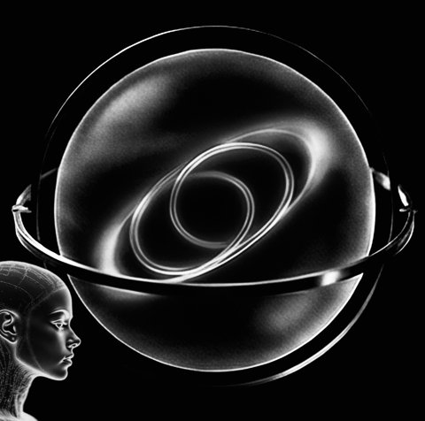</a> | **93178ccc90585ac70f8690b502fb3d33c1abb795.jpg** HsH · PUBLIC_SITE/generated/thumbnails/93178ccc90585ac70f8690b502fb3d33c1abb795.jpg 480×476 · square **suggest:** podcast_art, podcast, website_flavor family: near:000601 |
| <a href="https://raw.githubusercontent.com/Satobloc/HsH/main/PUBLIC_SITE/generated/thumbnails/936b616de045a0052841fa80cc5a4c3ce379caf0.jpg">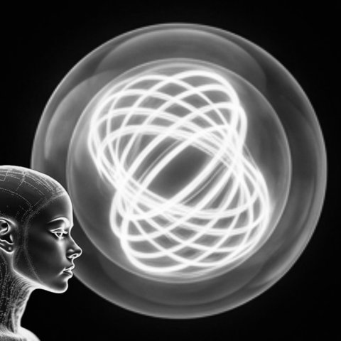</a> | **936b616de045a0052841fa80cc5a4c3ce379caf0.jpg** HsH · PUBLIC_SITE/generated/thumbnails/936b616de045a0052841fa80cc5a4c3ce379caf0.jpg 480×480 · square **suggest:** podcast_art, podcast, website_flavor family: near:000596 |
| <a href="https://raw.githubusercontent.com/Satobloc/HsH/main/PUBLIC_SITE/generated/thumbnails/94b6d53a202406b93e437de8ea8c57bc26488414.jpg">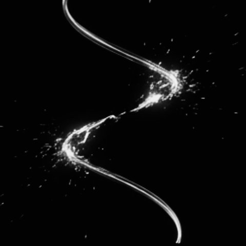</a> | **94b6d53a202406b93e437de8ea8c57bc26488414.jpg** HsH · PUBLIC_SITE/generated/thumbnails/94b6d53a202406b93e437de8ea8c57bc26488414.jpg 480×480 · square **suggest:** podcast_art, podcast, website_flavor family: near:000272 |
| <a href="https://raw.githubusercontent.com/Satobloc/HsH/main/PUBLIC_SITE/generated/thumbnails/952d481dcfeed7f6e0a673b55c12144256a023b0.jpg">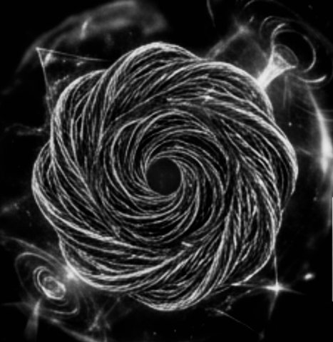</a> | **952d481dcfeed7f6e0a673b55c12144256a023b0.jpg** HsH · PUBLIC_SITE/generated/thumbnails/952d481dcfeed7f6e0a673b55c12144256a023b0.jpg 467×480 · square **suggest:** podcast_art, podcast, website_flavor family: near:000201 |
| <a href="https://raw.githubusercontent.com/Satobloc/HsH/main/PUBLIC_SITE/generated/thumbnails/9572d147c7be810384938a40297f78feb35b3e5f.jpg">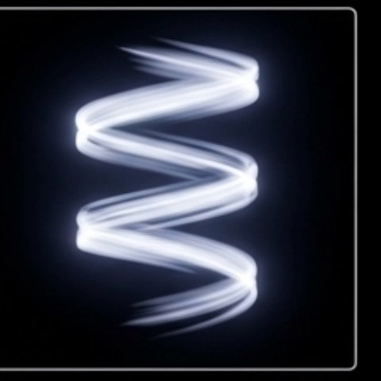</a> | **9572d147c7be810384938a40297f78feb35b3e5f.jpg** HsH · PUBLIC_SITE/generated/thumbnails/9572d147c7be810384938a40297f78feb35b3e5f.jpg 480×480 · square **suggest:** podcast_art, podcast, website_flavor family: near:000133 |
| <a href="https://raw.githubusercontent.com/Satobloc/HsH/main/PUBLIC_SITE/generated/thumbnails/95d6750c3baded92b6f7b734c1f7af9b80a6a77c.jpg">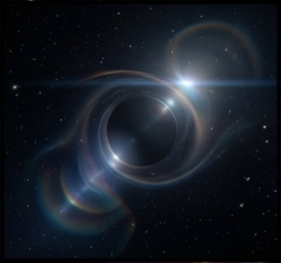</a> | **95d6750c3baded92b6f7b734c1f7af9b80a6a77c.jpg** HsH · PUBLIC_SITE/generated/thumbnails/95d6750c3baded92b6f7b734c1f7af9b80a6a77c.jpg 480×450 · landscape **suggest:** podcast_art, podcast, website_flavor family: near:000054 |
| <a href="https://raw.githubusercontent.com/Satobloc/HsH/main/PUBLIC_SITE/generated/thumbnails/96057322452005330d86ece47551cb64188bd5e3.jpg">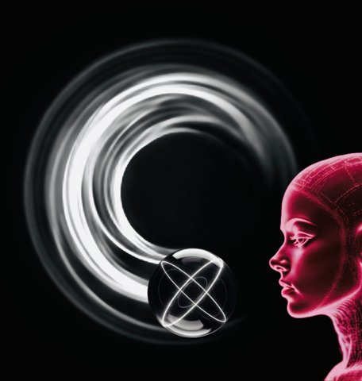</a> | **96057322452005330d86ece47551cb64188bd5e3.jpg** HsH · PUBLIC_SITE/generated/thumbnails/96057322452005330d86ece47551cb64188bd5e3.jpg 456×480 · portrait **suggest:** podcast_art, podcast, website_flavor family: near:000725 |
| <a href="https://raw.githubusercontent.com/Satobloc/HsH/main/PUBLIC_SITE/generated/thumbnails/96ea225e119625c2a3b62bb72d72c14c876b05b0.jpg">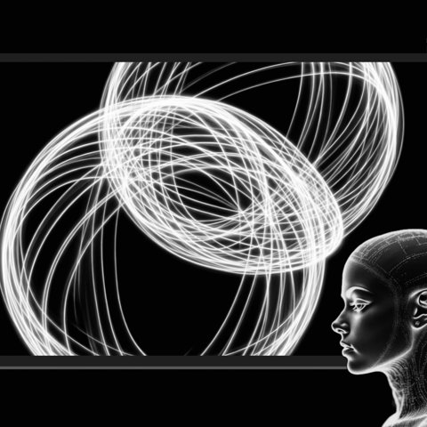</a> | **96ea225e119625c2a3b62bb72d72c14c876b05b0.jpg** HsH · PUBLIC_SITE/generated/thumbnails/96ea225e119625c2a3b62bb72d72c14c876b05b0.jpg 480×480 · square **suggest:** podcast_art, podcast, website_flavor family: near:000475 |
| <a href="https://raw.githubusercontent.com/Satobloc/HsH/main/PUBLIC_SITE/generated/thumbnails/9744241e8c38f97fc8f9a9621d299a91778776f1.jpg">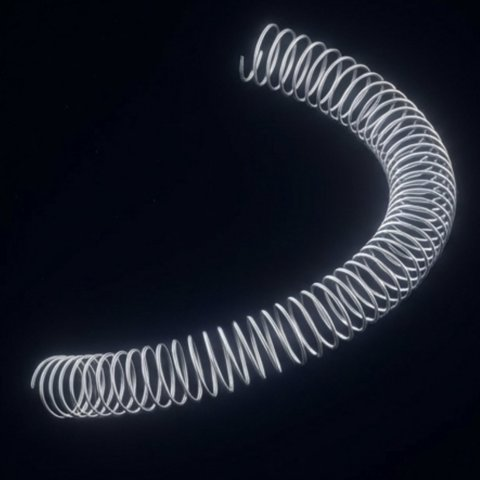</a> | **9744241e8c38f97fc8f9a9621d299a91778776f1.jpg** HsH · PUBLIC_SITE/generated/thumbnails/9744241e8c38f97fc8f9a9621d299a91778776f1.jpg 480×480 · square **suggest:** podcast_art, podcast, website_flavor family: near:000251 |
|  | **975d39a800bbefdbebe72befa2f25aef3d286999.jpg** HsH · PUBLIC_SITE/generated/thumbnails/975d39a800bbefdbebe72befa2f25aef3d286999.jpg 480×473 · square **suggest:** podcast_art, podcast, website_flavor family: near:000158 |
| <a href="https://raw.githubusercontent.com/Satobloc/HsH/main/PUBLIC_SITE/generated/thumbnails/9760c07452c52d1f08cbe0d5a995104ffe6bbd69.jpg">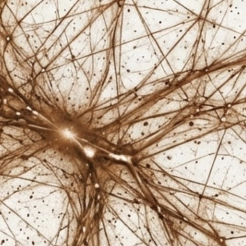</a> | **9760c07452c52d1f08cbe0d5a995104ffe6bbd69.jpg** HsH · PUBLIC_SITE/generated/thumbnails/9760c07452c52d1f08cbe0d5a995104ffe6bbd69.jpg 480×480 · square **suggest:** podcast_art, podcast, website_flavor family: near:000492 |
| <a href="https://raw.githubusercontent.com/Satobloc/HsH/main/PUBLIC_SITE/generated/thumbnails/97a96022604cce197021cc639d0df4e510265b1b.jpg">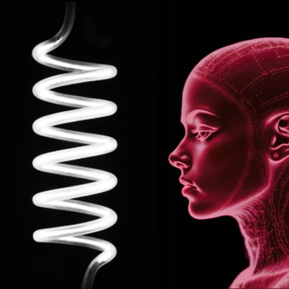</a> | **97a96022604cce197021cc639d0df4e510265b1b.jpg** HsH · PUBLIC_SITE/generated/thumbnails/97a96022604cce197021cc639d0df4e510265b1b.jpg 480×480 · square **suggest:** podcast_art, podcast, website_flavor family: near:000451 |
| <a href="https://raw.githubusercontent.com/Satobloc/HsH/main/PUBLIC_SITE/generated/thumbnails/97d0b157c977268aaba390f067136a6199c47434.jpg">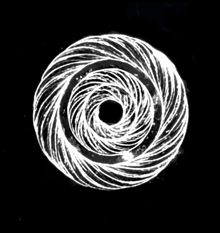</a> | **97d0b157c977268aaba390f067136a6199c47434.jpg** HsH · PUBLIC_SITE/generated/thumbnails/97d0b157c977268aaba390f067136a6199c47434.jpg 454×480 · portrait **suggest:** podcast_art, podcast, website_flavor family: near:000106 |
| <a href="https://raw.githubusercontent.com/Satobloc/HsH/main/PUBLIC_SITE/generated/thumbnails/97d9d24d39b2b1a2c5d5e5244377461ef90d8a94.jpg">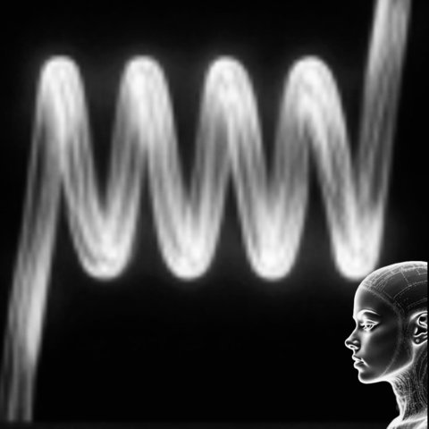</a> | **97d9d24d39b2b1a2c5d5e5244377461ef90d8a94.jpg** HsH · PUBLIC_SITE/generated/thumbnails/97d9d24d39b2b1a2c5d5e5244377461ef90d8a94.jpg 480×480 · square **suggest:** podcast_art, podcast, website_flavor family: near:000109 |
| <a href="https://raw.githubusercontent.com/Satobloc/HsH/main/PUBLIC_SITE/generated/thumbnails/97da84c864d9547f75f8ddd710aea8c59a02ff7e.jpg">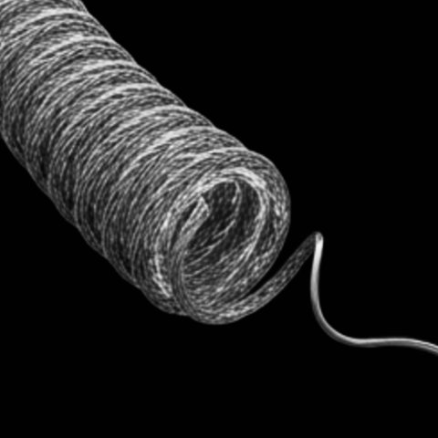</a> | **97da84c864d9547f75f8ddd710aea8c59a02ff7e.jpg** HsH · PUBLIC_SITE/generated/thumbnails/97da84c864d9547f75f8ddd710aea8c59a02ff7e.jpg 480×480 · square **suggest:** podcast_art, podcast, website_flavor family: near:000883 |
|  | **9941157c8129b3540af69fde525d84ad1ab63374.jpg** HsH · PUBLIC_SITE/generated/thumbnails/9941157c8129b3540af69fde525d84ad1ab63374.jpg 480×480 · square **suggest:** podcast_art, podcast, website_flavor family: near:000535 |
| <a href="https://raw.githubusercontent.com/Satobloc/HsH/main/PUBLIC_SITE/generated/thumbnails/9a619a12615949ae26d80b2a688b6824db6d14e4.jpg">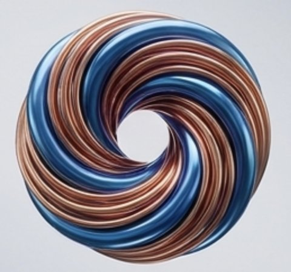</a> | **9a619a12615949ae26d80b2a688b6824db6d14e4.jpg** HsH · PUBLIC_SITE/generated/thumbnails/9a619a12615949ae26d80b2a688b6824db6d14e4.jpg 480×449 · landscape **suggest:** podcast_art, podcast, website_flavor family: near:000479 |
| <a href="https://raw.githubusercontent.com/Satobloc/HsH/main/PUBLIC_SITE/generated/thumbnails/9c9c4be1d813d65d59975688e73497440a02de9d.jpg">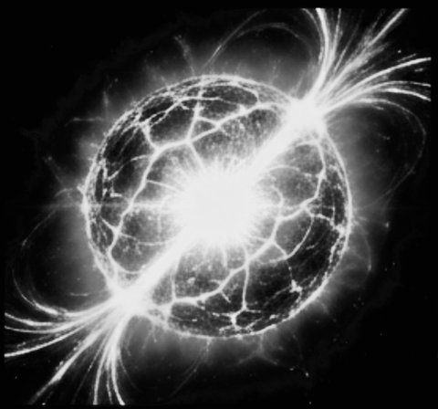</a> | **9c9c4be1d813d65d59975688e73497440a02de9d.jpg** HsH · PUBLIC_SITE/generated/thumbnails/9c9c4be1d813d65d59975688e73497440a02de9d.jpg 480×448 · landscape **suggest:** podcast_art, podcast, website_flavor family: near:000363 |
| <a href="https://raw.githubusercontent.com/Satobloc/HsH/main/PUBLIC_SITE/generated/thumbnails/9d0893ed0dc0de49aebb4f8f2b8c5cd1073f9f1b.jpg">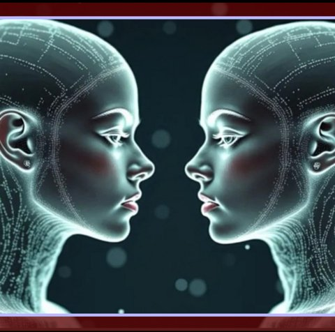</a> | **9d0893ed0dc0de49aebb4f8f2b8c5cd1073f9f1b.jpg** HsH · PUBLIC_SITE/generated/thumbnails/9d0893ed0dc0de49aebb4f8f2b8c5cd1073f9f1b.jpg 480×476 · square **suggest:** podcast_art, podcast, website_flavor family: near:000447 |
|  | **9d489816c53f898c98d5a4174b6d561490ac9622.jpg** HsH · PUBLIC_SITE/generated/thumbnails/9d489816c53f898c98d5a4174b6d561490ac9622.jpg 227×227 · square **suggest:** podcast_art, podcast, website_flavor family: near:000697 |
|  | **9d7aa1e20f7799612651b26cc4fe92de944ef3d6.jpg** HsH · PUBLIC_SITE/generated/thumbnails/9d7aa1e20f7799612651b26cc4fe92de944ef3d6.jpg 480×480 · square **suggest:** podcast_art, podcast, website_flavor family: near:000571 |
|  | **9dbbc7ac86d0846a9bb0b1b4bd3651a3f8ae8bac.jpg** HsH · PUBLIC_SITE/generated/thumbnails/9dbbc7ac86d0846a9bb0b1b4bd3651a3f8ae8bac.jpg 480×480 · square **suggest:** podcast_art, podcast, website_flavor family: near:000529 |
|  | **a0f3c63a57d77fc9ad6c8a78b4a1c5165646176f.jpg** HsH · PUBLIC_SITE/generated/thumbnails/a0f3c63a57d77fc9ad6c8a78b4a1c5165646176f.jpg 480×452 · landscape **suggest:** podcast_art, podcast, website_flavor family: near:000085 |
| <a href="https://raw.githubusercontent.com/Satobloc/HsH/main/PUBLIC_SITE/generated/thumbnails/a12cbe6437041e5c54ebc506a0d192cd4bb39b8d.jpg">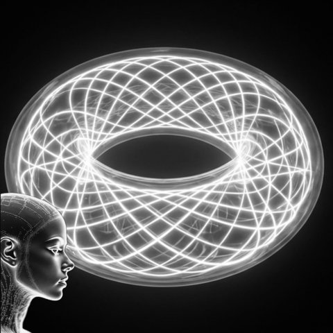</a> | **a12cbe6437041e5c54ebc506a0d192cd4bb39b8d.jpg** HsH · PUBLIC_SITE/generated/thumbnails/a12cbe6437041e5c54ebc506a0d192cd4bb39b8d.jpg 480×480 · square **suggest:** podcast_art, podcast, website_flavor family: near:000579 |
| <a href="https://raw.githubusercontent.com/Satobloc/HsH/main/PUBLIC_SITE/generated/thumbnails/a1324edd5ae2732cd5602101a3acdda2b584d32a.jpg">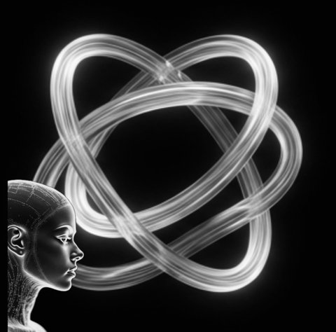</a> | **a1324edd5ae2732cd5602101a3acdda2b584d32a.jpg** HsH · PUBLIC_SITE/generated/thumbnails/a1324edd5ae2732cd5602101a3acdda2b584d32a.jpg 480×474 · square **suggest:** podcast_art, podcast, website_flavor family: near:000300 |
| <a href="https://raw.githubusercontent.com/Satobloc/HsH/main/PUBLIC_SITE/generated/thumbnails/a2bcd588d466d4a6ba938894c215e4a9b43ff7d5.jpg">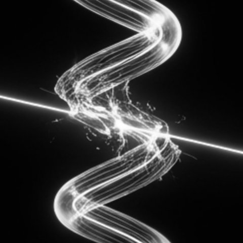</a> | **a2bcd588d466d4a6ba938894c215e4a9b43ff7d5.jpg** HsH · PUBLIC_SITE/generated/thumbnails/a2bcd588d466d4a6ba938894c215e4a9b43ff7d5.jpg 480×480 · square **suggest:** podcast_art, podcast, website_flavor family: near:000081 |
| <a href="https://raw.githubusercontent.com/Satobloc/HsH/main/PUBLIC_SITE/generated/thumbnails/a51abcc23f5d31e4b3b09e0a205e90441472aea9.jpg">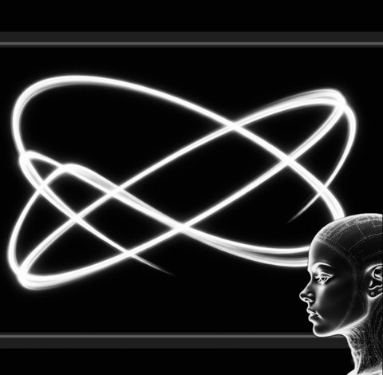</a> | **a51abcc23f5d31e4b3b09e0a205e90441472aea9.jpg** HsH · PUBLIC_SITE/generated/thumbnails/a51abcc23f5d31e4b3b09e0a205e90441472aea9.jpg 480×470 · square **suggest:** podcast_art, podcast, website_flavor family: near:000089 |
| <a href="https://raw.githubusercontent.com/Satobloc/HsH/main/PUBLIC_SITE/generated/thumbnails/a7970886941938269316e66fcd27a0f9037cd2d6.jpg">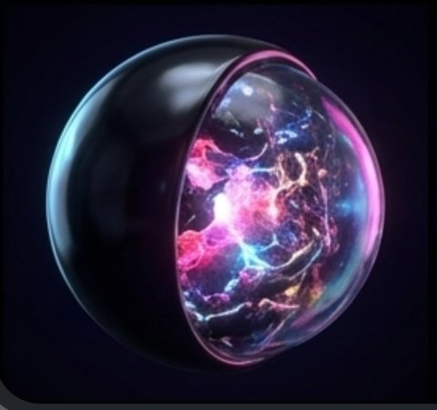</a> | **a7970886941938269316e66fcd27a0f9037cd2d6.jpg** HsH · PUBLIC_SITE/generated/thumbnails/a7970886941938269316e66fcd27a0f9037cd2d6.jpg 480×451 · landscape **suggest:** podcast_art, podcast, website_flavor family: near:000149 |
| <a href="https://raw.githubusercontent.com/Satobloc/HsH/main/PUBLIC_SITE/generated/thumbnails/a7d744c1ac447288d05c149c6e134ec582bbe084.jpg">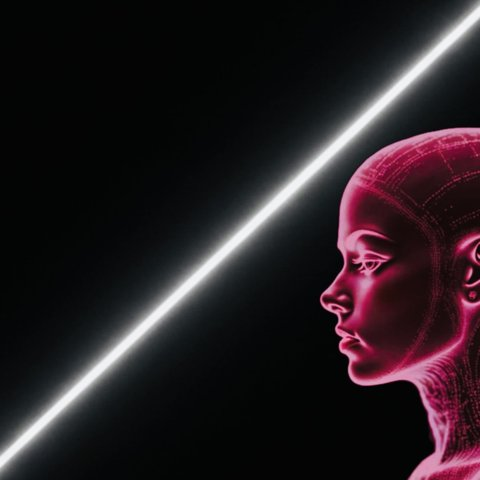</a> | **a7d744c1ac447288d05c149c6e134ec582bbe084.jpg** HsH · PUBLIC_SITE/generated/thumbnails/a7d744c1ac447288d05c149c6e134ec582bbe084.jpg 480×480 · square **suggest:** podcast_art, podcast, website_flavor family: near:000073 |
| <a href="https://raw.githubusercontent.com/Satobloc/HsH/main/PUBLIC_SITE/generated/thumbnails/a9526e6d0d89b1cee3f2b8ea95faec4b96765d6c.jpg">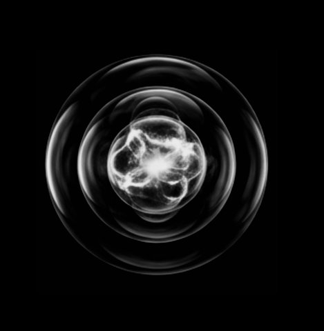</a> | **a9526e6d0d89b1cee3f2b8ea95faec4b96765d6c.jpg** HsH · PUBLIC_SITE/generated/thumbnails/a9526e6d0d89b1cee3f2b8ea95faec4b96765d6c.jpg 469×480 · square **suggest:** podcast_art, podcast, website_flavor family: near:000021 |
| <a href="https://raw.githubusercontent.com/Satobloc/HsH/main/PUBLIC_SITE/generated/thumbnails/a98ffc93b9e4253fb5f281c8ac0d30766218909a.jpg">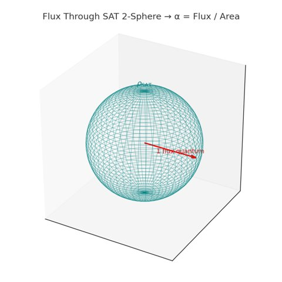</a> | **a98ffc93b9e4253fb5f281c8ac0d30766218909a.jpg** HsH · PUBLIC_SITE/generated/thumbnails/a98ffc93b9e4253fb5f281c8ac0d30766218909a.jpg 480×480 · square **suggest:** podcast_art, podcast, website_flavor family: near:000791 |
| <a href="https://raw.githubusercontent.com/Satobloc/HsH/main/PUBLIC_SITE/generated/thumbnails/aa892ffcf921a38a7572da76e35d1252a02ef027.jpg">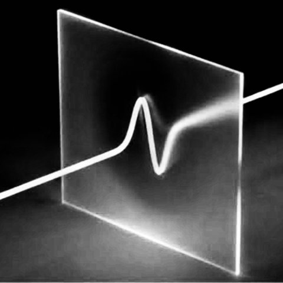</a> | **aa892ffcf921a38a7572da76e35d1252a02ef027.jpg** HsH · PUBLIC_SITE/generated/thumbnails/aa892ffcf921a38a7572da76e35d1252a02ef027.jpg 480×480 · square **suggest:** podcast_art, podcast, website_flavor family: near:000331 |
| <a href="https://raw.githubusercontent.com/Satobloc/HsH/main/PUBLIC_SITE/generated/thumbnails/ab16f7b90742e75087381dce7dc1e271fc270155.jpg">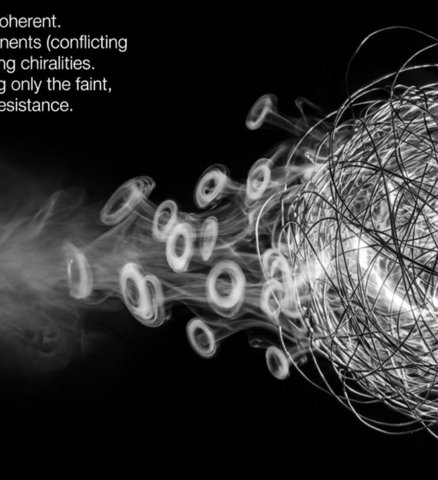</a> | **ab16f7b90742e75087381dce7dc1e271fc270155.jpg** HsH · PUBLIC_SITE/generated/thumbnails/ab16f7b90742e75087381dce7dc1e271fc270155.jpg 438×480 · portrait **suggest:** podcast_art, podcast, website_flavor family: near:000891 |
| <a href="https://raw.githubusercontent.com/Satobloc/HsH/main/PUBLIC_SITE/generated/thumbnails/ac463c373aeab93ebf0b6681e140338a75f979fc.jpg">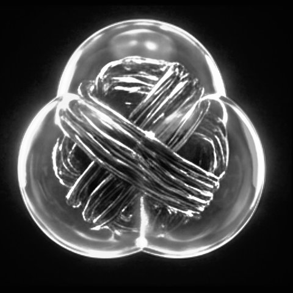</a> | **ac463c373aeab93ebf0b6681e140338a75f979fc.jpg** HsH · PUBLIC_SITE/generated/thumbnails/ac463c373aeab93ebf0b6681e140338a75f979fc.jpg 480×480 · square **suggest:** podcast_art, podcast, website_flavor family: near:000597 |
|  | **ac9b46b559abc862fc27ffa4cf1cfea5aea7bfc3.jpg** HsH · PUBLIC_SITE/generated/thumbnails/ac9b46b559abc862fc27ffa4cf1cfea5aea7bfc3.jpg 480×455 · landscape **suggest:** podcast_art, podcast, website_flavor family: near:000240 |
|  | **ac9c41b08682bc68c4f8d958f7765b127725734b.jpg** HsH · PUBLIC_SITE/generated/thumbnails/ac9c41b08682bc68c4f8d958f7765b127725734b.jpg 480×480 · square **suggest:** podcast_art, podcast, website_flavor family: near:000039 |
| <a href="https://raw.githubusercontent.com/Satobloc/HsH/main/PUBLIC_SITE/generated/thumbnails/ad87c01f0deab1a243c61c1323b1648bc1a2cfc5.jpg">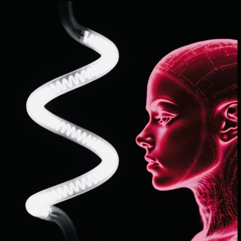</a> | **ad87c01f0deab1a243c61c1323b1648bc1a2cfc5.jpg** HsH · PUBLIC_SITE/generated/thumbnails/ad87c01f0deab1a243c61c1323b1648bc1a2cfc5.jpg 480×480 · square **suggest:** podcast_art, podcast, website_flavor family: near:000182 |
| <a href="https://raw.githubusercontent.com/Satobloc/HsH/main/PUBLIC_SITE/generated/thumbnails/ae4cf35ad1a328a841576c3d3e62d4fa0b23b84c.jpg">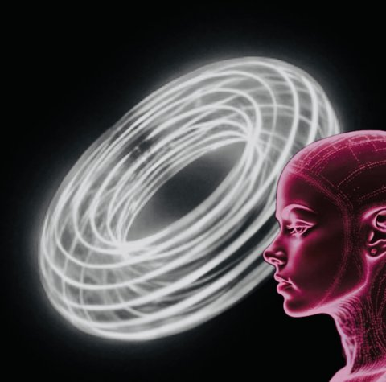</a> | **ae4cf35ad1a328a841576c3d3e62d4fa0b23b84c.jpg** HsH · PUBLIC_SITE/generated/thumbnails/ae4cf35ad1a328a841576c3d3e62d4fa0b23b84c.jpg 480×475 · square **suggest:** podcast_art, podcast, website_flavor family: near:000247 |
| <a href="https://raw.githubusercontent.com/Satobloc/HsH/main/PUBLIC_SITE/generated/thumbnails/ae8e87fcdd697f219ea10b040da498f9abe0808b.jpg">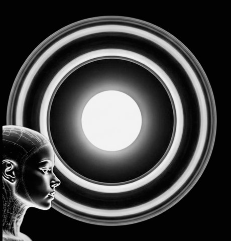</a> | **ae8e87fcdd697f219ea10b040da498f9abe0808b.jpg** HsH · PUBLIC_SITE/generated/thumbnails/ae8e87fcdd697f219ea10b040da498f9abe0808b.jpg 460×480 · portrait **suggest:** podcast_art, podcast, website_flavor family: near:000604 |
| <a href="https://raw.githubusercontent.com/Satobloc/HsH/main/PUBLIC_SITE/generated/thumbnails/af5fd225303a4dd6e5a8773d87051ba27965267e.jpg">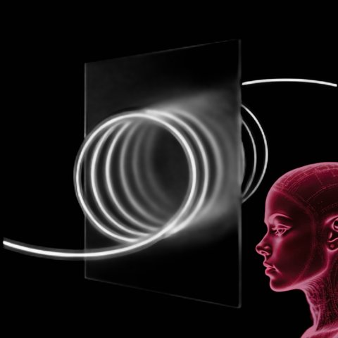</a> | **af5fd225303a4dd6e5a8773d87051ba27965267e.jpg** HsH · PUBLIC_SITE/generated/thumbnails/af5fd225303a4dd6e5a8773d87051ba27965267e.jpg 480×480 · square **suggest:** podcast_art, podcast, website_flavor family: near:000343 |
| <a href="https://raw.githubusercontent.com/Satobloc/HsH/main/PUBLIC_SITE/generated/thumbnails/b0e4d263efb9145a634642e4fccc46649185489c.jpg">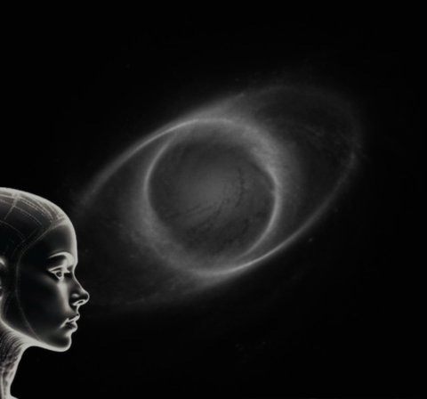</a> | **b0e4d263efb9145a634642e4fccc46649185489c.jpg** HsH · PUBLIC_SITE/generated/thumbnails/b0e4d263efb9145a634642e4fccc46649185489c.jpg 480×448 · landscape **suggest:** podcast_art, podcast, website_flavor family: near:000160 |
| <a href="https://raw.githubusercontent.com/Satobloc/HsH/main/PUBLIC_SITE/generated/thumbnails/b0e6f50f873120fabe167429e515d078a832153b.jpg">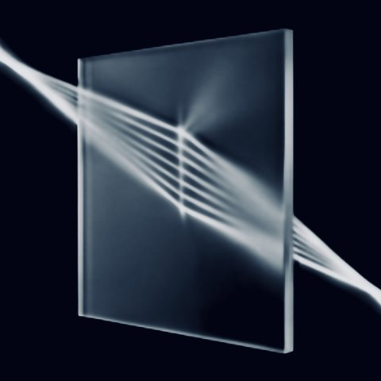</a> | **b0e6f50f873120fabe167429e515d078a832153b.jpg** HsH · PUBLIC_SITE/generated/thumbnails/b0e6f50f873120fabe167429e515d078a832153b.jpg 480×480 · square **suggest:** podcast_art, podcast, website_flavor family: near:000537 |
| <a href="https://raw.githubusercontent.com/Satobloc/HsH/main/PUBLIC_SITE/generated/thumbnails/b16f94189f3a01914c999aaab698cebbebb287f1.jpg">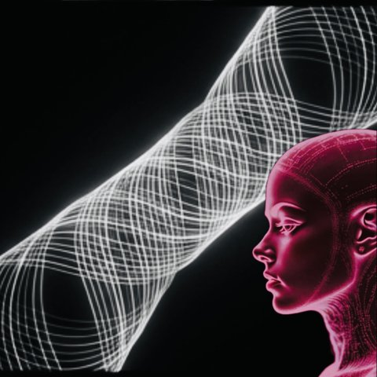</a> | **b16f94189f3a01914c999aaab698cebbebb287f1.jpg** HsH · PUBLIC_SITE/generated/thumbnails/b16f94189f3a01914c999aaab698cebbebb287f1.jpg 480×480 · square **suggest:** podcast_art, podcast, website_flavor family: near:000170 |
| <a href="https://raw.githubusercontent.com/Satobloc/HsH/main/PUBLIC_SITE/generated/thumbnails/b1971836daf69a949be2f062c2436998498d3bbe.jpg">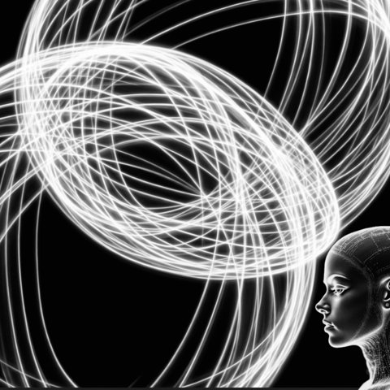</a> | **b1971836daf69a949be2f062c2436998498d3bbe.jpg** HsH · PUBLIC_SITE/generated/thumbnails/b1971836daf69a949be2f062c2436998498d3bbe.jpg 480×480 · square **suggest:** podcast_art, podcast, website_flavor family: near:000498 |
|  | **b197f9a40e743754973ad404d95963efd0404575.jpg** HsH · PUBLIC_SITE/generated/thumbnails/b197f9a40e743754973ad404d95963efd0404575.jpg 480×480 · square **suggest:** podcast_art, podcast, website_flavor family: near:000618 |
| <a href="https://raw.githubusercontent.com/Satobloc/HsH/main/PUBLIC_SITE/generated/thumbnails/b1a22268de7c90cb6e2837ed1b418db9e39aa364.jpg">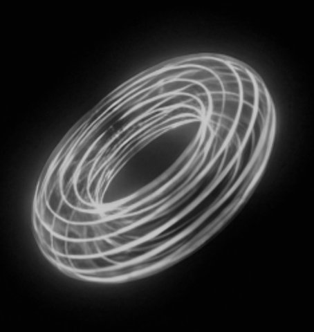</a> | **b1a22268de7c90cb6e2837ed1b418db9e39aa364.jpg** HsH · PUBLIC_SITE/generated/thumbnails/b1a22268de7c90cb6e2837ed1b418db9e39aa364.jpg 454×480 · portrait **suggest:** podcast_art, podcast, website_flavor family: near:000082 |
| <a href="https://raw.githubusercontent.com/Satobloc/HsH/main/PUBLIC_SITE/generated/thumbnails/b23eeaa55fef184d16a9f895e24466a7f24f6094.jpg">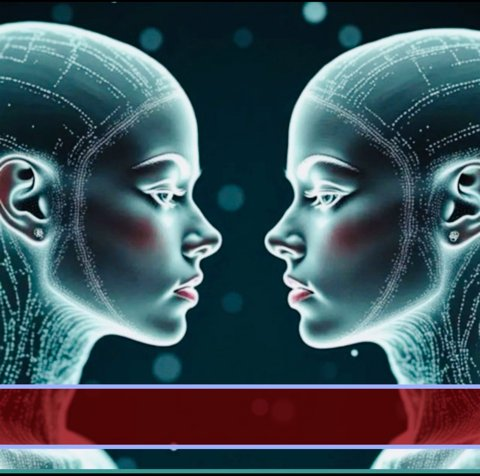</a> | **b23eeaa55fef184d16a9f895e24466a7f24f6094.jpg** HsH · PUBLIC_SITE/generated/thumbnails/b23eeaa55fef184d16a9f895e24466a7f24f6094.jpg 480×476 · square **suggest:** podcast_art, podcast, website_flavor family: near:000879 |
| <a href="https://raw.githubusercontent.com/Satobloc/HsH/main/PUBLIC_SITE/generated/thumbnails/b31b4def0a95563c74fd05c95583a333c6773785.jpg">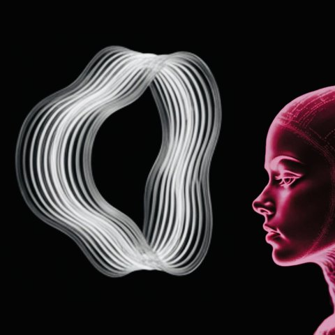</a> | **b31b4def0a95563c74fd05c95583a333c6773785.jpg** HsH · PUBLIC_SITE/generated/thumbnails/b31b4def0a95563c74fd05c95583a333c6773785.jpg 480×480 · square **suggest:** podcast_art, podcast, website_flavor family: near:000856 |
| <a href="https://raw.githubusercontent.com/Satobloc/HsH/main/PUBLIC_SITE/generated/thumbnails/b4525fbbabcde5472d985751595c60f474bf887d.jpg">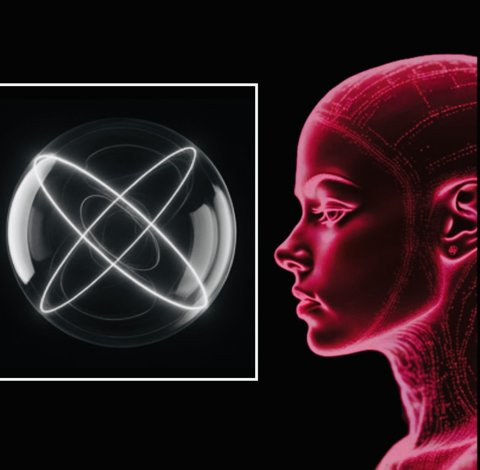</a> | **b4525fbbabcde5472d985751595c60f474bf887d.jpg** HsH · PUBLIC_SITE/generated/thumbnails/b4525fbbabcde5472d985751595c60f474bf887d.jpg 480×470 · square **suggest:** podcast_art, podcast, website_flavor family: near:000108 |
| <a href="https://raw.githubusercontent.com/Satobloc/HsH/main/PUBLIC_SITE/generated/thumbnails/b563164ade330c219a8f513cf8ec9d40839823a4.jpg">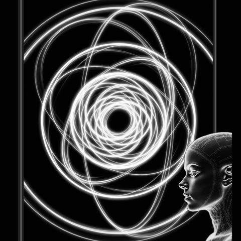</a> | **b563164ade330c219a8f513cf8ec9d40839823a4.jpg** HsH · PUBLIC_SITE/generated/thumbnails/b563164ade330c219a8f513cf8ec9d40839823a4.jpg 480×480 · square **suggest:** podcast_art, podcast, website_flavor family: near:000155 |
| <a href="https://raw.githubusercontent.com/Satobloc/HsH/main/PUBLIC_SITE/generated/thumbnails/b582e7598c6c42b966d2d22c210e65725c6cd62a.jpg">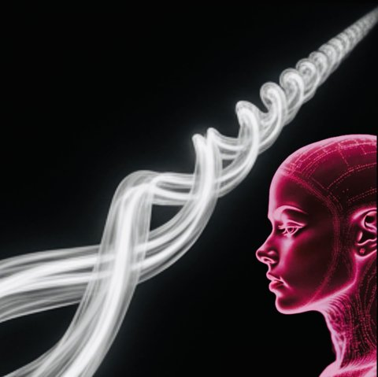</a> | **b582e7598c6c42b966d2d22c210e65725c6cd62a.jpg** HsH · PUBLIC_SITE/generated/thumbnails/b582e7598c6c42b966d2d22c210e65725c6cd62a.jpg 480×479 · square **suggest:** podcast_art, podcast, website_flavor family: near:000074 |
|  | **b5c70d658e0a384759ee68995353b7b8aa8001b1.jpg** HsH · PUBLIC_SITE/generated/thumbnails/b5c70d658e0a384759ee68995353b7b8aa8001b1.jpg 480×473 · square **suggest:** podcast_art, podcast, website_flavor family: near:000898 |
| <a href="https://raw.githubusercontent.com/Satobloc/HsH/main/PUBLIC_SITE/generated/thumbnails/b5e676a4ff11e03801820996ba237d53d8d6c16e.jpg">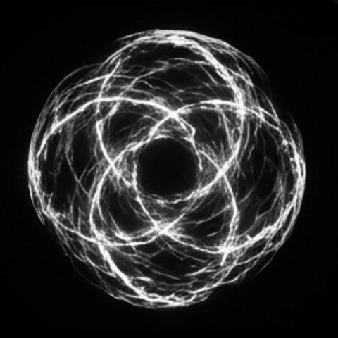</a> | **b5e676a4ff11e03801820996ba237d53d8d6c16e.jpg** HsH · PUBLIC_SITE/generated/thumbnails/b5e676a4ff11e03801820996ba237d53d8d6c16e.jpg 480×480 · square **suggest:** podcast_art, podcast, website_flavor family: near:000376 |
| <a href="https://raw.githubusercontent.com/Satobloc/HsH/main/PUBLIC_SITE/generated/thumbnails/b5fe9edd5d756761c971669e96c826640100cf2b.jpg">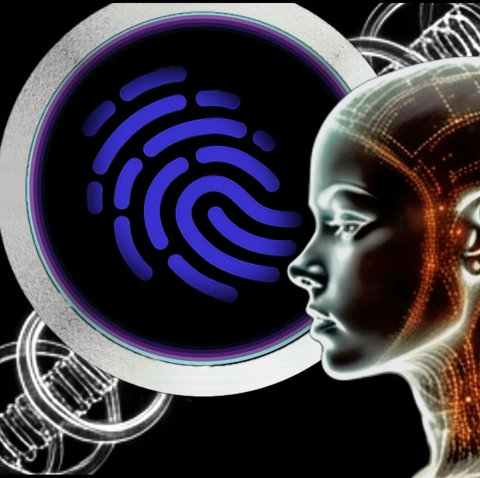</a> | **b5fe9edd5d756761c971669e96c826640100cf2b.jpg** HsH · PUBLIC_SITE/generated/thumbnails/b5fe9edd5d756761c971669e96c826640100cf2b.jpg 480×478 · square **suggest:** podcast_art, podcast, website_flavor family: near:000437 |
| <a href="https://raw.githubusercontent.com/Satobloc/HsH/main/PUBLIC_SITE/generated/thumbnails/b78a7c267397233daf74a4628f6894f60ccccd3d.jpg">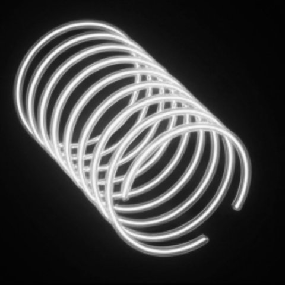</a> | **b78a7c267397233daf74a4628f6894f60ccccd3d.jpg** HsH · PUBLIC_SITE/generated/thumbnails/b78a7c267397233daf74a4628f6894f60ccccd3d.jpg 480×480 · square **suggest:** podcast_art, podcast, website_flavor family: near:000322 |
| <a href="https://raw.githubusercontent.com/Satobloc/HsH/main/PUBLIC_SITE/generated/thumbnails/b7ad035a6ab9875ad14c23d370949b0d7376ec64.jpg">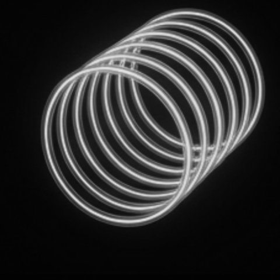</a> | **b7ad035a6ab9875ad14c23d370949b0d7376ec64.jpg** HsH · PUBLIC_SITE/generated/thumbnails/b7ad035a6ab9875ad14c23d370949b0d7376ec64.jpg 480×480 · square **suggest:** podcast_art, podcast, website_flavor family: near:000091 |
| <a href="https://raw.githubusercontent.com/Satobloc/HsH/main/PUBLIC_SITE/generated/thumbnails/b7bd166636284e351ddb62927b372c07b5b7b70b.jpg">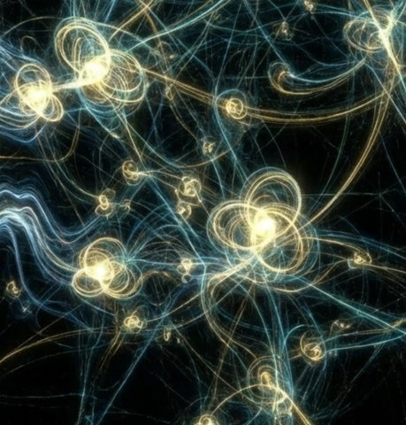</a> | **b7bd166636284e351ddb62927b372c07b5b7b70b.jpg** HsH · PUBLIC_SITE/generated/thumbnails/b7bd166636284e351ddb62927b372c07b5b7b70b.jpg 459×480 · portrait **suggest:** podcast_art, podcast, website_flavor family: near:000330 |
|  | **b8d148262de503e97d5af7bfa77f9546d170b7cc.jpg** HsH · PUBLIC_SITE/generated/thumbnails/b8d148262de503e97d5af7bfa77f9546d170b7cc.jpg 480×480 · square **suggest:** podcast_art, podcast, website_flavor family: near:000428 |
|  | **b8e3d58b4573bea815c9e3700b9c80a2d9ce9687.jpg** HsH · PUBLIC_SITE/generated/thumbnails/b8e3d58b4573bea815c9e3700b9c80a2d9ce9687.jpg 480×472 · square **suggest:** podcast_art, podcast, website_flavor family: near:000372 |
|  | **ba5c0ec9ad4ffbd32c8851bbbfc79928eb470ca7.jpg** HsH · PUBLIC_SITE/generated/thumbnails/ba5c0ec9ad4ffbd32c8851bbbfc79928eb470ca7.jpg 480×477 · square **suggest:** podcast_art, podcast, website_flavor family: near:000581 |
|  | **bbef09ec7a67a5e7ee2514c7804be96b41e14292.jpg** HsH · PUBLIC_SITE/generated/thumbnails/bbef09ec7a67a5e7ee2514c7804be96b41e14292.jpg 480×480 · square **suggest:** podcast_art, podcast, website_flavor family: near:000599 |
|  | **bc3f26f8f562505636886f0db1f6cd66834207ac.jpg** HsH · PUBLIC_SITE/generated/thumbnails/bc3f26f8f562505636886f0db1f6cd66834207ac.jpg 480×480 · square **suggest:** podcast_art, podcast, website_flavor family: near:000112 |
|  | **bdab7203c74c4fc57ff702cf1d73ab41f5ed62ff.jpg** HsH · PUBLIC_SITE/generated/thumbnails/bdab7203c74c4fc57ff702cf1d73ab41f5ed62ff.jpg 480×446 · landscape **suggest:** podcast_art, podcast, website_flavor family: near:000523 |
|  | **be2447ff626e4e8901840365d31444a237d6dee3.jpg** HsH · PUBLIC_SITE/generated/thumbnails/be2447ff626e4e8901840365d31444a237d6dee3.jpg 480×450 · landscape **suggest:** podcast_art, podcast, website_flavor family: near:000059 |
|  | **be6b45477ae133c41903188615c1a6b89e5d5b5d.jpg** HsH · PUBLIC_SITE/generated/thumbnails/be6b45477ae133c41903188615c1a6b89e5d5b5d.jpg 476×480 · square **suggest:** podcast_art, podcast, website_flavor family: near:000955 |
|  | **bed4f06ceb7662e5614605070e577d0681147830.jpg** HsH · PUBLIC_SITE/generated/thumbnails/bed4f06ceb7662e5614605070e577d0681147830.jpg 480×446 · landscape **suggest:** podcast_art, podcast, website_flavor family: near:000099 |
|  | **bf19743a10191cb52170cf69a4bf7330f8da90e8.jpg** HsH · PUBLIC_SITE/generated/thumbnails/bf19743a10191cb52170cf69a4bf7330f8da90e8.jpg 480×480 · square **suggest:** podcast_art, podcast, website_flavor family: near:000332 |
|  | **bf46cfbdcfd877af405a2bac0167394254ee5138.jpg** HsH · PUBLIC_SITE/generated/thumbnails/bf46cfbdcfd877af405a2bac0167394254ee5138.jpg 478×480 · square **suggest:** podcast_art, podcast, website_flavor family: near:000355 |
|  | **bfce1bf173f0917e7dfa2117ac7420fa68811a14.jpg** HsH · PUBLIC_SITE/generated/thumbnails/bfce1bf173f0917e7dfa2117ac7420fa68811a14.jpg 480×480 · square **suggest:** podcast_art, podcast, website_flavor family: near:000271 |
|  | **c021de3043208916dd22919cbf17fc02023a5393.jpg** HsH · PUBLIC_SITE/generated/thumbnails/c021de3043208916dd22919cbf17fc02023a5393.jpg 480×480 · square **suggest:** podcast_art, podcast, website_flavor family: near:000447 |
|  | **c045bc59517613a3e46b8fe1ca523213cfb3ee39.jpg** HsH · PUBLIC_SITE/generated/thumbnails/c045bc59517613a3e46b8fe1ca523213cfb3ee39.jpg 480×469 · square **suggest:** podcast_art, podcast, website_flavor family: near:000293 |
|  | **c087088c6bdfa2c6d14fa94d506fd75adb8c95a5.jpg** HsH · PUBLIC_SITE/generated/thumbnails/c087088c6bdfa2c6d14fa94d506fd75adb8c95a5.jpg 480×480 · square **suggest:** podcast_art, podcast, website_flavor family: near:000333 |
|  | **c157f9ac5557df653b3140c54f0e55bd52960e07.jpg** HsH · PUBLIC_SITE/generated/thumbnails/c157f9ac5557df653b3140c54f0e55bd52960e07.jpg 480×480 · square **suggest:** podcast_art, podcast, website_flavor family: near:000954 |
|  | **c163d88b619aca24612ed2e8c2060a6a402ddccf.jpg** HsH · PUBLIC_SITE/generated/thumbnails/c163d88b619aca24612ed2e8c2060a6a402ddccf.jpg 480×456 · landscape **suggest:** podcast_art, podcast, website_flavor family: near:000585 |
|  | **c26cafc0c33e7b8d8ffbaa5bd13bed8641d7c721.jpg** HsH · PUBLIC_SITE/generated/thumbnails/c26cafc0c33e7b8d8ffbaa5bd13bed8641d7c721.jpg 480×465 · square **suggest:** podcast_art, podcast, website_flavor family: near:000234 |
|  | **c2f5066a23e6f64d77053e0cf4a4756d9d34b89b.jpg** HsH · PUBLIC_SITE/generated/thumbnails/c2f5066a23e6f64d77053e0cf4a4756d9d34b89b.jpg 480×480 · square **suggest:** podcast_art, podcast, website_flavor family: near:000879 |
|  | **c3e232d9fe65ea74b6c3fcda7a6f55c7ea4cb9a1.jpg** HsH · PUBLIC_SITE/generated/thumbnails/c3e232d9fe65ea74b6c3fcda7a6f55c7ea4cb9a1.jpg 480×457 · landscape **suggest:** podcast_art, podcast, website_flavor family: near:000334 |
|  | **c40920d9898e22ed42750050317875ab16cca1d6.jpg** HsH · PUBLIC_SITE/generated/thumbnails/c40920d9898e22ed42750050317875ab16cca1d6.jpg 477×480 · square **suggest:** podcast_art, podcast, website_flavor family: near:000437 |
|  | **c4ccdfb523263dbd92c2eee19fcc1f5d5b896942.jpg** HsH · PUBLIC_SITE/generated/thumbnails/c4ccdfb523263dbd92c2eee19fcc1f5d5b896942.jpg 480×480 · square **suggest:** podcast_art, podcast, website_flavor family: near:000289 |
|  | **c51ae06fcae0bc92b2ab27c0ea36097ca6006585.jpg** HsH · PUBLIC_SITE/generated/thumbnails/c51ae06fcae0bc92b2ab27c0ea36097ca6006585.jpg 480×480 · square **suggest:** podcast_art, podcast, website_flavor family: near:000338 |
|  | **c8201b515483af5f0710c8f188c85e546d7577c6.jpg** HsH · PUBLIC_SITE/generated/thumbnails/c8201b515483af5f0710c8f188c85e546d7577c6.jpg 480×480 · square **suggest:** podcast_art, podcast, website_flavor family: near:000481 |
|  | **c82717872248c6f10491a47c02ac01f723c5f29c.jpg** HsH · PUBLIC_SITE/generated/thumbnails/c82717872248c6f10491a47c02ac01f723c5f29c.jpg 480×457 · landscape **suggest:** podcast_art, podcast, website_flavor family: near:000917 |
|  | **c8bcc14e8680b4ca0a84e12abc6efa93cf5a0f8b.jpg** HsH · PUBLIC_SITE/generated/thumbnails/c8bcc14e8680b4ca0a84e12abc6efa93cf5a0f8b.jpg 445×480 · portrait **suggest:** podcast_art, podcast, website_flavor family: near:000028 |
|  | **c8c8a28d30c920ecd5c3f9ccc96f0a91555333de.jpg** HsH · PUBLIC_SITE/generated/thumbnails/c8c8a28d30c920ecd5c3f9ccc96f0a91555333de.jpg 479×480 · square **suggest:** podcast_art, podcast, website_flavor family: near:000169 |
|  | **c9091b7cd5d2152b29cb65694ff03a20fc43792e.jpg** HsH · PUBLIC_SITE/generated/thumbnails/c9091b7cd5d2152b29cb65694ff03a20fc43792e.jpg 480×474 · square **suggest:** podcast_art, podcast, website_flavor family: near:000439 |
|  | **c912545962b1b9354da02d5b46561407e796fede.jpg** HsH · PUBLIC_SITE/generated/thumbnails/c912545962b1b9354da02d5b46561407e796fede.jpg 480×480 · square **suggest:** podcast_art, podcast, website_flavor family: near:000448 |
|  | **cb4b3a9ed1ef11e2144c060b3a1fdb379fba4c01.jpg** HsH · PUBLIC_SITE/generated/thumbnails/cb4b3a9ed1ef11e2144c060b3a1fdb379fba4c01.jpg 480×480 · square **suggest:** podcast_art, podcast, website_flavor family: near:000017 |
|  | **cb4c1efb5c96a2df6e5932fec6aa6700839d1089.jpg** HsH · PUBLIC_SITE/generated/thumbnails/cb4c1efb5c96a2df6e5932fec6aa6700839d1089.jpg 480×459 · landscape **suggest:** podcast_art, podcast, website_flavor family: near:000320 |
|  | **cc6a8e6261a9531c7809572527eed4bf38bf662f.jpg** HsH · PUBLIC_SITE/generated/thumbnails/cc6a8e6261a9531c7809572527eed4bf38bf662f.jpg 480×470 · square **suggest:** podcast_art, podcast, website_flavor family: near:000042 |
|  | **ccf4c11bf59eb0bd2dc406541fb46003e2d7750a.jpg** HsH · PUBLIC_SITE/generated/thumbnails/ccf4c11bf59eb0bd2dc406541fb46003e2d7750a.jpg 440×480 · portrait **suggest:** podcast_art, podcast, website_flavor family: near:000076 |
|  | **cd8a7a6687b289d285d2c7e45a61b515da307b0b.jpg** HsH · PUBLIC_SITE/generated/thumbnails/cd8a7a6687b289d285d2c7e45a61b515da307b0b.jpg 465×480 · square **suggest:** podcast_art, podcast, website_flavor family: near:000726 |
|  | **cd99a6fca5d62e2b8e4076f889204f7b8f754887.jpg** HsH · PUBLIC_SITE/generated/thumbnails/cd99a6fca5d62e2b8e4076f889204f7b8f754887.jpg 480×480 · square **suggest:** podcast_art, podcast, website_flavor family: near:000957 |
|  | **ce4b7e73aebc1a8e7116868c8854260ed8e0199c.jpg** HsH · PUBLIC_SITE/generated/thumbnails/ce4b7e73aebc1a8e7116868c8854260ed8e0199c.jpg 476×480 · square **suggest:** podcast_art, podcast, website_flavor family: near:000221 |
|  | **ce57966c15cc1c94080be3a39699c120eabc23a0.jpg** HsH · PUBLIC_SITE/generated/thumbnails/ce57966c15cc1c94080be3a39699c120eabc23a0.jpg 473×480 · square **suggest:** podcast_art, podcast, website_flavor family: near:000902 |
|  | **ce5a0cd479444920835f3346cf977a6ca68c8bd1.jpg** HsH · PUBLIC_SITE/generated/thumbnails/ce5a0cd479444920835f3346cf977a6ca68c8bd1.jpg 480×480 · square **suggest:** podcast_art, podcast, website_flavor family: near:000517 |
|  | **ceb398bf6922f081616102f35b67998d32b5572c.jpg** HsH · PUBLIC_SITE/generated/thumbnails/ceb398bf6922f081616102f35b67998d32b5572c.jpg 480×480 · square **suggest:** podcast_art, podcast, website_flavor family: near:000131 |
|  | **d1a0ac8907ef61f552d9c9d17b53efd61f69adf0.jpg** HsH · PUBLIC_SITE/generated/thumbnails/d1a0ac8907ef61f552d9c9d17b53efd61f69adf0.jpg 480×471 · square **suggest:** podcast_art, podcast, website_flavor family: near:000390 |
|  | **d1caba2401f16758a34281a99a5db51a9a6b7a23.jpg** HsH · PUBLIC_SITE/generated/thumbnails/d1caba2401f16758a34281a99a5db51a9a6b7a23.jpg 480×480 · square **suggest:** podcast_art, podcast, website_flavor family: near:000594 |
|  | **d2716d54bf2300706a416cb0112150dd291802d9.jpg** HsH · PUBLIC_SITE/generated/thumbnails/d2716d54bf2300706a416cb0112150dd291802d9.jpg 480×480 · square **suggest:** podcast_art, podcast, website_flavor family: near:000326 |
|  | **d318ce15d8886cbc52cb40c3a0881d3f96d8829a.jpg** HsH · PUBLIC_SITE/generated/thumbnails/d318ce15d8886cbc52cb40c3a0881d3f96d8829a.jpg 480×480 · square **suggest:** podcast_art, podcast, website_flavor family: near:000075 |
|  | **d3592d35d0e0d3ca80456fca2ac2f913323b4294.jpg** HsH · PUBLIC_SITE/generated/thumbnails/d3592d35d0e0d3ca80456fca2ac2f913323b4294.jpg 468×480 · square **suggest:** podcast_art, podcast, website_flavor family: near:000090 |
|  | **d3b4ddbacf8a465e7d97a155a603ffdbe9e051d8.jpg** HsH · PUBLIC_SITE/generated/thumbnails/d3b4ddbacf8a465e7d97a155a603ffdbe9e051d8.jpg 480×480 · square **suggest:** podcast_art, podcast, website_flavor family: near:000616 |
|  | **d53958d266676c7562a7f510ef45c468fb283331.jpg** HsH · PUBLIC_SITE/generated/thumbnails/d53958d266676c7562a7f510ef45c468fb283331.jpg 476×480 · square **suggest:** podcast_art, podcast, website_flavor family: near:000437 |
|  | **d5751ab212041e8c89ffe07b8900a6ad63b8dc45.jpg** HsH · PUBLIC_SITE/generated/thumbnails/d5751ab212041e8c89ffe07b8900a6ad63b8dc45.jpg 480×480 · square **suggest:** podcast_art, podcast, website_flavor family: near:000559 |
|  | **d59963423c6be9ea64f49934719985ed1edd8fd5.jpg** HsH · PUBLIC_SITE/generated/thumbnails/d59963423c6be9ea64f49934719985ed1edd8fd5.jpg 480×480 · square **suggest:** podcast_art, podcast, website_flavor family: near:000633 |
|  | **d6276cf54b9e05363de511102bf50721ccfca6db.jpg** HsH · PUBLIC_SITE/generated/thumbnails/d6276cf54b9e05363de511102bf50721ccfca6db.jpg 480×438 · landscape **suggest:** podcast_art, podcast, website_flavor family: near:000805 |
|  | **d678f31c9d7998e92bc8b604ea34b1be166d0ac2.jpg** HsH · PUBLIC_SITE/generated/thumbnails/d678f31c9d7998e92bc8b604ea34b1be166d0ac2.jpg 455×480 · portrait **suggest:** podcast_art, podcast, website_flavor family: near:000845 |
|  | **d773c342869c85d01ee99c72ad32508a8441276b.jpg** HsH · PUBLIC_SITE/generated/thumbnails/d773c342869c85d01ee99c72ad32508a8441276b.jpg 480×480 · square **suggest:** podcast_art, podcast, website_flavor family: near:000817 |
|  | **d783332662c3fd1c7b2f69b75b54884ea8ef87b2.jpg** HsH · PUBLIC_SITE/generated/thumbnails/d783332662c3fd1c7b2f69b75b54884ea8ef87b2.jpg 480×480 · square **suggest:** podcast_art, podcast, website_flavor family: near:000700 |
|  | **d784ff5955b713d35ec407f24cd67e4a26342a66.jpg** HsH · PUBLIC_SITE/generated/thumbnails/d784ff5955b713d35ec407f24cd67e4a26342a66.jpg 476×480 · square **suggest:** podcast_art, podcast, website_flavor family: near:000342 |
|  | **d7e8f76264bc2b17607195ae81484b2661bccc61.jpg** HsH · PUBLIC_SITE/generated/thumbnails/d7e8f76264bc2b17607195ae81484b2661bccc61.jpg 480×442 · landscape **suggest:** podcast_art, podcast, website_flavor family: near:000458 |
|  | **d9b6e0c34165bc731571dcaf96f96527330b55f5.jpg** HsH · PUBLIC_SITE/generated/thumbnails/d9b6e0c34165bc731571dcaf96f96527330b55f5.jpg 480×480 · square **suggest:** podcast_art, podcast, website_flavor family: near:000327 |
|  | **da05f98742b666425fa1197392fb152182947dda.jpg** HsH · PUBLIC_SITE/generated/thumbnails/da05f98742b666425fa1197392fb152182947dda.jpg 459×480 · portrait **suggest:** podcast_art, podcast, website_flavor family: near:000845 |
|  | **da0f4ff11a6c1d1d25c03c6f2d1acd4b3492a838.jpg** HsH · PUBLIC_SITE/generated/thumbnails/da0f4ff11a6c1d1d25c03c6f2d1acd4b3492a838.jpg 446×480 · portrait **suggest:** podcast_art, podcast, website_flavor family: near:000176 |
|  | **da1e3e7f0167e76713c315474798bd2b171370c4.jpg** HsH · PUBLIC_SITE/generated/thumbnails/da1e3e7f0167e76713c315474798bd2b171370c4.jpg 480×480 · square **suggest:** podcast_art, podcast, website_flavor family: near:000198 |
|  | **dbbba0e72d557ee82acf9e032b6b255f29902c3d.jpg** HsH · PUBLIC_SITE/generated/thumbnails/dbbba0e72d557ee82acf9e032b6b255f29902c3d.jpg 480×480 · square **suggest:** podcast_art, podcast, website_flavor family: near:000584 |
|  | **dbd75b6c5c887d365308a3352b04adee3a4c735e.jpg** HsH · PUBLIC_SITE/generated/thumbnails/dbd75b6c5c887d365308a3352b04adee3a4c735e.jpg 480×444 · landscape **suggest:** podcast_art, podcast, website_flavor family: near:000393 |
|  | **dd00616351a002a7ac94831debd5a0756fe1313c.jpg** HsH · PUBLIC_SITE/generated/thumbnails/dd00616351a002a7ac94831debd5a0756fe1313c.jpg 480×480 · square **suggest:** podcast_art, podcast, website_flavor family: near:000757 |
|  | **defb80caa430819732e9b9759129efe131634224.jpg** HsH · PUBLIC_SITE/generated/thumbnails/defb80caa430819732e9b9759129efe131634224.jpg 480×468 · square **suggest:** podcast_art, podcast, website_flavor family: near:000607 |
|  | **e029746a585ef56758ac1f00173a93c9721740eb.jpg** HsH · PUBLIC_SITE/generated/thumbnails/e029746a585ef56758ac1f00173a93c9721740eb.jpg 470×480 · square **suggest:** podcast_art, podcast, website_flavor family: near:000944 |
|  | **e1fc0844470a79e9d82ff4285028679c65dcbe36.jpg** HsH · PUBLIC_SITE/generated/thumbnails/e1fc0844470a79e9d82ff4285028679c65dcbe36.jpg 479×480 · square **suggest:** podcast_art, podcast, website_flavor family: near:000770 |
|  | **e2552323486d9c776102ef79e0108b0ccf455193.jpg** HsH · PUBLIC_SITE/generated/thumbnails/e2552323486d9c776102ef79e0108b0ccf455193.jpg 480×480 · square **suggest:** podcast_art, podcast, website_flavor family: near:000350 |
|  | **e48b38fe0f0bba5260dcbd90bf3dad8591e54757.jpg** HsH · PUBLIC_SITE/generated/thumbnails/e48b38fe0f0bba5260dcbd90bf3dad8591e54757.jpg 480×480 · square **suggest:** podcast_art, podcast, website_flavor family: near:000462 |
|  | **e549d7f219ce5c40e26adf6b0122aa6d6e5b20f0.jpg** HsH · PUBLIC_SITE/generated/thumbnails/e549d7f219ce5c40e26adf6b0122aa6d6e5b20f0.jpg 480×480 · square **suggest:** podcast_art, podcast, website_flavor family: near:000094 |
|  | **e64ae1e1ec25a780d2c5b4b8becf076457a82660.jpg** HsH · PUBLIC_SITE/generated/thumbnails/e64ae1e1ec25a780d2c5b4b8becf076457a82660.jpg 480×480 · square **suggest:** podcast_art, podcast, website_flavor family: near:000684 |
|  | **e6a0a1a3fdb21653ec8c7d6e5e871b7fd6ef9345.jpg** HsH · PUBLIC_SITE/generated/thumbnails/e6a0a1a3fdb21653ec8c7d6e5e871b7fd6ef9345.jpg 480×451 · landscape **suggest:** podcast_art, podcast, website_flavor family: near:000864 |
|  | **e6e30b70580cebc8f94c2bda029fd3230956ba7e.jpg** HsH · PUBLIC_SITE/generated/thumbnails/e6e30b70580cebc8f94c2bda029fd3230956ba7e.jpg 480×480 · square **suggest:** podcast_art, podcast, website_flavor family: near:000314 |
|  | **e806f8e5c3b644a94e18e243836b6b92087fd908.jpg** HsH · PUBLIC_SITE/generated/thumbnails/e806f8e5c3b644a94e18e243836b6b92087fd908.jpg 480×480 · square **suggest:** podcast_art, podcast, website_flavor family: near:000580 |
|  | **e89ccc91568dd94447aaa1c1377935d149ddce83.jpg** HsH · PUBLIC_SITE/generated/thumbnails/e89ccc91568dd94447aaa1c1377935d149ddce83.jpg 459×480 · portrait **suggest:** podcast_art, podcast, website_flavor family: near:000826 |
|  | **e8b34eb86a2363ee9e61aff6c9b73252c4fc6848.jpg** HsH · PUBLIC_SITE/generated/thumbnails/e8b34eb86a2363ee9e61aff6c9b73252c4fc6848.jpg 479×480 · square **suggest:** podcast_art, podcast, website_flavor family: near:000178 |
|  | **e8da23236548cdadb15f7f588f37d4171564acde.jpg** HsH · PUBLIC_SITE/generated/thumbnails/e8da23236548cdadb15f7f588f37d4171564acde.jpg 480×480 · square **suggest:** podcast_art, podcast, website_flavor family: near:000420 |
|  | **e98a6018047723447570ee803ba40812a59b8b70.jpg** HsH · PUBLIC_SITE/generated/thumbnails/e98a6018047723447570ee803ba40812a59b8b70.jpg 480×480 · square **suggest:** podcast_art, podcast, website_flavor family: near:000886 |
|  | **ea21d16636cdb9aa7865aff035f6f3d8a5684e97.jpg** HsH · PUBLIC_SITE/generated/thumbnails/ea21d16636cdb9aa7865aff035f6f3d8a5684e97.jpg 480×480 · square **suggest:** podcast_art, podcast, website_flavor family: near:000122 |
|  | **ea2a8cc5caae7139d8471c4a46fca631f57bca4f.jpg** HsH · PUBLIC_SITE/generated/thumbnails/ea2a8cc5caae7139d8471c4a46fca631f57bca4f.jpg 480×480 · square **suggest:** podcast_art, podcast, website_flavor family: near:000336 |
|  | **ea33c4bdb3a7661fc140b31a7e0230d1e2384d30.jpg** HsH · PUBLIC_SITE/generated/thumbnails/ea33c4bdb3a7661fc140b31a7e0230d1e2384d30.jpg 473×480 · square **suggest:** podcast_art, podcast, website_flavor family: near:000200 |
|  | **eb6932040da8858196e28f8a59b3b622108eb102.jpg** HsH · PUBLIC_SITE/generated/thumbnails/eb6932040da8858196e28f8a59b3b622108eb102.jpg 477×480 · square **suggest:** podcast_art, podcast, website_flavor family: near:000148 |
|  | **ec1517aba754a915624fee8052dccdd6c45001eb.jpg** HsH · PUBLIC_SITE/generated/thumbnails/ec1517aba754a915624fee8052dccdd6c45001eb.jpg 469×480 · square **suggest:** podcast_art, podcast, website_flavor family: near:000611 |
|  | **ec8a1e4f3be6fef7670b09f8efdb221e197744dc.jpg** HsH · PUBLIC_SITE/generated/thumbnails/ec8a1e4f3be6fef7670b09f8efdb221e197744dc.jpg 461×480 · square **suggest:** podcast_art, podcast, website_flavor family: near:000137 |
|  | **ecaa847a3401ab1aec383974fa3ceaf37e858f8c.jpg** HsH · PUBLIC_SITE/generated/thumbnails/ecaa847a3401ab1aec383974fa3ceaf37e858f8c.jpg 480×477 · square **suggest:** podcast_art, podcast, website_flavor family: near:000447 |
|  | **ed8e9850e9daa4a6be8528334ea219c858a1e107.jpg** HsH · PUBLIC_SITE/generated/thumbnails/ed8e9850e9daa4a6be8528334ea219c858a1e107.jpg 480×466 · square **suggest:** podcast_art, podcast, website_flavor family: near:000557 |
|  | **ed9e32452a7a83dd7e508c7767149b8b2a580496.jpg** HsH · PUBLIC_SITE/generated/thumbnails/ed9e32452a7a83dd7e508c7767149b8b2a580496.jpg 480×458 · landscape **suggest:** podcast_art, podcast, website_flavor family: near:000939 |
|  | **ee16f2ff6c8939a4a5fb7e006a124c6b01483d36.jpg** HsH · PUBLIC_SITE/generated/thumbnails/ee16f2ff6c8939a4a5fb7e006a124c6b01483d36.jpg 480×480 · square **suggest:** podcast_art, podcast, website_flavor family: near:000369 |
|  | **ef0d1812f55c9fe8329465f62ef683b0f02ebaa2.jpg** HsH · PUBLIC_SITE/generated/thumbnails/ef0d1812f55c9fe8329465f62ef683b0f02ebaa2.jpg 480×480 · square **suggest:** podcast_art, podcast, website_flavor family: near:000264 |
|  | **ef188374c2c9389bd49b0b01d790c4af74c17305.jpg** HsH · PUBLIC_SITE/generated/thumbnails/ef188374c2c9389bd49b0b01d790c4af74c17305.jpg 480×462 · square **suggest:** podcast_art, podcast, website_flavor family: near:000088 |
|  | **ef9c1bc0cc150b9096dd6c03cbc90aea91177f66.jpg** HsH · PUBLIC_SITE/generated/thumbnails/ef9c1bc0cc150b9096dd6c03cbc90aea91177f66.jpg 480×479 · square **suggest:** podcast_art, podcast, website_flavor family: near:000174 |
|  | **f02a7c3c8871bbb66968bd4ca6fb272275f7f876.jpg** HsH · PUBLIC_SITE/generated/thumbnails/f02a7c3c8871bbb66968bd4ca6fb272275f7f876.jpg 480×463 · square **suggest:** podcast_art, podcast, website_flavor family: near:000150 |
|  | **f035d8a3a528cde4b66a9fa9866ac1f74b5b6ebb.jpg** HsH · PUBLIC_SITE/generated/thumbnails/f035d8a3a528cde4b66a9fa9866ac1f74b5b6ebb.jpg 480×480 · square **suggest:** podcast_art, podcast, website_flavor family: near:000773 |
|  | **f0b2790d5a50c687c11dbb5c6b0100fa72c147e9.jpg** HsH · PUBLIC_SITE/generated/thumbnails/f0b2790d5a50c687c11dbb5c6b0100fa72c147e9.jpg 476×480 · square **suggest:** podcast_art, podcast, website_flavor family: near:000437 |
|  | **f44d3c9fa79de06858a6758f0410566786a8d37d.jpg** HsH · PUBLIC_SITE/generated/thumbnails/f44d3c9fa79de06858a6758f0410566786a8d37d.jpg 480×478 · square **suggest:** podcast_art, podcast, website_flavor family: near:000879 |
|  | **f5011eeee3a093b0c8f912900d0fc3934c65695a.jpg** HsH · PUBLIC_SITE/generated/thumbnails/f5011eeee3a093b0c8f912900d0fc3934c65695a.jpg 480×480 · square **suggest:** podcast_art, podcast, website_flavor family: near:000324 |
|  | **f513db853c45353d2045cbb9a5acfddcd96590cd.jpg** HsH · PUBLIC_SITE/generated/thumbnails/f513db853c45353d2045cbb9a5acfddcd96590cd.jpg 480×480 · square **suggest:** podcast_art, podcast, website_flavor family: near:000457 |
|  | **f5e4b36f8344c55a884155cddfa7c79425ab04ab.jpg** HsH · PUBLIC_SITE/generated/thumbnails/f5e4b36f8344c55a884155cddfa7c79425ab04ab.jpg 480×480 · square **suggest:** podcast_art, podcast, website_flavor family: near:000425 |
|  | **f64584d7acd80a9a83b97e8e7ce2b49d0bfe54d5.jpg** HsH · PUBLIC_SITE/generated/thumbnails/f64584d7acd80a9a83b97e8e7ce2b49d0bfe54d5.jpg 471×480 · square **suggest:** podcast_art, podcast, website_flavor family: near:000284 |
|  | **f7865b368ebb102234584c58fc40ab0fa36e5b53.jpg** HsH · PUBLIC_SITE/generated/thumbnails/f7865b368ebb102234584c58fc40ab0fa36e5b53.jpg 480×480 · square **suggest:** podcast_art, podcast, website_flavor family: near:000608 |
|  | **f7afae748138dbb2420fa5f77f6fb652c3212d9b.jpg** HsH · PUBLIC_SITE/generated/thumbnails/f7afae748138dbb2420fa5f77f6fb652c3212d9b.jpg 452×480 · portrait **suggest:** podcast_art, podcast, website_flavor family: near:000845 |
|  | **f7b0cda279bf7a89ca738dd47c0dcc61d0da2bbc.jpg** HsH · PUBLIC_SITE/generated/thumbnails/f7b0cda279bf7a89ca738dd47c0dcc61d0da2bbc.jpg 480×480 · square **suggest:** podcast_art, podcast, website_flavor family: near:000561 |
|  | **f80170d2d94180954bfce3baadf2e75ace29acf5.jpg** HsH · PUBLIC_SITE/generated/thumbnails/f80170d2d94180954bfce3baadf2e75ace29acf5.jpg 480×480 · square **suggest:** podcast_art, podcast, website_flavor family: near:000685 |
|  | **f81bb2c9412716b0a1e845a2347dee9f41a3654e.jpg** HsH · PUBLIC_SITE/generated/thumbnails/f81bb2c9412716b0a1e845a2347dee9f41a3654e.jpg 480×480 · square **suggest:** podcast_art, podcast, website_flavor family: near:000253 |
|  | **f8bb541fe4f02987ca978d6c180e0ab560cbbfd2.jpg** HsH · PUBLIC_SITE/generated/thumbnails/f8bb541fe4f02987ca978d6c180e0ab560cbbfd2.jpg 480×476 · square **suggest:** podcast_art, podcast, website_flavor family: near:000034 |
|  | **f9245a4dc8d054738fb35b9f1bead28dbcfffcc0.jpg** HsH · PUBLIC_SITE/generated/thumbnails/f9245a4dc8d054738fb35b9f1bead28dbcfffcc0.jpg 453×480 · portrait **suggest:** podcast_art, podcast, website_flavor family: near:000076 |
|  | **f96a0099ba42988ee0beb17c8cb315e4435196e9.jpg** HsH · PUBLIC_SITE/generated/thumbnails/f96a0099ba42988ee0beb17c8cb315e4435196e9.jpg 480×480 · square **suggest:** podcast_art, podcast, website_flavor family: near:000583 |
|  | **fb80aea8fe9befff5c6be7ee8773d44106d5f871.jpg** HsH · PUBLIC_SITE/generated/thumbnails/fb80aea8fe9befff5c6be7ee8773d44106d5f871.jpg 480×480 · square **suggest:** podcast_art, podcast, website_flavor family: near:000553 |
|  | **fc0e09e1b3759d35cf84263f35d2def70e2f6e55.jpg** HsH · PUBLIC_SITE/generated/thumbnails/fc0e09e1b3759d35cf84263f35d2def70e2f6e55.jpg 480×475 · square **suggest:** podcast_art, podcast, website_flavor family: near:000144 |
|  | **fc4fd93ec2cd7f345af61b10c07b055eed6fd6c5.jpg** HsH · PUBLIC_SITE/generated/thumbnails/fc4fd93ec2cd7f345af61b10c07b055eed6fd6c5.jpg 480×480 · square **suggest:** podcast_art, podcast, website_flavor family: near:000687 |
|  | **fcb3bf856b69c92ba2112e0ede12306c96a103e5.jpg** HsH · PUBLIC_SITE/generated/thumbnails/fcb3bf856b69c92ba2112e0ede12306c96a103e5.jpg 480×480 · square **suggest:** podcast_art, podcast, website_flavor family: near:000224 |
|  | **fce44b7a72f1d87501516c8ab48b3261ea3ea9aa.jpg** HsH · PUBLIC_SITE/generated/thumbnails/fce44b7a72f1d87501516c8ab48b3261ea3ea9aa.jpg 480×458 · landscape **suggest:** podcast_art, podcast, website_flavor family: near:000072 |
|  | **fcf0c9a9836c8dad24a18382d5557f2e158b7a0a.jpg** HsH · PUBLIC_SITE/generated/thumbnails/fcf0c9a9836c8dad24a18382d5557f2e158b7a0a.jpg 480×480 · square **suggest:** podcast_art, podcast, website_flavor family: near:000113 |
|  | **fd02500206bd82b49e407811c33b934402844b7f.jpg** HsH · PUBLIC_SITE/generated/thumbnails/fd02500206bd82b49e407811c33b934402844b7f.jpg 480×477 · square **suggest:** podcast_art, podcast, website_flavor family: near:000589 |
|  | **fd104ec4b568bda8ffa52e819b008b460a3ec373.jpg** HsH · PUBLIC_SITE/generated/thumbnails/fd104ec4b568bda8ffa52e819b008b460a3ec373.jpg 480×480 · square **suggest:** podcast_art, podcast, website_flavor family: near:000002 |
|  | **fd19d69d192188e029a5bce68e79009f664aae27.jpg** HsH · PUBLIC_SITE/generated/thumbnails/fd19d69d192188e029a5bce68e79009f664aae27.jpg 480×480 · square **suggest:** podcast_art, podcast, website_flavor family: near:000634 |
|  | **fd8e822d376f8f7461c8364fe4bd50bc5708e420.jpg** HsH · PUBLIC_SITE/generated/thumbnails/fd8e822d376f8f7461c8364fe4bd50bc5708e420.jpg 480×456 · landscape **suggest:** podcast_art, podcast, website_flavor family: near:000105 |
|  | **fe895909d5c8666f8ae13a0e44ff29987c40d7db.jpg** HsH · PUBLIC_SITE/generated/thumbnails/fe895909d5c8666f8ae13a0e44ff29987c40d7db.jpg 466×480 · square **suggest:** podcast_art, podcast, website_flavor family: near:000610 |
|  | **ff5f37906f75e43aacd3021c843510367a07fa6b.jpg** HsH · PUBLIC_SITE/generated/thumbnails/ff5f37906f75e43aacd3021c843510367a07fa6b.jpg 480×455 · landscape **suggest:** podcast_art, podcast, website_flavor family: near:000216 |
|  | **ffa0b2ad5ea111d0e24c205588658ae9d938fa60.jpg** HsH · PUBLIC_SITE/generated/thumbnails/ffa0b2ad5ea111d0e24c205588658ae9d938fa60.jpg 455×480 · portrait **suggest:** podcast_art, podcast, website_flavor family: near:000824 |
|  | **ffc3fff8c53b33db52a1ece7a7ce061f6fe8d84f.jpg** HsH · PUBLIC_SITE/generated/thumbnails/ffc3fff8c53b33db52a1ece7a7ce061f6fe8d84f.jpg 480×455 · landscape **suggest:** podcast_art, podcast, website_flavor family: near:000340 |

[← index](README.md) · [next →](page-005.md)
