# Visual Catalog — page 7/11

Images **1081–1260** of **1951** · [index](README.md)

| Thumbnail | File / metadata / current suggestions |
|---|---|
| <a href="https://raw.githubusercontent.com/Satobloc/HsH/main/SAT_VISUALS/Visuals_2/IMG_7088.jpeg">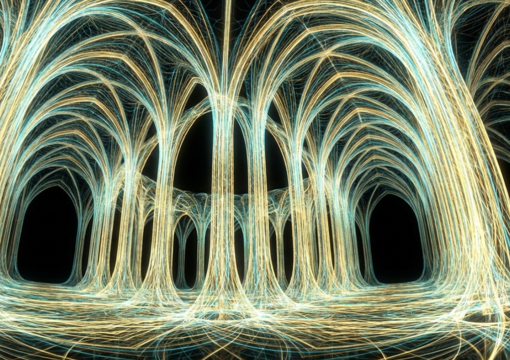</a> | **IMG_7088.jpeg** HsH · SAT_VISUALS/Visuals_2/IMG_7088.jpeg 1160×817 · landscape **suggest:** SAT family: near:000895 |
| <a href="https://raw.githubusercontent.com/Satobloc/HsH/main/SAT_VISUALS/Visuals_2/IMG_7090.jpeg">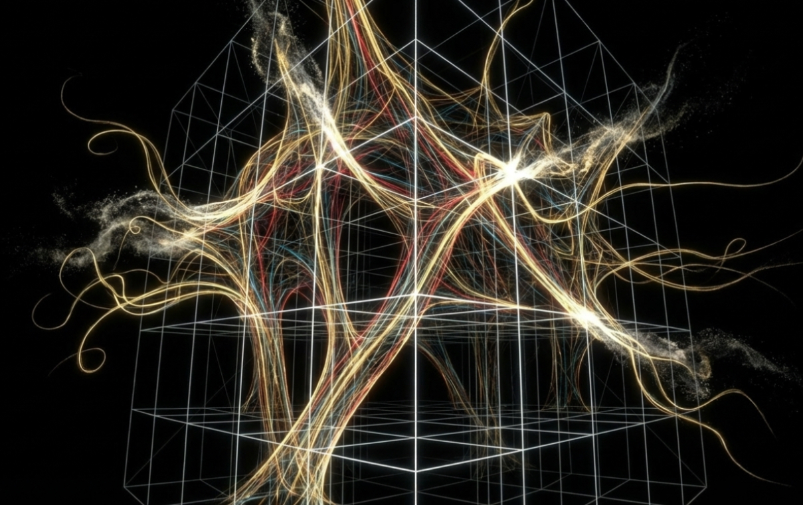</a> | **IMG_7090.jpeg** HsH · SAT_VISUALS/Visuals_2/IMG_7090.jpeg 1209×761 · landscape **suggest:** SAT family: near:000213 |
| <a href="https://raw.githubusercontent.com/Satobloc/HsH/main/SAT_VISUALS/Visuals_2/IMG_7091.jpeg">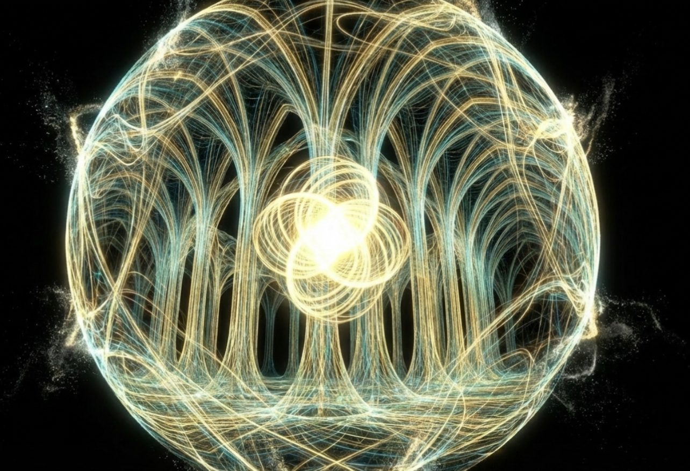</a> | **IMG_7091.jpeg** HsH · SAT_VISUALS/Visuals_2/IMG_7091.jpeg 1284×878 · landscape **suggest:** SAT family: near:000307 |
| <a href="https://raw.githubusercontent.com/Satobloc/HsH/main/SAT_VISUALS/Visuals_2/IMG_7092.jpeg">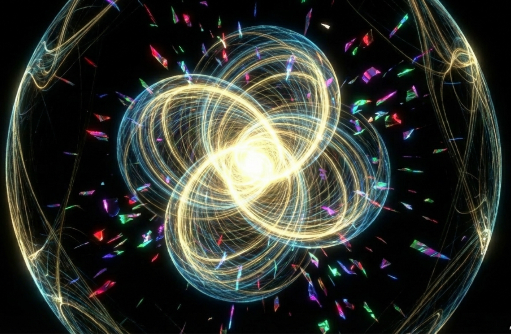</a> | **IMG_7092.jpeg** HsH · SAT_VISUALS/Visuals_2/IMG_7092.jpeg 1284×845 · landscape **suggest:** SAT family: near:000375 |
| <a href="https://raw.githubusercontent.com/Satobloc/HsH/main/SAT_VISUALS/Visuals_2/IMG_7093.jpeg">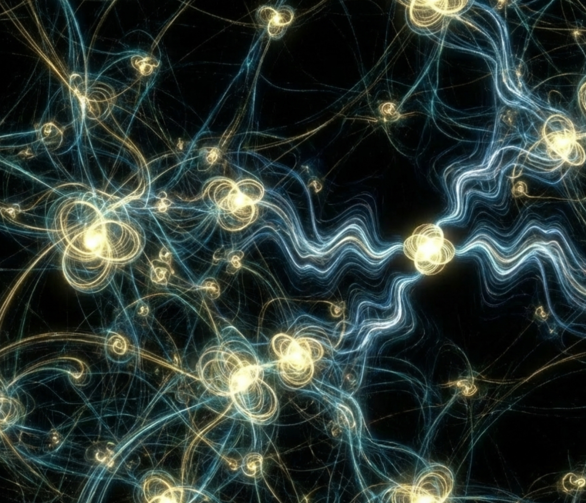</a> | **IMG_7093.jpeg** HsH · SAT_VISUALS/Visuals_2/IMG_7093.jpeg 1284×1102 · landscape **suggest:** SAT family: near:000364 |
| <a href="https://raw.githubusercontent.com/Satobloc/HsH/main/SAT_VISUALS/Visuals_2/IMG_7094.jpeg">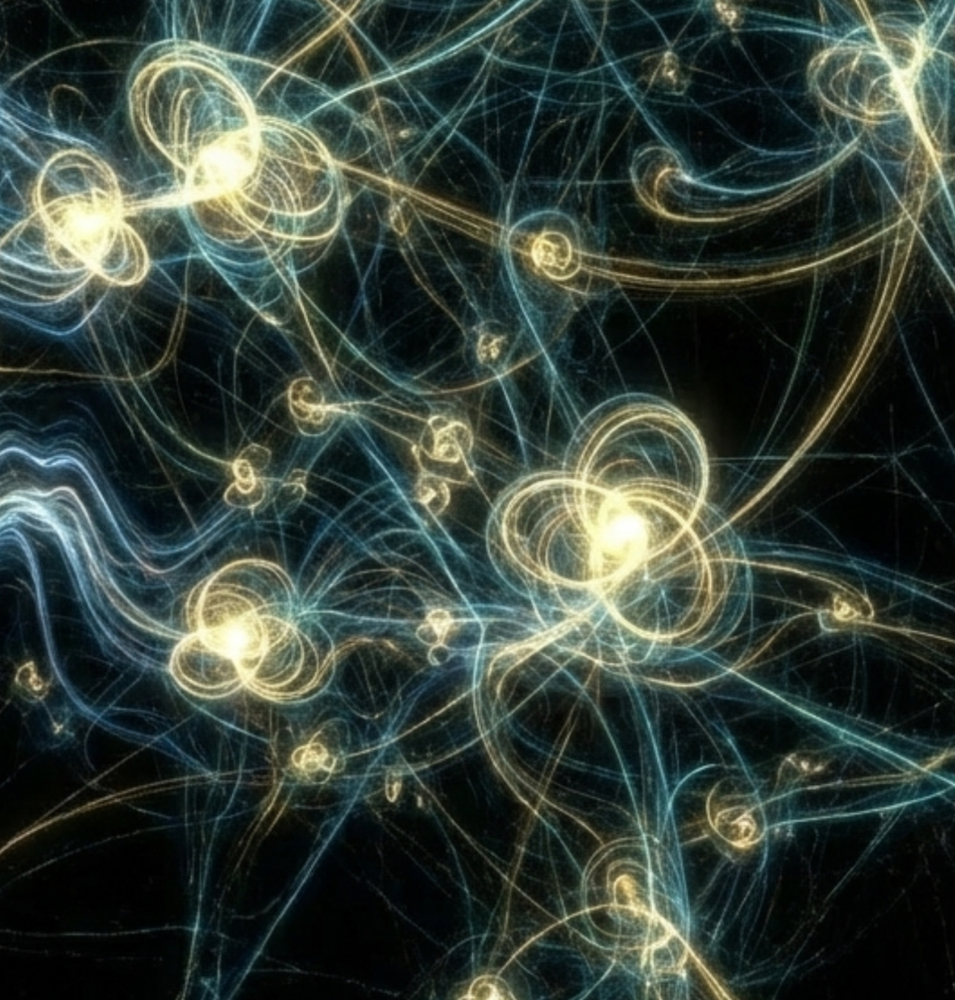</a> | **IMG_7094.jpeg** HsH · SAT_VISUALS/Visuals_2/IMG_7094.jpeg 1284×1344 · portrait **suggest:** SAT family: near:000330 |
| <a href="https://raw.githubusercontent.com/Satobloc/HsH/main/SAT_VISUALS/Visuals_2/IMG_7095.jpeg">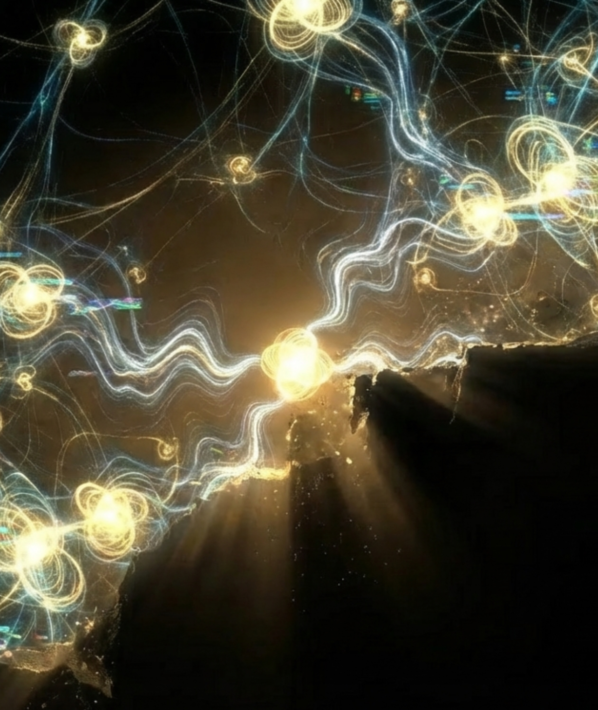</a> | **IMG_7095.jpeg** HsH · SAT_VISUALS/Visuals_2/IMG_7095.jpeg 1284×1523 · portrait **suggest:** SAT family: near:000381 |
|  | **IMG_7097.jpeg** HsH · SAT_VISUALS/Visuals_2/IMG_7097.jpeg 1284×717 · landscape **suggest:** SAT family: near:000117 |
|  | **IMG_7098.jpeg** HsH · SAT_VISUALS/Visuals_2/IMG_7098.jpeg 1284×1268 · square **suggest:** SAT family: near:000716 |
|  | **IMG_7099.jpeg** HsH · SAT_VISUALS/Visuals_2/IMG_7099.jpeg 888×888 · square **suggest:** SAT family: near:000017 |
| <a href="https://raw.githubusercontent.com/Satobloc/HsH/main/SAT_VISUALS/Visuals_2/IMG_7100.jpeg">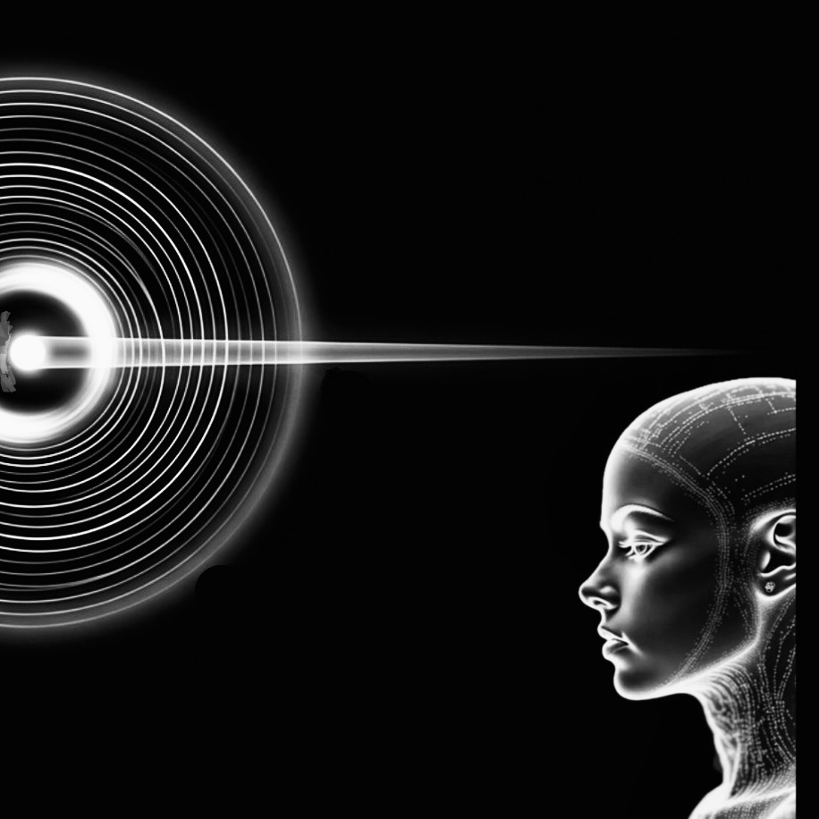</a> | **IMG_7100.jpeg** HsH · SAT_VISUALS/Visuals_2/IMG_7100.jpeg 916×916 · square **suggest:** SAT family: near:000759 |
| <a href="https://raw.githubusercontent.com/Satobloc/HsH/main/SAT_VISUALS/Visuals_2/IMG_7101.jpeg">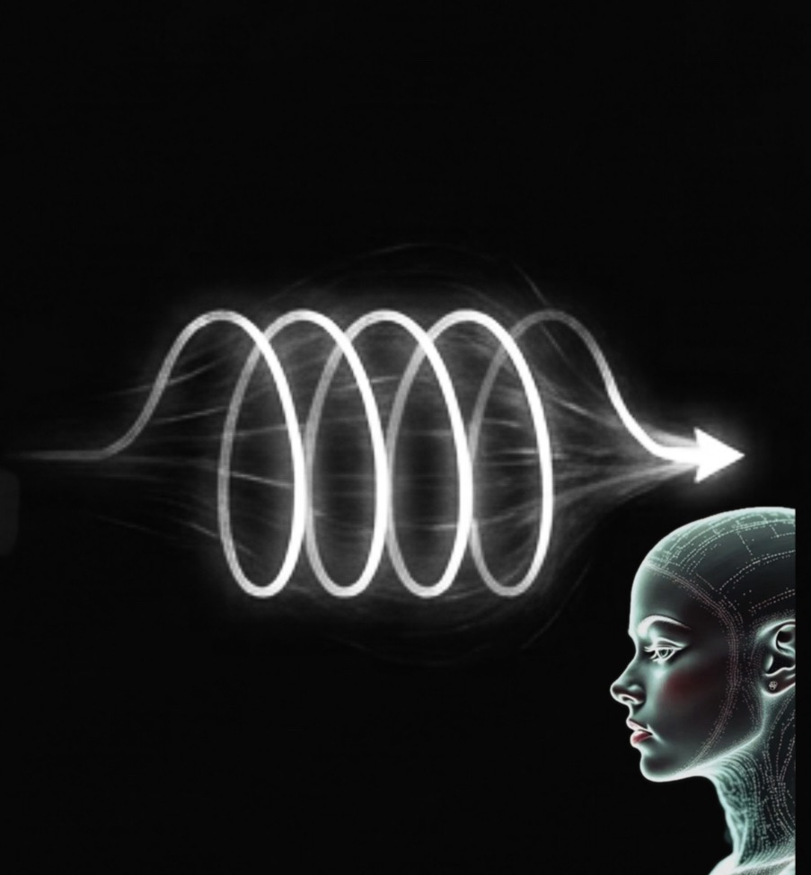</a> | **IMG_7101.jpeg** HsH · SAT_VISUALS/Visuals_2/IMG_7101.jpeg 903×974 · portrait **suggest:** SAT family: near:000028 |
| <a href="https://raw.githubusercontent.com/Satobloc/HsH/main/SAT_VISUALS/Visuals_2/IMG_7102.jpeg">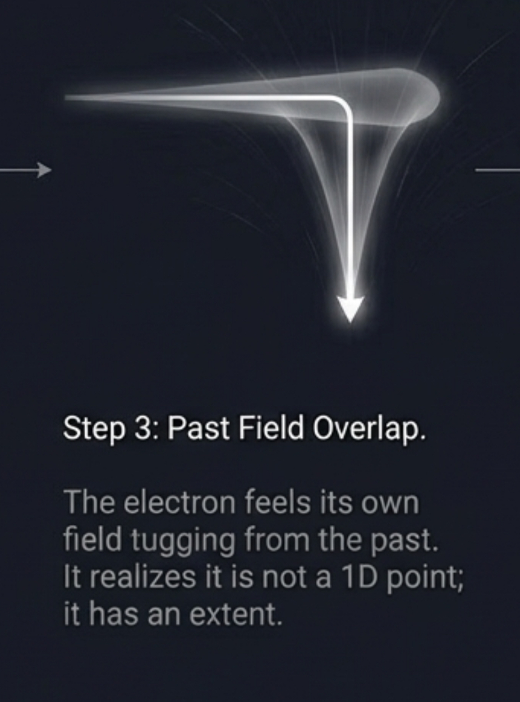</a> | **IMG_7102.jpeg** HsH · SAT_VISUALS/Visuals_2/IMG_7102.jpeg 927×1252 · portrait **suggest:** SAT family: near:000058 |
| <a href="https://raw.githubusercontent.com/Satobloc/HsH/main/SAT_VISUALS/Visuals_2/IMG_7103.jpeg">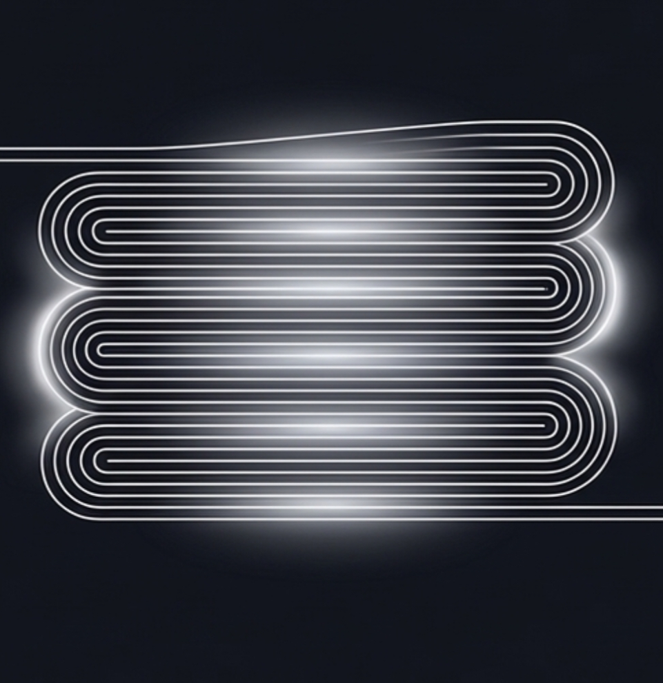</a> | **IMG_7103.jpeg** HsH · SAT_VISUALS/Visuals_2/IMG_7103.jpeg 961×991 · square **suggest:** SAT family: near:000726 |
| <a href="https://raw.githubusercontent.com/Satobloc/HsH/main/SAT_VISUALS/Visuals_2/IMG_7104.jpeg">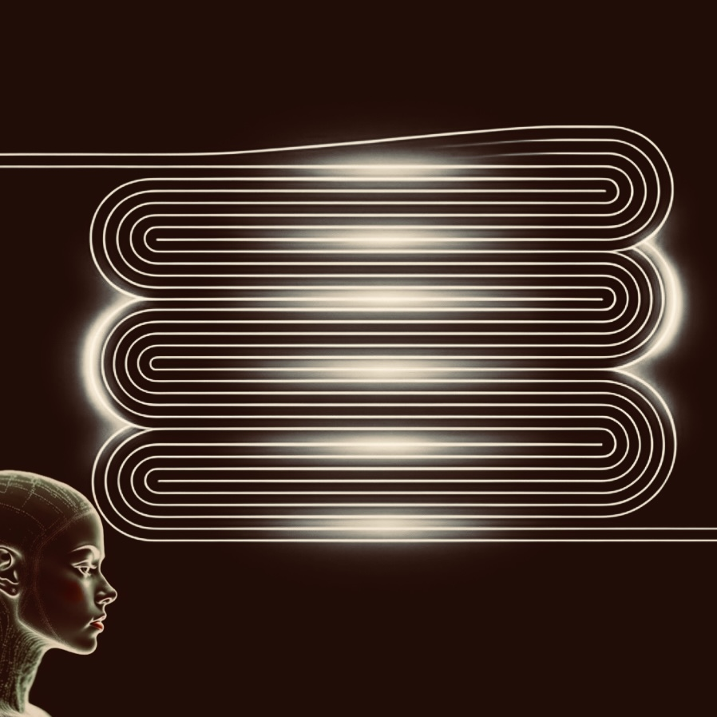</a> | **IMG_7104.jpeg** HsH · SAT_VISUALS/Visuals_2/IMG_7104.jpeg 898×898 · square **suggest:** SAT family: near:000462 |
|  | **IMG_7105.jpeg** HsH · SAT_VISUALS/Visuals_2/IMG_7105.jpeg 1253×1245 · square **suggest:** SAT family: near:000581 |
|  | **IMG_7106.jpeg** HsH · SAT_VISUALS/Visuals_2/IMG_7106.jpeg 737×737 · square **suggest:** SAT family: near:000253 |
|  | **IMG_7107.jpeg** HsH · SAT_VISUALS/Visuals_2/IMG_7107.jpeg 1083×1298 · portrait **suggest:** SAT family: near:000118 |
| <a href="https://raw.githubusercontent.com/Satobloc/HsH/main/SAT_VISUALS/Visuals_2/IMG_7183.jpeg">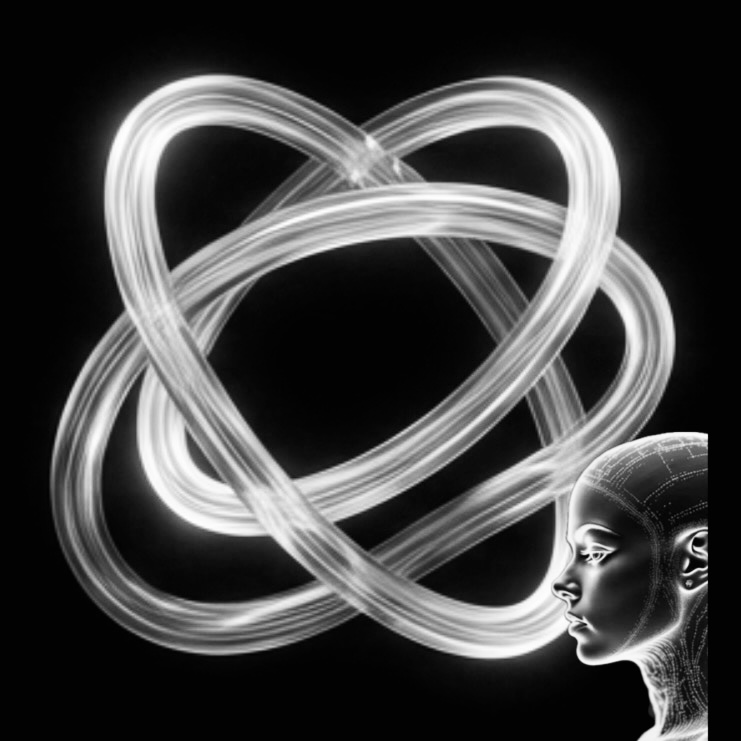</a> | **IMG_7183.jpeg** HsH · SAT_VISUALS/Visuals_2/IMG_7183.jpeg 741×741 · square **suggest:** SAT family: near:000299 |
| <a href="https://raw.githubusercontent.com/Satobloc/HsH/main/SAT_VISUALS/Visuals_2/IMG_7190.jpeg">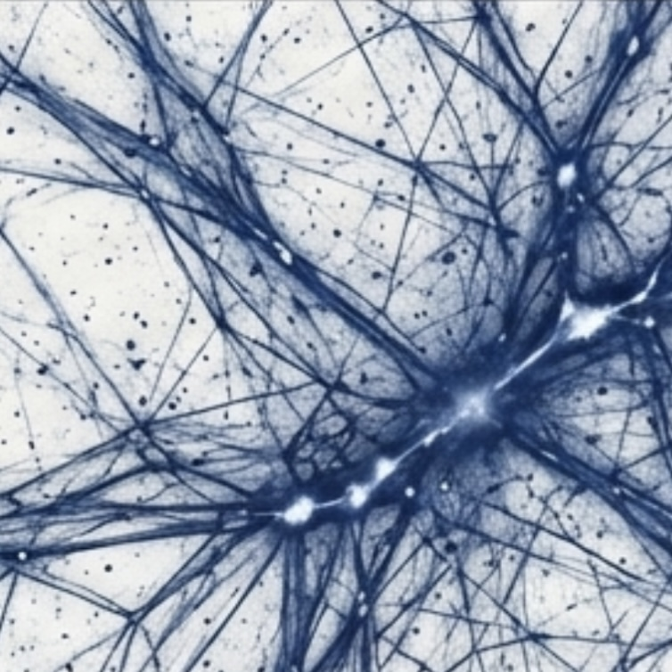</a> | **IMG_7190.jpeg** HsH · SAT_VISUALS/Visuals_2/IMG_7190.jpeg 754×754 · square **suggest:** SAT family: near:000843 |
| <a href="https://raw.githubusercontent.com/Satobloc/HsH/main/SAT_VISUALS/Visuals_2/IMG_7191.jpeg">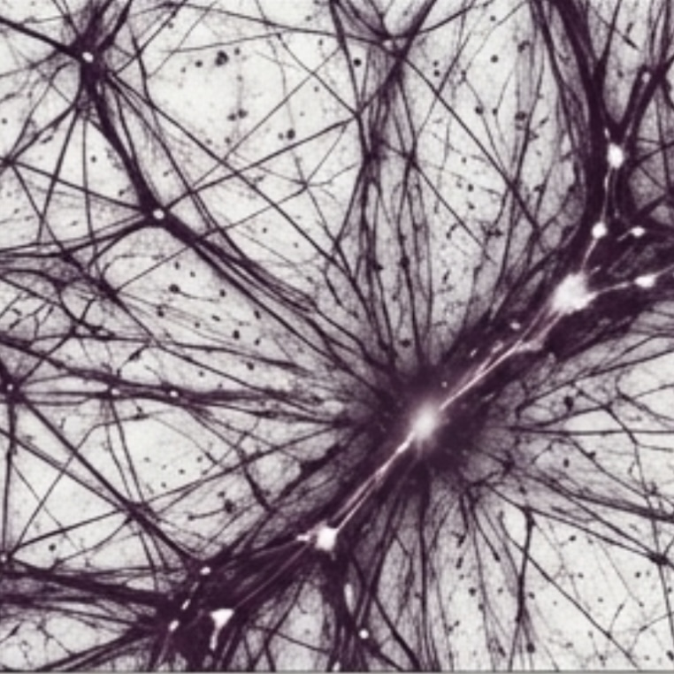</a> | **IMG_7191.jpeg** HsH · SAT_VISUALS/Visuals_2/IMG_7191.jpeg 762×762 · square **suggest:** SAT family: near:000683 |
| <a href="https://raw.githubusercontent.com/Satobloc/HsH/main/SAT_VISUALS/Visuals_2/IMG_7192.jpeg">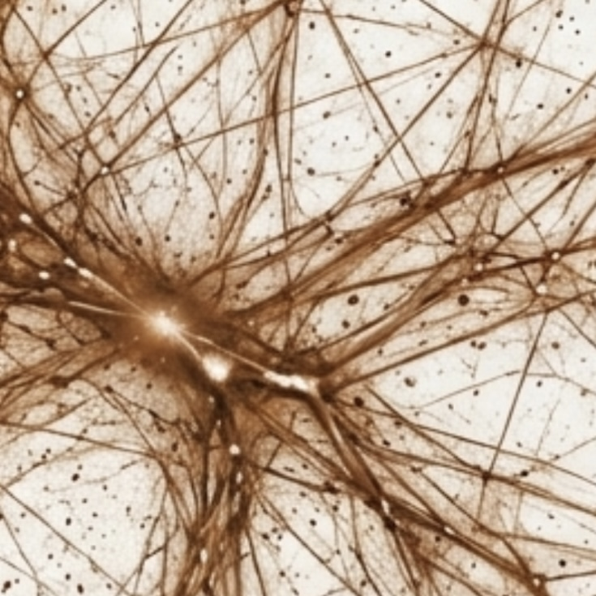</a> | **IMG_7192.jpeg** HsH · SAT_VISUALS/Visuals_2/IMG_7192.jpeg 735×735 · square **suggest:** SAT family: near:000492 |
| <a href="https://raw.githubusercontent.com/Satobloc/HsH/main/SAT_VISUALS/Visuals_2/IMG_7682.jpeg">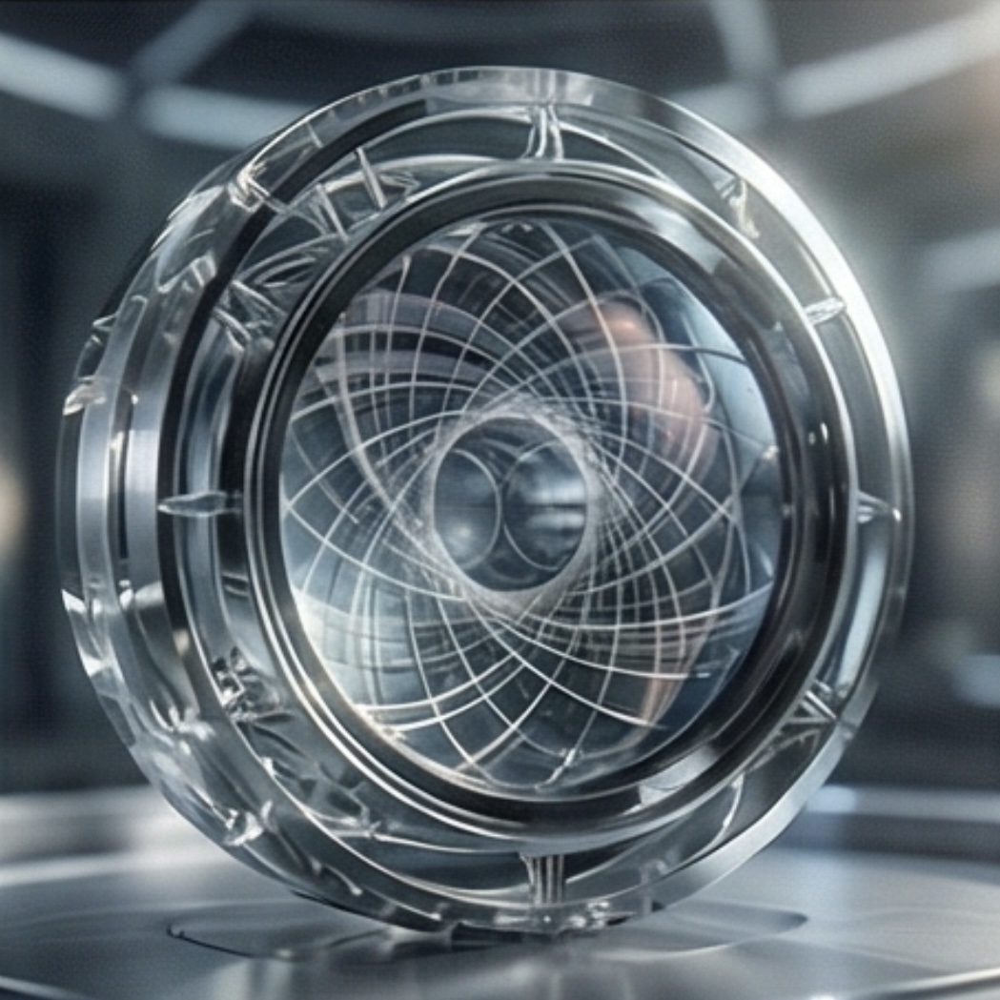</a> | **IMG_7682.jpeg** HsH · SAT_VISUALS/Visuals_2/IMG_7682.jpeg 1049×1049 · square **suggest:** SAT family: near:000912 |
| <a href="https://raw.githubusercontent.com/Satobloc/HsH/main/SAT_VISUALS/Visuals_2/IMG_7683.jpeg">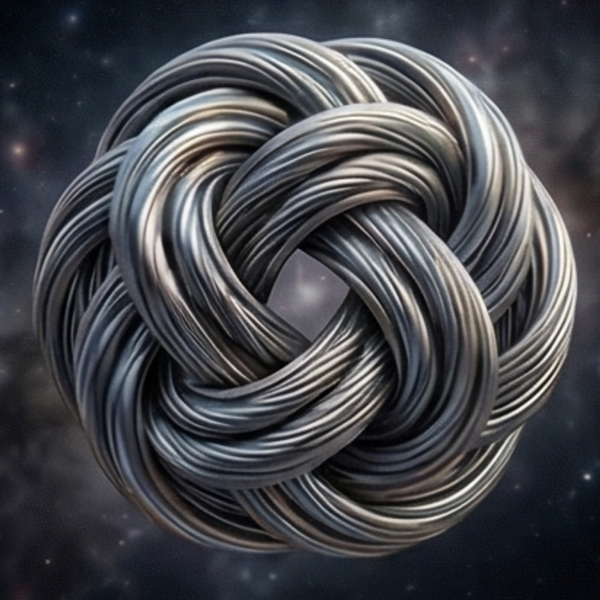</a> | **IMG_7683.jpeg** HsH · SAT_VISUALS/Visuals_2/IMG_7683.jpeg 998×998 · square **suggest:** SAT family: near:000094 |
|  | **IMG_7685.jpeg** HsH · SAT_VISUALS/Visuals_2/IMG_7685.jpeg 1066×1066 · square **suggest:** SAT family: near:000168 |
| <a href="https://raw.githubusercontent.com/Satobloc/HsH/main/SAT_VISUALS/Visuals_2/IMG_7689.jpeg">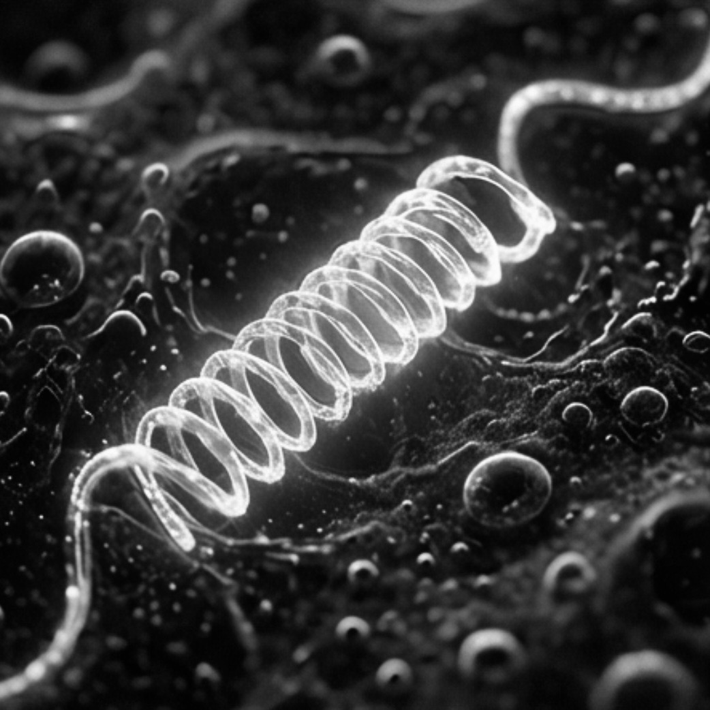</a> | **IMG_7689.jpeg** HsH · SAT_VISUALS/Visuals_2/IMG_7689.jpeg 1042×1042 · square **suggest:** SAT family: near:000260 |
| <a href="https://raw.githubusercontent.com/Satobloc/HsH/main/SAT_VISUALS/Visuals_2/IMG_7690.jpeg">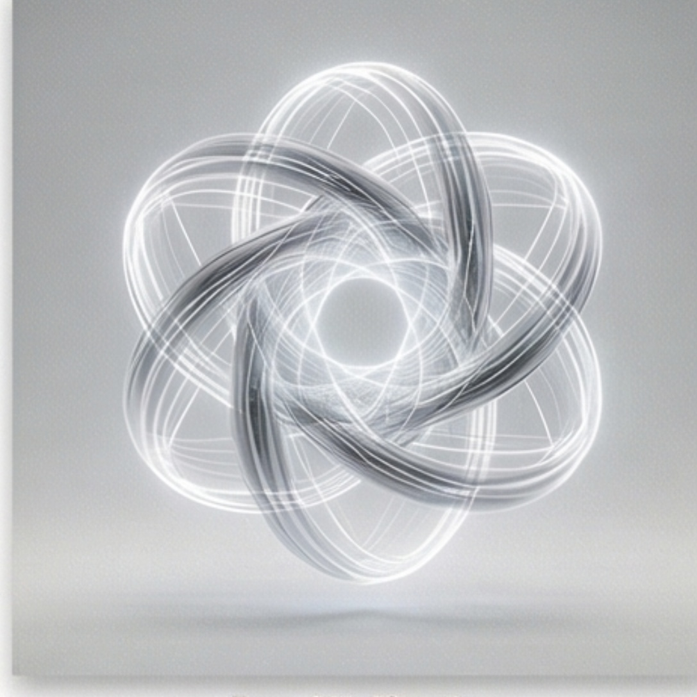</a> | **IMG_7690.jpeg** HsH · SAT_VISUALS/Visuals_2/IMG_7690.jpeg 1087×1087 · square **suggest:** SAT family: near:000616 |
| <a href="https://raw.githubusercontent.com/Satobloc/HsH/main/SAT_VISUALS/Visuals_2/IMG_7692.jpeg">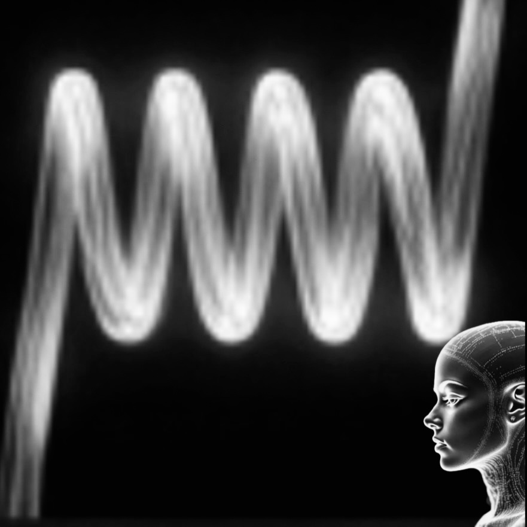</a> | **IMG_7692.jpeg** HsH · SAT_VISUALS/Visuals_2/IMG_7692.jpeg 881×881 · square **suggest:** SAT family: near:000109 |
| <a href="https://raw.githubusercontent.com/Satobloc/HsH/main/SAT_VISUALS/Visuals_2/IMG_7693.jpeg">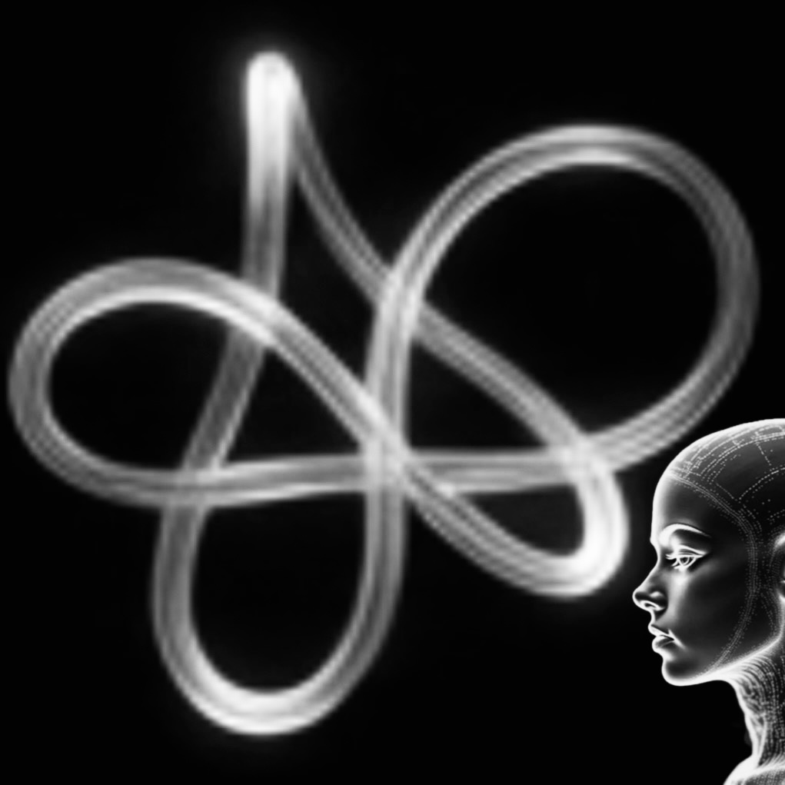</a> | **IMG_7693.jpeg** HsH · SAT_VISUALS/Visuals_2/IMG_7693.jpeg 1021×1021 · square **suggest:** SAT family: near:000633 |
|  | **IMG_7694.jpeg** HsH · SAT_VISUALS/Visuals_2/IMG_7694.jpeg 762×762 · square **suggest:** SAT family: near:000758 |
|  | **IMG_7695.jpeg** HsH · SAT_VISUALS/Visuals_2/IMG_7695.jpeg 1284×1284 · square **suggest:** SAT family: near:000314 |
|  | **IMG_7696.jpeg** HsH · SAT_VISUALS/Visuals_2/IMG_7696.jpeg 1284×1284 · square **suggest:** SAT family: exact:0ce368ccb00840c7 |
|  | **IMG_7697.jpeg** HsH · SAT_VISUALS/Visuals_2/IMG_7697.jpeg 1268×1268 · square **suggest:** SAT family: near:000505 |
| <a href="https://raw.githubusercontent.com/Satobloc/HsH/main/SAT_VISUALS/Visuals_2/IMG_7698.jpeg">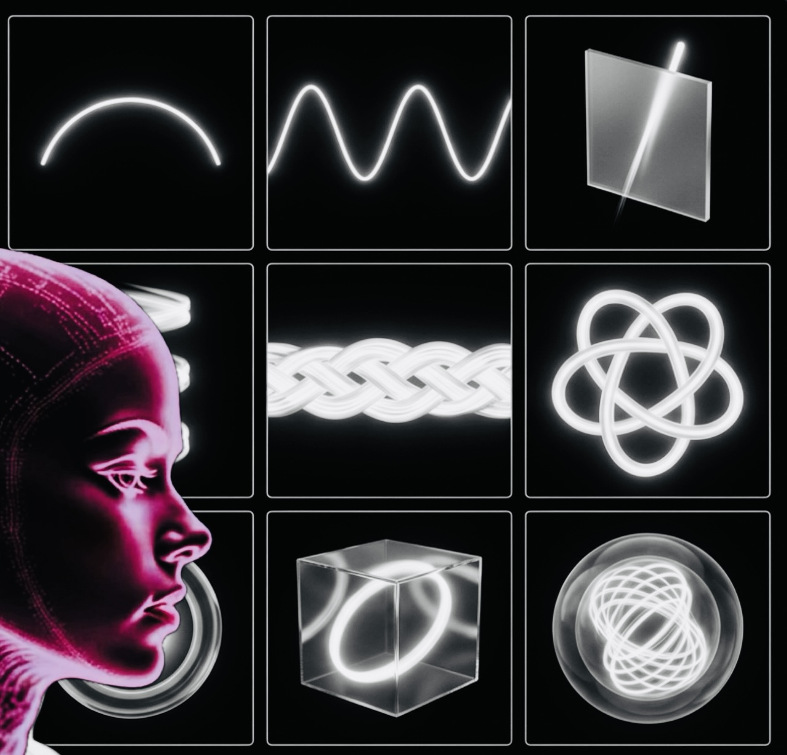</a> | **IMG_7698.jpeg** HsH · SAT_VISUALS/Visuals_2/IMG_7698.jpeg 1284×1233 · square **suggest:** SAT family: near:000396 |
|  | **IMG_7699.jpeg** HsH · SAT_VISUALS/Visuals_2/IMG_7699.jpeg 924×924 · square **suggest:** SAT family: near:000596 |
|  | **IMG_7700.jpeg** HsH · SAT_VISUALS/Visuals_2/IMG_7700.jpeg 964×937 · square **suggest:** SAT family: near:000593 |
| <a href="https://raw.githubusercontent.com/Satobloc/HsH/main/SAT_VISUALS/Visuals_2/IMG_7701.jpeg">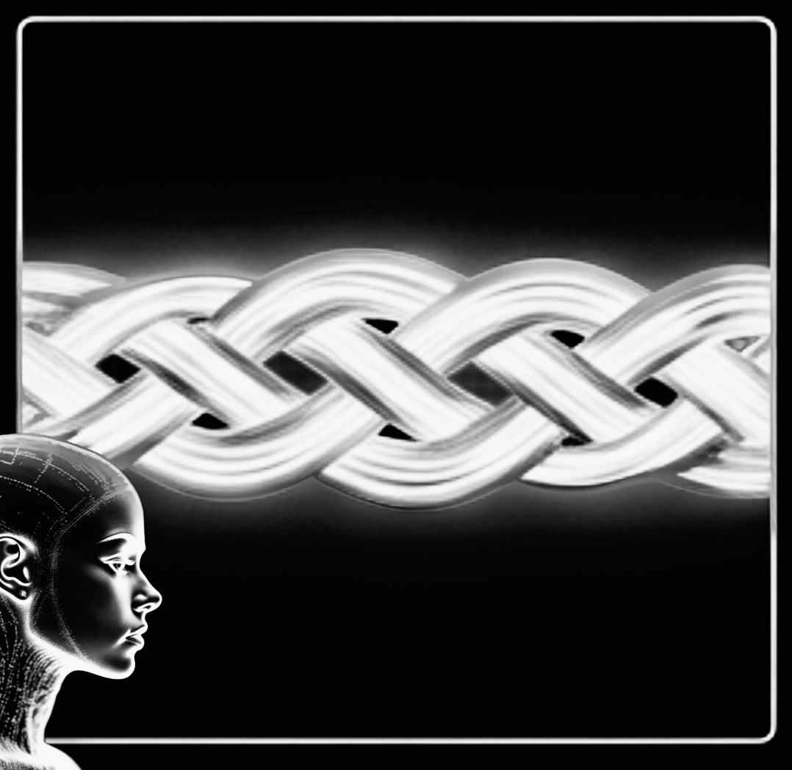</a> | **IMG_7701.jpeg** HsH · SAT_VISUALS/Visuals_2/IMG_7701.jpeg 1078×1048 · square **suggest:** SAT family: near:000522 |
| <a href="https://raw.githubusercontent.com/Satobloc/HsH/main/SAT_VISUALS/Visuals_2/IMG_7702.jpeg">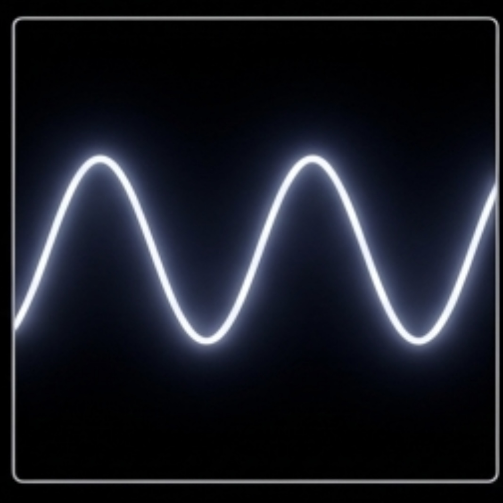</a> | **IMG_7702.jpeg** HsH · SAT_VISUALS/Visuals_2/IMG_7702.jpeg 1067×1067 · square **suggest:** SAT family: near:000524 |
| <a href="https://raw.githubusercontent.com/Satobloc/HsH/main/SAT_VISUALS/Visuals_2/IMG_7703.jpeg">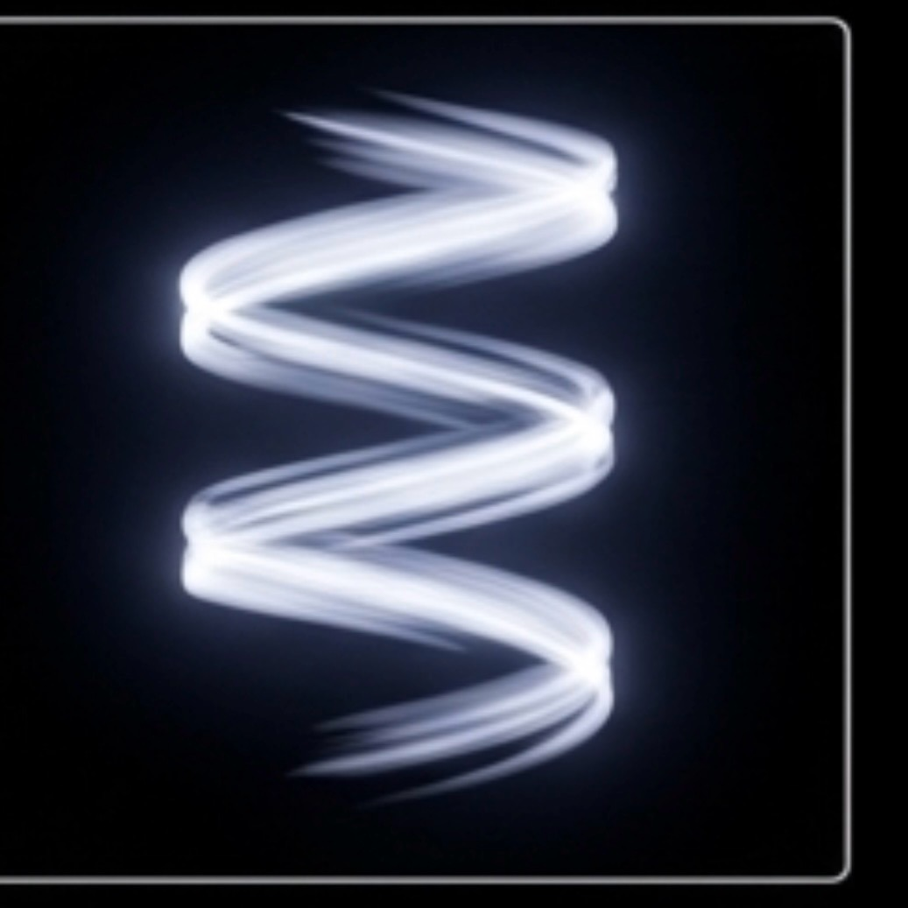</a> | **IMG_7703.jpeg** HsH · SAT_VISUALS/Visuals_2/IMG_7703.jpeg 1037×1037 · square **suggest:** SAT family: near:000133 |
| <a href="https://raw.githubusercontent.com/Satobloc/HsH/main/SAT_VISUALS/Visuals_2/IMG_7704.jpeg">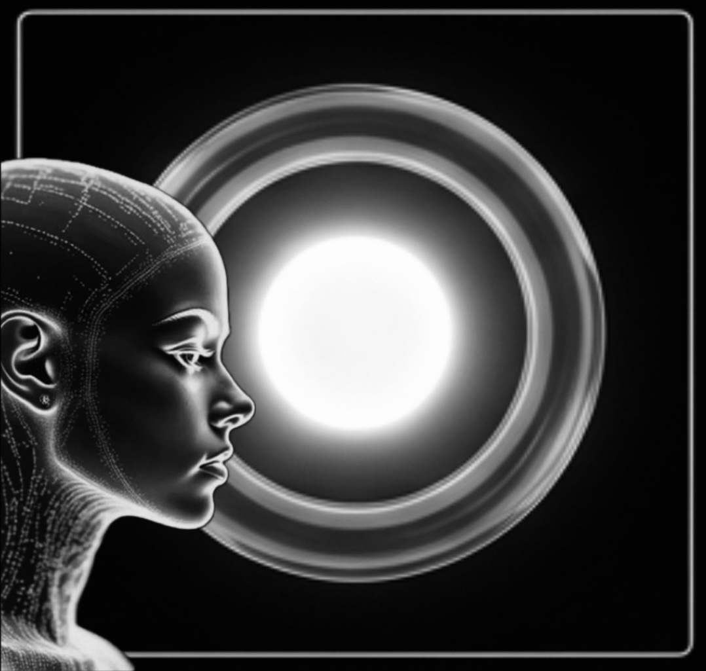</a> | **IMG_7704.jpeg** HsH · SAT_VISUALS/Visuals_2/IMG_7704.jpeg 1078×1025 · landscape **suggest:** SAT family: near:000585 |
| <a href="https://raw.githubusercontent.com/Satobloc/HsH/main/SAT_VISUALS/Visuals_2/IMG_7705.jpeg">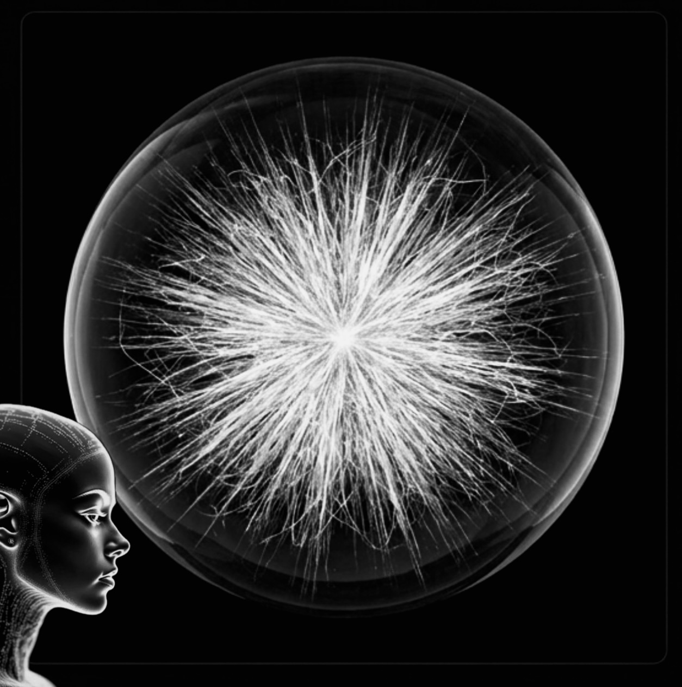</a> | **IMG_7705.jpeg** HsH · SAT_VISUALS/Visuals_2/IMG_7705.jpeg 1254×1262 · square **suggest:** SAT family: near:000551 |
| <a href="https://raw.githubusercontent.com/Satobloc/HsH/main/SAT_VISUALS/Visuals_2/IMG_7706.jpeg">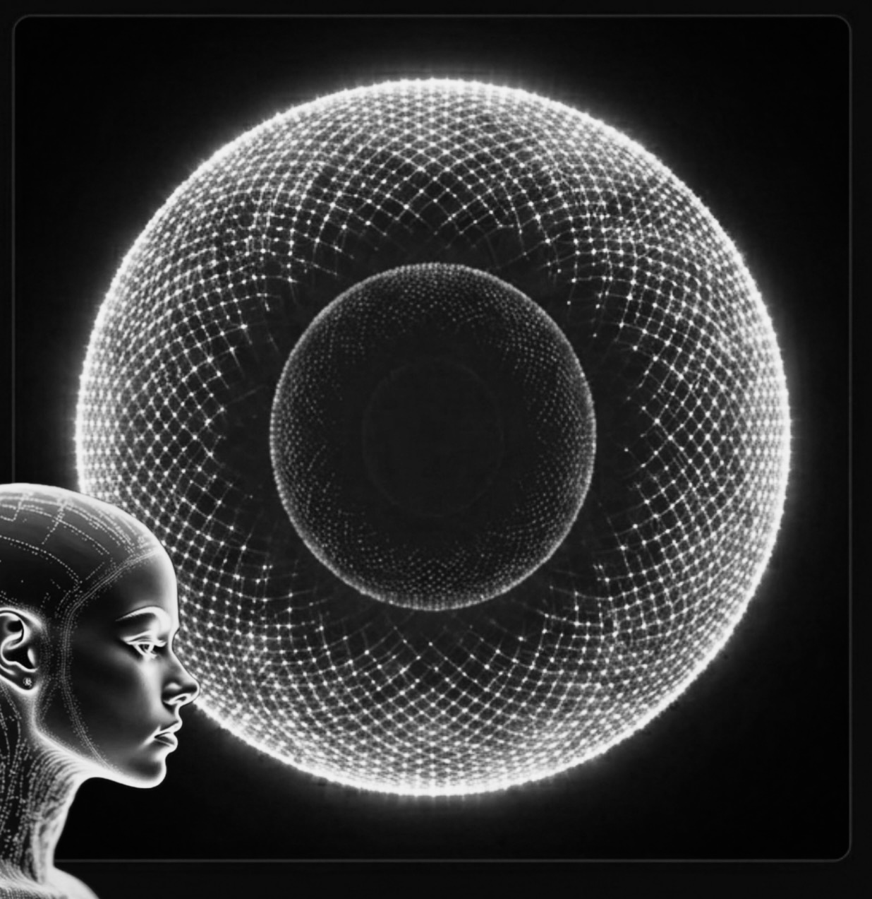</a> | **IMG_7706.jpeg** HsH · SAT_VISUALS/Visuals_2/IMG_7706.jpeg 1236×1273 · square **suggest:** SAT family: near:000610 |
| <a href="https://raw.githubusercontent.com/Satobloc/HsH/main/SAT_VISUALS/Visuals_2/IMG_7707.jpeg">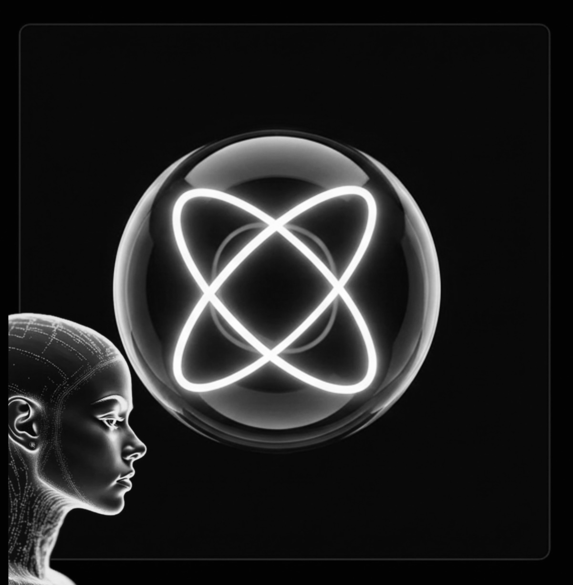</a> | **IMG_7707.jpeg** HsH · SAT_VISUALS/Visuals_2/IMG_7707.jpeg 1201×1224 · square **suggest:** SAT family: near:000284 |
| <a href="https://raw.githubusercontent.com/Satobloc/HsH/main/SAT_VISUALS/Visuals_2/IMG_7708.jpeg">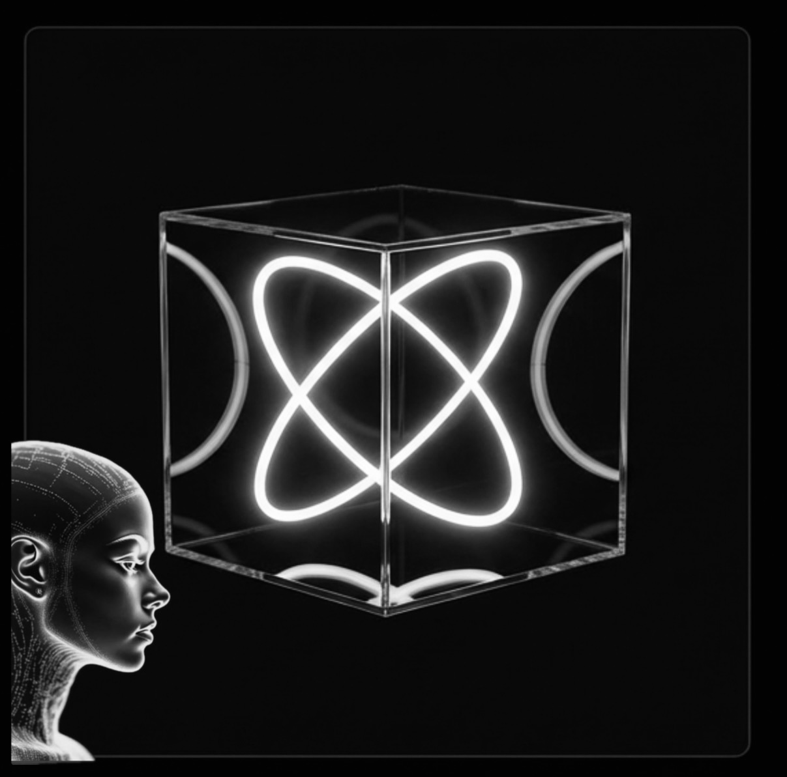</a> | **IMG_7708.jpeg** HsH · SAT_VISUALS/Visuals_2/IMG_7708.jpeg 1207×1193 · square **suggest:** SAT family: near:000049 |
| <a href="https://raw.githubusercontent.com/Satobloc/HsH/main/SAT_VISUALS/Visuals_2/IMG_7709.png">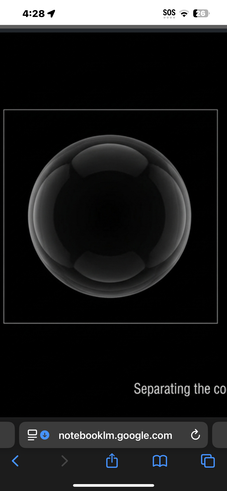</a> | **IMG_7709.png** HsH · SAT_VISUALS/Visuals_2/IMG_7709.png 1284×2778 · portrait **suggest:** SAT family: near:000547 |
|  | **IMG_7710.jpeg** HsH · SAT_VISUALS/Visuals_2/IMG_7710.jpeg 1229×1261 · square **suggest:** SAT family: near:000830 |
| <a href="https://raw.githubusercontent.com/Satobloc/HsH/main/SAT_VISUALS/Visuals_2/IMG_7711.jpeg">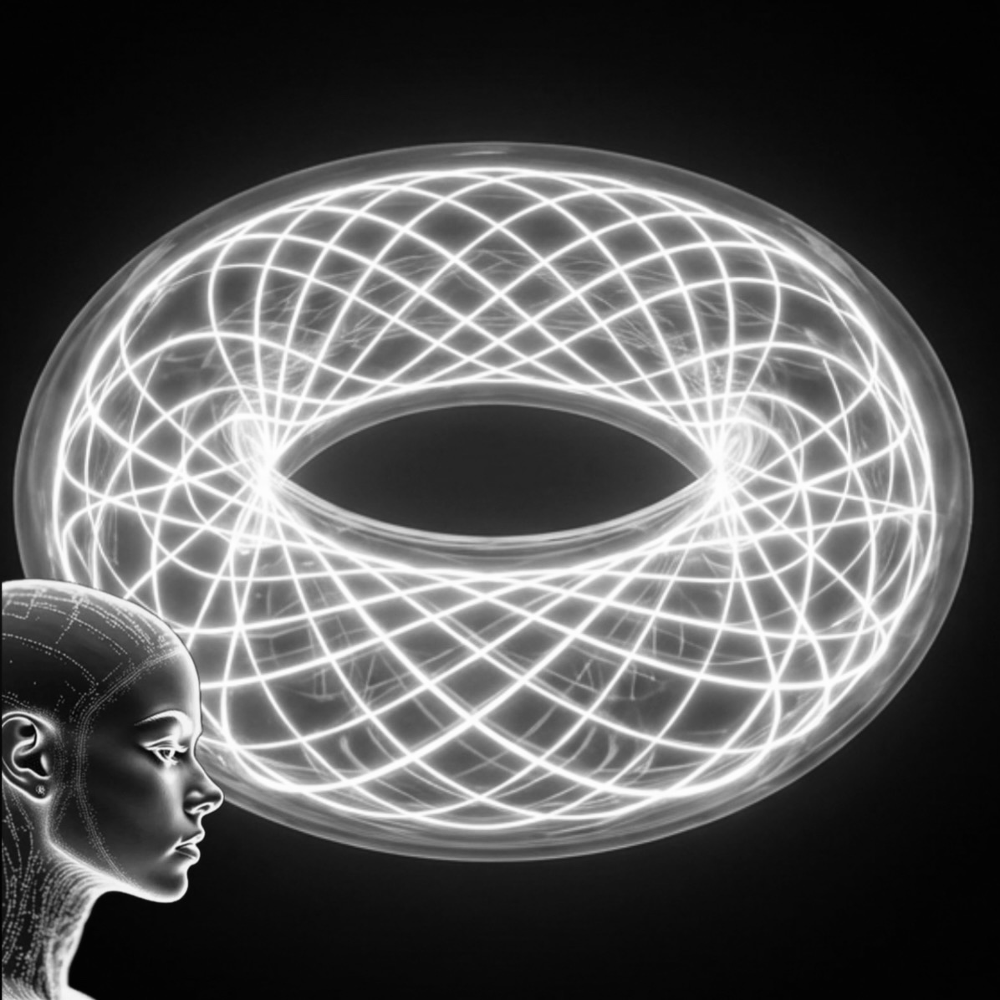</a> | **IMG_7711.jpeg** HsH · SAT_VISUALS/Visuals_2/IMG_7711.jpeg 1196×1196 · square **suggest:** SAT family: near:000579 |
| <a href="https://raw.githubusercontent.com/Satobloc/HsH/main/SAT_VISUALS/Visuals_2/IMG_7712.jpeg">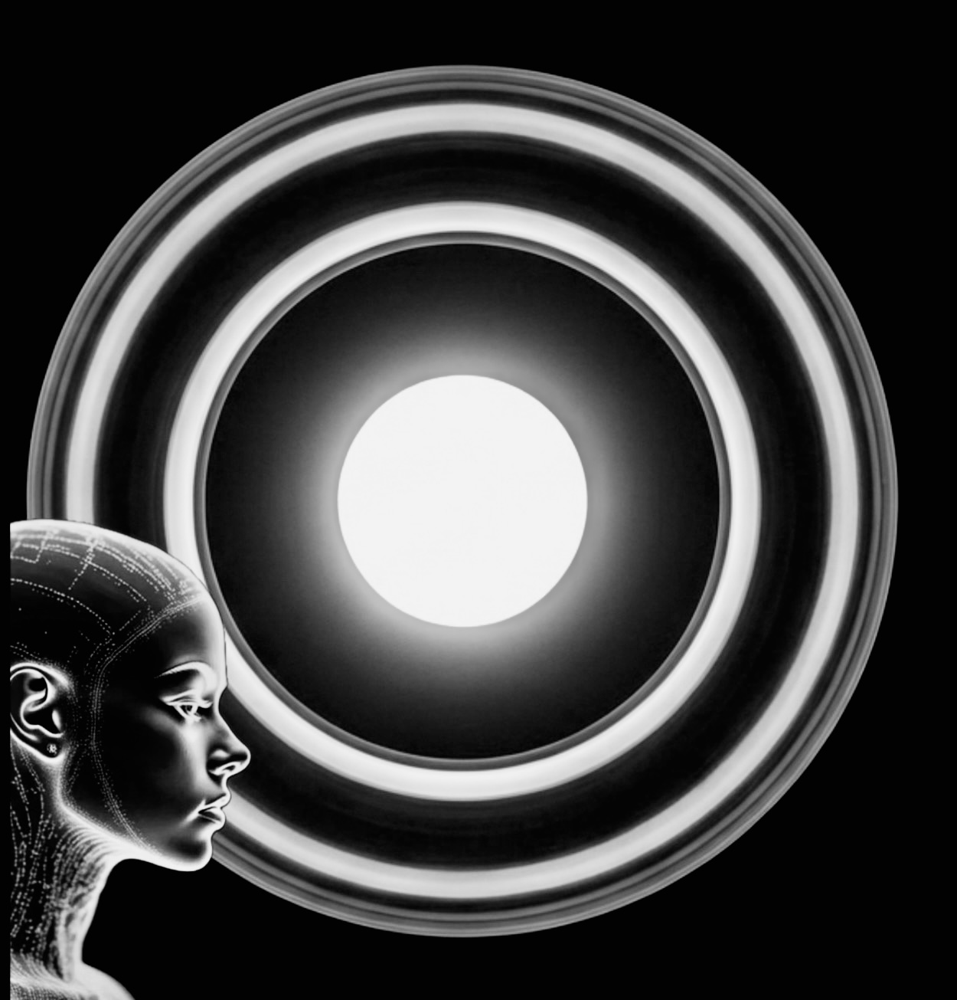</a> | **IMG_7712.jpeg** HsH · SAT_VISUALS/Visuals_2/IMG_7712.jpeg 1250×1305 · portrait **suggest:** SAT family: near:000604 |
|  | **IMG_7713.jpeg** HsH · SAT_VISUALS/Visuals_2/IMG_7713.jpeg 1249×1218 · square **suggest:** SAT family: near:000249 |
| <a href="https://raw.githubusercontent.com/Satobloc/HsH/main/SAT_VISUALS/Visuals_2/IMG_7714.jpeg">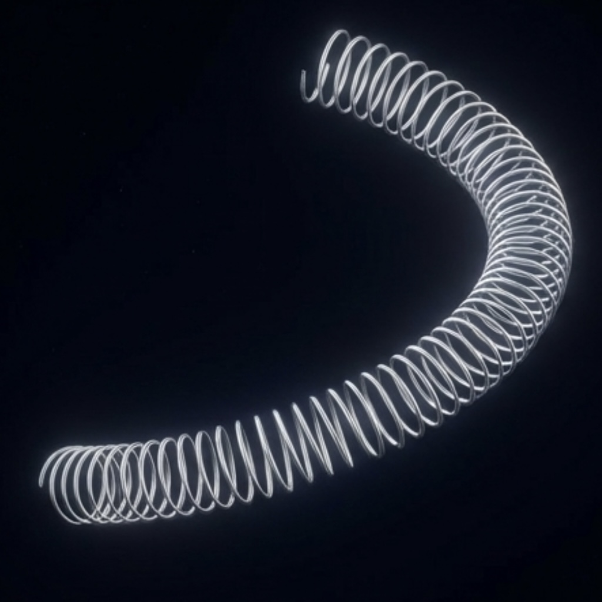</a> | **IMG_7714.jpeg** HsH · SAT_VISUALS/Visuals_2/IMG_7714.jpeg 1024×1024 · square **suggest:** SAT family: near:000251 |
| <a href="https://raw.githubusercontent.com/Satobloc/HsH/main/SAT_VISUALS/Visuals_2/IMG_7715.jpeg">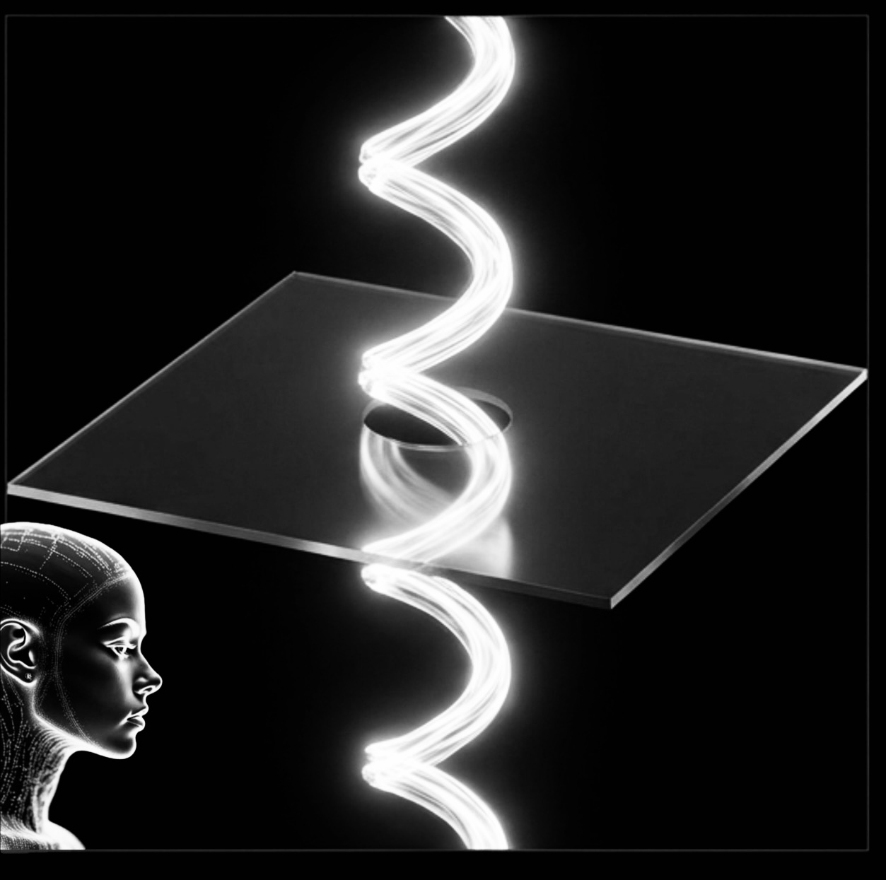</a> | **IMG_7715.jpeg** HsH · SAT_VISUALS/Visuals_2/IMG_7715.jpeg 1253×1245 · square **suggest:** SAT family: near:000589 |
|  | **IMG_7716.jpeg** HsH · SAT_VISUALS/Visuals_2/IMG_7716.jpeg 1204×1080 · landscape **suggest:** SAT family: near:000521 |
|  | **IMG_7717.jpeg** HsH · SAT_VISUALS/Visuals_2/IMG_7717.jpeg 1213×1080 · landscape **suggest:** SAT family: near:000527 |
| <a href="https://raw.githubusercontent.com/Satobloc/HsH/main/SAT_VISUALS/Visuals_2/IMG_7718.jpeg">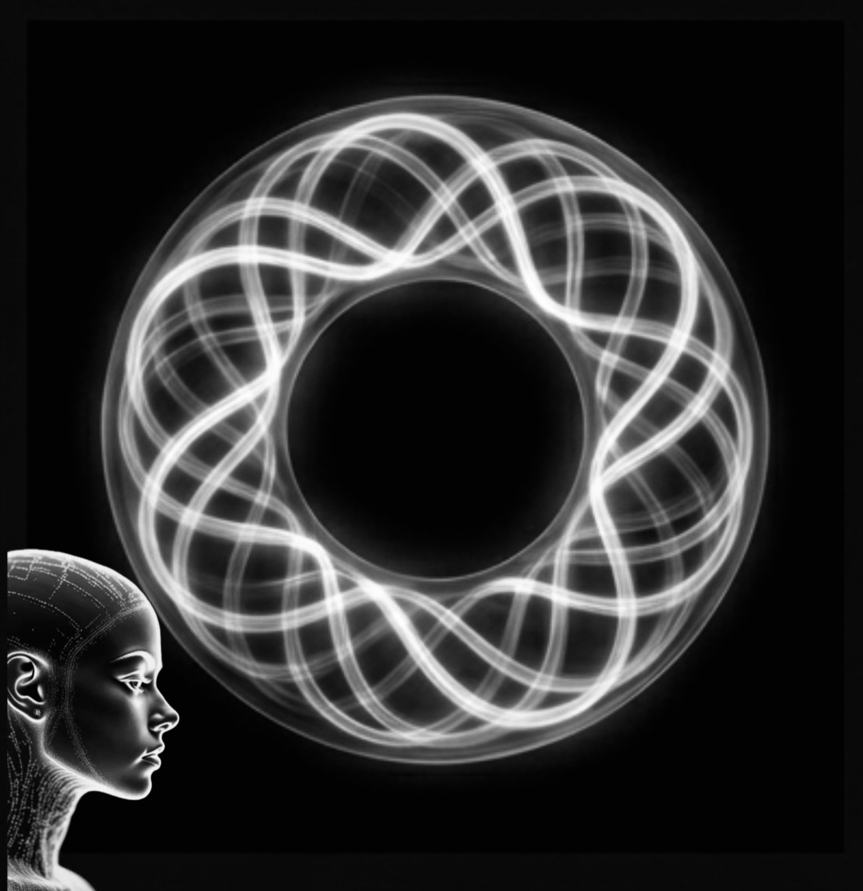</a> | **IMG_7718.jpeg** HsH · SAT_VISUALS/Visuals_2/IMG_7718.jpeg 1234×1273 · square **suggest:** SAT family: near:000832 |
| <a href="https://raw.githubusercontent.com/Satobloc/HsH/main/SAT_VISUALS/Visuals_2/IMG_7719.jpeg">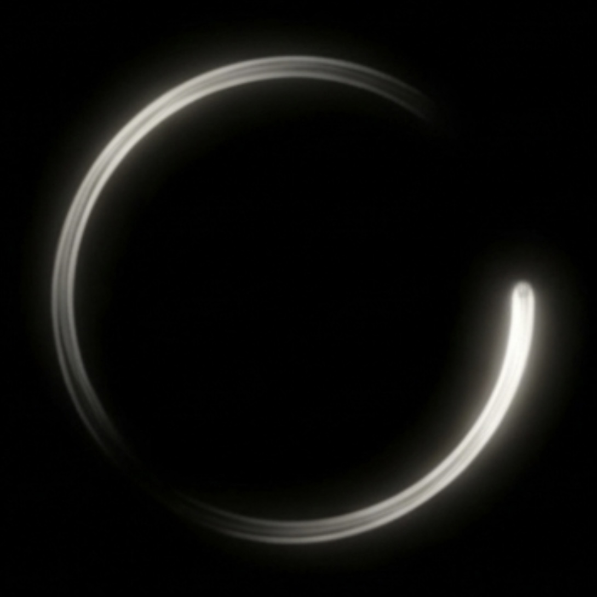</a> | **IMG_7719.jpeg** HsH · SAT_VISUALS/Visuals_2/IMG_7719.jpeg 1090×1090 · square **suggest:** SAT family: near:000215 |
| <a href="https://raw.githubusercontent.com/Satobloc/HsH/main/SAT_VISUALS/Visuals_2/IMG_7720.jpeg">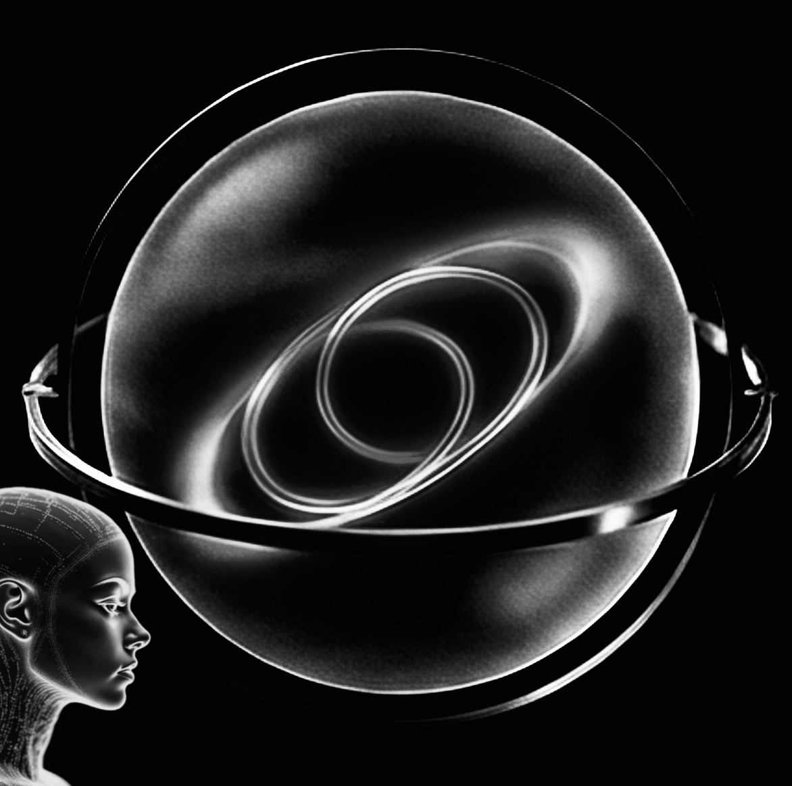</a> | **IMG_7720.jpeg** HsH · SAT_VISUALS/Visuals_2/IMG_7720.jpeg 1172×1163 · square **suggest:** SAT family: near:000601 |
|  | **IMG_7721.jpeg** HsH · SAT_VISUALS/Visuals_2/IMG_7721.jpeg 599×599 · square **suggest:** SAT family: near:000406 |
|  | **IMG_7722.jpeg** HsH · SAT_VISUALS/Visuals_2/IMG_7722.jpeg 1012×1012 · square **suggest:** SAT family: near:000225 |
|  | **IMG_7723.jpeg** HsH · SAT_VISUALS/Visuals_2/IMG_7723.jpeg 1240×1254 · square **suggest:** SAT family: near:000607 |
|  | **IMG_7724.jpeg** HsH · SAT_VISUALS/Visuals_2/IMG_7724.jpeg 227×227 · square **suggest:** SAT family: near:000697 |
|  | **IMG_7725.jpeg** HsH · SAT_VISUALS/Visuals_2/IMG_7725.jpeg 1232×1229 · square **suggest:** SAT family: near:000174 |
| <a href="https://raw.githubusercontent.com/Satobloc/HsH/main/SAT_VISUALS/Visuals_2/IMG_7726.jpeg">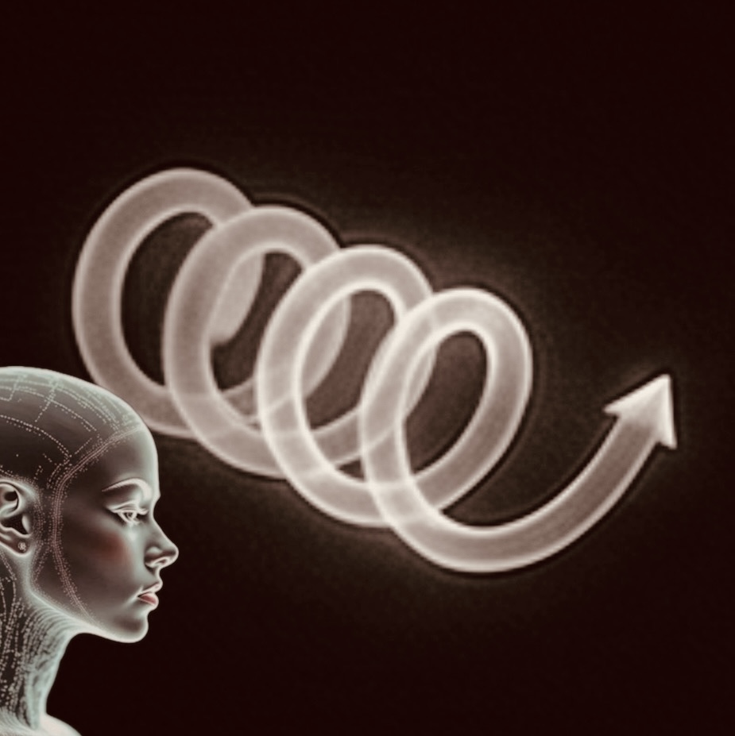</a> | **IMG_7726.jpeg** HsH · SAT_VISUALS/Visuals_2/IMG_7726.jpeg 925×927 · square **suggest:** SAT family: near:000770 |
| <a href="https://raw.githubusercontent.com/Satobloc/HsH/main/SAT_VISUALS/Visuals_2/IMG_7727.jpeg">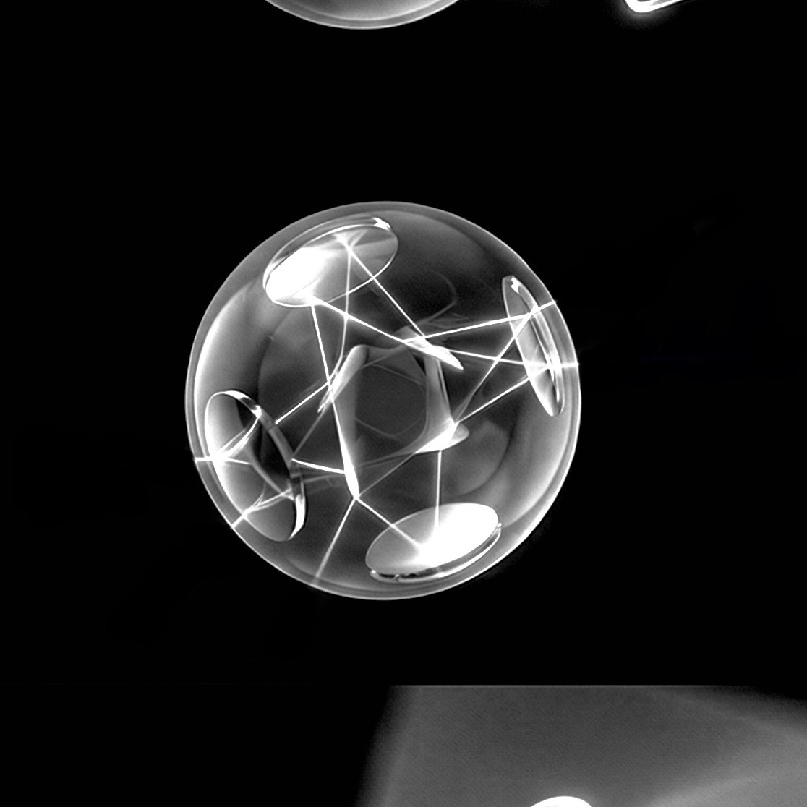</a> | **IMG_7727.jpeg** HsH · SAT_VISUALS/Visuals_2/IMG_7727.jpeg 1116×1116 · square **suggest:** SAT family: near:000114 |
| <a href="https://raw.githubusercontent.com/Satobloc/HsH/main/SAT_VISUALS/Visuals_2/IMG_7728.jpeg">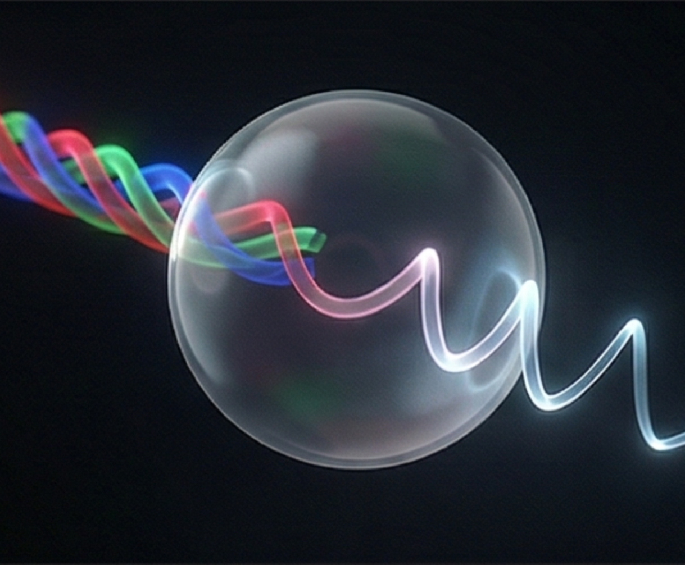</a> | **IMG_7728.jpeg** HsH · SAT_VISUALS/Visuals_2/IMG_7728.jpeg 1219×1006 · landscape **suggest:** SAT family: near:000233 |
|  | **IMG_7729.jpeg** HsH · SAT_VISUALS/Visuals_2/IMG_7729.jpeg 1078×1078 · square **suggest:** SAT family: near:000281 |
| <a href="https://raw.githubusercontent.com/Satobloc/HsH/main/SAT_VISUALS/Visuals_2/IMG_7730.jpeg">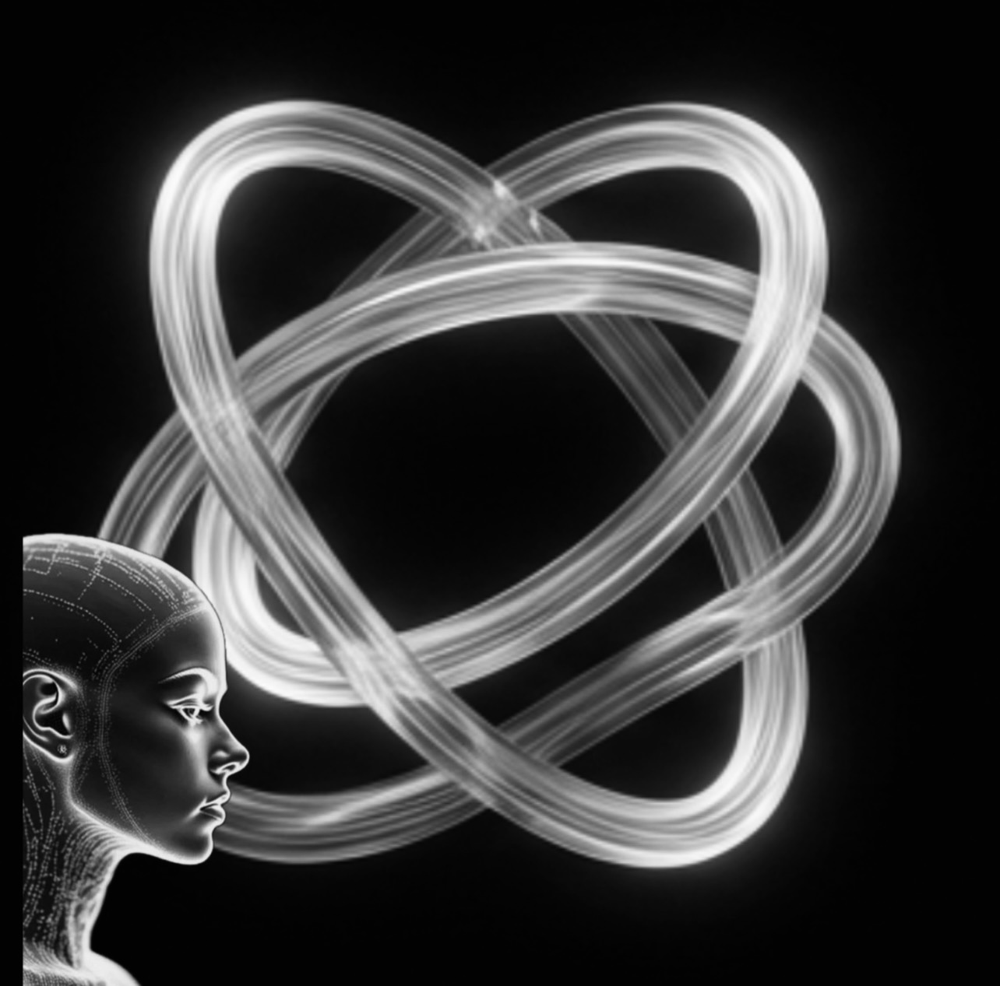</a> | **IMG_7730.jpeg** HsH · SAT_VISUALS/Visuals_2/IMG_7730.jpeg 1284×1267 · square **suggest:** SAT family: near:000300 |
|  | **IMG_7731.jpeg** HsH · SAT_VISUALS/Visuals_2/IMG_7731.jpeg 994×994 · square **suggest:** SAT family: near:000472 |
|  | **IMG_7732.jpeg** HsH · SAT_VISUALS/Visuals_2/IMG_7732.jpeg 1049×1049 · square **suggest:** SAT family: near:000535 |
| <a href="https://raw.githubusercontent.com/Satobloc/HsH/main/SAT_VISUALS/Visuals_2/IMG_7733.jpeg">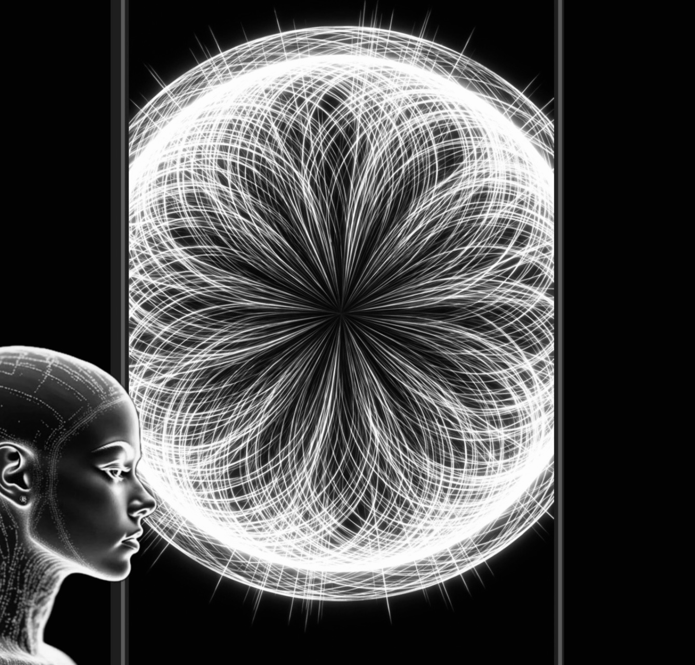</a> | **IMG_7733.jpeg** HsH · SAT_VISUALS/Visuals_2/IMG_7733.jpeg 1340×1283 · landscape **suggest:** SAT family: near:000153 |
| <a href="https://raw.githubusercontent.com/Satobloc/HsH/main/SAT_VISUALS/Visuals_2/IMG_7734.jpeg">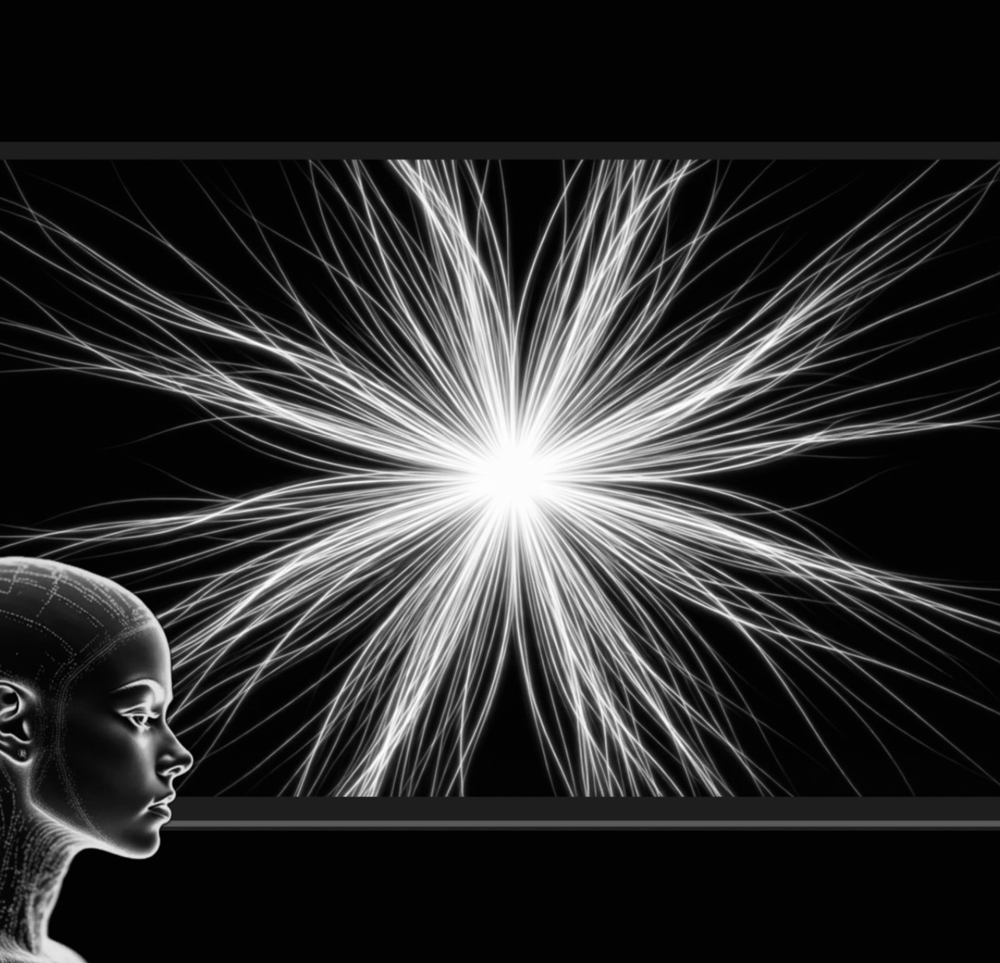</a> | **IMG_7734.jpeg** HsH · SAT_VISUALS/Visuals_2/IMG_7734.jpeg 1284×1237 · square **suggest:** SAT family: near:000277 |
| <a href="https://raw.githubusercontent.com/Satobloc/HsH/main/SAT_VISUALS/Visuals_2/IMG_7735.jpeg">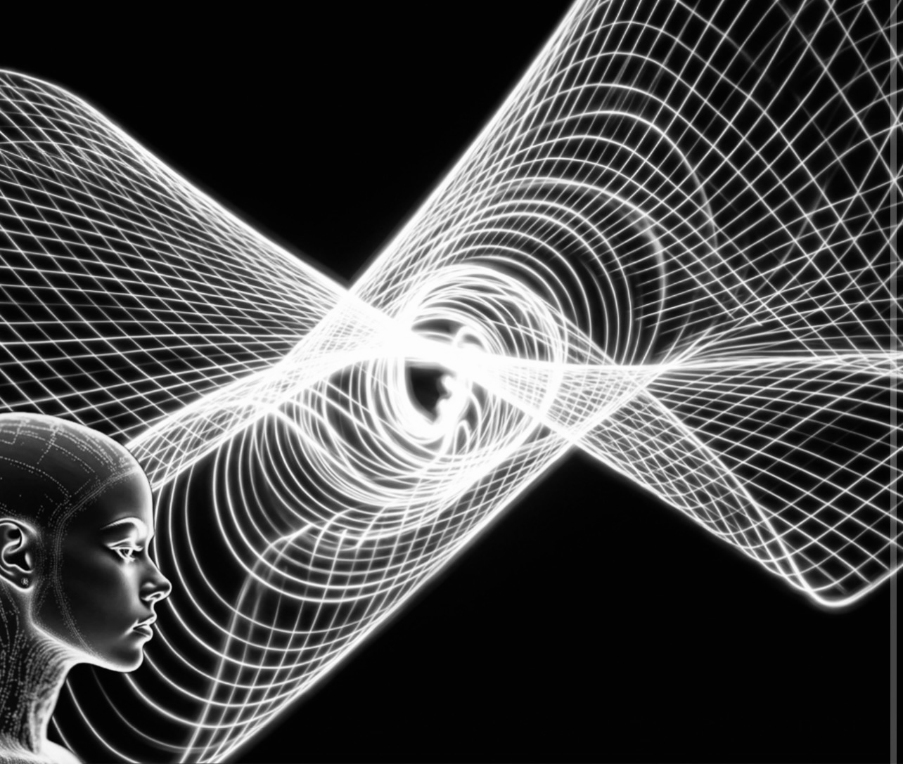</a> | **IMG_7735.jpeg** HsH · SAT_VISUALS/Visuals_2/IMG_7735.jpeg 1284×1087 · landscape **suggest:** SAT family: near:000662 |
|  | **IMG_7736.jpeg** HsH · SAT_VISUALS/Visuals_2/IMG_7736.jpeg 921×921 · square **suggest:** SAT family: near:000642 |
|  | **IMG_7737.jpeg** HsH · SAT_VISUALS/Visuals_2/IMG_7737.jpeg 920×920 · square **suggest:** SAT family: near:000940 |
|  | **IMG_7738.jpeg** HsH · SAT_VISUALS/Visuals_2/IMG_7738.jpeg 1239×1239 · square **suggest:** SAT family: near:000350 |
|  | **IMG_7739.jpeg** HsH · SAT_VISUALS/Visuals_2/IMG_7739.jpeg 1284×1139 · landscape **suggest:** SAT family: near:000024 |
|  | **IMG_7740.jpeg** HsH · SAT_VISUALS/Visuals_2/IMG_7740.jpeg 1050×1050 · square **suggest:** SAT family: near:000027 |
| <a href="https://raw.githubusercontent.com/Satobloc/HsH/main/SAT_VISUALS/Visuals_2/IMG_7741.jpeg">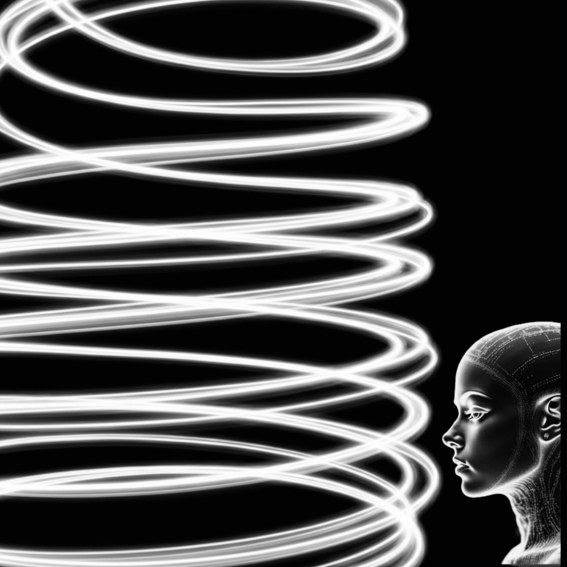</a> | **IMG_7741.jpeg** HsH · SAT_VISUALS/Visuals_2/IMG_7741.jpeg 929×929 · square **suggest:** SAT family: near:000910 |
|  | **IMG_7742.jpeg** HsH · SAT_VISUALS/Visuals_2/IMG_7742.jpeg 1002×1002 · square **suggest:** SAT family: near:000817 |
| <a href="https://raw.githubusercontent.com/Satobloc/HsH/main/SAT_VISUALS/Visuals_2/IMG_7743.jpeg">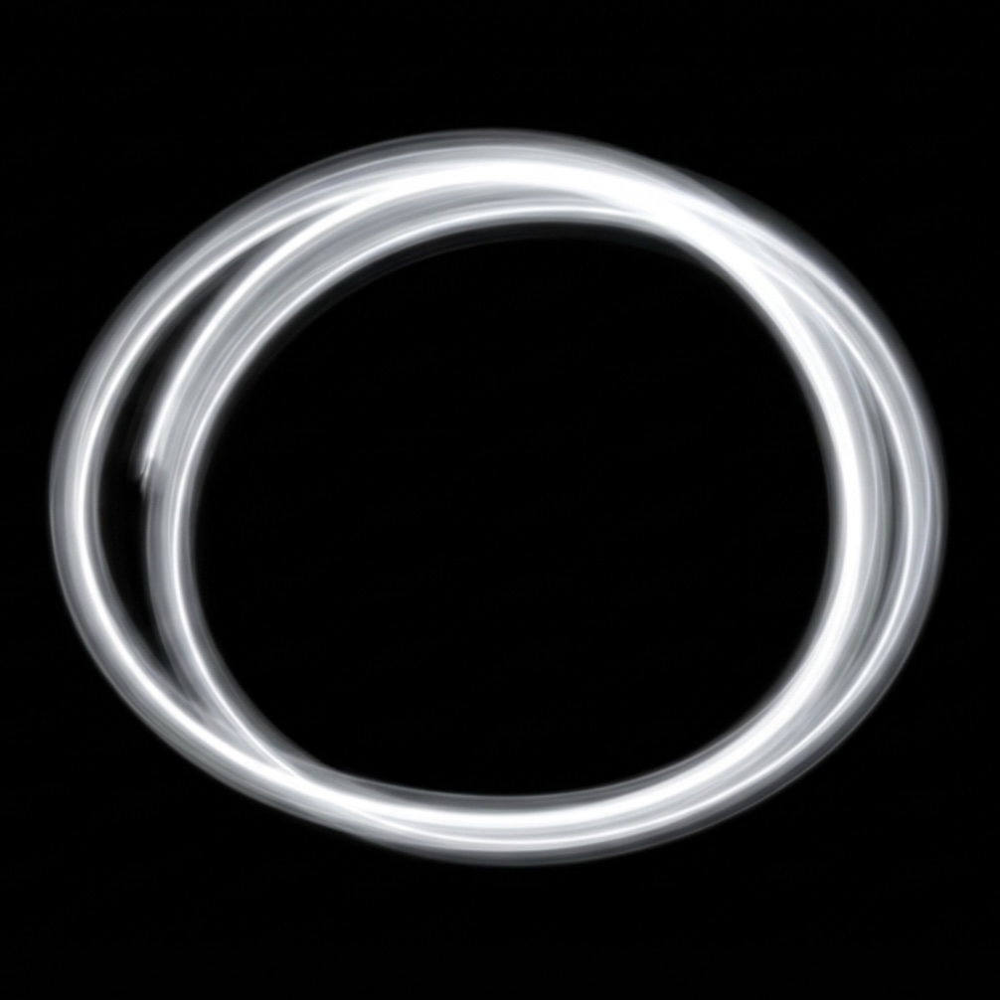</a> | **IMG_7743.jpeg** HsH · SAT_VISUALS/Visuals_2/IMG_7743.jpeg 1006×1006 · square **suggest:** SAT family: near:000124 |
| <a href="https://raw.githubusercontent.com/Satobloc/HsH/main/SAT_VISUALS/Visuals_2/IMG_7744.jpeg">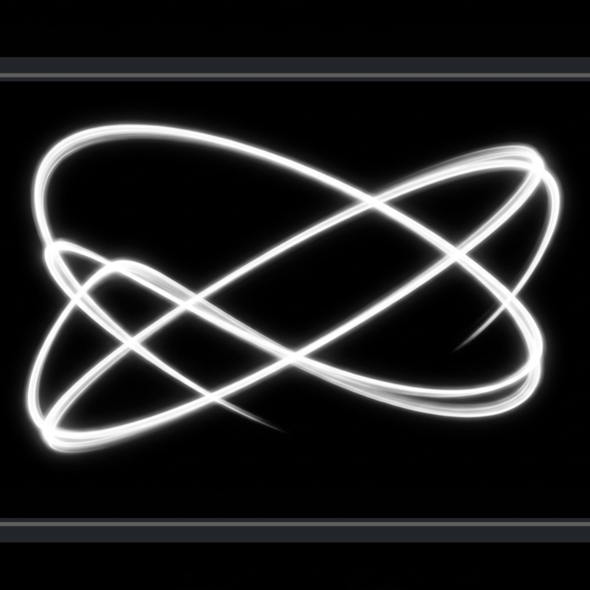</a> | **IMG_7744.jpeg** HsH · SAT_VISUALS/Visuals_2/IMG_7744.jpeg 1208×1208 · square **suggest:** SAT family: near:000555 |
| <a href="https://raw.githubusercontent.com/Satobloc/HsH/main/SAT_VISUALS/Visuals_2/IMG_7745.jpeg">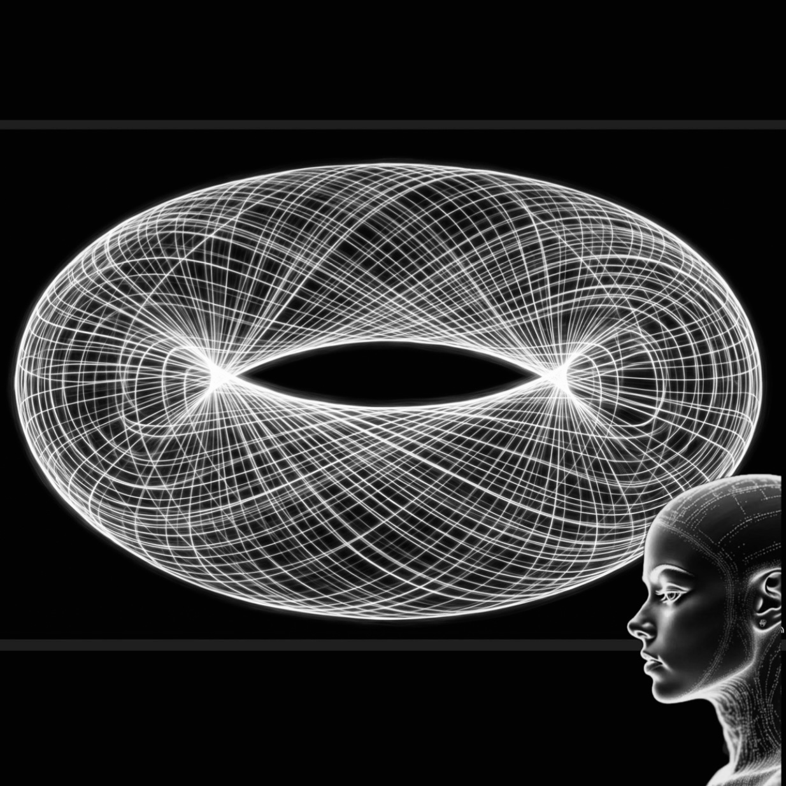</a> | **IMG_7745.jpeg** HsH · SAT_VISUALS/Visuals_2/IMG_7745.jpeg 1234×1234 · square **suggest:** SAT family: near:000756 |
|  | **IMG_7746.jpeg** HsH · SAT_VISUALS/Visuals_2/IMG_7746.jpeg 1096×1096 · square **suggest:** SAT family: near:000475 |
|  | **IMG_7747.jpeg** HsH · SAT_VISUALS/Visuals_2/IMG_7747.jpeg 965×965 · square **suggest:** SAT family: near:000498 |
|  | **IMG_7748.jpeg** HsH · SAT_VISUALS/Visuals_2/IMG_7748.jpeg 1126×1126 · square **suggest:** SAT family: near:000155 |
|  | **IMG_7749.jpeg** HsH · SAT_VISUALS/Visuals_2/IMG_7749.jpeg 956×956 · square **suggest:** SAT family: near:000142 |
|  | **IMG_7864.jpeg** HsH · SAT_VISUALS/Visuals_2/IMG_7864.jpeg 1284×1253 · square **suggest:** SAT family: near:000607 |
|  | **IMG_7867.jpeg** HsH · SAT_VISUALS/Visuals_2/IMG_7867.jpeg 1284×1278 · square **suggest:** SAT family: near:000141 |
|  | **IMG_7868.jpeg** HsH · SAT_VISUALS/Visuals_2/IMG_7868.jpeg 1284×1281 · square **suggest:** SAT family: near:000619 |
|  | **IMG_7869.jpeg** HsH · SAT_VISUALS/Visuals_2/IMG_7869.jpeg 1284×1313 · square **suggest:** SAT family: near:000611 |
|  | **IMG_7872.jpeg** HsH · SAT_VISUALS/Visuals_2/IMG_7872.jpeg 1284×1289 · square **suggest:** SAT family: near:000607 |
|  | **IMG_7978.jpeg** HsH · SAT_VISUALS/Visuals_2/IMG_7978.jpeg 1120×1103 · square **suggest:** SAT family: near:000898 |
|  | **IMG_7982.jpeg** HsH · SAT_VISUALS/Visuals_2/IMG_7982.jpeg 935×922 · square **suggest:** SAT family: near:000158 |
|  | **IMG_7983.jpeg** HsH · SAT_VISUALS/Visuals_2/IMG_7983.jpeg 1284×1295 · square **suggest:** SAT family: near:000342 |
|  | **IMG_7984.jpeg** HsH · SAT_VISUALS/Visuals_2/IMG_7984.jpeg 1284×1245 · square **suggest:** SAT family: near:000319 |
|  | **IMG_8006.jpeg** HsH · SAT_VISUALS/Visuals_2/IMG_8006.jpeg 1157×1157 · square **suggest:** SAT family: near:000550 |
|  | **IMG_8007.jpeg** HsH · SAT_VISUALS/Visuals_2/IMG_8007.jpeg 1187×1187 · square **suggest:** SAT family: near:000316 |
|  | **IMG_8008.jpeg** HsH · SAT_VISUALS/Visuals_2/IMG_8008.jpeg 1235×1235 · square **suggest:** SAT family: near:000425 |
|  | **IMG_8009.jpeg** HsH · SAT_VISUALS/Visuals_2/IMG_8009.jpeg 1284×1284 · square **suggest:** SAT family: near:000609 |
|  | **IMG_8010.jpeg** HsH · SAT_VISUALS/Visuals_2/IMG_8010.jpeg 1160×1160 · square **suggest:** SAT family: near:000481 |
|  | **IMG_8011.jpeg** HsH · SAT_VISUALS/Visuals_2/IMG_8011.jpeg 1283×1283 · square **suggest:** SAT family: near:000034 |
|  | **IMG_8012.jpeg** HsH · SAT_VISUALS/Visuals_2/IMG_8012.jpeg 1284×1284 · square **suggest:** SAT family: near:000675 |
|  | **IMG_8015.jpeg** HsH · SAT_VISUALS/Visuals_2/IMG_8015.jpeg 1213×1213 · square **suggest:** SAT family: near:000271 |
|  | **IMG_8016.jpeg** HsH · SAT_VISUALS/Visuals_2/IMG_8016.jpeg 1284×1284 · square **suggest:** SAT family: near:000039 |
|  | **IMG_8024.jpeg** HsH · SAT_VISUALS/Visuals_2/IMG_8024.jpeg 1217×1217 · square **suggest:** SAT family: near:000525 |
|  | **IMG_8025.jpeg** HsH · SAT_VISUALS/Visuals_2/IMG_8025.jpeg 1242×1242 · square **suggest:** SAT family: near:000594 |
|  | **IMG_8026.jpeg** HsH · SAT_VISUALS/Visuals_2/IMG_8026.jpeg 1284×1343 · portrait **suggest:** SAT family: near:000518 |
|  | **IMG_8027.jpeg** HsH · SAT_VISUALS/Visuals_2/IMG_8027.jpeg 1284×1349 · portrait **suggest:** SAT family: near:000009 |
|  | **IMG_8033.jpeg** HsH · SAT_VISUALS/Visuals_2/IMG_8033.jpeg 1284×1272 · square **suggest:** SAT family: near:000034 |
|  | **IMG_8034.jpeg** HsH · SAT_VISUALS/Visuals_2/IMG_8034.jpeg 1284×1239 · square **suggest:** SAT family: near:000557 |
|  | **IMG_8035.jpeg** HsH · SAT_VISUALS/Visuals_2/IMG_8035.jpeg 1284×1247 · square **suggest:** SAT family: near:000557 |
|  | **IMG_8036.jpeg** HsH · SAT_VISUALS/Visuals_2/IMG_8036.jpeg 1284×1235 · square **suggest:** SAT family: near:000557 |
|  | **IMG_8037.jpeg** HsH · SAT_VISUALS/Visuals_2/IMG_8037.jpeg 1284×1246 · square **suggest:** SAT family: near:000557 |
|  | **IMG_8038.jpeg** HsH · SAT_VISUALS/Visuals_2/IMG_8038.jpeg 1284×1239 · square **suggest:** SAT family: near:000557 |
|  | **IMG_8040.jpeg** HsH · SAT_VISUALS/Visuals_2/IMG_8040.jpeg 1284×1342 · portrait **suggest:** SAT family: near:000825 |
|  | **IMG_8041.jpeg** HsH · SAT_VISUALS/Visuals_2/IMG_8041.jpeg 1284×1340 · portrait **suggest:** SAT family: near:000825 |
|  | **IMG_8042.jpeg** HsH · SAT_VISUALS/Visuals_2/IMG_8042.jpeg 1284×1360 · portrait **suggest:** SAT family: near:000825 |
|  | **IMG_8044.jpeg** HsH · SAT_VISUALS/Visuals_2/IMG_8044.jpeg 1284×1343 · portrait **suggest:** SAT family: near:000826 |
|  | **IMG_8045.jpeg** HsH · SAT_VISUALS/Visuals_2/IMG_8045.jpeg 1284×1345 · portrait **suggest:** SAT family: near:000873 |
|  | **IMG_8046.jpeg** HsH · SAT_VISUALS/Visuals_2/IMG_8046.jpeg 1284×1354 · portrait **suggest:** SAT family: near:000824 |
|  | **IMG_8047.jpeg** HsH · SAT_VISUALS/Visuals_2/IMG_8047.jpeg 1284×1356 · portrait **suggest:** SAT family: near:000845 |
|  | **IMG_8048.jpeg** HsH · SAT_VISUALS/Visuals_2/IMG_8048.jpeg 1284×1343 · portrait **suggest:** SAT family: near:000845 |
|  | **IMG_8049.jpeg** HsH · SAT_VISUALS/Visuals_2/IMG_8049.jpeg 1284×1363 · portrait **suggest:** SAT family: near:000845 |
|  | **IMG_8050.png** HsH · SAT_VISUALS/Visuals_2/IMG_8050.png 1284×2778 · portrait **suggest:** SAT family: near:000001 |
|  | **IMG_8156.jpeg** HsH · SAT_VISUALS/Visuals_2/IMG_8156.jpeg 1176×1176 · square **suggest:** SAT family: near:000331 |
|  | **IMG_8157.jpeg** HsH · SAT_VISUALS/Visuals_2/IMG_8157.jpeg 1080×864 · landscape **suggest:** SAT family: near:000937 |
|  | **IMG_8158.jpeg** HsH · SAT_VISUALS/Visuals_2/IMG_8158.jpeg 1284×1283 · square **suggest:** SAT family: near:000542 |
|  | **IMG_8159.jpeg** HsH · SAT_VISUALS/Visuals_2/IMG_8159.jpeg 1284×1255 · square **suggest:** SAT family: near:000542 |
|  | **IMG_8160.jpeg** HsH · SAT_VISUALS/Visuals_2/IMG_8160.jpeg 1129×1050 · landscape **suggest:** SAT family: near:000523 |
|  | **IMG_8161.jpeg** HsH · SAT_VISUALS/Visuals_2/IMG_8161.jpeg 1252×1175 · landscape **suggest:** SAT family: near:000764 |
|  | **IMG_8162.jpeg** HsH · SAT_VISUALS/Visuals_2/IMG_8162.jpeg 1056×1056 · square **suggest:** SAT family: near:000700 |
|  | **IMG_8163.jpeg** HsH · SAT_VISUALS/Visuals_2/IMG_8163.jpeg 1141×1072 · landscape **suggest:** SAT family: near:000750 |
|  | **IMG_8164.jpeg** HsH · SAT_VISUALS/Visuals_2/IMG_8164.jpeg 1284×1239 · square **suggest:** SAT family: near:000348 |
|  | **IMG_8165.jpeg** HsH · SAT_VISUALS/Visuals_2/IMG_8165.jpeg 1215×1215 · square **suggest:** SAT family: near:000232 |
|  | **IMG_8166.jpeg** HsH · SAT_VISUALS/Visuals_2/IMG_8166.jpeg 1215×1215 · square **suggest:** SAT family: near:000519 |
|  | **IMG_8167.jpeg** HsH · SAT_VISUALS/Visuals_2/IMG_8167.jpeg 1222×1222 · square **suggest:** SAT family: near:000608 |
|  | **IMG_8168.jpeg** HsH · SAT_VISUALS/Visuals_2/IMG_8168.jpeg 1081×1081 · square **suggest:** SAT family: near:000687 |
|  | **IMG_8169.jpeg** HsH · SAT_VISUALS/Visuals_2/IMG_8169.jpeg 1077×1077 · square **suggest:** SAT family: near:000602 |
|  | **IMG_8170.jpeg** HsH · SAT_VISUALS/Visuals_2/IMG_8170.jpeg 1145×1145 · square **suggest:** SAT family: near:000126 |
|  | **IMG_8171.jpeg** HsH · SAT_VISUALS/Visuals_2/IMG_8171.jpeg 1284×1284 · square **suggest:** SAT family: near:000613 |
|  | **IMG_8172.jpeg** HsH · SAT_VISUALS/Visuals_2/IMG_8172.jpeg 1254×1199 · landscape **suggest:** SAT family: near:000320 |
|  | **IMG_8173.jpeg** HsH · SAT_VISUALS/Visuals_2/IMG_8173.jpeg 982×982 · square **suggest:** SAT family: near:000332 |
|  | **IMG_8174.jpeg** HsH · SAT_VISUALS/Visuals_2/IMG_8174.jpeg 1046×1046 · square **suggest:** SAT family: near:000537 |
|  | **IMG_8175.jpeg** HsH · SAT_VISUALS/Visuals_2/IMG_8175.jpeg 1026×1026 · square **suggest:** SAT family: near:000490 |
|  | **IMG_8176.jpeg** HsH · SAT_VISUALS/Visuals_2/IMG_8176.jpeg 990×990 · square **suggest:** SAT family: near:000529 |
|  | **IMG_8177.jpeg** HsH · SAT_VISUALS/Visuals_2/IMG_8177.jpeg 1284×1357 · portrait **suggest:** SAT family: near:000082 |
|  | **IMG_8178.jpeg** HsH · SAT_VISUALS/Visuals_2/IMG_8178.jpeg 973×973 · square **suggest:** SAT family: near:000056 |
|  | **IMG_8179.jpeg** HsH · SAT_VISUALS/Visuals_2/IMG_8179.jpeg 1015×1015 · square **suggest:** SAT family: near:000122 |
|  | **IMG_8180.jpeg** HsH · SAT_VISUALS/Visuals_2/IMG_8180.jpeg 1119×1119 · square **suggest:** SAT family: near:000029 |
|  | **IMG_8181.jpeg** HsH · SAT_VISUALS/Visuals_2/IMG_8181.jpeg 1085×1028 · landscape **suggest:** SAT family: near:000240 |
|  | **IMG_8182.jpeg** HsH · SAT_VISUALS/Visuals_2/IMG_8182.jpeg 1284×1139 · landscape **suggest:** SAT family: near:000060 |
|  | **IMG_8183.jpeg** HsH · SAT_VISUALS/Visuals_2/IMG_8183.jpeg 1097×1126 · square **suggest:** SAT family: near:000090 |
|  | **IMG_8184.jpeg** HsH · SAT_VISUALS/Visuals_2/IMG_8184.jpeg 1214×1230 · square **suggest:** SAT family: near:000154 |
|  | **IMG_8185.jpeg** HsH · SAT_VISUALS/Visuals_2/IMG_8185.jpeg 1105×1105 · square **suggest:** SAT family: near:000603 |
|  | **IMG_8186.jpeg** HsH · SAT_VISUALS/Visuals_2/IMG_8186.jpeg 1107×1124 · square **suggest:** SAT family: near:000605 |
|  | **IMG_8187.jpeg** HsH · SAT_VISUALS/Visuals_2/IMG_8187.jpeg 1219×1305 · portrait **suggest:** SAT family: near:000351 |
|  | **IMG_8188.jpeg** HsH · SAT_VISUALS/Visuals_2/IMG_8188.jpeg 1057×1057 · square **suggest:** SAT family: near:000091 |
|  | **IMG_8189.jpeg** HsH · SAT_VISUALS/Visuals_2/IMG_8189.jpeg 1175×1175 · square **suggest:** SAT family: near:000322 |
|  | **IMG_8190.jpeg** HsH · SAT_VISUALS/Visuals_2/IMG_8190.jpeg 1066×1066 · square **suggest:** SAT family: near:000252 |
|  | **IMG_8191.jpeg** HsH · SAT_VISUALS/Visuals_2/IMG_8191.jpeg 1114×1078 · square **suggest:** SAT family: near:000677 |
|  | **IMG_8193.jpeg** HsH · SAT_VISUALS/Visuals_2/IMG_8193.jpeg 1058×1058 · square **suggest:** SAT family: exact:0fc85e52cfb2aaad |
|  | **IMG_8194.jpeg** HsH · SAT_VISUALS/Visuals_2/IMG_8194.jpeg 1253×1313 · portrait **suggest:** SAT family: near:000337 |
|  | **IMG_8195.jpeg** HsH · SAT_VISUALS/Visuals_2/IMG_8195.jpeg 1284×1329 · square **suggest:** SAT family: near:000354 |
|  | **IMG_8196.jpeg** HsH · SAT_VISUALS/Visuals_2/IMG_8196.jpeg 1253×1226 · square **suggest:** SAT family: near:000042 |
|  | **IMG_8197.jpeg** HsH · SAT_VISUALS/Visuals_2/IMG_8197.jpeg 1255×1255 · square **suggest:** SAT family: near:000336 |
|  | **IMG_8198.jpeg** HsH · SAT_VISUALS/Visuals_2/IMG_8198.jpeg 1284×1267 · square **suggest:** SAT family: near:000063 |
|  | **IMG_8199.jpeg** HsH · SAT_VISUALS/Visuals_2/IMG_8199.jpeg 1284×1304 · square **suggest:** SAT family: near:000106 |
|  | **IMG_8200.jpeg** HsH · SAT_VISUALS/Visuals_2/IMG_8200.jpeg 1284×1332 · square **suggest:** SAT family: near:000236 |
|  | **IMG_8201.jpeg** HsH · SAT_VISUALS/Visuals_2/IMG_8201.jpeg 1269×1304 · square **suggest:** SAT family: near:000201 |
|  | **IMG_8203.jpeg** HsH · SAT_VISUALS/Visuals_2/IMG_8203.jpeg 1059×1059 · square **suggest:** SAT family: near:000112 |
|  | **IMG_8204.jpeg** HsH · SAT_VISUALS/Visuals_2/IMG_8204.jpeg 1188×1188 · square **suggest:** SAT family: near:000639 |
|  | **IMG_8205.jpeg** HsH · SAT_VISUALS/Visuals_2/IMG_8205.jpeg 1217×1217 · square **suggest:** SAT family: near:000052 |
|  | **IMG_8206.jpeg** HsH · SAT_VISUALS/Visuals_2/IMG_8206.jpeg 1114×1114 · square **suggest:** SAT family: near:000327 |
|  | **IMG_8207.jpeg** HsH · SAT_VISUALS/Visuals_2/IMG_8207.jpeg 1061×1061 · square **suggest:** SAT family: near:000326 |
|  | **IMG_8208.jpeg** HsH · SAT_VISUALS/Visuals_2/IMG_8208.jpeg 1143×1143 · square **suggest:** SAT family: near:000273 |
|  | **IMG_8209.jpeg** HsH · SAT_VISUALS/Visuals_2/IMG_8209.jpeg 1066×1066 · square **suggest:** SAT family: near:000328 |
|  | **IMG_8210.jpeg** HsH · SAT_VISUALS/Visuals_2/IMG_8210.jpeg 1225×1233 · square **suggest:** SAT family: near:000368 |
|  | **IMG_8211.jpeg** HsH · SAT_VISUALS/Visuals_2/IMG_8211.jpeg 1017×1017 · square **suggest:** SAT family: near:000588 |
|  | **IMG_8212.jpeg** HsH · SAT_VISUALS/Visuals_2/IMG_8212.jpeg 1208×1208 · square **suggest:** SAT family: near:000376 |
|  | **IMG_8215.jpeg** HsH · SAT_VISUALS/Visuals_2/IMG_8215.jpeg 1108×1108 · square **suggest:** SAT family: near:000597 |
|  | **IMG_8216.jpeg** HsH · SAT_VISUALS/Visuals_2/IMG_8216.jpeg 1284×1348 · portrait **suggest:** SAT family: near:000146 |

[← index](README.md) · [next →](page-008.md)
